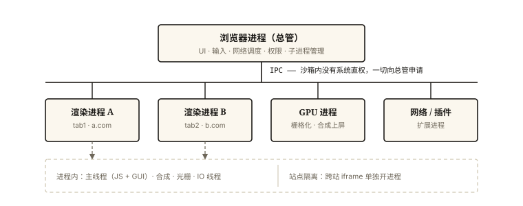

# 浏览器基础之多进程架构入门

## 从「一个标签页崩了全家」说起

> **系列导读**：《浏览器基础系列》共 6 篇——从进程架构到存储、同源策略与异步入门，为中级网络系列与渲染系列铺路。

十年前的浏览器：一个标签页的 Flash 崩了，**整浏览器所有标签页一起白屏**——因为那时只有一个进程，一损俱损。今天一个标签页崩溃只影响它自己，还能点「重新加载」——这背后是浏览器从**单进程**到**多进程**的架构革命。⭐ 理解多进程架构，是理解「JS 为什么是单线程」「跨域为什么存在」「性能优化为什么分主线程/合成线程」的地基。

## 现象与直觉解释

打开 Chrome 的「更多工具 → 任务管理器」，你会看到多个进程：

```
浏览器（Browser）进程     ×1   —— 总管
渲染（Renderer）进程      ×N   —— 每个标签页（可能共享）
GPU 进程                ×1   —— 画图专用
网络进程 / 插件进程 / 工具进程 …
```

直觉模型：**从「一个人的公司」变成「部门制公司」**——

- 浏览器进程：前台+行政（UI、地址栏、书签、网络调度、权限弹窗）；
- 渲染进程：车间（HTML→像素的全部工作：解析、样式、布局、JS 执行）；**每个车间是独立小楼（沙箱），着火只烧一栋**；
- GPU 进程：美工部（把各车间的绘制指令合成最终画面——因为要共享 GPU，单独成进程）。

## 深入原理

### 一、核心进程清单 ⭐⭐

| 进程 | 数量 | 职责 | 崩溃影响 |
|---|---|---|---|
| 浏览器进程 | 1 | UI、用户输入、网络、存储调度、子进程管理 | 全军覆没（所以它尽量薄） |
| 渲染进程 | ~标签页数 | HTML/CSS/JS 执行、布局绘制（**沙箱内，无磁盘/网络直权**） | 单页崩溃 |
| GPU 进程 | 1 | 栅格化与合成、WebGL/视频解码 | 画面异常 |
| 网络进程 | 1 | 收发请求、DNS、缓存 | 无法联网 |
| 插件/扩展进程 | ~插件数 | 隔离第三方代码 | 插件失效 |

### 二、为什么必须多进程：四大理由 ⭐⭐

1. **稳定性**：进程隔离——一个渲染进程崩溃（JS 无限递归、插件错误）不拖垮其他；

2. **安全/沙箱**：渲染进程是「最危险的地方」（要执行任意网页代码），所以**剥夺系统权限**——不能读文件、不能直接碰网络，一切都要通过 IPC 向浏览器进程申请。恶意网页攻破渲染进程也拿不到系统权限（纵深防御，《security》系列的地基）；

3. **性能的可控性**：慢标签页（疯狂 JS）不冻结 UI——你在卡死页面时仍能点关闭按钮（UI 在浏览器进程，不卡）；

4. **现代必需——站点隔离（Site Isolation）** ⭐：不同**站点**的标签页/iframe 跑在**不同渲染进程**（即使同标签页）。这与安全强相关：Spectre 等旁路攻击可以跨 iframe 读内存，进程隔离是物理防线；也顺带解释了为什么跨站 iframe 崩溃只崩那块区域。

### 三、多进程的代价与「面向服务的架构」演进 ⭐

代价：**内存**——每个进程独立的 V8、Blink 实例，几十 MB 起步。浏览器的应对（Chrome 的 SOA 演进）：

```
设备内存不足 → 合并进程（同站点标签页共享渲染进程）
硬件强        → 拆得更细（网络、存储、音频…独立成"服务"）
即：进程数量动态伸缩 ——「面向服务的架构」
```

这也解释了一个日常现象：**开的标签越多内存涨得越快，但同站点的多标签相对省**。

### 四、从前端视角看架构 ⭐⭐

1. **「JS 单线程」的精确含义**：单线程的是**渲染进程里的主线程**（一条 JS 执行线 + 一条 GUI 线，《browser-basic-002》）；浏览器整体是多进程、渲染进程内部还有多线程——所以 Web Worker 能并行、合成线程能在主线程卡死时继续滚动页面；

2. **「页面无响应」弹窗的来源**：渲染进程主线程被长任务占死，浏览器进程发现它不回应心跳 → 弹窗提供「等待/关闭」——**跨进程的健康监测**；

3. **为什么关闭标签能省内存**：渲染进程随标签销毁而退出——内存整体回收（vs 长驻页面的内存只增不减，《v8-005》可达性的进程级版本）。

## 回看开篇

一个标签崩不再全家的答案：**进程是操作系统的隔离单元**——崩溃被限制在单个渲染进程内，浏览器进程（UI）和其他标签页安然无恙。这套「用进程换稳定与安全」的架构，是浏览器从单进程时代一路演进的结果，也直接塑造了前端世界的规则（单线程 JS、沙箱、跨进程通信的异步性）。

## 实战延伸

**1. 面试答题骨架**：「现代浏览器是多进程架构——浏览器进程负责 UI、网络与子进程管理；每个标签页有独立的渲染进程在沙箱内执行 HTML 解析、样式计算与 JS 运行，无直接磁盘网络权限，一切经 IPC 向浏览器进程申请；GPU 进程统一做栅格化合成；站点隔离让不同站点的标签页与 iframe 分属不同渲染进程，防 Spectre 类跨站内存攻击。多进程换来稳定性与安全，代价是内存，因此设备不足时会合并进程。前端语境里的 JS 单线程指的是渲染进程的主线程。」

**2. 动手实验**：地址栏输入 `chrome://process-internals` 或开任务管理器（Shift+Esc），数一数你的浏览器现在有几个进程、哪个标签页占内存最大——把抽象架构落到眼前。

**3. 快手辨析**：iframe 一定独立进程吗？——同站 iframe 共享进程、**跨站** iframe 才隔离（站点隔离按「站点」不按「元素」）。

## 图解总结



*图 · 总管在顶层，沙箱在下面：渲染进程拿不到系统权限，一切经 IPC 申请；站点隔离再把跨站 iframe 推出去单独成进程*

```
 浏览器进程（总管：UI/输入/网络调度/权限）           ← 尽量薄
   │ IPC（沙箱内无直权，一切申请）
   ├─ 渲染进程A（tab1: a.com）──┐
   ├─ 渲染进程B（tab2: b.com）  ├ 每进程内：主线程(JS+GUI) + 合成/光栅/IO线程…
   │      └─ 跨站 iframe c.com → 独立渲染进程（站点隔离）
   ├─ GPU 进程（共享显卡，统一合成）
   ├─ 网络进程 / 插件进程 / 扩展进程

四大价值：稳定性 │ 沙箱安全 │ UI 不卡 │ 站点隔离防旁路攻击
代价：内存 → SOA 动态伸缩（内存紧张合并进程）
```

## 总结

- 多进程家族：浏览器（总管）、渲染（沙箱车间）、GPU、网络、插件；
- 四大价值：稳定隔离、沙箱安全、UI 流畅、站点隔离（防旁路攻击）；
- 沙箱 = 渲染进程无系统权限，经 IPC 申请一切；
- 代价是内存，SOA 架构按设备动态伸缩进程数；
- 「JS 单线程」精确指渲染进程主线程——与浏览器整体多进程并不矛盾。

**面试一句话回答**：现代浏览器采用多进程架构——浏览器进程统一管理 UI、用户输入、网络与权限；每个标签页拥有独立的渲染进程，在沙箱中执行 HTML 解析、样式计算、布局与 JavaScript，没有直接访问磁盘与网络的权限，一切需求通过 IPC 向浏览器进程申请；GPU 进程负责统一的栅格化与合成，网络进程处理请求，站点隔离进一步让不同站点的标签页与 iframe 运行在不同渲染进程中以防御旁路攻击。这套架构以内存换来了稳定性、安全与流畅——单个页面崩溃不影响其他页面，卡死页面时 UI 依然可操作；而我们说的 JavaScript 单线程，指的正是渲染进程中的主线程。

## 思考题

1. 页面 JS 死循环时，为什么地址栏和关闭按钮依然能用、但页面内的一切都停了？用「进程职责划分」解释。
2. 同一站点开 10 个标签页 vs 10 个不同站点，内存占用差异为什么明显？什么时候浏览器会合并渲染进程？
3. Web Worker 能绕开「单线程」吗？它能操作 DOM 吗——从「渲染进程内的线程分工」解释边界（《browser-basic-002》预习）。
4. 开放讨论：Electron 应用「每个 BrowserWindow 一个进程」——为什么它天然内存大？有哪些收敛手段（共享窗口/按需创建/合并进程）？

（思考题解析将同步录入小程序题库，关联本文 id：browser-basic-001）

## 参考文献：

- Chrome 官方博客 — Inside look at modern web browser（多进程架构四部曲）
- 《深入浅出Chrome浏览器》（现代浏览器内核中文资料）
- web.dev — 关于站点隔离与渲染进程的说明
