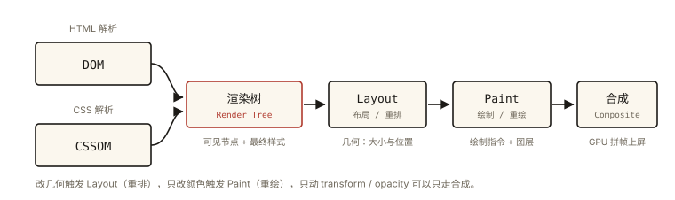
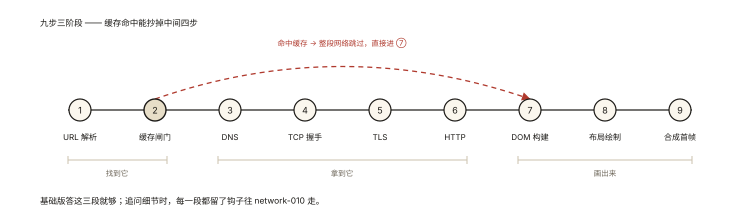

# 浏览器基础之从输入 URL 到页面呈现（基础版）

## 「面试圣经题」的第一站

> 「浏览器地址栏输入 URL 回车，到页面完整呈现，中间发生了什么？」

这是前端面试流传最广的题——没有边界，能从初级问到专家。本篇是**基础版**：建立完整的**流程框架**（每一步都点到）；中级版（缓存/TLS/HTTP2/渲染细节全展开）在《network-010》，渲染管线专篇在《rendering-001》。⭐⭐ 面试策略：先背熟本篇的九步框架，每步留个「钩子」等面试官追问。

## 现象与直觉解释

九步流程总览（先混个脸熟）：

```
① URL 解析 → ② 缓存检查 → ③ DNS 解析 → ④ TCP 连接 → ⑤ TLS 握手（HTTPS）
→ ⑥ 发送请求/响应 → ⑦ HTML 解析建 DOM → ⑧ 样式布局绘制 → ⑨ 合成上屏
```

快递类比：核对地址（URL）→ 查家里有没有（缓存）→ 查地图（DNS）→ 修路（TCP）→ 加密线路（TLS）→ 下单收货（请求响应）→ 拆箱组装（DOM/渲染）→ 上架（合成显示）。

## 深入原理：九步逐个过

### ① URL 解析

输入可能是关键词（走搜索）或 URL（补协议、处理 IDN 中文域名）；HSTS 检查（强制 HTTPS 名单）。

### ② 缓存检查（发请求之前！）⭐

Service Worker → 内存缓存 → 磁缓存（强缓存未过期直接用，**网络阶段整个跳过**）；过期则协商缓存可能 304。——「秒开的页面很多根本没出网」。

### ③ DNS 解析：域名 → IP

浏览器缓存 → 系统缓存 → 路由器 → 递归查询各级 DNS 服务器。CDN 域名会就近返回节点 IP。

### ④ TCP 三次握手

可靠线路的建立（1 RTT；为什么是三次——《network-001》追问点）。

### ⑤ TLS 握手（HTTPS 才有）

协商加密（1 RTT；证书验证——HTTPS 的「中间人防线」《network-005》）。

### ⑥ 发送请求、拿到响应

HTTP 请求（方法/头）→ 服务器处理 → 响应：**200** 继续 / **301/302** 回到③换地址重来的 / **304** 用缓存 / **404/500** 错误页。

### ⑦ HTML 解析：字节流 → DOM 树 ⭐

```
字节 → 字符（编码）→ Token（标签词法）→ 节点 → DOM 树
```

边下载边解析（增量）；关键阻塞规则：

- **CSS 不阻塞 DOM 解析，但阻塞 JS 执行与首次渲染**（JS 可能读样式）；
- **同步 `<script>` 阻塞 DOM 解析**（下载+执行完才继续）；`defer`/`async` 解药（《network-010》详细展开）。

### ⑧ CSSOM + 渲染树 + 布局 + 绘制 ⭐



*图 · DOM 与 CSSOM 合并成渲染树，再依次走 Layout、Paint、合成——每一段的重做代价不同*

```
CSS → CSSOM ──┐
              ├─▶ 渲染树（可见节点+最终样式）
DOM ──────────┘        │
                      ▼
              布局 Layout（几何：大小位置）
                      │
                      ▼
              绘制 Paint（指令与图层）
```

### ⑨ 合成上屏

GPU 把各图层拼成最终帧显示——首帧完成，之后进入「事件循环 + 按需渲染」的稳态（用户输入 → JS → 可能重排重绘 → 合成）。

## 回看与记忆法 ⭐

三个阶段记法：**「找到它（①-③）→ 拿到它（④-⑥）→ 画出来（⑦-⑨）」**。

每步的追问钩子（进阶篇目地图）：

| 步 | 面试官追问 | 深挖篇目 |
|---|---|---|
| ② | 强缓存协商缓存区别？304 什么时候出现？ | network-006 |
| ③ | DNS 有缓存吗？CDN 怎么就近？ | network 系列 |
| ④⑤ | 三次握手为什么不是两次？TLS 怎么防中间人？ | network-001/005 |
| ⑥ | HTTP2 多路复用是什么？ | network-003 |
| ⑦ | defer/async 区别？CSS 阻塞什么？ | network-010 |
| ⑧⑨ | 重排重绘区别？transform 为什么快？ | performance-005 / rendering-003 |

## 实战延伸

**1. 面试答题节奏（基础版 90 秒版）**：

> 「先过缓存闸门——命中强缓存直接进渲染，否则可能协商缓存 304 复用；没命中则 DNS 解析拿 IP、TCP 三次握手、HTTPS 再做 TLS 握手，发出 HTTP 请求按状态码分流拿到 HTML；渲染阶段浏览器增量解析 HTML 构建 DOM，CSS 构建 CSSOM 并阻塞渲染、同步脚本阻塞解析，两树合成渲染树，经布局算几何、绘制生成指令、GPU 合成上屏得到首帧，随后进入事件循环与按需渲染的稳态。」

**2. 与框架的关系**：SPA 在首帧后才开始「下载 JS → 执行 → 挂载 → 请求首屏数据 → 再渲染」——白屏的大头常在第⑦步的 JS 与接口，而不是 HTML 本身。

## 图解总结



*图 · 九步三阶段，缓存命中抄掉中间四步*

```
①URL解析 ─ ②缓存闸门(SW→内存→强缓存→协商304?)──命中──▶ ⑦
                │未命中
                ▼
③DNS → ④TCP握手 → ⑤TLS(https) → ⑥HTTP(200/301→③/304)
                ▼
⑦HTML→DOM(遇CSS→CSSOM;遇JS:阻塞或defer/async)
                ▼
⑧渲染树 → Layout → Paint → ⑨GPU合成 ══▶ 首帧! ══▶ 事件循环稳态
```

## 总结

- 九步三阶段：找到它（URL/缓存/DNS）→ 拿到它（TCP/TLS/HTTP）→ 画出来（DOM→渲染树→布局→绘制→合成）；
- 缓存检查发生在网络之前——命中则跳过整个网络阶段；
- CSS 阻塞渲染与 JS 执行、同步 JS 阻塞 DOM 解析——两个关键阻塞规则；
- 基础版答框架，每步留钩子，按追问进阶（network-010 是完整版）；

**面试一句话回答**：输入 URL 后浏览器先检查缓存——命中强缓存或协商缓存 304 则直接进入渲染，否则进行 DNS 解析获取 IP、TCP 三次握手建立连接、HTTPS 再完成 TLS 握手，随后发送 HTTP 请求并根据状态码分流拿到 HTML；渲染阶段浏览器增量解析 HTML 构建 DOM 树，同时解析 CSS 生成 CSSOM（它阻塞渲染与脚本执行，而同步脚本阻塞 DOM 解析），两树合成只含可见节点的渲染树，经布局计算几何、绘制生成指令，最终由 GPU 合成上屏得到首帧，之后进入事件循环与按需渲染的稳态。

## 思考题

1. 断网时打开一个最近访问过的网站，为什么有时还能「秒开」？（离线缓存/Service Worker 在第②步的角色）
2. 同步 script 放在 head 与放在 body 尾部，对首屏时间的影响路径有什么不同？
3. 「重排一定重绘、重绘不一定重排」——从第⑧步的管线顺序解释这句话。
4. 开放练习：给自己画一张九步流程图，并在每一步标注「我能讲多深」的档位——这就是你的知识体检表。

（思考题解析将同步录入小程序题库，关联本文 id：browser-basic-003）

## 参考文献：

- MDN — [渲染页面：浏览器的工作原理](https://developer.mozilla.org/zh-CN/docs/Web/Performance/How_browsers_work)
- 本课程《network-010 完整版》《rendering-001 渲染管线》（两个方向的进阶）
