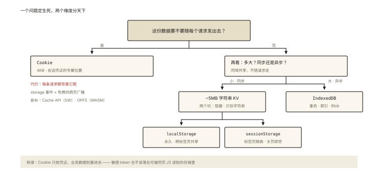

# 浏览器基础之前端存储四件套

## 从「把购物车塞进 localStorage」的翻车说起

```js
// 初版方案：购物车存 localStorage
localStorage.setItem('cart', JSON.stringify(cart));
// 商品多了之后：
// ❌ 超过 5MB 直接 QuotaExceededError
// ❌ 每次全量序列化，10MB 的 JSON 读写都卡主线程
// ❌ 异步竞态：两个标签页同时改，互相覆盖
```

选错存储方案的代价是延迟暴露的。⭐⭐「Cookie/localStorage/sessionStorage/IndexedDB 的区别与选型」是基础必考——四个不是「随便挑一个」，而是**四套不同的设计取舍**。

## 现象与直觉解释

四件套一张表看全貌：

| | Cookie | localStorage | sessionStorage | IndexedDB |
|---|---|---|---|---|
| 容量 | ~4KB/条 | ~5MB/域 | ~5MB/域 | 数百 MB+ |
| 生命周期 | 可设过期 | 永久（手动清） | 标签页关闭 | 永久 |
| 随请求发送 | **每次自动带** ⭐ | ❌ | ❌ | ❌ |
| API | 字符串 | 同步 KV | 同步 KV | **异步**、事务、索引 |
| 作用域 | 域+路径 | 域 | 域+标签页 | 域 |
| 主线程影响 | — | 大数据读写**阻塞** | 同左 | 异步不阻塞 |

**一句话人设**：

- Cookie：**随身的身份牌**（每个请求自动带——会话的天然载体，也是性能负担）；
- localStorage：**永久储物柜**（同步、小量、字符串）；
- sessionStorage：**临时储物柜**（随标签页生灭——表单草稿、一次性状态）；
- IndexedDB：**仓库**（异步、事务、索引查询——真·数据库）。

## 深入原理

### 一、Cookie 的「自动携带」是分水岭 ⭐⭐

只有 Cookie 会随**同域每个 HTTP 请求**自动出现在请求头——这决定了它的定位与代价：

- **定位**：会话凭证（登录态）非它莫属（HttpOnly 防 XSS 等安全属性详见《network-008》）；
- **代价**：每条请求都背着它跑——**存业务数据进 Cookie = 每个请求变重**；4KB 上限与 ~50 条数量限制也是硬约束。

工程铁律：**Cookie 只放凭证，业务数据去 localStorage/IndexedDB**。

### 二、localStorage 的三个特性与两个坑 ⭐⭐

```js
localStorage.setItem('theme', 'dark');      // 同步 API
localStorage.getItem('theme');
localStorage.removeItem('theme');

// ⭐ 特性1：同域所有标签页【共享】
// ⭐ 特性2：跨标签页通信：storage 事件（别的标签页改动时收到通知）
window.addEventListener('storage', (e) => {
  // e.key / e.newValue —— 另一个标签页改了数据
});

// 坑1：同步阻塞 —— 存取大数据（如几 MB JSON）卡主线程
// 坑2：只支持字符串 —— 对象要 JSON 序列化；存储的是【拷贝】
```

**sessionStorage 与它的唯一大差异**：标签页隔离（不同标签页各自独立）+ 关页即焚——「同一浏览器多开两个账号互不干扰」就是它的功劳。

### 三、IndexedDB：被低估的「真数据库」⭐⭐

```js
// 异步 + 事务 + 对象仓库(表) + 索引 —— 面向对象的 NoSQL
const req = indexedDB.open('app-db', 1);
req.onupgradeneeded = (e) => {           // 版本升级时建表
  const db = e.target.result;
  const store = db.createObjectStore('articles', { keyPath: 'id' });
  store.createIndex('byDate', 'updatedAt');   // 索引 → 按字段查询
};
req.onsuccess = (e) => {
  const db = e.target.result;
  const tx = db.transaction('articles', 'readwrite');  // 事务
  tx.objectStore('articles').put({ id: 1, title: 'x', updatedAt: Date.now() });
  const getReq = tx.objectStore('articles').get(1);
  getReq.onsuccess = () => console.log(getReq.result);
};

// 原生 API 回调风格繁琐 —— 生产常用封装：idb（Promise 化）、Dexie.js
// PWA 离线应用、草稿自动保存、大文件分块缓存 都是它的主场
```

三个关键点：① **异步**（不阻塞主线程——对比 localStorage 的大数据瓶颈）；② **事务**保证一致性；③ 可以存**对象/Blob**（不只字符串，文件也能放）。

### 四、新成员一句话（体系补全）⭐

- **Cache API**（Service Worker 的缓存仓库）：可编程的「HTTP 响应级」缓存——离线方案的主角（《network-006》层次图的一员）；
- **OPFS**（Origin Private File System）：高吞吐本地文件系统——WASM 大数据场景的新选择。

## 回看开篇

购物车翻车的对位修复：数据量与并发超出 localStorage 设计——迁到 **IndexedDB**（异步不卡、容量充足、事务防覆盖）；「多标签页同步」用 storage 事件或 BroadcastChannel 补齐。**选型的本质：按「大小、生命周期、是否随请求、同步异步」四问对号入座。**

## 实战延伸

**1. 面试答题骨架**：「Cookie 每请求自动携带、约 4KB，是会话凭证的专属位置（配 HttpOnly/Secure/SameSite）；localStorage 与 sessionStorage 同为 5MB 同步字符串 KV——前者永久且跨标签页共享、可借 storage 事件通信，后者标签页隔离且关页即焚；IndexedDB 是异步带事务与索引的 NoSQL，容量大且可存对象与 Blob，适合离线与大数据。选型四问：要不要随请求带？多大？活多久？要不要异步？」

**2. 快手辨析**：localStorage 存的对象改属性后再读——读到的是旧值（存的是序列化**拷贝**不是引用）。

**3. 安全一句话**：所有前端存储都可被同页 JS 读取——**敏感数据（token）要么 HttpOnly Cookie 要么内存变量**，明文放 localStorage 是 XSS 的一锅端（《security-001》）。

## 图解总结



*图 · 一个问题定生死：随不随请求走决定 Cookie 的独苗地位，容量与同步性再分剩下三个*

```
                是否随请求发送？
               /            \
           是(4KB)           否
            Cookie            \
        （会话凭证）        容量&异步？
                          /         \
                   小·同步           大·异步
                   /      \            IndexedDB
              永久共享   标签页隔离      （事务/索引/Blob）
           localStorage sessionStorage
                │                    新补: Cache API(SW) / OPFS(WASM)
                └ storage 事件 = 免费的跨标签页广播
```

## 总结

- Cookie 自动随请求带（凭证专用，4KB）；localStorage 永久共享；sessionStorage 标签页隔离即焚；IndexedDB 异步事务大容量；
- localStorage 两个坑：同步阻塞与字符串拷贝；storage 事件是免费跨页通信；
- IndexedDB 三件套：异步、事务、索引；生产用 idb/Dexie 封装；
- 敏感数据不落可被 JS 读的存储——HttpOnly 或内存；
- 选型四问：随请求？大小？生命周期？同步异步？

**面试一句话回答**：四者定位不同——Cookie 每次请求自动携带、容量约 4KB，是登录凭证的专属载体并配合 HttpOnly、Secure、SameSite 做安全加固；localStorage 和 sessionStorage 是 5MB 级的同步字符串键值存储，前者永久保存且同域标签页共享、还能借 storage 事件做跨页通信，后者标签页隔离、关闭即清空；IndexedDB 则是异步、支持事务与索引的大容量对象数据库，可存对象与 Blob，适合离线应用与大数据缓存。选型看四点：是否需要随请求发送、数据量级、生命周期要求、是否需要异步非阻塞——敏感 token 应放 HttpOnly Cookie 或内存，而非可被脚本读取的 localStorage。

## 思考题

1. 为什么「把埋点数据攒在 localStorage」是坏方案？从容量、阻塞、竞态三个角度分析，给出 IndexedDB 版的设计。
2. sessionStorage 在「新标签页打开链接」时是共享还是独立？（提示：复制 vs 跳转的行为差异）
3. 用 storage 事件实现「多标签页登录态同步」：一个页退出，全部页跳登录——写出骨架并处理事件不回发本页的细节。
4. 开放设计：离线可用的笔记应用——Service Worker+Cache（静态资源）与 IndexedDB（笔记数据）怎么分工？同步冲突（离线编辑两台设备）留一个解决思路。

（思考题解析将同步录入小程序题库，关联本文 id：browser-basic-004）

## 参考文献：

- MDN — [Web storage API](https://developer.mozilla.org/zh-CN/docs/Web/API/Web_Storage_API)、[IndexedDB](https://developer.mozilla.org/zh-CN/docs/Web/API/IndexedDB_API)
- web.dev — Storage for the web（官方选型指南）
- 本课程《network-006 浏览器缓存》《network-008 Cookie》
