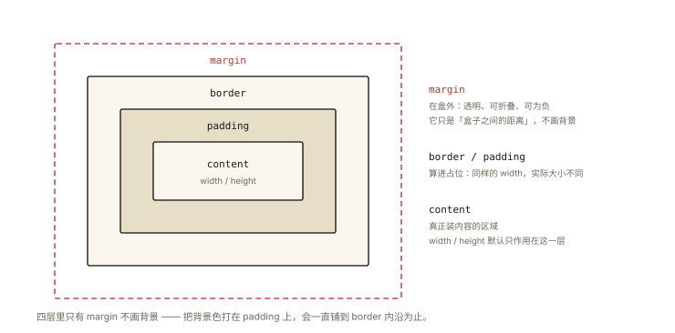
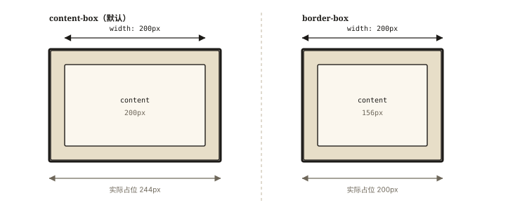

# CSS 深入之盒模型：content-box 与 border-box

## 从一个「宽度对不上」的排障说起

> **系列导读**：《CSS 深入系列》共 10 篇，从盒模型、文档流到 BFC、Flex/Grid，把「能用」的 CSS 变成「能解释」的 CSS。

设计稿：卡片宽 300px，内边距 20px，边框 1px。同学的 CSS：

```css
.card {
  width: 300px;
  padding: 20px;
  border: 1px solid #ccc;
}
/* 实测卡片占了 300 + 20×2 + 1×2 = 342px —— 和旁边的 300px 栅格对不上了 */
```

「明明写了 300px，为什么实际是 342？」——答案就在盒模型的两种计算规则里。⭐ 盒模型是 CSS 布局的第一块地基，`box-sizing` 是它最重要的开关。

## 现象与直觉解释

浏览器把每个元素渲染成一个**矩形盒子**，从内到外四层：



*图 · 四层从里到外：只有 margin 在盒外且不画背景，border 与 padding 都算进占位*

```
┌───────────── margin（外边距：盒子之间的距离）─────────────┐
│ ┌────────── border（边框）──────────────┐                │
│ │ ┌─────── padding（内边距）──────────┐ │                │
│ │ │        content（内容：width/height）│ │                │
│ │ └─────────────────────────────────┘ │                │
│ └───────────────────────────────────────┘                │
└───────────────────────────────────────────────────────────┘
```

直觉争议点只有一个：**CSS 里写的 width，管到哪一层？**

- `content-box`（默认）：width 只管 content 层——实际占位 = width + padding + border；
- `border-box`：width 管到 border 层——padding 和 border 向内挤压，总占位恒等于 width。

## 深入原理

### 一、两种 box-sizing 的对照 ⭐⭐

```css
/* 同样声明：width: 300px; padding: 20px; border: 1px */

/* content-box（默认） */
.box1 { box-sizing: content-box; }
/* content = 300，实际宽 = 300 + 40 + 2 = 342px */

/* border-box */
.box2 { box-sizing: border-box; }
/* 总宽 = 300，content = 300 - 40 - 2 = 258px */
```



*图 · 同一句 width: 200px（padding 20、border 2）：content-box 量内容区，实际占位 244px；border-box 量到边框外沿，内容被挤成 156px*

```
content-box:  ◀─ width ─▶
             ┌───────┐
             │content│ ── padding/border 向【外】顶
             └───────┘
             ◀────────── 实际占位 ──────────▶

border-box:  ◀────────── width ──────────▶
             ┌───────────────┐
             │ p │content│ p │ ── padding/border 向【内】挤
             └───────────────┘
```

### 二、工程实践：全局 border-box 的标准姿势 ⭐⭐

```css
/* 现代标准写法（继承友好：表单控件等替换元素也吃到） */
*, *::before, *::after {
  box-sizing: border-box;
}
```

为什么它是几乎所有 reset/normalize 的标配？三个理由：

1. **心智简单**：写了 width 就是最终占位——「所见即所得」；
2. **栅格友好**：`width: 25%` 的四列布局，无论加多少 padding/border 都不会溢出容器；
3. **计算量少**：不用做 `width = 设计稿 - padding×2 - border×2` 的减法（content-box 时代的日常噩梦）。

**保留 content-box 的场景**：需要「内容区精确等宽」时（如两端对齐的文本栏、固定内容区的打印样式）——知道何时不用，才是真正的理解。

### 三、margin：盒模型的第五层 ⭐

margin 在 box-sizing 之外，有两个必须知道的特性：

```css
/* ① 垂直方向的 margin 折叠（相邻/父子块级盒） */
.a { margin-bottom: 20px; }
.b { margin-top: 30px; }
/* a、b 相邻：实际间距是 30px（取大者），不是 50px！ */
/* 详见 css-deep-003 BFC——折叠的解药 */

/* ② margin 可以为负（padding/border 不行） */
.pull-up { margin-top: -10px; }  /* 向上叠压的常用手法 */
```

### 四、行内元素的盒模型差异 ⭐

```css
span {
  width: 100px;    /* ❌ 无效！行内盒的宽高由内容决定 */
  height: 50px;    /* ❌ 无效 */
  padding: 20px;   /* ⚠️ 生效但【不撑起行高】——上下 padding 溢出，不占布局空间 */
  margin: 10px;    /* ⚠️ 水平生效、垂直不占位 */
}
/* 要让行内元素接受完整盒模型 → display: inline-block 或 block */
```

（display 的完整语义见下一篇《css-deep-002》。）

### 五、盒模型相关的三个实战 API ⭐

```js
// ① 获取「实际渲染尺寸」（含 padding+border，不含 margin）：
el.offsetWidth;   // 342（整数，含 transform 前的布局尺寸）

// ② 获取 content 尺寸：
getComputedStyle(el).width;  // '300px'（content-box 下）

// ③ 「占位总宽」= offsetWidth + 左右 margin

// ⚠️ 高频陷阱：offsetWidth 读一次可能强制重排（layout thrashing）——
// 循环里「读写交替」是性能杀手，见《performance-005 渲染优化》
```

## 回看开篇

300px 变 342 的原因：默认 content-box 下，width 只定义内容区，padding 与 border **向外扩展**实际占位。修复一行：`box-sizing: border-box`（或全局 reset）——声明尺寸从此「说到做到」。

## 实战延伸

**1. 面试答题骨架**：「盒模型从内到外是 content、padding、border、margin 四层，box-sizing 决定 width 归属——content-box 只定义内容区，实际占位还要加 padding 和 border；border-box 则 width 直接等于含边框的总占位。现代工程普遍全局设置 border-box，让声明尺寸即最终占位，栅格布局加内边距也不会溢出；此外行内元素不接受 width/height 且垂直 padding 不占布局空间，垂直 margin 相邻会发生折叠取大者。」

**2. 快手辨析**：box-sizing 不影响 margin——无论哪种模式，margin 都在盒子之外。

**3. 一个经典布局题**：两栏布局，侧栏定宽 200px、自适应栏 `width: calc(100% - 200px)` + padding——不用 border-box 时右栏必然溢出，加上 border-box 完美（calc 与盒模型联动的必考点）。

## 图解总结

```
          margin（始终在盒外 · 可折叠 · 可为负）
        ┌──────────────────────────────┐
        │ border                       │
        │  ┌────────────────────────┐  │
        │  │ padding                │  │
        │  │  ┌──────────────────┐  │  │
        │  │  │  content         │  │  │
        │  │  │  width/height    │  │  │  ← content-box: width 管这层
        │  │  └──────────────────┘  │  │  ← border-box:  width 管到 border 层
        │  └────────────────────────┘  │
        └──────────────────────────────┘
```

## 总结

- 盒模型四层：content → padding → border → margin（margin 在盒外）；
- content-box：width 只管内容，实际占位 = width + padding + border；
- border-box：width 即总占位，padding/border 向内挤——现代工程标配 `* { box-sizing: border-box }`；
- 行内元素不接受宽高，垂直 padding/margin 不占布局位；
- offsetWidth = content + padding + border；margin 折叠是 margin 独有行为。

**面试一句话回答**：CSS 盒模型从内到外由 content、padding、border、margin 四层构成，box-sizing 决定 width 属性的管辖范围——默认 content-box 只定义内容区宽度，实际占位需要加上左右 padding 与 border；border-box 则让 width 等于含边框的总宽度、内边距与边框向内挤压，因此工程上普遍全局启用 border-box 使声明尺寸即最终占位，栅格布局加内边距也不会溢出；同时注意行内元素不接受宽高、垂直方向 padding 不占布局空间，而相邻块级盒的垂直 margin 会折叠为较大值。

## 思考题

1. `width: 100%; padding: 20px; box-sizing: content-box` 的盒子会怎样？两种 box-sizing 各写一遍修复。
2. `offsetWidth`、`clientWidth`、`scrollWidth` 三者的包含关系？（提示：client 不含 border 含 padding；scroll 再加溢出内容）
3. 为什么很多老项目的表单 input 要单独重置 `box-sizing`？（input 默认样式与统一栅格的冲突）
4. 开放讨论：`aspect-ratio: 16/9` 与盒模型如何协作？在 border-box 下给容器加 padding，比例还准吗？

（思考题解析将同步录入小程序题库，关联本文 id：css-deep-001）

## 参考文献：

- MDN — [盒模型](https://developer.mozilla.org/zh-CN/docs/Learn/CSS/Building_blocks/The_box_model)、[box-sizing](https://developer.mozilla.org/zh-CN/docs/Web/CSS/box-sizing)
- CSS 规范 — CSS Box Model Level 3
- 《CSS 揭秘》相关章节
