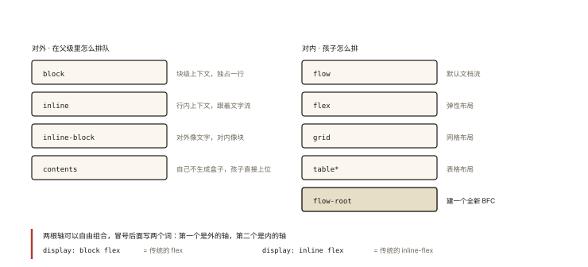
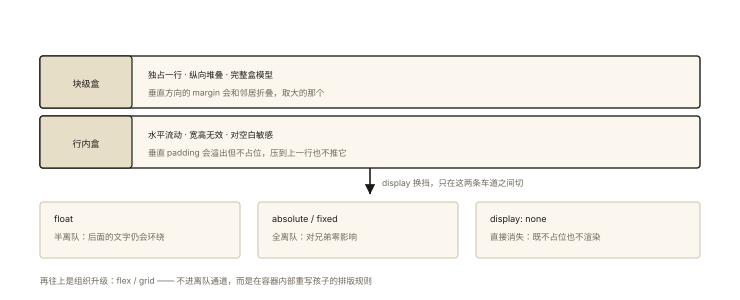

# CSS 深入之文档流与 display 的本质

## 从两个「挤来挤去」的疑问说起

```html
<div>a</div><div>b</div>          <!-- 为什么各占一行？ -->
<span>x</span> <span>y</span>     <!-- 为什么排在一行？中间的空白哪来的？ -->
```

```css
/* 更怪的现象： */
span  { width: 200px; }   /* 不生效（css-deep-001 讲过） */
div   { display: inline; } /* 也不占一行了 —— display 改的是"排版规则" */
```

一切答案都指向 CSS 的第一性原理：**文档流（Normal Flow）**——元素默认如何一个接一个排布的规则系统；而 `display` 是选择「参与哪种排版上下文」的开关。⭐ 理解文档流，是理解 float、position、flex、grid 全部布局体系的起点——它们本质上都是「如何脱离或重组文档流」。

## 现象与直觉解释

**文档流的直觉模型**：页面是一张从上到下流动的纸，元素按两条基本规则排布——

- **块级（block）**：独占一行（纸的一整行），从上到下堆叠；
- **行内（inline）**：在行内水平流动，排满换行——像文字排版。

`display` 属性的本质：**告诉浏览器「这个盒子按什么规则参与布局」**。

## 深入原理

### 一、三族 display 的行为对照 ⭐⭐

| 特性 | block | inline | inline-block |
|---|---|---|---|
| 独占一行 | ✅ | ❌ | ❌ |
| 接受 width/height | ✅ | ❌ | ✅ |
| 垂直 margin/padding 占位 | ✅ | ❌（溢出不推开行距） | ✅ |
| 换行敏感（源码空白） | 否 | **是**（空白成为空格） | **是** |

```css
/* inline-block = 「对外的行内 + 对内的块」：
在行内排队（外），自身是一个完整盒模型（内）——按钮、标签的经典选择 */
.badge {
  display: inline-block;
  padding: 4px 12px;
  width: 60px;      /* 生效 ✅ */
}
```

**行内/inline-block 的「空白缝隙」问题**（源码换行符被当作一个空格渲染）：

```css
/* 解法速记 */
.parent { font-size: 0; }        /* 老派：空格字号归零 */
/* 现代解法：干脆用 flex 布局（子项间没有空白节点问题） */
.parent { display: flex; }
```

### 二、display 的完整谱系 ⭐



*图 · display 不是一个属性，是两根独立的轴*

```
对外如何排队 ──┬── block        块级上下文
              ├── inline       行内上下文
              ├── inline-block 混合
对内如何管理孩子 ─┬── flow        传统文档流（默认）
                ├── flex        弹性布局（css-deep-007）
                ├── grid        网格布局（css-deep-008）
                ├── table*      表格布局
                └── flow-root   全新 BFC（css-deep-003 的主角！）

两轴可组合（Display Level 3）：
display: block flex;   /* 对外块级 + 对内 flex（即传统的 flex） */
display: inline flex;  /* 对外行内 + 对内 flex（即传统的 inline-flex） */
```

这个「**对外 × 对内**」两轴模型是理解 display 的钥匙：`flex` 其实是 `block flex` 的简写，`inline-flex` 是 `inline flex`——对外排队方式和内部布局体系是正交的两个决定。

### 三、脱离文档流的三种方式 ⭐⭐

文档流是默认状态，以下属性让盒子「离队」：

```css
/* ① float：脱离文档流，但仍「影响」行内内容（文字环绕） */
img { float: left; }        /* 后文文字绕着图排 —— float 的本意 */

/* ② absolute / fixed：彻底离队，不再影响任何内容的布局 */
.overlay { position: absolute; }

/* ③ 负 margin：不离队，但允许重叠（css-deep-001） */
```

离队之后的空白谁来补？——**没人补**：absolute 盒子原来的位置被后续元素直接占掉。这是「图文环绕（float 保留影响）」与「悬浮层（absolute 零影响）」的核心差异。

### 四、margin 折叠：文档流的著名副作用 ⭐⭐

**块级盒在文档流中的垂直 margin 会折叠**（相邻兄弟、父子嵌套、空盒自身三种场景）：

```css
/* 场景 1：相邻兄弟 */
.a { margin-bottom: 30px; }
.b { margin-top: 20px; }
/* 间距 = 30px（取大），不是 50px */

/* 场景 2：父子折叠（最坑的一种） */
.parent { margin-top: 20px; }
.child  { margin-top: 30px; }
/* child 的 margin「穿透」parent，页面顶部出现 30px 间距——parent 没被推下来 */

/* 折叠不发生的情况（BFC 的三大解药，css-deep-003 展开）：
   ① 任一盒子被 BFC 隔离  ② flex/grid 容器的子项  ③ 加了 border/padding 挡住 */
```

**为什么会有折叠**：文档流本质是「段落排版」，相邻段落的间距合并是排版惯例（段落 A 的下间距与段落 B 的上间距合并为一个）——CSS 继承了这个印刷传统。

## 回看开篇

div 独占一行、span 水平排列：它们的**默认 display**（div→block、span→inline）决定了在文档流中的排队方式；`display: inline` 之所以改变 div 行为，是因为它换掉了 div 的「排版规则」而不是改变元素种类——**display 决定盒子如何排队，与标签是什么无关**（标签只提供默认值）。

## 实战延伸

**1. 「display:none vs visibility:hidden vs opacity:0」三连**（文档流视角）：

| | display:none | visibility:hidden | opacity:0 |
|---|---|---|---|
| 占布局空间 | ❌ 离队 | ✅ 保留 | ✅ 保留 |
| 触发重排/重绘 | 重排 | 重绘 | 合成层可零重绘 |
| 可点击/可聚焦 | ❌ | ❌ | ✅ 仍可交互 |
| 子元素可单独反隐 | ❌ | ✅（visible 覆盖） | ❌ |

**2. 面试答题骨架**：「文档流是元素默认排布规则——块级从上到下堆叠、行内在行内盒中水平流动；display 决定盒子对外如何排队（block/inline/inline-block）与对内如何布局（flow/flex/grid），两轴正交可组合；float 与 absolute 都脱离文档流，但 float 仍影响行内内容（环绕），absolute 完全不再影响布局；块级垂直 margin 在文档流中折叠取大者，BFC、flex 容器、border/padding 隔断可以阻止折叠。」

## 图解总结



*图 · 只有两条车道，所有布局都是在这上面做加减*

```
文档流（默认排布系统）
 ├─ 块级盒：独占一行 · 纵向堆叠 · 完整盒模型 · 垂直margin折叠
 └─ 行内盒：水平流动 · 宽高无效 · 垂直padding溢出不占位 · 对空白敏感
        │
        │  display 切换「对外排队方式 + 对内布局体系」（两轴）
        ▼
 离队通道：float（文字仍环绕）│ absolute/fixed（零影响）│ display:none（直接消失）
 组织升级：flex / grid —— 容器内重写排版规则（后续专篇）
```

## 总结

- 文档流 = 默认排布系统：块级纵向堆叠、行内水平流动；
- display 两轴模型：对外（block/inline/inline-block）× 对内（flow/flex/grid）；
- inline-block：对外行内、对内完整盒——空白缝隙问题可用 font-size:0 或 flex 解决；
- float 离队但影响行内内容；absolute 彻底零影响；display:none 不占位且不可交互；
- 垂直 margin 折叠是文档流的排版传统，BFC/flex/border 可隔断。

**面试一句话回答**：文档流是元素默认的排布系统——块级盒子独占一行纵向堆叠、行内盒子在行盒中水平流动且不接受宽高、垂直内边距不占据布局空间；display 属性的本质是同时决定盒子对外如何排队与对内采用何种布局体系，block、inline、inline-block 属于外轴而 flow、flex、grid 属于内轴，两轴可组合成 block flex 或 inline flex；脱离文档流的方式中 float 仍会让行内内容环绕、absolute 则完全不再影响布局，而块级元素在文档流中的垂直外边距会折叠为较大值，可通过建立 BFC、使用弹性容器或加边框内边距来隔断。

## 思考题

1. 两个相邻元素 margin 分别是 30px 和 -20px，最终间距是多少？（折叠与负 margin 的组合规则：正取大、负取绝对值大、正负相加）
2. 为什么「给 inline 元素设置垂直 padding」在视觉上生效却不撑开行距？这个特性有什么妙用（提示：导航文字的视觉扩展热区）？
3. `display: flow-root` 和 `overflow: hidden` 都能建 BFC——为什么现代更推荐前者？（副作用对比）
4. 开放讨论：语义化标签（header/nav/article）与 display 的关系——「语义管内容含义、display管视觉表现」，两者如何各司其职？

（思考题解析将同步录入小程序题库，关联本文 id：css-deep-002）

## 参考文献：

- CSS 规范 — CSS Display Module Level 3（两轴模型原文）
- MDN — [视觉格式化模型](https://developer.mozilla.org/zh-CN/docs/Web/CSS/Visual_formatting_model)
- 《CSS 世界》第 3~4 章（文档流与盒模型的中文最佳讲述）
