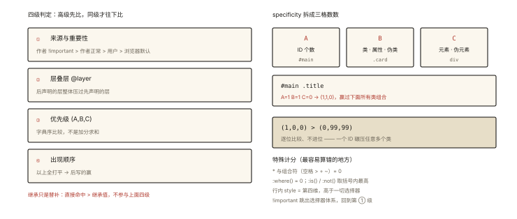

# CSS 深入之选择器优先级与层叠规则

## 从「样式怎么都改不动」的排障说起

```css
.card .title { color: red; }
.card .content .title { color: blue; }  /* 哪个生效？ */
#main .title { color: green; }          /* 呢？ */
.title { color: gray !important; }      /* 呢？？ */
```

开发者日常三大绝望之一：**样式写了但不生效**。排除拼写错误后，剩下的原因几乎全在「层叠（Cascade）算法」里——CSS 的 C 就是它。⭐ 优先级计算是基础必考，而「同一元素上多条规则打架时谁赢」的完整判定链，才是这道题的全貌。

## 现象与直觉解释

CSS 的本质是**规则集合**，同一元素可能命中多条规则——冲突必须仲裁。仲裁算法（层叠）看四个因素，**按顺序逐级比较**：



*图 · 左：四级判定从高到低；右：三元组怎么数、字典序为什么一个 ID 能碾压一堆类*

```
① 来源与重要性（important > 正常；来源分层）
② 层叠层（@layer）
③ 优先级（specificity，(id, class, type) 三元组）
④ 出现顺序（都打平 → 后写的赢）
```

**高级先比，同级才往下比**——不是加分求和，是字典序比较。

## 深入原理

### 一、specificity 三元组 ⭐⭐

每个选择器算一个 **(A, B, C)**：

| 位 | 计什么 | 权重示例 |
|---|---|---|
| A | **ID 选择器**个数 | `#main` → (1,0,0) |
| B | **类/属性/伪类**个数 | `.card` `[type=text]` `:hover` → (0,1,0) |
| C | **元素/伪元素**个数 | `div` `::before` → (0,0,1) |

```css
*                    /* (0,0,0) 通配符不计分 */
p                    /* (0,0,1) */
.list li             /* (0,1,1) */
.card .content .title /* (0,3,0) */
#main .title          /* (1,1,0) */
button[type='submit'] /* (0,1,1) */
:hover                /* (0,1,0) 伪类按 B 计 */
::before              /* (0,0,1) 伪元素按 C 计 */
```

**比较规则：字典序**——`(1,0,0) > (0,99,99)`：**一个 ID 碾压任意多个类**。

```css
/* 开篇答案 */
#main .title { color: green; }   /* (1,1,0) 胜出 ✅ */
.card .content .title { ... }     /* (0,3,0) 输 */
.card .title { ... }              /* (0,2,0) 输 */
.title { color: gray !important; } /* 但 !important 直接升级到第①级——最终赢 ❗ */
```

### 二、容易被算错的五类「不计分/特殊」⭐⭐

| 选择器 | 优先级 | 备注 |
|---|---|---|
| `*` / 组合符（空格 > + ~） | 0 | 完全不计 |
| `:where(...)` | **0** | 「把一串选择器打包但不加分」——降权利器 |
| `:is(...)` / `:not(...)` | **取括号内最高的那个** | `:is(#a, .b)` 按 (1,0,0) 算 |
| 行内样式 `style="…"` | 高于一切选择器 | (1,0,0,0) 可视为第四维 |
| `!important` | 跳出选择器体系 | 进入「来源与重要性」战场 |

### 三、!important 与来源战场 ⭐⭐

一旦出现 important，比较升维到**来源**：

```
浏览器默认样式 < 用户样式 < 【作者样式】 < 作者!important < 用户!important < 浏览器!important(极少)
（作者 = 我们写的页面样式）
```

**工程共识：禁用 important**——它是「跳出仲裁体系用核弹」，赢了当下、断了后来（任何想覆盖它的正常样式都无能为力）。合理的三个例外：工具类的兜底、覆盖第三方内联样式、用户样式表场景。

### 四、层叠层 @layer：官方的「优先级分组」⭐（现代特性）

```css
@layer reset, base, components, utilities;

@layer components {
  .btn { padding: 8px; }        /* 组内优先级再高，也压不过 utilities 组 */
}
@layer utilities {
  .p-0 { padding: 0; }          /* 后声明的层整体胜出 ✅ */
}
```

`@layer` 把「来源」维度交给开发者：**层顺序 > 层内 specificity**——第三方库样式放低层、业务放高层，从此不用跟组件库拼选择器权重。这是解决「优先级军备竞赛」的官方答案（2022 年后浏览器全面支持）。

### 五、继承：不参与打架的「替补席」⭐

```
直接命中元素的规则（哪怕 * {}） > 继承来的值
color/font-family 等可继承属性：自身没命中 → 沿父链取值
```

```css
/* 经典误导题 */
p { color: red; }          /* 直接命中 */
body { color: blue; }      /* p 继承 body —— 但直接命中优先 */
/* <p> 是红色 ✅ 继承只兜底，不参与优先级比较 */
```

`inherit` / `initial` / `unset` / `revert` 四个关键字控制继承与回退（reset 的核心工具）。

## 回看开篇

判定链条完整走一遍：先看有没有 important（第①级）→ 有 @layer 比层序（第②级）→ 再比三元组（第③级）→ 最后比出现顺序（第④级）。开篇四条规则：`.title !important` 升维获胜；去掉它则 `#main .title` 靠 (1,1,0) 登顶——**任何「改不动」的样式，沿这条链检查必有答案**。

## 实战延伸

**1. DevTools 定位层叠胜负**：Elements → Styles 面板里，被覆盖的规则会被划掉、生效规则按优先级排列，悬停选择器能看到 specificity 计算值——排障第一现场。

**2. 面试答题骨架**：「同一元素多条规则冲突时按四层判定——来源与重要性、层叠层、优先级、书写顺序，逐级字典序比较而非求和；specificity 是 (id, class/属性/伪类, 元素/伪元素) 三元组，通配符与组合符不计分，:where 计零分而 :is/:not 取参数最高分；行内样式高于一切选择器，important 升维到来源战场但工程应禁用；@layer 提供官方的层序管理，后声明的层整体压过先声明的层；继承只兜底不参与比较。」

**3. 「低权重覆盖库样式」的姿势清单**：提高自身选择器层级 < 复用同 specificity 靠源码顺序 < @layer 分层 < （万不得已）important。

## 图解总结

```
冲突仲裁链（从高到低）：
 ① important？作者!important > 作者正常 …
 ② @layer 层序：后声明的层 > 先声明
 ③ specificity：(A,B,C) 字典序 —— 1个ID > 任意多个类
 ④ 源码顺序：后写的赢
 ⑤ 继承：只是替补，不参与以上

特殊计分：*=0 | :where()=0 | :is()/:not()=取内最高 | style=第四维 | !important=升维
```

## 总结

- 层叠四因素按序判定：来源与 important → @layer → specificity → 顺序；
- specificity 三元组 (ID, 类/属性/伪类, 元素/伪元素)，字典序比较；
- 通配符与组合符不计分；:where 降零权、:is/:not 取内最高；行内样式高于所有选择器；
- important 升维但破坏可维护性，工程禁用；@layer 是优先级军备竞赛的官方解；
- 继承是兜底机制，不参与优先级比较。

**面试一句话回答**：当多条规则命中同一元素时，浏览器按四级判定胜负——先看来源与重要性，important 的作者样式高于一切正常声明；再看层叠层，后声明的 layer 整体压过先声明的层；然后比较选择器优先级，即 ID 数、类属性伪类数、元素伪元素数构成的三元组按字典序比较，一个 ID 就能压过任意多个类；全部相同则后书写的规则获胜。通配符与组合符不计算优先级，where 优先级为零、is 与 not 取参数中最高分，行内样式高于所有选择器，important 会跳出选择器体系进入来源战场但工程上应避免使用，继承值只在无直接命中时兜底、不参与优先级比较。

## 思考题

1. 按优先级从高到低排序：`div a`、`:is(#x, .y)`、`:where(#x)`、`a:hover`、`*`。
2. `!important` 打 `!important` 怎么分胜负？作者样式与浏览器默认样式（user-agent）各带 important 时呢？
3. 用 `@layer` 设计「reset < 库样式 < 业务 < 工具类」的四层结构，写出声明顺序与一条覆盖示例。
4. 开放讨论：为什么 Tailwind 等原子化 CSS 几乎不需要担心优先级？（单类选择器同权重 + 源码顺序稳定 + 工具类放最高层）

（思考题解析将同步录入小程序题库，关联本文 id：css-deep-005）

## 参考文献：

- CSS 规范 — CSS Cascading and Inheritance Level 4/5（层叠算法原文）
- MDN — [层叠与继承](https://developer.mozilla.org/zh-CN/docs/Learn/CSS/Building_blocks/Cascade_and_inheritance)、[Specificity](https://developer.mozilla.org/zh-CN/docs/Web/CSS/Specificity)
- web.dev — Cascade layers 指南
