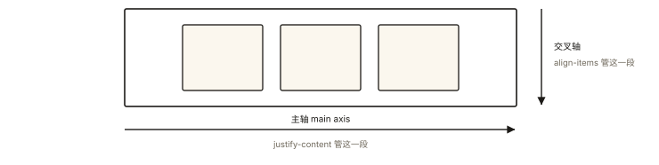
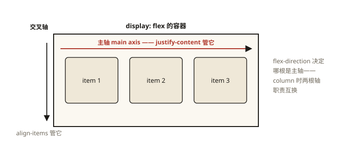

# CSS 深入之 Flex 布局完全指南

## 从「居中难题」的一行解法说起

垂直居中——CSS 史上被抱怨最久的问题。float/inline-block 时代要各种 hack，Flex 时代一行：

```css
.center { display: flex; justify-content: center; align-items: center; }
```

⭐⭐ Flex 是现代布局的绝对主力（UI 组件、页面骨架的 80% 场景），也是 CSS 面试的必考项。本文按「两轴模型 → 容器属性 → 项目属性 → 计算算法」的顺序把它一次讲透——重点是多数人没学过的 **flex-grow/shrink 的分配算法**。

## 现象与直觉解释

Flex 的核心心智模型：**两根轴 + 主尺寸弹性**。



*图 · 两根轴永远垂直，改 flex-direction 等于把两根一起转*

```
flex-direction: row 时：

  主轴 main axis ──────────────▶  (justify-content 管它)
 ┌───────────────────────────────┐
 │ [item1] [item2] [item3]       │ ▲
 │                               │ │ 交叉轴 cross axis
 └───────────────────────────────┘ ▼ (align-items 管它)
```

- **主轴**：flex-direction 决定方向（row/column + reverse）；
- **交叉轴**：垂直于主轴的另一根；
- **弹性**：项目在主轴上可以伸缩（grow/shrink），这是 Flex 之名的由来。

**两个高频口诀错误纠正** ⭐：justify-content **永远管主轴**、align-items **永远管交叉轴**——不一定是水平和垂直！direction 是 column 时两职责互换。

## 深入原理



*图 · Flex 的两轴模型——主轴（红）与交叉轴（墨）各自有自己的属性族*

### 一、容器（父）六属性 ⭐⭐

```css
.container {
  display: flex;              /* 或 inline-flex（对外行内） */

  flex-direction: row;        /* 主轴方向: row|row-reverse|column|column-reverse */
  flex-wrap: nowrap;          /* 换行: wrap 时项目可换行成多行 */
  justify-content: flex-start;/* 主轴分布: flex-start|center|space-between|space-around|space-evenly */
  align-items: stretch;       /* 交叉轴对齐: stretch|center|flex-start|flex-end|baseline */
  align-content: stretch;     /* 多行时行组的整体分布（单行无效）*/
}
/* 快捷: flex-flow: <direction> <wrap> */
```

**space 三兄弟的区别**（高频考点）：

```
space-between:  ▓▓┄┄┄┄┄┄▓▓┄┄┄┄┄┄▓▓   两端贴边，中间等分
space-around:  ┄▓▓┄┄┄▓▓┄┄┄▓▓┄       每项两侧等距（所以两端只有一半间距）
space-evenly:  ┄┄▓▓┄┄┄▓▓┄┄┄▓▓┄┄    所有间隙完全相等
```

### 二、项目（子）六属性 ⭐⭐

```css
.item {
  order: 0;           /* 排序权重（不改 DOM 顺序，只改视觉顺序）*/
  flex-grow: 0;       /* 主轴有【剩余空间】时的放大份额 */
  flex-shrink: 1;     /* 主轴【空间不足】时的缩小份额 */
  flex-basis: auto;   /* 分配前的"基准尺寸"（优先于 width）*/
  align-self: auto;   /* 单个项目覆盖 align-items */
  /* flex: <grow> <shrink> <basis> 简写 */
}
```

**flex 简写的四个常用档位** ⭐⭐：

```css
flex: initial;   /* 0 1 auto —— 默认：不放大、可压缩、按内容 */
flex: auto;      /* 1 1 auto —— 完全弹性：有剩余就分、不足就缩 */
flex: none;      /* 0 0 auto —— 刚性：死守自身尺寸（防被压扁的图标/头像）*/
flex: 1;         /* 1 1 0%   —— 等分弹性：忽略内容宽度，按比例瓜分全部空间 ⭐最常用 */
```

**`flex: 1` 与 `flex: auto` 的区别**（必考）：basis 是 0 还是 auto——前者**不看内容**（三项都 flex:1 必然等分），后者**先按内容再分配**（内容大的占得多）。

### 三、flex-grow / shrink 的分配算法 ⭐⭐（多数人的盲区）

**grow：剩余空间按 grow 值的比例分配**

```
容器 600px；A(basis 100px, grow 1)、B(basis 200px, grow 2)
剩余 = 600 - 300 = 300px
A 分得 300 × 1/3 = 100px → A 最终 200px
B 分得 300 × 2/3 = 200px → B 最终 400px
```

**shrink：不足空间按「shrink × basis」的加权比例扣减**（注意不是纯 shrink 比例！）

```
容器 300px；A(basis 200px, shrink 1)、B(basis 100px, shrink 1)
溢出 = 300 - 300 = 0 → 不缩
容器 250px 时：溢出 50px
加权: A = 1×200 = 200, B = 1×100 = 100（总和 300）
A 扣 50 × 200/300 = 33.3px → 166.7px
B 扣 50 × 100/300 = 16.7px → 83.3px
/* basis 大的承担更多缩减 —— 防止小项目被压没 */
```

会算这两个例子，就能预测一切 Flex 尺寸行为（也是面试的高段位加分项）。

### 四、经典配方速查 ⭐⭐

```css
/* ① 完美居中 */
.place-center { display: flex; justify-content: center; align-items: center; }

/* ② 左右两端（导航栏：logo 左、菜单右）*/
.space-between { display: flex; justify-content: space-between; }

/* ③ 圣杯布局：定宽两侧 + 弹性中间 */
.holy-grail { display: flex; }
.holy-grail .side { width: 200px; flex: none; }
.holy-grail .main { flex: 1; }

/* ④ 底部固定 footer（页面高度自适应）*/
.page { display: flex; flex-direction: column; min-height: 100vh; }
.page .content { flex: 1; }

/* ⑤ 等宽卡片行（自动换行、间距均等）*/
.cards { display: flex; flex-wrap: wrap; gap: 16px; }
.card { flex: 0 0 calc((100% - 32px) / 3); }   /* 三列等宽 + 两个间距 */

/* ⑥ 元素自适应撑满剩余（搜索框组）*/
.search-bar { display: flex; }
.search-bar input { flex: 1; }   /* input 吃掉全部剩余 */
```

### 五、Flex 的三个「意外」⭐

```css
/* ① 子项的 margin: auto —— 吃掉全部空隙的"超级 margin" */
.push-right { margin-left: auto; }   /* 在 flex 里被顶到最右（分布魔法）*/

/* ② 子项 float/vertical-align 失效 —— flex 项无视这两者 */
/* ③ min-width: auto 陷阱：内容撑住不让缩 —— 想真正压缩需 min-width: 0
   （长文本把 flex 项撑爆容器、overflow ellipsis 失效的头号原因） */
.shrinkable { min-width: 0; }   /* 允许收缩到内容宽以下 ✅ */
```

## 回看开篇

一行居中的原理：flex 容器里的项目**默认放弃传统文档流排布**，交由两轴坐标系统一调度——justify-content 沿主轴居中、align-items 沿交叉轴居中，两轴各管一半，任何方向组合的「居中/对齐」都退化成两个属性赋值。

## 实战延伸

**1. 面试答题骨架**：「Flex 以主轴与交叉轴组织布局——flex-direction 定主轴，justify-content 管主轴分布、align-items 管交叉轴对齐、align-content 管多行整体；项目侧 order 排序、flex-basis 定基准、grow 按 share=剩余×grow/总grow 分配剩余、shrink 按 shrink×basis 加权扣减溢出、align-self 单独覆盖。常用档位 flex:1 是 1 1 0（等分忽略内容）、auto 是 1 1 auto（先内容后分配）、none 刚性不缩。常见坑是 min-width:auto 阻止收缩与 gap 替代 margin 布局。」

**2. gap 优先**：子项间距用容器 `gap`（无需给子项加 margin 与负 margin 抵消）——flex/grid 通用的现代间距方案。

## 图解总结

```
            justify-content（主轴）
 flex-start   center   space-between   space-evenly
 [▓▓▓░░░░]  [░░▓▓▓░░]  [▓░░░░░░░▓▓░░░░░▓]  [░▓░░░▓░░░▓░]
            align-items（交叉轴）: stretch(默认拉伸)|center|start|end|baseline
 多行: flex-wrap:wrap + align-content（行组分布）

项目: order | flex:<grow 分剩余> <shrink 加权缩> <basis 基准> | align-self
档位: flex:1 → 等分 | auto → 内容+弹性 | none → 刚性
陷阱: min-width:auto 撑爆容器 → min-width:0
```

## 总结

- 两轴模型：direction 定主轴；justify 管主轴、align 管交叉轴（跟方向走，不跟水平垂直走）；
- 容器六属性 + 项目六属性；space 三兄弟间隙分布不同；
- flex 简写四档：initial/auto/none/1——basis 的 0 与 auto 是等分与内容优先的分水岭；
- grow 按比例分剩余、shrink 按 shrink×basis 加权扣减——会算两个例子就能预测尺寸；
- 三个意外：margin:auto 的超级吸附、float 失效、min-width:auto 的收缩陷阱。

**面试一句话回答**：Flex 用主轴与交叉轴组织布局，flex-direction 决定主轴方向，justify-content 管理主轴分布（含 space-between 两端贴边与 space-evenly 全等距）、align-items 管理交叉轴对齐、align-content 管多行整体分布；项目属性中 order 控制视觉顺序，flex 简写由 grow、shrink、basis 构成——剩余空间按 grow 比例分配、空间不足按 shrink 乘以 basis 的加权比例压缩，常用档位 flex:1 展开为 1 1 0 表示等分忽略内容、auto 为 1 1 auto 先按内容再分配、none 为 0 0 auto 刚性不缩；典型坑是子项 min-width 默认 auto 阻止收缩，需要显式设为 0。

## 思考题

1. 容器 500px，A(basis 100, grow 2)、B(basis 100, grow 1)、C(basis 100, grow 1)——三者最终宽度？（100+分到剩余200的2/4=200；各100+100 → A 200, B 200？算一遍）
2. 为什么 `flex: 1` 的三个子项有时并不严格等宽？改成严格等宽要加什么？
3. `min-height: 0`（column 方向）解决的是哪类具体 Bug？（列表超长撑爆纵向 flex 的场景）
4. 开放设计：响应式卡片墙——桌面 4 列、平板 3 列、手机 2 列，间距固定 16px——用 flex-wrap + calc 与 grid auto-fill 两种实现，对比可维护性。

（思考题解析将同步录入小程序题库，关联本文 id：css-deep-007）

## 参考文献：

- CSS 规范 — CSS Flexible Box Layout Module Level 1（grow/shrink 算法原文）
- MDN — [Flexbox](https://developer.mozilla.org/zh-CN/docs/Learn/CSS/CSS_layout/Flexbox)
- A Complete Guide to Flexbox（CSS-Tricks 经典图鉴）
