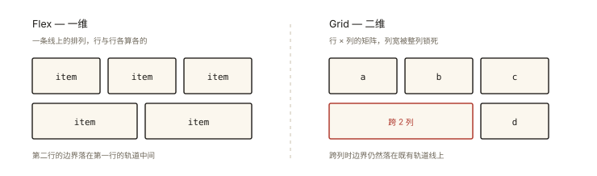

# CSS 深入之 Grid 布局入门与实战

## 从「为什么还要学 Grid」说起

Flex 已经这么强了，Grid 存在的意义是什么？一张对比图说清：



*图 · 差别不在能摆几个格子，而在谁先把尺寸定下来*

```
Flex（一维）：一条线上的排列 —— 组件内布局的王者
  [item] [item] [item]     每行独立决策，行与行之间没有"列对齐"关系

Grid（二维）：行×列的矩阵 —— 页面骨架的王者
  ┌────┬────┐
  │ a  │ b  │    每个项目同时在「行」和「列」两个维度被精确放置
  ├────┴────┤    列宽天然对齐；跨行跨列一句话
  │    c    │
  └─────────┘
```

⭐⭐ Grid 与 Flex 是**互补关系**：页面骨架用 Grid、组件内部用 Flex，是现代布局的标准分工。本文覆盖 Grid 的核心心智（轨道 → 区域 → 放置）与高频配方。

## 现象与直觉理解

Grid 的三步心智：

```
① 画格子（grid-template-*）：定义行轨道与列轨道 —— "设计稿的栅格线"
② （可选）命名区域：给格子组合起名字 —— "户型图"
③ 放项目（子项声明自己住哪个格）—— 不声明则自动流动填充
```

## 深入原理

### 一、定义轨道：三种列宽写法 ⭐⭐

```css
.grid {
  display: grid;
  /* ① 固定轨道 */
  grid-template-columns: 200px 1fr 1fr;     /* 定宽 + 两等分 */
  /* ② repeat 简写 */
  grid-template-columns: repeat(3, 1fr);    /* 三等分 */
  /* ③ 自动填充（响应式卡片墙的核心 ⭐）*/
  grid-template-columns: repeat(auto-fill, minmax(240px, 1fr));
  grid-template-rows: auto 1fr auto;        /* 头部/内容/底部 三行 */
  gap: 16px;
}
```

**`fr` 单位**：把「剩余空间」按比例分配（类似 flex-grow，但作用于轨道）。`1fr 2fr` = 剩余空间 1:2。

**auto-fill + minmax 一行实现响应式**（无需媒体查询）⭐⭐：

```css
/* 含义：每列最小 240px、平分剩余；放得下就自动多放一列 */
grid-template-columns: repeat(auto-fill, minmax(240px, 1fr));
/* 宽 1200px 容器 → 4 列多；768px → 3 列；480px → 2 列 —— 自动降列 */
```

### 二、区域命名：户型图式布局 ⭐⭐

```css
.layout {
  display: grid;
  grid-template-areas:
    "header header"
    "side   main"
    "footer footer";
  grid-template-columns: 200px 1fr;
  grid-template-rows: auto 1fr auto;
}
.header { grid-area: header; }
.side   { grid-area: side; }
.main   { grid-area: main; }
.footer { grid-area: footer; }
```

二维布局的**可读性天花板**：HTML 结构不用动，CSS 里画 ASCII 图就能重排版——移动端改一行 `grid-template-areas` 即可（`"header" "main" "side" "footer"` 单列化）。

### 三、项目放置：线号 / 跨越 ⭐

```css
.item-a { grid-column: 1 / 3; }        /* 从第1条线跨到第3条线（占两列）*/
.item-b { grid-column: 1 / span 2; }   /* span 写法：从当前位置跨2格 */
.item-c {
  grid-row: 2 / 4;                     /* 跨两行 */
  grid-column: 2;
}
/* 心智：Grid 有 1~N+1 条【线】，项目声明自己起止于哪两条线 */
```

### 四、自动布局流与对齐 ⭐

```css
/* 未声明位置的项目按顺序自动填充（dense 允许回填空洞）*/
.grid { grid-auto-flow: row dense; }

/* 容器整体对齐（flex 同名属性在 grid 里的二维版）*/
justify-items: center;   /* 每个项目在自己的格子里水平对齐 */
align-items: center;     /* 垂直 */
place-content: center;   /* 整个网格在容器里的位置 */
```

### 五、Grid vs Flex 决策表 ⭐⭐

| 判断 | 用 |
|---|---|
| 内容排一行（工具栏、卡片内） | Flex |
| 行列对齐的矩阵（页面骨架、图片墙、表单栅格） | Grid |
| 需要「内容决定彼此尺寸」（互相牵制） | Flex |
| 需要「先定格子再放内容」 | Grid |
| 一维方向未知/反向 | Flex（wrap 天然支持） |
| 间距不等、跨行跨列、整体居中于容器 | Grid |

**经验法则**：**从外到内**——先问「这层是不是二维」，是 → Grid；只是一行/一列 → Flex；两者混用是常态（Grid 页面骨架，每个区块内部 Flex）。

### 六、高频配方 ⭐

```css
/* ① 经典页面骨架 */
.app { display: grid; grid-template: "nav main" auto / 240px 1fr; min-height: 100vh; }

/* ② 响应式卡片墙（无媒体查询） */
.wall { display: grid; grid-template-columns: repeat(auto-fill, minmax(220px, 1fr)); gap: 16px; }

/* ③ 表单两列 + 跨列提交 */
.form { display: grid; grid-template-columns: 1fr 1fr; gap: 12px 24px; }
.form .full { grid-column: 1 / -1; }      /* -1 = 最后一条线，通栏 */

/* ④ sticky footer 三行 */
.page { display: grid; grid-template-rows: auto 1fr auto; min-height: 100vh; }

/* ⑤ 瀑布流近似（grid 的短板，真正的瀑布流用 CSS columns 或 JS） */
```

## 回看开篇

「为什么还要 Grid」：Flex 是**一维内容流**（一次管一个方向），Grid 是**二维结构**（行列同时定义、跨行跨列、线号定位）——页面骨架天然是二维的，Grid 交给它，组件内部天然是一维的，Flex 继续统治。**互补而不是替代。**

## 实战延伸

**1. 面试答题骨架**：「Grid 是二维布局系统——用 grid-template-columns/rows 定义轨道（固定值、fr 份数、repeat 简写），auto-fill 加 minmax 可无媒体查询实现响应式列数；支持 areas 区域命名画户型图、线号或 span 跨行跨列放置项目；对齐用 justify-items/align-items 管格子内、place-content 管网格整体。与 Flex 的分工是：页面骨架与矩阵用 Grid、一维内容流用 Flex，二者常嵌套使用。」

**2. 快手辨析**：`fr` 与 `%` 的区别——% 基于容器总宽（可能溢出，gap 不计入），fr 分配的是**扣除 gap 与固定轨道后的剩余**（永不吃撑）。

## 图解总结

```
画格子: grid-template-columns: 200px 1fr 1fr      行同理
        repeat(n, x) | repeat(auto-fill, minmax(min, 1fr)) ← 响应式
        gap: 行距 列距

        1    2    3    4     ← 线号 1~N+1
      ┌────┬────┬────┐
      │    │    │    │  grid-column: 1/3 或 1/span 2（跨列）
      ├────┴─┬──┴────┤  grid-row: 2/4（跨行）
      │      │       │  grid-area: header（命名区域）
      └──────┴───────┘
区域命名: "header header" "side main" —— 二维排版可读性天花板

分工: 二维骨架 → Grid │ 一维流 → Flex │ 常见: Grid 外层 + Flex 内层
```

## 总结

- Grid 三步心智：画轨道（template）→ 命名区域（areas）→ 放项目（线号/span/area）；
- 轨道三种写法：固定、fr 份数、auto-fill+minmax（响应式一行流）；
- fr 分配扣除 gap 的剩余空间；线号从 1 到 N+1，-1 表尾线；
- 对齐两层：格子内 justify/align-items、网格整体 place-content；
- Grid（二维骨架）与 Flex（一维流）互补，从外到内选型。

**面试一句话回答**：Grid 是二维布局系统，通过 grid-template-columns 与 rows 定义轨道，轨道尺寸支持固定值、按比例分配剩余空间的 fr 单位以及 repeat 简写，其中 repeat(auto-fill, minmax(240px, 1fr)) 一行即可实现无需媒体查询的响应式列数；项目可以用 grid-area 区域命名对照户型图放置，也可以用起止线号或 span 跨行跨列，线号从 1 开始且负数从尾部计数；对齐分两层——justify-items 与 align-items 管项目在格子内的位置、place-content 管整个网格在容器中的位置。与 Flex 的分工：二维的页面骨架与矩阵布局用 Grid，一维的内容流用 Flex，两者常嵌套使用。

## 思考题

1. `grid-template-columns: 1fr 2fr` 与 `30% 60%`（容器含 gap: 20px）各会怎样？说明 fr 与百分比对 gap 的处理差异。
2. 用 grid-template-areas 实现桌面三栏（侧/主/右）到手机单栏的切换——只改 CSS，写出两套 areas。
3. `grid-auto-flow: dense` 解决什么问题？它对内容顺序敏感的场景（搜索结果）有什么风险？
4. 开放设计：用 Grid 实现「跨列合并的表格报表头」（第1行两格、第2行四格）——对比用 colspan 的 HTML table，各自的可维护性。

（思考题解析将同步录入小程序题库，关联本文 id：css-deep-008）

## 参考文献：

- CSS 规范 — CSS Grid Layout Module Level 1
- MDN — [Grid 布局](https://developer.mozilla.org/zh-CN/docs/Learn/CSS/CSS_layout/Grids)
- A Complete Guide to Grid（CSS-Tricks）
