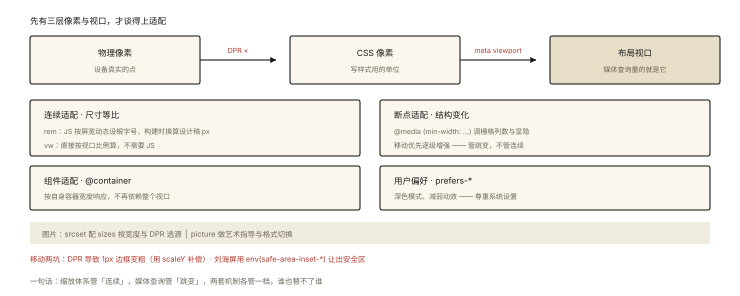

# CSS 深入之响应式设计

## 从「设计稿是 750 的，页面跑在 375 上」说起

移动端第一天，每个前端都会遇到这道题：

```
设计稿（iPhone 标注稿）：750px 宽，一个按钮标注 375px、字号 28px
页面跑在：375px 逻辑像素的真机 / 414px 的安卓 / 1024px 的平板
—— CSS 到底写多少？
```

这背后是移动端适配的完整问题域：**视口单位、设备像素比、动态 rem、媒体查询**。⭐ 「rem 适配方案」「1px 边框问题」「媒体查询断点」是响应式面试的三连发。

## 现象与直觉解释

先分清三组基础概念 ⭐：

```
物理像素（physical px）：屏幕真实的发光点数
逻辑像素 / CSS 像素（css px）：CSS 里写的就是它
设备像素比 DPR = 物理像素 / 逻辑像素（iPhone 3x：1 css px = 9 个物理点）

视口（viewport）：
布局视口 layout viewport：页面默认排版宽度（移动端默认 ~980px）
视觉视口 visual viewport：用户正在看到的区域
理想视口 ideal viewport：让布局视口 = 设备宽度 —— <meta name="viewport"> 干的事
```

```html
<!-- 没有 meta viewport：手机按 980px 排版再整体缩小 —— 字小到看不清 -->
<meta name="viewport" content="width=device-width, initial-scale=1">
<!-- 声明：布局视口 = 设备逻辑宽度 —— 一切移动适配的前提 -->
```

## 深入原理

### 一、相对单位全家福 ⭐⭐

| 单位 | 相对于 | 典型用途 |
|---|---|---|
| `px` | 绝对 | 边框、阴影 |
| `%` | 父级对应尺寸 | 流式布局 |
| `em` | **自身/父级** font-size（同属性看父、字体类看自身——易混） | 组件内比例 |
| `rem` | **根元素** font-size | 全局缩放体系 ⭐ |
| `vw/vh` | 视口宽/高的 1% | 全屏英雄区、无 JS 适配 |
| `vmin/vmax` | 视口较小/较大边 | 正方形自适应 |
| `dvh/svh/lvh` | 动态/小/大视口高（移动端地址栏问题） | 全屏容器 |

### 二、rem 适配方案：移动端的经典流水线 ⭐⭐

**原理**：根字号 = 屏幕宽度/设计稿等分数，元素尺寸全用 rem —— 屏幕变宽，根字号变大，所有元素等比放大。

```js
// 动态设置根字号（以 750 设计稿、等分 10 份为例）
function setRootFont() {
  const docEl = document.documentElement;
  const width = docEl.getBoundingClientRect().width;
  docEl.style.fontSize = (width / 10) + 'px';   // 375 屏 → 37.5px；750 屏 → 75px
}
setRootFont();
window.addEventListener('resize', setRootFont);
```

```css
/* PostCSS 插件（postcss-pxtorem）自动换算，开发时仍按设计稿 px 写 */
.btn { width: 375px; }   /* 自动转成 → width: 5rem（375/75）✅ 任何屏等比 */
```

**vw 方案（现代替代）**：`width: 50vw` 天然按视口比例，无需 JS 与根字号——`postcss-px-to-viewport` 把设计稿 px 自动转 vw。rem 派与 vw 派之争的实践结论：**新项目多用 vw，老项目 rem 存量巨大**；两者也可以混用（vw 做整体缩放 + rem 做字号）。

### 三、媒体查询：断点体系 ⭐⭐

```css
/* 移动优先（mobile-first）：默认样式 = 手机，逐级增强 ⭐ 推荐 */
.container { padding: 12px; }              /* 手机默认 */
@media (min-width: 768px) {                /* ≥768 平板 */
  .container { padding: 24px; max-width: 720px; }
}
@media (min-width: 1024px) {               /* ≥1024 桌面 */
  .container { padding: 32px; max-width: 960px; }
}

/* 常用断点（约定俗成）：480 手机 / 768 平板 / 1024 笔电 / 1440 大屏 */
/* 其他维度：orientation(横竖屏) / prefers-color-scheme(暗色) / prefers-reduced-motion */
@media (prefers-color-scheme: dark) { :root { --bg: #111; } }
@media (prefers-reduced-motion: reduce) { * { animation: none !important; } }
```

**「容器查询」一句话**（新特性）：`@container (min-width: 400px)` 按**父容器**宽度响应——组件级响应式的正确形态（卡片在宽栏 2 列、窄栏 1 列，与屏幕无关）。

### 四、响应式图片两件套 ⭐

```html
<!-- srcset + sizes：按 DPR 与视口宽度选最优图 -->


<!-- picture：艺术指导（不同屏裁剪不同图）+ 格式兜底 -->
<picture>
  <source type="image/avif" srcset="hero.avif">
  <source type="image/webp" srcset="hero.webp">
  
</picture>
```

### 五、三个移动端经典问题 ⭐⭐

**① 1px 边框问题**：DPR=3 的屏幕上 `border: 1px` 占 3 个物理像素——视觉偏粗。解法：伪元素 + `transform: scaleY(0.33)`（0.5 是 DPR=2 的值）。

**② 点击穿透/300ms 延迟**：历史问题已由现代浏览器解决（meta viewport 含 width=device-width 即禁用延迟）——只需知道「为什么以前慢」。

**③ 安全区适配（刘海屏）**：

```css
.safe-area { padding-bottom: env(safe-area-inset-bottom); }  /* 苹果底部横条 */
```

## 回看开篇

750 设计稿跑在 375 屏的答案：**等比缩放体系**——rem 方案按屏宽动态设根字号（或 vw 方案直接按视口比例），开发时按设计稿 px 写、构建时自动换算，375 屏上「按钮 375px 设计值」呈现为半个屏宽，与设计稿视觉比例一致。媒体查询负责**断点级**的结构变化（栅格列数、显隐），缩放体系负责**连续**的尺寸适配——两套机制各管一档。

## 实战延伸

**1. 面试答题骨架**：「响应式三板斧——viewport meta 把布局视口对齐设备宽度；相对单位体系（rem 按根字号配动态设置或 vw 按视口比例，构建工具自动换算设计稿 px）实现连续等比适配；媒体查询按断点做结构级调整，采用移动优先写法。配套能力包括 srcset/picture 响应式图片、prefers-* 系列用户偏好查询、容器查询实现组件级响应，移动端要注意 DPR 相关的 1px 边框与 safe-area 适配。」

**2. 「该用 rem 还是 px 做字号」的现代讨论**：正文建议用可缩放的相对单位+浏览器默认字号的倍数（如 `1rem=16px` 基准 + 用户字号偏好），标题与装饰性文本随意——「一刀切全 rem」会让老年模式（用户调大默认字号）失效，纯 px 则无法随用户偏好缩放。

## 图解总结



*图 · 三层像素与视口是前提，下面五层各管一档，别指望一套机制包打天下*

```
适配分层：
 物理像素 ←DPR×→ CSS 像素 ←meta viewport→ 布局视口
 连续适配（尺寸等比）: rem（JS动态根字号）| vw（原生视口比例）
 断点适配（结构变化）: @media (min-width: …) 移动优先增强
 组件适配: @container 容器查询（新）
 用户偏好: prefers-color-scheme / reduced-motion
 图片: srcset(w+sizes) | picture(艺术指导+格式)
 移动坑: 1px边框(scaleY) | safe-area(env())
```

## 总结

- 三组概念：物理/CSS 像素与 DPR、布局/视觉/理想视口、meta viewport 是适配前提；
- rem 方案（动态根字号 + 构建换算）与 vw 方案是连续适配两大主流；
- 媒体查询做断点级结构变化，移动优先；prefers-* 管用户偏好；@container 管组件级响应；
- srcset/sizes 与 picture 解决响应式图片；
- 移动端三坑：1px 边框（scaleY 补偿）、点击延迟（已历史化）、safe-area。

**面试一句话回答**：响应式适配分两层——连续的尺寸等比与断点的结构变化。前提是 meta viewport 把布局视口对齐设备宽度；尺寸层面用 rem 配合按屏宽动态设置根字号、或直接用 vw 视口单位，让构建工具把设计稿像素自动换算实现等比缩放；结构层面用媒体查询按断点做栅格与显隐调整并推荐移动优先写法；新能力包括容器查询实现组件级响应、prefers-color-scheme 等用户偏好查询；图片用 srcset 与 sizes 按宽度和 DPR 选源；移动端还需处理 DPR 导致的 1px 边框与刘海屏 safe-area 适配。

## 思考题

1. `width: 50%` 与 `width: 50vw` 什么情况下相等、什么情况下差很多？（父容器宽度 ≠ 视口时）
2. rem 方案下如何实现「字号跟随用户系统偏好」而其他尺寸仍按屏宽缩放？（提示：字号用不带换算的 rem、尺寸用换算的 rem —— 怎么区分两套基准？）
3. 写出移动优先的断点样式：卡片手机 1 列、平板 2 列、桌面 3 列——再用 `repeat(auto-fill, minmax())` 一行替代，比较两种方案的差异（显式断点 vs 内容驱动）。
4. 开放设计：一个「管理后台 + 营销页」混合项目，你会分别采用什么适配策略？说明理由（后台：桌面为主固定栅格 + min-width；营销：全响应式 + 视口单位）。

（思考题解析将同步录入小程序题库，关联本文 id：css-deep-009）

## 参考文献：

- MDN — [Viewport meta 标签](https://developer.mozilla.org/zh-CN/docs/Web/HTML/Viewport_meta_tag)、[使用媒体查询](https://developer.mozilla.org/zh-CN/docs/Web/CSS/CSS_media_queries/Using_media_queries)
- web.dev — Learn Design / Responsive images
- 《CSS 揭秘》相关章节
