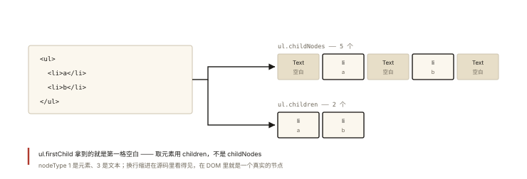
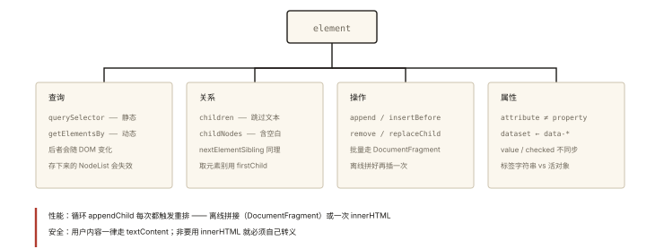

# DOM 与事件之 DOM 树、节点类型与常用 API

## 从「插入 1000 个节点卡了 3 秒」说起

> **系列导读**：《DOM 与事件系列》共 6 篇——DOM 结构、事件流、事件对象、事件委托到观察者 API，把「页面交互的地基」讲透。

```js
// 渲染 1000 条列表：直觉写法
for (let i = 0; i < 1000; i++) {
  const li = document.createElement('li');
  li.textContent = `第 ${i} 条`;
  list.appendChild(li);        // ⚠️ 每次都可能触发重排重绘 —— 卡顿元凶
}

// 优化写法：离线拼接，一次挂载
const frag = document.createDocumentFragment();
for (let i = 0; i < 1000; i++) {
  const li = document.createElement('li');
  li.textContent = `第 ${i} 条`;
  frag.appendChild(li);        // 在"文档碎片"里拼 —— 不碰真实 DOM
}
list.appendChild(frag);        // 一次性上树 ✅
```

⭐ DOM 是「JavaScript 通往页面的桥」——这篇讲清它的结构模型、节点家族与高频 API 的性能差异。

## 现象与直觉解释

**DOM（Document Object Model）**：浏览器把 HTML 解析成一棵**对象树**，JS 通过操作这棵树来改变页面。



*图 · 你在源码里敲的换行，在 DOM 里是一个真节点*

```
document
 └── html (Element)
      ├── head (Element) ── title (Element) ── "标题" (Text)
      └── body (Element)
           ├── h1 (Element) ── "Hello" (Text)
           └── ul (Element)
                ├── li (Element) ── "a" (Text)
                └── li (Element) ── "b" (Text)
```

**HTML 是文本，DOM 是对象**——标签变成节点对象，属性变成对象属性，树形嵌套变成父子引用。

## 深入原理

### 一、节点类型家族 ⭐

| 类型 | nodeType | 说明 |
|---|---|---|
| 元素节点 | 1 (ELEMENT_NODE) | 标签 |
| 文本节点 | 3 (TEXT_NODE) | 标签之间的文字（含换行空白！） |
| 注释节点 | 8 (COMMENT_NODE) | `<!-- -->` |
| 文档节点 | 9 (DOCUMENT_NODE) | document 本身 |
| 文档碎片 | 11 (DOCUMENT_FRAGMENT_NODE) | 离线容器（开篇主角） |

**「空白文本节点」的坑** ⭐：HTML 源码里的换行缩进都是文本节点——`ul.firstChild` 可能是空白文本而不是第一个 li！安全取法：`children`（只取元素）而非 `childNodes`（含文本/注释）。

### 二、查询 API 的两代对照 ⭐

```js
// 现代首选（都返回【静态】集合或单个元素）
document.querySelector('.item');        // CSS 选择器，第一个
document.querySelectorAll('.item');     // NodeList（静态快照）—— 可直接 forEach

// 经典家族
document.getElementById('x');           // 最快（id 索引）
document.getElementsByClassName('a');   // HTMLCollection【动态】⚠️
document.getElementsByTagName('li');    // HTMLCollection【动态】⚠️

// ⭐ 动态 vs 静态的经典陷阱：
const lis = document.getElementsByTagName('li');
console.log(lis.length);        // 3
document.body.appendChild(document.createElement('li'));
console.log(lis.length);        // 4 ❗ 自动更新（活在文档上的"实时视图"）
// querySelectorAll 返回的是快照 —— 循环中增删节点时行为完全不同！
```

### 三、节点操作四件套 ⭐⭐

```js
// 增
const div = document.createElement('div');
div.id = 'box';
parent.appendChild(div);          // 尾部
parent.insertBefore(div, ref);    // ref 前面
parent.append('文本', anotherEl); // 现代版：可混插文本、多参数

// 删
el.remove();                      // 现代版 ✅（老 API: parent.removeChild(el)）

// 改（替换）
parent.replaceChild(newEl, oldEl);

// 查（关系）
el.parentElement;   el.children;      el.previousElementSibling;
el.firstElementChild;                  el.nextElementSibling;
// ⚠️ 认准带 Element 的版本（跳过文本节点）；不带的是 childNodes/nextSibling 等（含空白文本）
```

### 四、属性与数据的三个层次 ⭐⭐

```js
// ① HTML 属性（attribute）：写在标签上的【字符串】
el.getAttribute('href');
el.setAttribute('data-id', '7');
el.hasAttribute('disabled'); el.removeAttribute('disabled');

// ② DOM 属性（property）：JS 对象上的【任意类型】—— 与 attribute 大多同名同步，但有例外
el.href;              // 完整 URL（attribute 是相对路径原样）
el.checked = true;    // property 变了，attribute 不一定变（checked/value 是著名不同步对）
el.className;         // ↔ class attribute（class 是保留字所以改名）

// ③ dataset：data-* 的官方通道
<div data-user-id="7" data-role="admin">
el.dataset.userId;    // '7'（连字符转驼峰）
el.dataset.role;      // 'admin'

// React 的受控/非受控组件之争，根源就是 value 这对 attribute/property 的同步差异
```

### 五、innerHTML vs createElement：三笔账 ⭐⭐

```js
// 方式一：innerHTML 字符串拼接
list.innerHTML = items.map((x) => `<li>${x.name}</li>`).join('');

// 方式二：createElement 逐个构建
items.forEach((x) => {
  const li = document.createElement('li');
  li.textContent = x.name;
  list.appendChild(li);
});
```

| 维度 | innerHTML | createElement |
|---|---|---|
| 写入速度 | 快（一次解析） | 大量节点时慢 |
| **安全** | ❌ XSS 风险（用户内容必须转义） | ✅ textContent 天然安全 |
| 内存 | 全量替换，丢失已有节点状态 | 可复用节点 |
| 事件 | 全部丢失（节点重建） | 已绑定监听保留 |

**安全红线**：`innerHTML` 里插入任何用户输入都是 XSS 入口（《security-001》）——用户内容一律 `textContent` 或严格转义。**性能红线**：循环里逐个 appendChild → 用 DocumentFragment 或 innerHTML 一次性写入（开篇的两种正解）。

## 回看开篇

1000 节点卡顿的根因：**每次 appendChild 都是一次潜在的样式失效→布局→绘制**（渲染管线见《rendering-001》）。DocumentFragment 的价值：**离线容器**（不挂在文档树上、改它不触发渲染），拼装完一次性上树——「批处理」思想在 DOM 操作上的体现（虚拟 DOM 本质上把这种批处理自动化了，《handwritten-008》）。

## 实战延伸

**1. 面试答题骨架**：「DOM 是 HTML 解析出的对象树，节点分元素/文本/注释/文档/碎片五类，children 只取元素而 childNodes 含空白文本节点；查询用 querySelector 全家（静态 NodeList），注意 getElementsBy* 返回动态 HTMLCollection 在循环增删时行为不同；attribute 是标签字符串、property 是 JS 对象属性，value/checked 存在同步差异；大量节点操作用 DocumentFragment 离线拼接或 innerHTML 一次写入，但 innerHTML 拼用户内容有 XSS 风险，用户数据必须 textContent。」

**2. 快手题**：`el.children.length` 与 `el.childNodes.length` 什么时候相等？（只有元素节点、无文本注释时——标签连写不换行）。

## 图解总结



*图 · 四类 API 各自解决一个问题，混着背必然乱*

```
document（树根）
 └ 树 = 节点（元素1/文本3/注释8/文档碎片11）
      查询: querySelector*（静态）| getElementsBy*（动态⚠️）
      关系: children/nextElementSibling（跳过文本）| childNodes（含空白）
      操作: append/insertBefore/remove/replaceChild
      属性: attribute（标签字符串）≠ property（对象属性，value/checked 不同步）
            dataset ← data-* 驼峰通道
      性能: 离线拼接（DocumentFragment）| 一次 innerHTML | 循环 appendChild ❌
      安全: 用户内容 → textContent；innerHTML 必转义
```

## 总结

- DOM = HTML 的对象树；五类节点；children 与 childNodes 的空白文本差异；
- querySelector 静态 vs getElementsBy 动态——循环增删时行为分水岭；
- attribute（标签字符串）与 property（对象属性）两层；data-* 走 dataset；
- 批量操作：DocumentFragment 离线拼装或一次性 innerHTML；循环 appendChild 是反模式；
- innerHTML 拼 HTML 有 XSS 风险，用户内容用 textContent。

**面试一句话回答**：DOM 是浏览器把 HTML 解析成的对象树，节点分为元素、文本、注释、文档与文档碎片几种类型，children 与 elementSibling 系列只取元素节点而 childNodes 系列会包含空白文本节点；查询上 querySelectorAll 返回静态快照、getElementsBy 系列返回随文档实时更新的动态集合，在循环中增删节点时行为完全不同；标签上的 attribute 是字符串、DOM 对象的 property 是任意类型，value 与 checked 等存在两者不同步的著名差异；批量渲染应使用 DocumentFragment 离线拼接或一次性 innerHTML 写入避免反复触发重排，而 innerHTML 拼接用户内容有 XSS 风险，用户数据应一律使用 textContent。

## 思考题

1. 为什么 `getElementsByClassName` 在「边遍历边删除」时会漏删元素？用「动态集合」解释，并给出两种修复（倒序遍历 / 转静态数组）。
2. `el.setAttribute('value', 'x')` 与 `el.value = 'x'` 对 input 的表现差异？输入框被用户改过之后呢？
3. 手写 `renderList(container, items)`：支持增量更新（复用旧 li、只改文本）——对比全量 innerHTML 的性能与节点状态保留差异。
4. 开放讨论：虚拟 DOM 解决了本篇的哪些问题（批处理、心智），又没解决哪些（innerHTML 的一次解析仍更快）？

（思考题解析将同步录入小程序题库，关联本文 id：dom-events-001）

## 参考文献：

- MDN — [DOM 概述](https://developer.mozilla.org/zh-CN/docs/Web/API/Document_Object_Model)
- 《JavaScript DOM 编程艺术》（入门经典）
- 本课程《rendering-001 渲染管线》《handwritten-008 虚拟 DOM》
