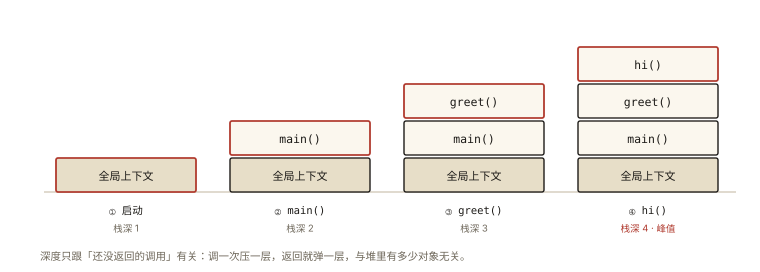

# JavaScript 深入之执行上下文栈

> **系列导读**：《JavaScript 深入系列》共 12 篇，目标是把「JavaScript 代码到底是怎么跑起来的」这条主线讲透：从执行上下文出发，途经变量对象、作用域、闭包、this，再到原型与继承，最后用总串讲（第 11 篇）和综合面试题精讲（第 12 篇）收束。建议按序阅读——后面每一篇都以前面的机制为地基；每篇的示例代码都值得亲手跑一遍，报错信息也是学习资料。本篇是第 1 篇，讲一切机制运转的舞台：执行上下文栈。

## 从一段「能跑又不能跑」的代码说起

先写一个再普通不过的递归求和：

```js
function sumTo(n) {
  if (n === 1) return 1; // 递归出口
  return n + sumTo(n - 1);
}

console.log(sumTo(3)); // 6，没问题
console.log(sumTo(10)); // 55，没问题
console.log(sumTo(100000));
// Chrome / Node：Uncaught RangeError: Maximum call stack size exceeded
// Firefox 的措辞不同：InternalError: too much recursion
```

同一段代码，喂小数据岁月静好，喂大数据直接抛异常。三个问题随之浮出水面：

1. 报错里的 **call stack（调用栈）** 到底是什么？
2. 为什么参数一大，程序就「爆栈」？这个上限是谁定的？
3. 函数层层调用之后，引擎凭什么知道「该回到哪一行继续执行」？

要回答这些，得先认识本文的主角——**执行上下文（Execution Context）**，以及管理它的**执行上下文栈（Execution Context Stack）**。⭐ 面试高频指数：★★★★（执行上下文是理解作用域、闭包、this 的总开关）

## 现象与直觉解释

直觉上可以这么理解：引擎手里有个账本，每调用一个函数就记一笔「谁在等我返回」，函数返回了就划掉这一笔。递归调用 100000 次，就是 100000 笔账同时挂着，账本写满了，于是抛错。

这个直觉方向是对的，但经不起追问：

- 「一笔账」具体记了什么？只有函数名吗？
- 账本什么时候记账、什么时候销账？
- 最外层还有没有人记账？程序从哪儿开始记？
- 「写满」的上限是多少？为什么换个浏览器、换个函数，能承受的层数还不一样？

下面进入原理部分，把这些问号一个一个填平。

## 深入原理

### 一、可执行代码的三种类型

JavaScript 引擎并不把所有代码一视同仁。规范（ECMA-262）对「可执行代码」做了分类，ES3 时代是三类，ES2015 起增加了第四类：

1. **全局代码（global code）**：不属于任何函数体的代码。程序启动后最先执行的就是它，也是整个调用栈的起点；
2. **函数代码（function code）**：函数体里的代码。注意，哪怕一个函数嵌套写在另一个函数内部，它的函数体也是一段独立的「函数代码」——调用它时，进入的是它自己的执行环境，与外层函数无关；
3. **eval 代码（eval code）**：传给 `eval()` 的字符串。它执行时同样有对应的上下文，而且直接调用的 `eval` 还能看见调用处的环境——这也是它危险且难以被引擎优化的原因之一；
4. **模块代码（module code，ES2015+）**：一个 ES Module 的顶层代码。本文按经典三类展开，模块代码的差异不影响主干结论，碰到时知道它同属「可执行代码」即可。

分类的意义在于一句话：**每进入一类可执行代码，引擎就会为它创建一个执行上下文**。

### 二、执行上下文：代码运行的随身行李

**执行上下文是引擎为一段可执行代码准备的执行环境**，可以理解成代码运行时随身携带的行李箱：变量放在哪、外层环境是谁、this 指向谁、执行到了哪一行，全都记录在里面。

按 ES3 的经典说法，一个执行上下文包含三样东西：

- **变量对象（VO, Variable Object）**：存放该上下文中的变量和函数声明——这是本系列第 2 篇《变量对象》的主角；
- **作用域链**：变量查找的路线图——本系列第 4 篇《作用域链》展开；
- **this**：本轮代码执行时的「主人」——本系列第 6 篇《this》展开。

> 术语演进提示：ES5 之后规范不再使用「变量对象」这个词，改用**词法环境（LexicalEnvironment）/ 变量环境（VariableEnvironment）**等组件来描述，职责与 ES3 的 VO/AO 一脉相承。社区教程（包括本系列沿用的讲法）常继续借 VO/AO 讲概念，读规范时知道这层对应关系即可。

这只行李箱里装的三样东西，撑起了本系列后面的整整十篇文章。本文先把舞台本身看清楚——行李箱是怎么被摆放和回收的。

### 三、执行上下文栈：一场完整的压栈出栈演示 ⭐

规范规定：**同一时刻，一个执行上下文栈上最多只有一个上下文在真正执行代码**，称为「运行中的执行上下文」；它永远位于栈顶。这个栈就是**执行上下文栈**，也就是日常所说的**调用栈（call stack）**。

运转规则只有三条：

1. 程序启动，**全局上下文**入栈，从此垫在栈底；
2. 每次函数调用（函数体开始执行时），该函数的上下文入栈，成为新的栈顶；
3. 函数执行完毕（`return` 或执行到函数体末尾），它的上下文出栈，栈顶交还给下方的上下文继续执行。

规范还专门强调：**即使函数递归调用自己，每一次调用也会创建新的执行上下文**——这句话正是后文栈溢出的伏笔。

看一段嵌套调用，对照下方逐步观察栈的变化：

```js
function hi(name) {
  return 'Hi, ' + name;
}

function greet(name) {
  return hi(name) + '!'; // greet 内部调用 hi
}

function main() {
  const msg = greet('JavaScript'); // main 内部调用 greet
  console.log(msg); // "Hi, JavaScript!"
}

main(); // 全局代码里调用 main
```

压栈阶段（函数逐层调用，栈越来越深）：



*图 · 四个连续时刻：每调一层压一层，朱砂描边的永远是正在执行的那一层（栈顶）*

```
步骤① 程序启动，全局上下文入栈（此后一直垫底）

┌──────────────────┐
│    全局上下文     │ ← 栈底
└──────────────────┘

步骤② 执行 main()，main 的函数上下文入栈

┌──────────────────┐
│   main 的上下文   │ ← 栈顶：正在执行
├──────────────────┤
│    全局上下文     │
└──────────────────┘

步骤③ main 里调用 greet()，greet 的上下文入栈

┌──────────────────┐
│   greet 的上下文  │ ← 栈顶：正在执行
├──────────────────┤
│   main 的上下文   │ ← 被压住，等 greet 返回
├──────────────────┤
│    全局上下文     │
└──────────────────┘

步骤④ greet 里调用 hi()，hi 的上下文入栈，栈深达到峰值 4

┌──────────────────┐
│    hi 的上下文    │ ← 栈顶：正在执行
├──────────────────┤
│   greet 的上下文  │
├──────────────────┤
│   main 的上下文   │
├──────────────────┤
│    全局上下文     │ ← 栈底
└──────────────────┘
```

出栈阶段（后进先出：最后进来的最先离开）：

```
步骤⑤ hi 返回 "Hi, JavaScript"，hi 出栈，greet 回到栈顶继续拼上 '!'

┌──────────────────┐
│   greet 的上下文  │ ← 栈顶：恢复执行
├──────────────────┤
│   main 的上下文   │
├──────────────────┤
│    全局上下文     │
└──────────────────┘

步骤⑥ greet 返回，出栈；main 回到栈顶，执行 console.log(msg)
        （console.log 自身也会短暂压栈出栈，随后栈回到本图状态）

步骤⑦ main 执行完毕，出栈，回到只剩全局上下文的空闲状态

┌──────────────────┐
│    全局上下文     │ ← 页面存活期间常驻栈底
└──────────────────┘
```

四个值得咂摸的细节：

- **后进先出**：最后被调用的 `hi` 最先执行完——调用栈是最标准的栈结构；
- **被压住的函数没有消失**：`greet` 在栈顶执行时，`main` 只是暂停等待，它的局部变量、执行到了哪一行，都完好保存在自己的上下文里——这就是函数返回后「知道从哪继续」的原因；
- **全局上下文常驻栈底**：浏览器里，只要页面还在，全局上下文就一直在栈底。脚本全部执行完、再无函数上下文压在上面时，调用栈就处于「空闲」状态，事件循环才能安排下一件事（异步调度的细节在 P2 阶段的事件循环篇展开）；
- **栈深 = 同一时刻挂起的调用数**：上面的例子栈深不过 4；而 `sumTo(100000)` 需要 100000 个尚未返回的调用同时挂在栈上——难怪要爆。



*图 · 一段嵌套调用的完整压栈过程——栈顶（红框）永远是「正在执行」的上下文*

### 四、栈溢出与递归：Maximum call stack size exceeded ⭐

栈不是无限大的。每个执行上下文都要占用一块内存（参数、局部变量、返回地址等），而引擎分配给调用栈的内存有上限。当压入的上下文超出上限，就抛出 `RangeError: Maximum call stack size exceeded`（Firefox 的说法是 `too much recursion`）。

关于爆栈，有三个工程事实：

1. **上限因引擎、平台而异**，没有「递归 N 层必炸」的统一数字；同一引擎里，单个上下文占多大也随函数的参数和局部变量数量浮动，换个函数再测就不一样；
2. **爆栈不一定源于你亲手写的递归**。`JSON.stringify` 序列化嵌套极深的对象、扁平化超深嵌套的数组、框架对循环引用的数据做递归处理，都可能触发同一个报错。看到这条错误，第一反应应该是「哪条调用链过深」，而不是「我没写递归啊」；
3. **它是一个普通的 RangeError**，`try/catch` 能捕获，但捕获不解决根因。

顺手做个实验，量一量当前引擎给你的栈有多深：

```js
function measureDepth(n) {
  try {
    return measureDepth(n + 1); // 不断压栈，直到爆
  } catch (e) {
    return n; // 最深一层捕获到 RangeError，返回当时的层数
  }
}

console.log(measureDepth(0));
// Chrome / Node：数量级通常在一万多层；Safari 明显更深
// 给函数多加几个局部变量再测，数值会变小 —— 单个上下文变大了
```

（结果每次运行有波动，也随函数形态变化，别把具体数字当常量去背。）

解法方向只有两个：**减少同时挂起的调用数**（改成循环迭代），或**让每次调用尽快返回**（尾调用）。ES2015 规范定义了尾调用优化（PTC），Safari 已经落地，但 Chrome/V8 出于调试栈信息与安全性的考虑没有正式启用——所以跨浏览器的生产代码不能指望它，**老老实实改成循环**才是通用解。

## 回看开篇问题

现在可以完整解释 `sumTo(100000)` 之死了：

1. `sumTo(100000)` 尚未返回，就要先等 `sumTo(99999)` 的结果——它的上下文必须留在栈上；
2. 依此类推，100000 → 99999 → … → 1，每一层都挂着不返回，调用栈深度一路逼近 100000；
3. 引擎分配的栈内存装不下这么多上下文，压栈失败，抛出 `RangeError: Maximum call stack size exceeded`；
4. `n = 3` 时栈深只有 3，自然安然无恙。**同样的代码，命运取决于「同一时刻挂起的调用数」，而不是代码本身写没写错。**

修复思路就是把「挂起 N 层」改成「一路走一路加」：

```js
// 迭代版：无论 n 多大，栈上始终只有 1 个函数上下文
function sumToIter(n) {
  let sum = 0;
  for (let i = 1; i <= n; i++) sum += i;
  return sum;
}

console.log(sumToIter(100000)); // 5000050000，稳

// 数学版：一步到位（高斯：谢谢）
console.log((100000 * 100001) / 2); // 5000050000
```

递归不是罪，**没有出口的递归、深度不受控的递归**才是。写递归前先问自己两件事：出口条件一定可达吗？数据规模会不会把栈压垮？

## 实战与延伸

### 1. 亲手「看见」调用栈

- DevTools 的 Sources 面板打断点，右侧的 **Call Stack 面板**展示的就是此刻的执行上下文栈，还能逐帧跳转查看每层的状态；
- 代码里调 `console.trace()` 会打印当前调用链，排查「这个函数到底被谁调用了」非常顺手：

```js
function c() {
  console.trace(); // 打印 c ← b ← a ← 全局 的完整链路
}
function b() { c(); }
function a() { b(); }
a();
```

- `new Error().stack` 能拿到字符串形式的调用栈（长期以来是事实标准，各引擎格式略有差异），适合埋进日志上报；
- Node 环境还可以用 `node --stack-size=...`（单位 KB）调大栈空间应急，但这是治标，深度失控的根因还在。

### 2. 调用栈被占住，页面就「死」了

JavaScript 主线程只有一个调用栈（Web Worker 是另开线程、另开调用栈，不改变主线程的事实）。一段同步代码不返回，它的上下文就一直压在栈顶，事件循环无法继续派活——按钮不响应、动画冻结、渲染停止，全都因为「舞台被占了」。

顺带纠正一个常见误解：`setTimeout(fn, 0)` 的回调**不是注册时入栈，而是轮到它执行时才入栈**。注册动作只是把任务挂到任务队列；等主线程调用栈空闲，事件循环才会把 `fn` 压上调用栈。完整调度机制在 P2 阶段的事件循环（Event Loop）篇展开。

### 3. 一个现代例外：生成器与 async 函数

「函数上下文从压栈到出栈一直占着栈」对普通函数成立，但生成器和 `async` 函数是例外：执行到 `yield` / `await` 时，它们的上下文会**先出栈**，把主线程让出来；恢复执行时再**重新压栈**。所以成千上万个挂起的 Promise 并不会撑爆调用栈——挂起的执行状态住在堆里，不住在栈上。

### 4. 排查栈溢出的三步法

1. 看报错堆栈里**最靠上的、属于你自己代码的那一帧**，锁定是哪条调用链过深；
2. 检查递归出口：是否可达？数据是否循环引用（A 引用 B、B 又引用 A，递归遍历就永远出不来）？
3. 深度可能失控的场景（超深嵌套结构、层数由用户输入决定），优先用显式栈/队列改写成迭代。

## 图解总结

```
      可执行代码：全局代码 / 函数代码 / eval 代码（ES2015+ 另有模块代码）
                              │ 进入时
                              ▼ 创建
                  ┌─────────────────────┐
                  │      执行上下文       │
                  │  · 变量对象（词法环境）│ ──▶ 第 2 篇《变量对象》
                  │  · 作用域链          │ ──▶ 第 4 篇《作用域链》
                  │  · this             │ ──▶ 第 6 篇《this》
                  └──────────┬──────────┘
                             │ 压栈
                             ▼
        执行上下文栈   ┌────────────────┐
        （调用栈）     │  函数上下文 N    │ ← 栈顶：正在执行
                      ├────────────────┤   函数调用 → 压栈
                      │  ……            │   函数返回 → 出栈
                      ├────────────────┤
                      │  全局上下文     │ ← 栈底：页面存活期间常驻
                      └────────────────┘
                             │ 深度超出引擎上限
                             ▼
          RangeError: Maximum call stack size exceeded
```

## 总结

- 规范把可执行代码分为**全局代码、函数代码、eval 代码**（ES2015 起另有模块代码）；**每进入一段可执行代码，就创建一个执行上下文**，递归调用自己也不例外；
- 执行上下文里装着变量对象、作用域链和 this（ES5+ 规范对应为词法环境等组件），它是后续理解变量提升、作用域、闭包、this 的共同地基；
- 所有活跃上下文构成**执行上下文栈**：全局上下文垫底，函数调用压栈、执行完出栈，**栈顶即正在执行**的上下文，后进先出；
- 调用栈容量有限，**同一时刻挂起的调用过多**就会抛出 `RangeError: Maximum call stack size exceeded`；通用解法是改写成迭代，不能依赖尾调用优化。

**面试一句话回答**：JavaScript 引擎用执行上下文栈管理代码执行——进入可执行代码（全局/函数/eval）就创建执行上下文并压栈，全局上下文在栈底、当前执行的上下文在栈顶，函数调用压栈、执行完出栈；栈的容量有限，深度失控的递归会不断压栈直至抛出 RangeError: Maximum call stack size exceeded，而每个上下文里装的变量对象、作用域链和 this，正是理解作用域、闭包、this 的钥匙。

栈的舞台搭好了，聚光灯该照向舞台中央：上下文里的变量到底是怎么存放的？函数为什么能「先使用、后定义」？下一篇——本系列第 2 篇《变量对象》，我们推开执行上下文的行李箱看个究竟。

## 思考题

1. 写出下面代码的输出顺序，并画出每一条 `console.log` 执行时的调用栈：

```js
function a() {
  console.log('a 开始');
  b();
  console.log('a 结束');
}
function b() {
  console.log('b 开始');
  c();
  console.log('b 结束');
}
function c() {
  console.log('c 执行');
}
a();
```

2. 主线程上一段同步的 `while (true) {}` 会让页面卡死，连按钮都点不动。请从「执行上下文栈」的角度解释：卡死时调用栈处于什么状态？点击事件的处理函数为什么迟迟进不了栈？

3. 有人写了 `function f(n) { return n <= 1 ? 1 : n * f(n - 1); }`，认为「只要加了出口条件就永远不会栈溢出」。这个说法对吗？什么情况下它依然会爆栈？ES2015 的尾调用优化能指望吗？

4. 开放设计：实现 `flattenDeep(arr)`，把任意深度嵌套的数组拍平成一维，要求**不因嵌套深度过大而爆栈**（提示：用显式栈或队列模拟递归过程，把「深度」从调用栈搬到堆上）。

（思考题解析将同步录入小程序题库，关联本文 id：js-deep-001）

## 参考文献

- ECMA-262（ES3）§10「Executable Code and Execution Contexts」——可执行代码分类与执行上下文的经典定义
- ECMA-262 现行版本同名章节（各版本章节号有调整，现行规范明确使用 execution context stack 一词）
- MDN — [Call stack](https://developer.mozilla.org/en-US/docs/Glossary/Call_stack)
- MDN — [RangeError: Maximum call stack size exceeded](https://developer.mozilla.org/en-US/docs/Web/JavaScript/Reference/Errors/Stack_overflow)
- 《JavaScript 高级程序设计（第 4 版）》作用域与内存相关章节
- 冴羽《JavaScript 深入之执行上下文栈》
