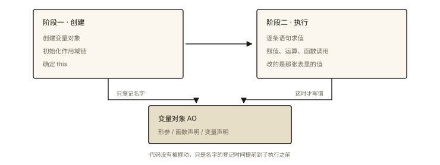
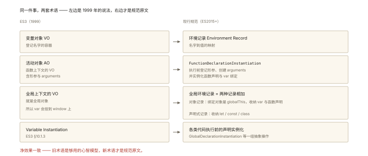

# JavaScript 深入之变量对象

## 从一段"时序错乱"的代码说起

先看一段代码，不运行，猜猜三次输出：

```js
sayHi();               // ① 输出什么？
console.log(nickname); // ② 输出什么？

var nickname = '小明';

function sayHi() {
  console.log('你好，' + nickname);
}

var sayHi = function () {
  console.log('再见，' + nickname);
};

sayHi();               // ③ 输出什么？
```

实际输出（Node 与浏览器一致）：

```text
你好，undefined
undefined
再见，小明
```

三个"意外"：

- ① `sayHi` 还没在源码里"出现"，为什么就能调用？而且调用的分明是**上面那个函数声明**的版本？
- ② `nickname` 为什么不报 ReferenceError，而是 `undefined`？
- ③ 同名的函数声明和 `var sayHi`，最终谁说了算？

⭐ 面试高频指数：★★★★★——「变量提升 / 函数提升」几乎是 JS 面试的必考开场，而它背后的机制就叫**变量对象**。读完本文，你不仅能推出任何一道提升题的答案，还能讲清它和现行规范里「词法环境」的对应关系。

## 现象与直觉解释

最常见的说法是「提升（hoisting）」：JavaScript 引擎会把 `var` 声明和函数声明"提升"到作用域顶部。

这个直觉能解释一部分现象（为什么能先调用后定义），但细问三层就露馅了：

1. 同样号称"提升"，**函数声明**提升后就能直接调用，**var 变量**提升后只有 `undefined`，**函数表达式**提前调用反而报 `TypeError`——三种截然不同的结果，"提升"两个字解释不了；
2. 函数声明和 `var` 同名时，`var` 不会把函数打回 `undefined`；两个同名函数声明，后者覆盖前者。凭什么规则如此精确？
3. "提升"这个动作发生在什么时刻？代码真的被引擎物理地挪到前面了吗？

并没有。真正的答案是：**声明根本不是在代码执行到那一行时处理的，而是在执行上下文被创建的那一刻集中处理的**。处理有一套固定的顺序和覆盖规则，处理结果存进一个数据容器——变量对象（Variable Object，VO）。

## 深入原理

### 1. 两阶段模型：先搭骨架，再逐行执行

本系列第 1 篇《JavaScript 深入之执行上下文栈》讲过：每段代码都运行在执行上下文里，上下文随调用入栈出栈。每个上下文的一生分两个阶段：



*图 · 两个阶段动的是同一张表，只是阶段一只碰键、阶段二才碰值*

```
函数被调用 / 脚本开始执行
        │
        ▼
┌────────────────────────────────┐    ┌────────────────────────────────┐
│ 阶段一：创建（进入执行上下文）     │    │ 阶段二：执行（逐行跑代码）        │
│  · 创建变量对象 ← 本文主角        │ ─▶ │  · 逐条语句求值                  │
│  · 初始化作用域链                │    │  · 赋值、运算、函数调用……         │
│  · 确定 this                    │    │   （改写的是变量对象里的属性值）   │
└────────────────────────────────┘    └────────────────────────────────┘
```

（作用域链见本系列第 4 篇，this 见本系列第 6 篇，本文只管第一格。）

**变量对象**就是上下文中登记"本上下文有哪些名字"的容器：形参、函数声明、变量声明都记在这里。所谓"提升"，只是声明在阶段一就被处理了——一行代码还没执行，名字们已经各就各位。**代码没有被移动，是处理时机提前了。**

变量对象在不同上下文里有不同身份：

- **全局上下文**：变量对象就是全局对象——浏览器里的 `window`（Node 里是 `global`）。这也是为什么全局 `var` 声明的变量会成为 `window` 的属性；
- **函数上下文**：变量对象有个专名——**活动对象（Activation Object，AO）**。进入函数上下文时创建，比全局 VO 多两样东西：**形参**和 **arguments 对象**。

AO 和 VO 本质是同一个东西的两种叫法：讨论函数内部行为时习惯说 AO，讨论通用模型时说 VO。下面统一用 AO 举例。

### 2. 三条填充规则：形参 → 函数声明 → 变量声明 ⭐

ES3 规范 §10.1.3（Variable Instantiation）规定了创建阶段的处理顺序，翻译成人话是三条规则：

1. **处理形参**：以形参名为属性名登记进 AO，属性值为对应实参；没传的形参值为 `undefined`；
2. **处理函数声明**：以函数名为属性名、**整个函数对象**为属性值登记进 AO；**若同名属性已存在，整体覆盖**；
3. **处理变量声明**：以变量名为属性名、`undefined` 为属性值登记进 AO；**若同名属性已存在，什么都不做**（不重置值）。

先用一道能同时考察三条规则的经典题走一遍流程 ⭐：

```js
function fn(a) {
  console.log(typeof a); // ①
  var a = 1;
  console.log(a);        // ②
  function a() {}
  console.log(typeof a); // ③
}
fn(0);
// 输出：'function'、1、'number'
```

创建阶段，AO 的快照一步步变成：

```
进入函数上下文：AO = { arguments: <Arguments 对象> }
第 1 步（形参 a = 0）：   AO = { arguments: …, a: 0 }
第 2 步（函数声明 a）：    a 已存在 → 整体覆盖
                        AO = { arguments: …, a: function a(){} }
第 3 步（var a）：        a 已存在 → 跳过，不重置为 undefined
```

然后才进入执行阶段逐行跑：① `typeof a` → `'function'`（读到函数声明）；`var a = 1` 执行到这一行才赋值为 1（**声明在创建阶段，赋值在执行阶段**）；② 输出 `1`；函数声明那行在执行阶段无事发生（创建阶段已处理完）；③ `'number'`。三条规则全部出场。

再看三道高频同名覆盖例题 ⭐。

**例题一：var 与函数声明同名（出现率最高）**

```js
console.log(foo); // ① 打印出函数对象（Node 显示 [Function: foo]，Chrome 显示 ƒ foo()）
var foo = 1;
console.log(foo); // ② 1
function foo() {}
console.log(foo); // ③ 1
```

创建阶段：函数声明先登记（foo = 函数对象）；`var foo` 发现重名，跳过。执行阶段：① 打印函数对象；`foo = 1` 执行期赋值；② 打印 `1`；函数声明行无事发生；③ 还是 `1`。

**例题二：光秃秃的 var 不会把函数打回 undefined**

```js
console.log(bar); // 打印出函数对象，而不是 undefined
function bar() {}
var bar;
console.log(bar); // 仍然是那个函数对象
```

`var bar` 只有声明没有赋值：创建阶段遇同名跳过，执行阶段也没有赋值动作——bar 自始至终是那个函数。很多人误以为"var 提升也会覆盖"，规则三明确说了：**跳过**。

**例题三：两个同名函数声明，后者胜**

```js
baz(); // 输出 2
function baz() { console.log(1); }
function baz() { console.log(2); }
```

函数声明按源码顺序逐个登记，后登记的覆盖先登记的。创建阶段结束时，baz 已经是第二个函数。

一句话记忆：**函数声明是"覆盖式"登记，变量声明是"让位式"登记；赋值永远等执行阶段。**

### 3. 函数声明与函数表达式的提升差异 ⭐

```js
calc();  // '函数声明' —— 创建阶段就已整体就绪
sugar(); // TypeError: sugar is not a function

function calc() {
  console.log('函数声明');
}

var sugar = function () {
  console.log('函数表达式');
};
```

`sugar` 的情况拆开看：`var sugar = function () {...}` 是一条赋值语句——左边的 var 声明在创建阶段只登记了名字（`undefined`），右边的函数对象要等这行**执行时**才被创建并赋值。所以「函数表达式也会提升」只对了一半：**提升的只是那个 var 名字，函数本体没有**。这就是声明与表达式提升差异的全部真相，也是 `TypeError`（而不是 `ReferenceError`）的原因——名字存在，值还不是函数。

顺带一个常被问到的细节——**命名函数表达式**的名字只在函数体内部可见：

```js
var f = function named() {
  console.log(typeof named); // 'function' —— 函数名仅在函数体内可用
};
f();                      // 'function'
console.log(typeof f);    // 'function'
console.log(typeof named); // 'undefined' —— 外部作用域根本没有这个名字
```

它长得像函数声明，但本质是表达式：宿主作用域只登记了 `f`，`named` 不会被登记，自然也不参与"覆盖"。

### 4. ES3 的「变量对象」与现行规范的「词法环境」⭐

到这里你可能发现：「变量对象」「活动对象」讲得很顺，但去查现行规范（ECMA-262 2015 之后）却搜不到这两个词——因为它们是 **ES3（1999 年）时代的规范术语**。ES5 起规范更换了描述模型：执行上下文改由**词法环境（Lexical Environment）/ 变量环境（Variable Environment）+ 环境记录（Environment Record）**描述。两套术语的对应关系：



*图 · ES3 变量对象与现代词法环境的对应关系*

```
ES3（1999）                              现行规范（ES2015+）
────────────────────────────────────────────────────────────────────
变量对象 VO（登记名字的容器）       →    环境记录（Environment Record）
活动对象 AO（函数上下文的 VO，     →    函数代码执行前的
 含形参与 arguments）                   FunctionDeclarationInstantiation：
                                       登记形参、创建 arguments 对象、
                                       实例化函数声明与 var 绑定
全局上下文的 VO = 全局对象         →    全局环境记录 =
                                       对象记录（绑定对象是 globalThis，
                                        收纳 var / 函数声明）
                                     + 声明式记录（收纳 let/const/class）
进入上下文时的 Variable           →    各类代码执行前的声明实例化
Instantiation（ES3 §10.1.3）
```

四个关键点：

1. **净效果一致**。对只用 `var` 和函数声明的传统代码，两套模型预测的行为完全一致——本文的三条规则依然成立。这也是 VO/AO 至今仍是面试主流话术的原因：它是个足够好用的心智模型；
2. **新模型表达能力更强**。ES6 的 let/const、块级作用域、模块，旧模型装不下。比如块内函数声明的行为，ES5 时代各浏览器实现不一，ES2015 才统一规定（严格与非严格模式仍有差异），不要依赖「在 if 块里声明函数」这类写法；
3. **var 与 let/const 的归宿不同**。var 与函数声明登记进变量环境（全局层面成为 globalThis 的属性），let/const 登记进词法环境（不是全局对象的属性）：

```js
// 浏览器环境
var a = 1;
let b = 2;
console.log(window.a); // 1     —— var 进了全局对象
console.log(window.b); // undefined —— let 不进全局对象
```

4. **let/const 同样"提前处理"，但不初始化**。创建阶段它们的绑定已存在、值却未就绪，声明语句执行前访问会抛 ReferenceError——这就是**暂时性死区（TDZ）**：

```js
console.log(x); // ReferenceError: Cannot access 'x' before initialization
                // （换成 var，这里会是 undefined —— 差别只在初始化时机）
let x = 1;
```

面试时用 VO/AO 讲清传统行为，再补一句「在现行规范里，这个角色由词法环境的环境记录承担」，准确度和深度就都有了。

## 回看开篇问题

用两阶段模型重放开篇代码。创建阶段，全局 VO：

```
处理函数声明：VO = { sayHi: function sayHi(){ console.log('你好，' + nickname) } }
处理 var 声明：nickname → undefined
              sayHi → 已存在，跳过
最终 VO = {
  sayHi: 函数声明的版本,
  nickname: undefined
}
```

执行阶段逐行走：

1. `sayHi()`：调用的是**函数声明**版本；函数体内读 `nickname`——此刻它是"登记了、没赋值"的 `undefined` → 输出 `你好，undefined`；
2. `console.log(nickname)` → `undefined`；
3. `var nickname = '小明'` → 执行期赋值，nickname 变成 `'小明'`；
4. `var sayHi = function () {...}` → 执行期赋值，sayHi 被换成函数表达式的版本（与创建阶段的"跳过"不冲突——**跳过的只是声明，赋值照常执行**）；
5. `sayHi()` → `再见，小明`。

三个"意外"全部闭环：① 能先调用，是因为函数声明在创建阶段整体就绪，且两个 sayHi 中先登记的是函数声明；② 不报错而打印 `undefined`，是因为 var 声明在创建阶段登记了名字、赋值要等执行；③ 最终生效的是函数表达式，因为它的赋值发生在执行阶段，晚于创建阶段的一切。

顺带也看清了「提升」的本质：**没有任何代码被移动，只是声明们的处理被提前到了上下文创建阶段。**

## 实战与延伸

### 面试方法论：两阶段分析法

碰到任何提升题，别凭感觉，固定两步：

1. **写快照**：按「形参 → 函数声明 → 变量声明」写出创建阶段结束时 VO/AO 的内容；
2. **再执行**：逐行跑剩余语句，只有赋值语句才改值。

本文所有例题都是这么推出来的，文末思考题你也可以用这个方法自验。

### 工程实践：别依赖提升

- 「先调用后定义」虽然合法，但读者要反向搜索函数定义在哪，可读性差。很多团队的 ESLint 配置会用 `no-use-before-define` 之类规则限制先使用后定义；
- 条件、循环体内放函数声明是历史重灾区：ES5 时代各浏览器行为不一致，ES2015 才统一为块级作用域语义（严格与非严格模式还有差异）。稳妥做法是把函数声明放在函数体/模块顶层；
- ES6+ 项目尽量用 const/let 加函数表达式（或箭头函数）代替 var，让 TDZ 把"忘了先定义"变成显式报错，而不是静默的 `undefined`。

### 与后续内容的关联

变量对象回答了"名字登记在哪"，还没回答"当前上下文找不到名字时怎么办"——那是作用域链的事，本系列第 4 篇《JavaScript 深入之作用域链》展开；而作用域链搜索的起点是当前上下文的 AO，终点是全局 VO。本系列第 5 篇《JavaScript 深入之闭包》里函数随身携带的 `[[Environment]]`，引用的正是这一个个环境。下一篇我们先补上作用域的前置概念——本系列第 3 篇《JavaScript 深入之词法作用域与动态作用域》。

## 图解总结

```
                    一次函数调用的完整时序
 ┌──────────────────────────────────────────────────────────────┐
 │ 创建阶段（进入执行上下文，一行代码还没执行）                     │
 │                                                              │
 │   AO / 环境记录   ┌─ ① 形参：     a = 实参值（缺省 undefined） │
 │                  ├─ ② 函数声明： fn = 完整函数对象（同名→覆盖）│
 │                  └─ ③ 变量声明： x = undefined（同名→跳过）    │
 │                                                              │
 │   ES3 叫法：变量对象 VO / 活动对象 AO                          │
 │   现行规范：词法环境 + 环境记录                                │
 │   （var/函数声明进变量环境，let/const 进词法环境、有 TDZ）       │
 ├──────────────────────────────────────────────────────────────┤
 │ 执行阶段（逐行执行）                                           │
 │   · 赋值语句此刻才写入：x = 1                                  │
 │   · 函数声明行无事发生                                         │
 │   · 访问未初始化的 let/const → ReferenceError（TDZ）           │
 └──────────────────────────────────────────────────────────────┘
```

## 总结

- **变量对象**是执行上下文中登记形参、函数声明、变量声明的容器；函数上下文中叫**活动对象**（多出形参与 arguments），全局上下文中就是全局对象；
- 创建阶段按 **「形参 → 函数声明 → 变量声明」** 的顺序处理：函数声明**整体覆盖**同名项，变量声明遇同名**跳过不重置**，赋值一律等执行阶段；
- **函数声明**创建阶段整体就绪，所以能先调用后定义；**函数表达式**只有 var 名字被登记，提前调用报 `TypeError`；
- **提升的本质**不是移动代码，而是声明在上下文创建阶段被集中处理；
- ES3 的 VO/AO 在 ES5+ 规范中由**词法环境/变量环境 + 环境记录**承担：var 与函数声明进变量环境，let/const 进词法环境且有暂时性死区；对传统代码，两套模型净效果一致。

**面试一句话回答**：函数能先调用后定义，是因为执行上下文在创建阶段会集中处理声明——按「形参 → 函数声明 → 变量声明」的顺序填充变量对象：函数声明连同函数体一起登记并覆盖同名项，var 声明只登记为 undefined 且遇同名跳过，赋值则等代码执行到那一行；函数表达式提升的只是 var 名字，所以提前调用会报 TypeError。ES3 术语里的 VO/AO，在现代规范中对应词法环境的环境记录，对传统代码净效果一致。

## 思考题

1. 用两阶段分析法写出下面代码的输出：
```js
function test(x) {
  console.log(x); // ①
  var x = 'var';
  console.log(x); // ②
  function x() { return 'fn'; }
  console.log(x); // ③
}
test('arg');
```

2. 写出输出并说明原因：
```js
console.log(typeof a); // ①
console.log(typeof b); // ②
a();                   // ③
var a = function () { console.log('A'); };
function b() { console.log('B'); }
```

3. 原理辨析：「提升是引擎把声明代码物理地移动到作用域顶部」这个说法对吗？请用「创建阶段/执行阶段」两阶段模型给出更准确的表述，并说明 let/const 与 var 在这件事上的差别。

4. 开放设计：不查任何资料，只用两三段可运行代码和它们的运行结果，向一个刚学 JS 的新人证明「函数声明在创建阶段就绪、var 变量在创建阶段只是占位」。写出你设计的代码，并说明每段分别证明了什么。

（思考题解析将同步录入小程序题库，关联本文 id：js-deep-002）

## 参考文献

- ECMA-262 3rd Edition（1999）§10.1.3 Variable Instantiation、§10.1.6 Activation Object、§10.2 Entering An Execution Context——VO/AO 与三条规则的规范出处：<https://www.ecma-international.org/wp-content/uploads/ECMA-262-3rd-edition-December-1999.pdf>
- ECMA-262 现行版 Lexical Environments、Environment Records、FunctionDeclarationInstantiation 相关章节：<https://tc39.es/ecma262/>
- MDN — Hoisting（术语表）：<https://developer.mozilla.org/zh-CN/docs/Glossary/Hoisting>
- MDN — let（含暂时性死区说明）：<https://developer.mozilla.org/zh-CN/docs/Web/JavaScript/Reference/Statements/let>
- 《JavaScript 高级程序设计（第 4 版）》第 4 章「变量、作用域与内存」
- 冴羽《JavaScript 深入之变量对象》（github.com/mqyqingfeng/Blog）
