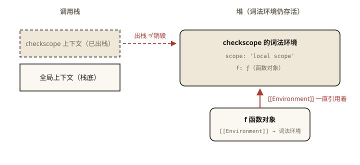

# JavaScript 深入之闭包

## 从一道面试题说起

先看一段代码，不运行，猜猜输出：

```js
for (var i = 0; i < 3; i++) {
  setTimeout(function () {
    console.log(i);
  }, 100);
}
```

输出是 `3 3 3`，而不是很多人直觉上的 `0 1 2`。

为什么会这样？如果追问一句「怎么改成输出 `0 1 2`」，能给出几种解法？这道题背后站着的，正是 JavaScript 中被讨论最多的概念——**闭包（Closure）**。⭐ 面试高频指数：★★★★★

本文目标：读完之后，你不仅知道答案，还能从 **作用域、执行上下文、内存** 三个层面把它讲清楚。

## 闭包是什么：三种定义的取舍

翻开不同的资料，你会看到三种定义：

**MDN**：
> 闭包（closure）是一个函数以及其捆绑的周边环境状态（lexical environment，词法环境）的引用的组合。

**《JavaScript 高级程序设计》（红宝书）**：
> 闭包是指那些引用了另一个函数作用域中变量的函数，通常在嵌套函数中实现。

**直觉版**：
> 函数「记住」了它定义时所处的作用域，即使后来在别处执行，也能访问那个作用域里的变量。

这三种定义并不矛盾，它们分别站在 **规范层、实践层、直觉层** 说话。理解了本文的原理部分，你会发现它们说的是同一件事。

## 预备知识：词法作用域（30 秒回顾）

JavaScript 采用**词法作用域（lexical scope，也叫静态作用域）**：函数能访问哪些变量，在函数**定义时**就确定了，跟在哪里调用无关。

```js
var value = 1;

function foo() {
  console.log(value);
}

function bar() {
  var value = 2;
  foo();
}

bar(); // 1，而不是 2
```

`foo` 定义在全局，它的查找链是「foo 自己的作用域 → 全局作用域」，压根不经过 `bar`。函数执行时查找变量，会沿着「当前作用域 → 定义时的外层作用域 → …… → 全局作用域」逐级检索，这条链就是**作用域链**——而链的形状，在函数创建那一刻就固定了。

（作用域链如何随执行上下文创建，详见本系列第 1~4 篇，这里记住结论即可。）

## 从内存角度看：变量为什么没被销毁

通常情况下，函数调用结束，它的执行上下文出栈，里面的变量就变成了「不可达」状态，等待垃圾回收：

```js
function foo() {
  var a = 2;
}
foo();
// 执行完毕，a 不可达，可以被回收
```

但如果内层函数引用了外层函数的变量，情况就变了：

```js
function foo() {
  var a = 2;

  function bar() {
    console.log(a);
  }

  return bar;
}

var baz = foo(); // foo 执行完，返回了 bar
baz(); // 2 —— a 还活着！
```

按常理，`foo()` 执行结束后它的上下文应该被销毁，`a` 也随之而去。但 `baz()` 打印出了 `2`，说明 `a` 还在内存里。

**在规范层面，发生了什么？**

ECMAScript 规范规定，每个函数对象都有一个内部槽 `[[Environment]]`，保存**该函数创建时所处词法环境**的引用。上面的代码拆开看：

1. 执行 `foo()` 时，创建 `foo` 的执行上下文（其中包含变量 `a` 的环境记录）；
2. 定义 `bar` 时，`bar.[[Environment]]` 被赋值为这个环境——**注意，这一步发生在 `bar` 被创建的时候，而不是被调用的时候**；
3. `foo()` 执行完毕出栈，但 `bar.[[Environment]]` 仍然引用着它的环境，所以 `a` 依然可达；
4. `baz`（也就是 `bar`）被调用时，创建自己的执行上下文，其作用域链 = 自己的环境 → `[[Environment]]` 指向的 `foo` 环境 → 全局环境。查找 `a`，命中。

一句话：**函数对象随身携带着它出生地的环境引用，这就是闭包的机制本质。**

用一张图表示：

```
function foo() {                ┌─────────────────────────────┐
  var a = 2;                    │        bar 函数对象          │
  function bar() {...}  ─创建─▶ │  [[Environment]] ─────────┐ │
  return bar;                   └───────────────────────────│─┘
}                                                           ▼
foo() 执行完出栈，但 foo 的词法环境（含 a = 2）仍被引用，无法回收
```



*图 · 上下文出栈了，但词法环境被 f.[[Environment]] 引用——这就是闭包让变量存活的全部机制*

## 一个经典争论：是不是所有函数都是闭包？

如果严格按规范——每个函数都有 `[[Environment]]`，都携带了定义时的环境——那**所有函数都是闭包**，包括你在全局写的普通函数。

但实践中大家通常只把「**访问了外部函数变量的函数**」或者「**在外层函数返回后仍然访问其变量的函数**」叫作闭包。红宝书的定义就属于这一派。

两派没有对错，只是口径不同。面试时比较讨巧的回答是：

> 从规范角度，所有函数都通过内部槽 `[[Environment]]` 携带词法环境，可以说都是闭包；从工程角度，我们通常只关注那些**在外层函数执行结束后仍持有其变量**的函数，因为这才是闭包真正产生影响的场景——延长变量生命周期。

## 回看开篇题目

现在用闭包的视角解释 `3 3 3`：

1. `var` 声明的 `i` 隶属于**函数作用域**（此处是全局），三次循环共享**同一个** `i`；
2. `setTimeout` 的回调函数在循环体内被创建，每个回调的 `[[Environment]]` 都引用同一个全局环境；
3. 100ms 后回调执行时，循环早已结束，`i` 已经是 `3`；
4. 三个回调打印的都是同一个变量此刻的值：`3 3 3`。

三种修复方案，对应三种「让每个回调持有独立环境」的思路：

```js
// 方案一：let —— 每次迭代都会创建一个新的块级作用域，绑定一个新的 i
for (let i = 0; i < 3; i++) {
  setTimeout(() => console.log(i), 100);
}

// 方案二：IIFE —— 立即执行函数创建函数作用域，通过参数把值「拷贝」进去
for (var i = 0; i < 3; i++) {
  (function (j) {
    setTimeout(() => console.log(j), 100);
  })(i);
}

// 方案三：setTimeout 的第三个参数 —— 直接作为回调入参传入
for (var i = 0; i < 3; i++) {
  setTimeout((j) => console.log(j), 100, i);
}
```

三种方案输出都是 `0 1 2`。理解了「闭包捕获的是**变量的引用（环境）**，而不是变量**当时的值**」，这类题就再也难不倒你。

## 闭包的四大应用

### 1. 模块模式与私有变量

JavaScript 没有原生 private（class 的 `#x` 私有字段是 2022 年之后的事），闭包曾是实现私有性的标准手段：

```js
function createCounter() {
  let count = 0; // 外界无法直接访问，只能通过返回的方法操作
  return {
    inc: () => ++count,
    get: () => count,
  };
}

const counter = createCounter();
counter.inc();
counter.inc();
counter.get(); // 2
counter.count; // undefined —— 私有
```

### 2. 函数柯里化

柯里化把多参函数转化为一系列单参函数，闭包负责「记住」已传的参数：

```js
function curry(fn) {
  return function curried(...args) {
    if (args.length >= fn.length) {
      return fn.apply(this, args);
    }
    // args 被闭包持有，等待后续参数补齐
    return function (...rest) {
      return curried.apply(this, [...args, ...rest]);
    };
  };
}

const add = curry((a, b, c) => a + b + c);
add(1)(2)(3); // 6
add(1, 2)(3); // 6
```

### 3. 防抖与节流 ⭐ 手写面试高频

防抖函数里 `timer` 变量之所以能跨多次调用存活，靠的就是闭包：

```js
function debounce(fn, wait) {
  let timer = null; // 被返回的函数引用 —— 这就是闭包
  return function (...args) {
    clearTimeout(timer);
    timer = setTimeout(() => fn.apply(this, args), wait);
  };
}

const onSearch = debounce((kw) => fetchResults(kw), 300);
input.addEventListener('input', (e) => onSearch(e.target.value));
```

### 4. 缓存 / memoize

```js
function memoize(fn) {
  const cache = new Map(); // 闭包持有缓存
  return function (arg) {
    if (!cache.has(arg)) {
      cache.set(arg, fn(arg));
    }
    return cache.get(arg);
  };
}

const slowSquare = (n) => { /* 假设很慢 */ return n * n; };
const fastSquare = memoize(slowSquare);
fastSquare(9999); // 慢
fastSquare(9999); // 瞬间 —— 命中缓存
```

注意：这个 `cache` 没有任何容量上限，入参无限多时内存会持续膨胀——这正好引出下一节。

## 闭包的代价：内存

闭包不是免费的午餐，它的核心代价是**延长了变量的生命周期**：

1. **基础事实**：只要闭包函数活着，被它引用的环境就无法回收；
2. **引擎优化**：现代引擎（如 V8）会做作用域分析——外层函数中**没有被任何闭包实际引用**的变量，即使环境被保留，也可能被提前回收。所以「闭包保留整个外层作用域」是过时的说法，更准确的是「保留被引用的部分」；
3. **真正的泄漏场景**：长生命周期的闭包捕获了大对象。

```js
function process() {
  const bigData = new Array(1_000_000).fill('*'); // 约 8MB
  return function () {
    return bigData.length; // 闭包引用了 bigData
  };
}

const leak = process();
// bigData 会一直存活，直到 leak 被置为 null 或自身不可达
leak = null; // 现在它可以被回收了
```

一个更隐蔽的版本是「闭包只用了对象的一个小字段，却导致整个大对象无法回收」。工程上的解法是把需要的字段提前解构出来：

```js
function betterProcess() {
  const bigData = new Array(1_000_000).fill('*');
  const len = bigData.length; // 只捕获原始值
  return function () {
    return len; // bigData 不再被引用，可以被回收
  };
}
```

内存泄漏的系统排查方法（Heap Snapshot、对比快照等）将在 P3 阶段《V8 之内存管理与垃圾回收》与《常见内存泄漏模式与排查》中展开。

## 图解总结

```
              创建时绑定
  外层函数 ──────────────▶ 闭包函数.[[Environment]] ──▶ 外层词法环境 { 被引用的变量 }
     │                                                      ▲
     │ 执行结束、上下文出栈                                  │ 环境仍被引用 → 变量存活
     └──────────────────────────────────────────────────────┘
```

## 总结

- **定义**：闭包 = 函数 + 它创建时携带的词法环境（`[[Environment]]` 内部槽）；
- **机制**：闭包捕获的是**环境（变量的引用）**，不是变量某一刻的值，所以闭包里读到的永远是变量**当前**的值；
- **决定时机**：能访问哪些变量由**定义时**决定（词法作用域），与调用位置无关；
- **应用**：模块与私有变量、柯里化、防抖节流、缓存；
- **代价**：延长变量生命周期，注意「闭包捕获大对象」型泄漏。

**面试一句话回答**：闭包是函数与其词法环境的组合——函数创建时通过内部槽引用了定义时的作用域，即使外层函数执行结束，被引用的变量依然可达、无法回收；它捕获的是环境引用而非值的快照，这也是 `for + var + setTimeout` 输出 `3 3 3` 的根本原因。

## 思考题

1. 写出下面代码的输出，并用「捕获的是环境而非值」解释：
```js
var arr = [];
for (var i = 0; i < 3; i++) {
  arr.push(function () { return i; });
}
console.log(arr[0](), arr[1](), arr[2]());
```

2. 「闭包一定会导致内存泄漏」这个说法对吗？请说明闭包、内存占用、内存泄漏三者的关系。

3. 用闭包实现 `once(fn)`：返回的函数只有第一次调用会执行 `fn`，之后调用直接返回第一次的结果。

4. 下面的代码里，`bigData` 会被回收吗？为什么？
```js
function init() {
  const bigData = { list: new Array(1e6).fill(1) };
  return () => bigData.list.length;
}
const f = init();
```

（思考题解析将同步录入小程序题库，关联本文 id：js-deep-005）

## 参考文献

- MDN — [Closures](https://developer.mozilla.org/en-US/docs/Web/JavaScript/Closures)
- ECMA-262 — ECMAScript Function Objects 的 `[[Environment]]` 内部槽
- 《JavaScript 高级程序设计（第 4 版）》第 10 章「函数」
- 冴羽《JavaScript 深入之闭包》
