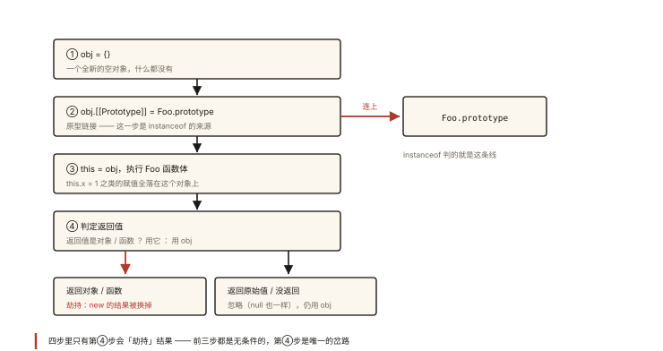

# JavaScript 深入之 new

## 从一个「返回值失踪案」说起

```js
function Person(name) {
  this.name = name; // 注意：没有 return
}
var p = new Person('小明');
console.log(p.name); // '小明' —— this 明明不是返回值，怎么就到了 p 上？

function Robot(name) {
  this.name = name;
  return { tag: 'surprise' }; // 返回了一个对象
}
var r = new Robot('R2');
console.log(r.tag);    // 'surprise'
console.log(r.name);   // undefined —— this.name 被丢弃了！
```

`new` 到底对函数做了什么？为什么返回对象会「劫持」结果、而返回原始值却毫无影响？⭐ 「new 的过程」与「手写 new」是面试常客，本文一次讲透，手写完整版见《handwritten-002 手写 new 与 instanceof》。

## 现象与直觉解释

直觉版本：

> `new Foo()` 的时候，引擎会悄悄造一个空对象 `o`，让函数里的 `this` 指向 `o`，执行函数体；最后**默认把 `o` 返回给你**——除非函数自己返回了一个对象，那引擎就尊重函数的选择。

这个直觉可以解释开篇两段代码。但「悄悄造对象」到底造了什么样的对象、和函数的 `prototype` 什么关系、手写要还原哪几步——需要精确到规则。

## 深入原理：构造调用四步曲 ⭐

当执行 `new Foo(...)` 时，规范语义下发生四件事：

```
① 创建一个全新的空对象
        obj = {}
② 原型链接：obj.[[Prototype]] = Foo.prototype
        （对象隐式接入构造函数的原型链 —— 下一篇《原型与原型链》的核心）
③ this 绑定并执行：以 obj 为 this 执行 Foo 函数体
        Foo.apply(obj, arguments)
④ 返回值判定：
        函数返回了对象（object/function/array...）→ 用该对象
        返回原始值 / 没有 return              → 用 obj
```

### 逐步用代码验证

```js
function Person(name) {
  // ③ 进入函数时，this 已经是 new 造出来的对象了
  console.log(this instanceof Person); // true（由第②步的原型链接保证）
  console.log(this.constructor === Person); // true（来自 Person.prototype）

  this.name = name; // 给新对象挂属性

  // 没有 return → 走第④步：默认返回 this（即新对象）
}

var p = new Person('小明');

console.log(p instanceof Person); // true —— 第②步的成果
console.log(p.name);              // '小明' —— 第③步的成果
```

### 第④步的精确规则（开篇悬案）

```js
function A() { return { x: 1 }; }        // 返回对象
function B() { return 42; }              // 返回原始值（数字）
function C() { return 'hello'; }         // 返回原始值（字符串）
function D() { return null; }            // null 是原始值！

console.log(new A().x);  // 1     —— 对象被采用
console.log(new B());    // D 的实例 { } —— 42 被忽略，返回 this
console.log(new C());    // C 的实例 { } —— 同上
console.log(new D());    // D 的实例 { } —— null 虽「像对象」，但是原始值，被忽略
```

**判定标准：返回值 `typeof` 为 object 或 function 才被采用，其余（含 null/undefined/原始值）一律忽略、返回新造的 this 对象。**

### 手写 objectFactory：四步的代码化

结合《js-deep-007》的 `call/apply`，四步翻译成代码水到渠成：

```js
function objectFactory() {
  var Constructor = [].shift.call(arguments); // 取出第一个参数（构造函数）
  // ①② 创建新对象并链接原型
  var obj = Object.create(Constructor.prototype);
  // ③ 以 obj 为 this 执行构造函数
  var result = Constructor.apply(obj, arguments);
  // ④ 返回值判定
  return (typeof result === 'object' && result !== null) ||
         typeof result === 'function'
    ? result
    : obj;
}

// 验证
function Person2(name) { this.name = name; }
var p2 = objectFactory(Person2, '小红');
console.log(p2 instanceof Person2); // true
console.log(p2.name);               // '小红'
```

（旧式写法 `obj.__proto__ = Constructor.prototype` 与 `Object.create` 等效，后者是标准方式。）

### 补充规则：这些边界常被追问

**1. `new` 与普通调用的天壤之别**

```js
function Person(name) { this.name = name; }

var p = new Person('new 调用'); // this → 新对象，返回新对象
var q = Person('裸调用');       // this → 全局（非严格），q 为 undefined
// 裸调用还把 name 挂到了全局对象上 —— 这就是构造函数要大写开头的原因：
// 大写是「请务必配合 new 使用」的约定信号
```

**2. `new.target` 检测调用方式**

```js
function Person(name) {
  if (!new.target) {
    throw new Error('Person 必须使用 new 调用！');
  }
  this.name = name;
}
```

**3. class 强制 new、且不经受「返回对象劫持」**：class 不用 new 直接调用报 `TypeError`；class 构造函数里若返回对象同样会覆盖实例（返回原始值则报错）——class 在规范层面比普通函数更严格。

**4. `new Foo` 不带括号**：`new Person` 合法（不传参时的简写），与 `new Person()` 等价（优先级陷阱：`new Foo().name` 先 new 再取属性）。

## 回看开篇

- `Person` 没有 return → 第④步走默认分支，`p` 就是 new 造的那个对象，`this.name` 自然在它身上；
- `Robot` 返回了对象 `{ tag: 'surprise' }` → 第④步采用返回值，`this` 那个对象被整个丢弃，所以 `r.name` 是 undefined。

一句话：**new 的返回值 = 「构造函数的返回对象」优先，否则「this 对象」**。

## 实战延伸

**1. 为什么 instanceof 能判断 `p instanceof Person`**：正是第②步把 `p` 的原型链接到了 `Person.prototype`——判断机制沿原型链查找（详见《js-deep-009 原型与原型链》）。

**2. 构造函数模式 vs 工厂模式**：工厂模式 `function makePerson(n) { return { name: n }; }` 完全绕开 this 和原型——没有共享方法的原型链优势；构造函数 + 原型 是「实例数据放 this、共享方法放 prototype」的经典组合（继承篇展开）。

**3. `new` 的次数也能被玩出花**：`new new Function` 这类「套娃」题目本质还是优先级（成员访问 > new 带参 > 函数调用），遇到时逐层拆括号即可。

## 图解总结



*图 · 前三步是固定的，只有第四步是岔路*

```
   new Foo(args)
        │
        ▼
 ① obj = {}                       全新空对象
        │
        ▼
 ② obj.[[Prototype]] ───────────▶ Foo.prototype   原型链接
        │
        ▼
 ③ this = obj，执行 Foo 函数体      属性挂在实例上
        │
        ▼
 ④ 返回 = (返回值是对象/函数) ? 返回值 : obj
```

## 总结

- new 四步曲：创建空对象 → 原型链接到 `Constructor.prototype` → this 绑定并执行 → 返回值判定；
- 返回对象/函数会「劫持」new 的结果；返回原始值（含 null）一律被忽略；
- 手写 new 的核心三件套：`Object.create(proto)` + `apply(obj)` + 返回值判定；
- `new.target` 检测调用方式；class 强制 new 且规则更严格；
- 第②步的原型链接是 `instanceof` 判定的来源，直通下一篇《原型与原型链》。

**面试一句话回答**：new 一个函数时引擎做四件事——创建空对象、把它的 [[Prototype]] 指向构造函数的 prototype、以它为 this 执行函数体、最后除非构造函数显式返回了对象否则把这个 this 对象返回；返回原始值会被忽略，这也是手写 new 时用 Object.create 建原型链接、用 apply 绑 this、再做返回值判断的原因。

## 思考题

1. 写出每个实例的最终形态并说明走的是第④步哪个分支：
```js
function F1() { this.a = 1; }
function F2() { this.a = 1; return 2; }
function F3() { this.a = 1; return [9, 9]; }
function F4() { this.a = 1; return function () {}; }
function F5() { this.a = 1; return null; }
```

2. `new Foo()` 与 `Object.create(Foo.prototype)` 得到的对象有什么相同与不同？（提示：第③步有没有发生）

3. 修改本文的 objectFactory，让它支持 `new.target` 在构造函数内正确指向构造函数本身是不可行的——为什么？那 `new.target` 的判断在手写版里应该用什么替代？

4. 开放设计：一个库导出构造函数 `Store`，如何从多个层面（命名约定、运行时检测、直接用 class）防止用户裸调用 `Store()` 造成全局污染？给出取舍分析。

（思考题解析将同步录入小程序题库，关联本文 id：js-deep-008）

## 参考文献

- ECMA-262 现行版 — `EvaluateNew`、`[[Construct]]`、`GetPrototypeFromConstructor` 相关章节
- MDN — [new 运算符](https://developer.mozilla.org/zh-CN/docs/Web/JavaScript/Reference/Operators/new)、[new.target](https://developer.mozilla.org/zh-CN/docs/Web/JavaScript/Reference/Operators/new.target)
- 《JavaScript 高级程序设计（第 4 版）》第 8 章
- 冴羽《JavaScript 深入之 new 的模拟实现》
