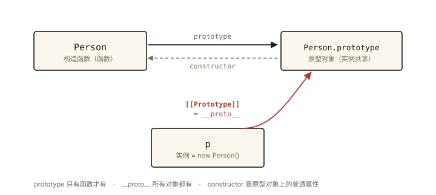
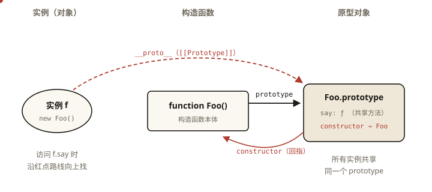
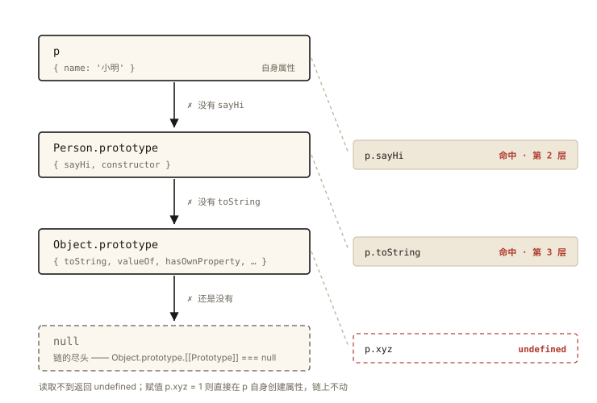
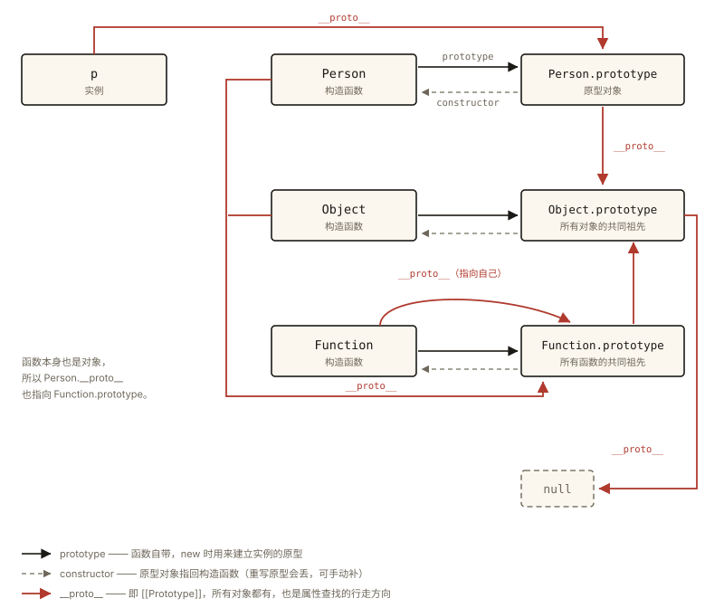

# JavaScript 深入之原型与原型链

## 从「对象身上没有的方法」说起

```js
function Person(name) {
  this.name = name;
}
Person.prototype.sayHi = function () {
  return 'Hi, ' + this.name;
};

var p = new Person('小明');

console.log(p.sayHi());                      // 正常调用 —— 但 p 自身没有 sayHi
console.log(p.toString());                   // '[object Object]' —— 谁定义的？
console.log(p.__proto__ === Person.prototype);           // true
console.log(Person.prototype.constructor === Person);    // true
console.log(p.constructor === Person);                   // true —— p 自己也没定义 constructor
```

`p` 身上明明只有 `name` 一个属性，为什么 `sayHi`、`toString` 甚至 `constructor` 都能访问到？这些「不在自己身上的能力」从哪来？⭐⭐ 原型与原型链是 JavaScript 面试的第一梯队考点，本文把 `prototype`、`__proto__`、`constructor` 的三角关系彻底讲透。

## 现象与直觉解释

直觉版本：

> 每个对象都有一条看不见的「上线」（原型对象）。自己身上找不到的属性，就找上线要；上线没有，再找上线的上线……直到尽头。这条「上线链」就是原型链。

上一篇《js-deep-008 new》的第②步说过：new 的时候，实例的 `[[Prototype]]` 会被链接到构造函数的 `prototype` 上——这条「上线关系」，就是 new 建立的。

## 深入原理

### 一、三个角色与三角关系

理解原型必须先分清三个角色：



*图 · 三条边：prototype 只有函数有，[[Prototype]]（__proto__）所有对象都有，constructor 只是原型上的普通属性*

```
   Person（构造函数）                  p（实例）
        │                               │
        │ 定义时自带                     │ new 时链接
        ▼                               ▼
   Person.prototype（原型对象）◀── p.[[Prototype]]
        │
        │ 自带属性 constructor
        └────────▶ 指回 Person
```

**三角关系三条边**（⭐ 必须能默画）：

1. `Person.prototype`：函数定义时就自带的属性，指向它的**原型对象**——所有实例共享方法的存放地；
2. `p.[[Prototype]]` → `Person.prototype`：每个对象都有内部槽 `[[Prototype]]`（new 的第②步建立），浏览器通过 `__proto__` 访问器暴露它；
3. `Person.prototype.constructor` → `Person`：原型对象自带 `constructor` 属性指回构造函数。

注意两个方向不要混：

- **`prototype` 是函数才有的属性**（箭头函数、class 内部方法没有）；
- **`[[Prototype]]` / `__proto__` 是所有对象都有的内部槽**——函数也是对象，所以 `Person.__proto__` 也存在（指向 `Function.prototype`）。



*图 · prototype / __proto__ / constructor 的三角关系——红点是属性查找的行进路线*

### 二、属性查找：沿原型链向上

访问 `p.sayHi` 的完整过程：



*图 · 三次查询叠在同一条链上：sayHi 停在第 2 层，toString 停在第 3 层，xyz 一路走到 null 仍没有*

```
p 自身属性 { name: '小明' }
   │ 没有 sayHi
   ▼
p.[[Prototype]] === Person.prototype { sayHi: ƒ, constructor: ƒ Person }
   │ 命中 ✅
```

如果访问 `p.toString`，继续向上：

```
Person.prototype { sayHi, constructor }
   │ 没有 toString
   ▼
Object.prototype { toString, valueOf, hasOwnProperty, ... }
   │ 命中 ✅
```

如果访问 `p.xyz`，走完全程：

```
Object.prototype
   │ 没有
   ▼
null —— 链的尽头（Object.prototype.[[Prototype]] === null）
   │ 仍未命中
   ▼
返回 undefined（注意：读取是 undefined；赋值则直接在 p 自身创建新属性）
```

**「继承」的真相**：JavaScript 的继承不是复制，而是**委托查找**——实例没有的能力，运行时沿链「借」。`hasOwnProperty` 与 `in` 运算符正好验证了这条链的边界：

```js
console.log(p.hasOwnProperty('name')); // true —— 自身属性
console.log(p.hasOwnProperty('sayHi')); // false —— 在原型上
console.log('sayHi' in p);              // true —— in 不区分自身与原型链
```

### 三、constructor 的真相：一个「不可靠的导游」

`p.constructor === Person` 为 true，不是因为 p 有 constructor，而是**沿链查到了 Person.prototype.constructor**。它的不可靠之处：

```js
function Dog() {}
Dog.prototype = {
  bark: function () {} // 整体重写原型 —— constructor 丢了！
};
var d = new Dog();
console.log(d.constructor === Dog);   // false
console.log(d.constructor === Object); // true —— 沿链找到 Object.prototype.constructor
// 修复：重写时补一句 Dog.prototype.constructor = Dog;
```

结论：**constructor 可以作为参考，但绝不能作为类型判断依据**——可靠的是 `instanceof` 和 `Object.prototype.toString.call`（《js-deep-007》）。

### 四、instanceof 的原理：沿链「认亲」⭐

`p instanceof Person` 的判定：**沿 p 的原型链逐级向上，看能否找到 `Person.prototype` 这个对象**：

```js
function myInstanceof(L, R) {
  let proto = Object.getPrototypeOf(L); // 不用 __proto__，用标准 API
  while (proto !== null) {
    if (proto === R.prototype) return true; // 找到同源原型
    proto = Object.getPrototypeOf(proto);   // 继续向上
  }
  return false; // 走到 null（链尽头）仍未命中
}

console.log(myInstanceof(p, Person));  // true
console.log(myInstanceof(p, Object));  // true —— 链路过 Object.prototype
console.log(myInstanceof([], Array));  // true
console.log(myInstanceof([], Object)); // true
```

这也解释了跨 iframe 失效的原因：两个 iframe 各有一套 `Array`，`iframeA 的数组 instanceof iframeB 的 Array` 沿链找不到**那个特定的** `Array.prototype`，返回 false（类型判断详见《js-core-002》）。

### 五、完整链路图：把终点画出来



*图 · 把终点画出来：实例链、函数层、以及 Function 自指的那个环，三色边分别是 prototype / constructor / __proto__*

```
实例 p ──▶ Person.prototype ──▶ Object.prototype ──▶ null
              ▲ constructor: Person    ▲ constructor: Object

Person（函数也是对象）
  └─▶ Function.prototype ──▶ Object.prototype ──▶ null

有趣的环：
  Function.__proto__ === Function.prototype   （函数由「函数」构造）
  Object.__proto__  === Function.prototype    （Object 构造函数本身是个函数）
```

「Function 与 Object 谁先有」的鸡蛋问题面试常被拿来钓鱼——不必深究先后，记住这两条环即可：**一切函数的 [[Prototype]] 指向 Function.prototype，一切对象的链最终经过 Object.prototype 到达 null。**

### 六、术语澄清：三个「原型」词汇

| 写法 | 本质 | 说明 |
|---|---|---|
| `[[Prototype]]` | 规范内部槽 | 每个对象都有，真正的「上线引用」 |
| `__proto__` | 访问器属性（getter/setter） | 浏览器事实标准，ES2015 收入规范附录；教学/调试用，生产代码用 `Object.getPrototypeOf()` / `Object.create()` |
| `prototype` | 函数的普通属性 | 仅函数拥有，new 时用来建立实例的 `[[Prototype]]` |

## 回看开篇

| 访问 | 查找路径 | 命中位置 |
|---|---|---|
| `p.name` | p 自身 | 实例属性 |
| `p.sayHi` | p → Person.prototype | 构造函数原型 |
| `p.toString` | p → Person.prototype → Object.prototype | Object 原型 |
| `p.constructor` | 同上，在 Person.prototype 上 | 原型的回指属性 |

「对象身上没有的能力，沿原型链向上借」——这就是开篇所有「怪现象」的统一答案。

## 实战延伸

**1. 方法放 prototype 上：省内存的共享**

```js
function Person(name) {
  this.name = name;                 // 每实例一份（数据各不相同）
}
Person.prototype.sayHi = function () { ... }; // 一份共享（行为完全相同）
// 一万个实例，sayHi 只占一份内存
```

「数据放实例、方法放原型」是构造函数模式的标准姿势，也是《js-deep-010 继承》的地基。

**2. Object.create(null)：没有上线的「纯净对象」**

```js
var pure = Object.create(null);
pure.toString; // undefined —— 没有任何继承来的属性
// 用途：安全的字典/哈希表，不怕键名与 Object.prototype 属性撞车
```

**3. 原型污染（Prototype Pollution）一句话预警**

给 `Object.prototype` 挂属性会影响**所有对象**（沿链查找全被波及），历史上多次重大安全漏洞源于此——深入讨论见《security-001 XSS》之后的《security-005 供应链安全》。

## 图解总结

```
     ┌─── new 建立 ───┐                    constructor 回指
     │                │                        │
实例 p ──[[Prototype]]──▶ Person.prototype ◀────┴──── Person
                              │                     ▲
                              │ [[Prototype]]       │ __proto__
                              ▼                     │
                        Object.prototype        Function.prototype
                              │                     ▲      │
                              ▼ null              ┌───────┘ [[Prototype]]
                          （链的尽头）            ▼
                                              Object.prototype → null
```

## 总结

- 三角关系：函数的 `prototype` ↔ 原型对象的 `constructor` ↔ 实例的 `[[Prototype]]`；
- 属性查找沿 `[[Prototype]]` 链由内向外，终点是 `Object.prototype.[[Prototype]] === null`；读取不命中返回 undefined，赋值在自身创建；
- `constructor` 是原型上的属性，重写原型会丢失，不能用于类型判断；
- `instanceof` 沿左侧原型链寻找右侧 `prototype` 对象，本质是「认原型」而非「认构造函数」；
- `__proto__` 是内部槽的浏览器访问器，生产代码用 `Object.getPrototypeOf` / `Object.create`。

**面试一句话回答**：每个对象都有内部槽 [[Prototype]]，访问不存在的属性时沿这条链逐级向上委托查找，直到 Object.prototype 再到 null——new 会把实例的 [[Prototype]] 指向构造函数的 prototype，原型对象又通过 constructor 指回构造函数，构成三角关系；instanceof 的判定就是沿左侧原型链查找右侧的 prototype 是否存在。

## 思考题

1. 写出完整原型链并标注每一步命中位置：
```js
function A() {}
A.prototype.x = 1;
var a = new A();
a.y = 2;
// 访问 a.x、a.y、a.toString、a.valueOf 分别走了几步？
```

2. `d.constructor === Object` 在什么情况下发生？如何避免？

3. 手写 `myInstanceof` 并回答：`myInstanceof('str', String)` 返回什么？为什么 `'str' instanceof String` 是 false 而 `new String('str') instanceof String` 是 true？

4. 开放设计：给「一万个人名」设计 Person 结构——name 属性与 greet 方法分别应该放在实例还是原型上？如果 greet 需要访问 name，这会影响你的放置决策吗？

（思考题解析将同步录入小程序题库，关联本文 id：js-deep-009）

## 参考文献

- ECMA-262 现行版 — OrdinaryObjectInternalMethods [[GetPrototypeOf]]、`Object.create`、`Function.prototype` 相关章节
- MDN — [继承与原型链](https://developer.mozilla.org/zh-CN/docs/Web/JavaScript/Inheritance_and_the_prototype_chain)
- 《JavaScript 高级程序设计（第 4 版）》第 8 章
- 冴羽《JavaScript 深入之从原型到原型链》
