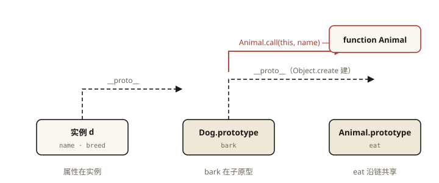
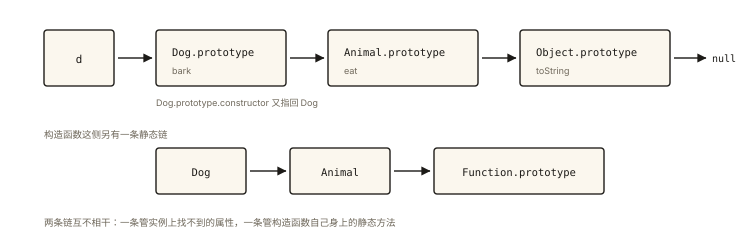

# JavaScript 深入之继承

## 从一个「越写越不对劲」的需求说起

```js
function Animal(name) {
  this.name = name;
}
Animal.prototype.eat = function () {
  return this.name + ' 在吃饭';
};

// 现在需要 Dog：有自己的 breed，还要复用 name 和 eat —— 怎么写？
function Dog(name, breed) {
  this.breed = breed; // name 怎么办？eat 怎么复用？
}
```

「让 Dog 拥有 Animal 的属性和方法」——这就是继承问题。⭐ 「继承有哪几种方式、各有什么优缺点」是面试出现率极高的问题，而它真正考的是你对原型链（上一篇）和 this 绑定（第 6 篇）的理解深度。本文沿着历史演进讲：**每一代方案都是为了修复上一代的缺陷**。

## 现象与直觉解释

继承要解决两个独立的问题：

1. **实例属性**（name 这种每个实例一份的数据）——需要以子类 this 执行父类构造逻辑；
2. **原型方法**（eat 这种共享行为）——需要让子类实例的原型链上有父类原型。

直觉方案呼之欲出：「把父类实例当子类原型」+「在子类里调一遍父类构造函数」。历史上的演进正是从这两个直觉分别出发，最后合流。

## 深入原理：五代方案的演进

### 方案一：原型链继承

**思路**：子类原型 = 父类实例，让父类的一切出现在子类实例的原型链上。

```js
function Animal(name) {
  this.name = name;
  this.colors = ['white', 'black']; // ⚠️ 引用类型实例属性
}
Animal.prototype.eat = function () {};

function Dog() {}
Dog.prototype = new Animal('旺财'); // 关键一步
Dog.prototype.constructor = Dog;    // 修复回指（上篇讲过）

var d1 = new Dog();
var d2 = new Dog();

d1.colors.push('brown');
console.log(d2.colors); // ['white', 'black', 'brown'] ⚠️ 被污染了！
```

**两大缺陷**：

1. **引用类型属性被所有实例共享**——colors 挂在原型（Animal 实例）上，d1 的修改沿链影响 d2（《js-deep-004》查找规则的直接恶果）；
2. **创建子类实例时无法向父类构造函数传参**——`new Dog('小黑')` 的参数到不了 Animal。

### 方案二：借用构造函数继承

**思路**：在子类构造函数里，以子类 this 调用父类构造函数（call 的经典应用，《js-deep-007》）。

```js
function Dog(name, breed) {
  Animal.call(this, name); // 以 this 执行父类初始化
  this.breed = breed;
}

var d1 = new Dog('旺财', '柴犬');
var d2 = new Dog('小黑', '拉布拉多');
d1.colors.push('brown');
console.log(d2.colors); // ['white', 'black'] ✅ 各自独立
```

完美解决两个缺陷？但它引入新问题：

```js
console.log(d1.eat); // undefined ⚠️
```

**缺陷**：只执行了构造函数，**原型链根本没有建立**——父类原型上的方法完全拿不到；而且方法只能写在构造函数里，无法共享，一万个实例一万份方法。

### 方案三：组合继承（原型链 + 借用构造）

**思路**：数据用借用构造（各份独立），方法用原型链（共享）——两者各取所长。

```js
function Dog(name, breed) {
  Animal.call(this, name);        // 第 2 次调用 Animal：拿属性
  this.breed = breed;
}
Dog.prototype = new Animal();     // 第 1 次调用 Animal：建链
Dog.prototype.constructor = Dog;

var d = new Dog('旺财', '柴犬');
console.log(d.name);  // ✅
console.log(d.eat);   // ✅ ƒ
```

**这是 ES5 时代最常用的继承方案**，但仍有洁癖不可忍之处：**父构造函数被调用了两次**——`new Animal()` 在原型上挂了一份多余的 name/colors（实例属性出现在原型上，被实例自身的同名属性遮蔽，浪费且碍眼）。

### 方案四：原型式继承 / 寄生式继承（过渡方案）

```js
// 原型式：道格拉斯·克罗克福德的 object()，即 Object.create 的前身
function object(o) {
  function F() {}        // 临时构造函数
  F.prototype = o;       // 原型指向传入对象
  return new F();        // 新对象“继承”了 o
}
var person = { name: '小明', friends: ['A', 'B'] };
var another = object(person); // another 沿链共享 person 的一切
```

寄生式 = 原型式 + 返回前增强对象。它们是「不需要构造函数、直接基于对象造对象」的轻量思路（缺陷同方案一：引用值共享），真正的大用场在下面——**组合出终极方案**。

### 方案五：寄生组合式继承（ES5 最优解）⭐

**思路**：组合继承中那次 `new Animal()` 的唯一目的是建链——而建链只需要 `Animal.prototype`，根本不需要调用构造函数！用 `Object.create(Animal.prototype)` 代替它：

```js
function inherit(Child, Parent) {
  var prototype = Object.create(Parent.prototype); // ① 造一个原型为 Parent.prototype 的空对象
  prototype.constructor = Child;                   // ② 修复 constructor 回指
  Child.prototype = prototype;                     // ③ 作为子类原型
}

function Dog(name, breed) {
  Animal.call(this, name); // 父构造只调用这一次 ✅
  this.breed = breed;
}
inherit(Dog, Animal);

var d = new Dog('旺财', '柴犬');
console.log(d instanceof Dog);    // true
console.log(d instanceof Animal); // true ✅ 链正确
console.log(d.eat);               // ✅ 共享方法
// 原型上不再有多余的 name/colors ✅
```

**只调用一次父构造函数、链正确、方法共享、数据独立**——寄生组合式是《JavaScript 高级程序设计》盖章的「引用类型继承的最佳范式」。

### 方案六：class extends（ES2015+，现代标准答案）⭐

```js
class Animal {
  constructor(name) {
    this.name = name;
    this.colors = ['white'];
  }
  eat() {}
}

class Dog extends Animal {
  constructor(name, breed) {
    super(name);      // 必须先 super 再用 this
    this.breed = breed;
  }
  bark() {}
}

const d = new Dog('旺财', '柴犬');
```

class 继承在**语义上**正是寄生组合式，但规范层面做了更多事——它同时建立了**两条链**：

```js
Dog.__proto__ === Animal;                          // ① 静态链：Dog 直接继承 Animal（静态方法可用）
Dog.prototype.__proto__ === Animal.prototype;      // ② 原型链：实例方法的查找路径
// ES5 寄生组合式只有链 ②，链 ① 需要额外写 Dog.__proto__ = Animal（且不可靠）
```

两条链的实现依赖于 `Symbol.__proto__` 机制，这是 class 「不是纯语法糖」的最有力证据。

**super 的两条硬规则**：

1. 派生类 constructor 中，**使用 this 之前必须先调用 super()**（this 由父类构造「初始化」后才存在——规范中派生类的 this 绑定发生在 super 调用时）；
2. `super(...)` 当函数调用（调父构造）、`super.x` 当对象使用（沿原型链取父类成员，且方法内绑定 this）。



*图 · 寄生组合式继承——虚线是原型委托（找方法），红线是构造调用（拿属性），两条通路各司其职*

## 五代方案对比总结 ⭐

| 方案 | 数据独立 | 方法共享 | 传参 | 父构造调用次数 | 备注 |
|---|---|---|---|---|---|
| 原型链继承 | ❌ 引用值共享 | ✅ | ❌ | 1 | 有致命缺陷 |
| 借用构造函数 | ✅ | ❌ | ✅ | 1 | 无链 |
| 组合继承 | ✅ | ✅ | ✅ | **2** | ES5 常用 |
| 寄生组合式 | ✅ | ✅ | ✅ | **1** | ES5 最优 |
| class extends | ✅ | ✅ | ✅ | 1 | 现代（双链） |

## 回看开篇

Dog 的完整答案（现代版）：

```js
class Dog extends Animal {
  constructor(name, breed) {
    super(name);
    this.breed = breed;
  }
}
```

（ES5 版：`Animal.call(this, name)` + `inherit(Dog, Animal)`。）属性复用靠「以子 this 调父构造」，方法复用靠「原型链接到父原型」——继承的两半，缺一不可。

## 实战延伸

**1. 面试追问：组合继承到底调用了哪两次父构造？**

一次在 `Dog.prototype = new Animal()`（建链时，副作用：原型挂上多余属性），一次在 `Animal.call(this, name)`（初始化实例）。寄生组合式把前者换成 `Object.create(Animal.prototype)`，消掉了第一次。

**2. class 里「方法放原型、属性放构造」依然成立**

`eat() {}` 写在 class 体里就是挂到 `Dog.prototype`（生成器、静态方法、`#私有字段` 各有去处）——class 的原型本质没变，详见《es6-010 Class 与模块化》。

**3. 判断继承质量的四连问**（面试自检清单）

`d instanceof Dog/Animal`？数据是否各自独立？方法是否共享一份？父构造调用几次？——任何继承方案都能用这四问快速体检。

## 图解总结



*图 · 看着像一条，其实是两条，中间的桥是 Dog.prototype*

```
寄生组合式 / class 的目标链路：

d ──▶ Dog.prototype ──▶ Animal.prototype ──▶ Object.prototype ──▶ null
        │ bark                 │ eat                │ toString
        └── constructor: Dog

class 额外的静态链：
Dog ──▶ Animal ──▶ Function.prototype（Dog 可直接用 Animal 的静态方法）
```

## 总结

- 继承 = 属性继承（借构造：以子 this 调父构造）+ 方法继承（建链：子原型链接父原型）；
- 原型链继承的引用值共享与无法传参 → 借用构造的无链 → 组合的两次调用 → 寄生组合式（Object.create 建链）一次到位；
- class extends = 寄生组合式语义 + 双链（原型链与构造函数静态链）+ super 硬规则（this 前必须 super）；
- 面试答题路线：先讲需求两半，再按演进报方案与缺陷，最后落到寄生组合式与 class。

**面试一句话回答**：JS 继承要同时解决属性与方法两个问题——以子类 this 调用父构造函数获得实例属性，用 Object.create(Parent.prototype) 建立子原型到父原型的链接获得共享方法，即寄生组合式继承；class extends 在此基础上还建立了构造函数之间的静态链并强制 super 先于 this，是现代标准写法。

## 思考题

1. 写出输出并解释污染是怎么沿链发生的：
```js
function P() { this.list = [1]; }
P.prototype.shared = [2];
function C() { P.call(this); }
C.prototype = Object.create(P.prototype);
var c1 = new C(), c2 = new C();
c1.list.push(9); c1.shared.push(9);
console.log(c2.list, c2.shared);
```

2. 派生类 constructor 中「先 this 后 super」会抛什么错？从「this 何时被创建」的角度解释原因。

3. 写出下面两个表达式的值，并说明 class 的两条链分别对应哪一条：
```js
class A { static who() { return 'A'; } hi() { return 'hi'; } }
class B extends A {}
console.log(B.who());
console.log(new B().hi());
```

4. 开放设计：实现 `mixin(Base, ...mixins)`，把多个普通对象的方法混入 Base 的原型——它与 extends 有什么本质区别？什么场景该用 mixin？

（思考题解析将同步录入小程序题库，关联本文 id：js-deep-010）

## 参考文献

- 《JavaScript 高级程序设计（第 4 版）》第 8 章「继承」——五种方案演进的经典论述
- MDN — [class extends](https://developer.mozilla.org/zh-CN/docs/Web/JavaScript/Reference/Classes/extends)、[super](https://developer.mozilla.org/zh-CN/docs/Web/JavaScript/Reference/Operators/super)
- ECMA-262 现行版 — ClassDefinitionEvaluation、`Symbol.__proto__` 相关章节
- 冴羽《JavaScript 深入之继承的多种方式和优缺点》
