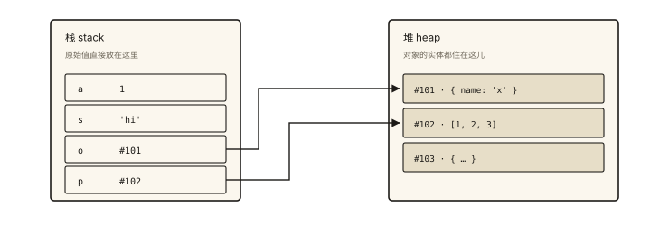
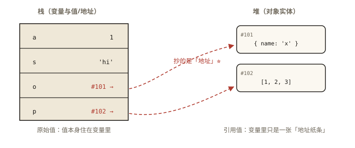

# JavaScript 核心之数据类型：原始值与引用值

## 从一道「交换失败」的题说起

> **系列导读**：《JavaScript 核心系列》共 9 篇，覆盖语言地基：类型、判断、声明、转换、函数、数组、对象、字符串、错误处理——是《JavaScript 深入系列》的前置读物。

```js
function swap(a, b) {
  [a, b] = [b, a];
}
let x = 1, y = 2;
swap(x, y);
console.log(x, y); // 1 2 —— 没交换成功（这题不难）

// 换个对象试试
function update(user) {
  user.name = '新名字';   // ✅ 改到了
  user = { name: '整体替换' }; // ❌ 外面看不到
}
const u = { name: '旧名字' };
update(u);
console.log(u.name); // '新名字' —— 为什么改属性生效、整体赋值失效？
```

答案藏在一个最基础也最容易被轻视的区分里：**原始值与引用值**。⭐ 这是所有「值怎么变」「拷贝了什么」「为什么改了那边这边也变」问题的总根源。

## 现象与直觉解释

JavaScript 有 **8 种数据类型**：

| 类别 | 类型 | 值举例 |
|---|---|---|
| **原始类型（7）** | Number / String / Boolean | `1` `'a'` `true` |
| | Undefined / Null | `undefined` `null` |
| | Symbol / BigInt | `Symbol()` `10n` |
| **引用类型（1）** | Object（含 Array/Function/Date/Map…） | `{}` `[]` `() => {}` |

两类在内存里的存在方式完全不同——直觉类比：

- **原始值是「值本身」**：像写在纸上的数字，`a = b` 是**抄一份**；
- **引用值是「地址」**：像写着储物柜编号的纸条，`a = b` 是**抄编号**——两张纸条指向同一个柜子，谁都能改柜子里的东西。

## 深入原理

### 一、栈与堆：两种存放方式 ⭐



*图 · 所以复制一个对象变量，复制走的是那串地址*

```
栈（stack）                        堆（heap）
┌──────────────────┐             ┌──────────────────────┐
│ a │  1           │  原始值直接存  │  #101: { name: 'x' } │
│ s │ 'hi'         │             │  #102: [1, 2, 3]     │
│ o │ #101  ───────┼────────────▶│  #103: { … }          │
│ p │ #102  ───────┼────────────▶└──────────────────────┘
└──────────────────┘   引用值在栈上只存「地址」，实体在堆上
```

（「栈存原始值、堆存对象」是教学模型：真实引擎如 V8 对小整数、短字符串等有进一步优化，但**「变量持有的是值还是地址」这个语义模型完全准确**——面试按此作答即可，提一句引擎优化是加分。）



*图 · 栈与堆——原始值存值本身，引用值存地址；赋值与传参拷贝的都是「格子里写的东西」*

### 二、赋值与拷贝：三种行为的对照实验 ⭐⭐

```js
// 实验一：原始值赋值 —— 各自独立
let a = 1;
let b = a;
b = 2;
console.log(a); // 1 ✅ 抄的是值

// 实验二：对象赋值 —— 共享实体
let o1 = { n: 1 };
let o2 = o1;        // 抄的是地址
o2.n = 2;
console.log(o1.n);  // 2 ❗ 同一个柜子

// 实验三：数组同病
let arr1 = [1, 2];
let arr2 = arr1;
arr2.push(3);
console.log(arr1.length); // 3 ❗
```

开篇第二题的答案就此清晰：

```js
function update(user) {
  user.name = '新名字';   // 沿地址进柜子改东西 → 外面可见
  user = { name: '整体替换' }; // 纸条被换成了新编号 —— 只影响「函数内的形参纸条」
}
```

### 三、参数传递：按值传递（值里包含「地址值」）⭐⭐

JavaScript **只有按值传递**——但「值」对引用类型来说是**地址的拷贝**：

```
传原始值：copy(值)          → 函数内外互不影响
传引用值：copy(地址)        → 函数内改【属性】影响外部（同一柜子）
                             函数内【重新赋值】不影响外部（新纸条）
```

「JS 是按引用传递的」是常见错误答案——反证就是上面的 update：按引用传递的话整体赋值也会反映到外部（像 C++ 的 `int&`）。

### 四、原始值的三个特性 ⭐

**1. 不可变（immutable）**：

```js
let s = 'hello';
s[0] = 'H';          // 静默失败（严格模式报错）
s.toUpperCase();     // 返回新字符串 'HELLO'
console.log(s);      // 'hello' —— 所有字符串方法都返回新值
// 同理：数字、布尔没有任何「就地修改」的方法
```

**2. 字符串比较是比较内容**（原始值比较的是值本身）：

```js
'abc' === 'abc';     // true（值相等）
{} === {};           // false ❗ 比较的是地址——两个不同的柜子
[] === [];           // false
const arr = [1]; arr === arr; // true（同一柜子）
```

**3. 包装对象：原始值怎么会有方法？**

```js
'abc'.length;        // 3 —— string 不是对象，哪来的属性？
// 引擎瞬间干了三件事：
//   const temp = new String('abc')  ← 临时包装对象
//   temp.length                      ← 在包装对象上读
//   temp 销毁
// 证据：给原始值挂属性会「消失」
let str = 'abc';
str.x = 1;
console.log(str.x);  // undefined —— 挂在了临时包装上，用完即毁
```

### 五、typeof 的七种输出（下一篇的伏笔）

```js
typeof 1         // 'number'
typeof 'a'       // 'string'
typeof true      // 'boolean'
typeof undefined // 'undefined'
typeof 10n       // 'bigint'
typeof Symbol()  // 'symbol'
typeof {}        // 'object'   ← 引用类型基本都归它
typeof null      // 'object'   ← 千年历史 bug（下篇详解）
typeof (() => {})// 'function' ← 唯一有专属名的引用类型
```

## 回看开篇

swap 失败：x、y 的值拷贝进函数，交换的是「纸条的抄写件」；update 的「改属性生效、整体赋值失效」：**属性改动沿地址进堆上实体（共享），重新赋值只换了自己的形参纸条（隔离）**——按值传递 + 引用值 = 全部现象的答案。

## 实战延伸

**1. 浅拷贝的边界**：`{...obj}` 只拷第一层——嵌套对象仍是共享地址（深拷贝方案见《handwritten-003》）。

**2. React/Vue 状态更新的深层原因**：框架要求「不可变更新」（返回新对象而不是改属性）——正是因为引用相等可被快速比较（=== 比较地址 O(1)），框架借此判断「变没变」（关联《react-008》）。

**3. 一道综合快手题**：

```js
const a = { x: 1 };
const b = [a, a];
b[0].x = 99;
console.log(b[1].x, a.x); // 99 99 —— 数组两处与 a 都是同一个柜子
```

## 图解总结

```
原始值（7 类）                引用值（Object 族）
值本身存于变量               变量存地址，实体在堆
a = b 抄值 → 各自独立        a = b 抄地址 → 共享实体
不可变（方法返回新值）        可变（沿地址改属性）
比较 = 比内容               比较 = 比地址（=== 同柜才 true）
参数：值的拷贝              参数：地址的拷贝
                            ├ 改属性 → 外部可见
                            └ 重新赋值 → 外部无感
```

## 总结

- 8 种类型 = 7 原始 + 1 引用（Object 是引用类型大家族）；
- 原始值拷贝的是值、引用值拷贝的是地址——共享与独立的分水岭；
- JS 只有按值传递：引用类型传的是「地址值的拷贝」，改属性可见、重赋值不可见；
- 原始值不可变、方法来自临时包装对象；
- `===` 对原始值比内容、对引用值比地址。

**面试一句话回答**：JavaScript 有七种原始类型与一种引用类型，原始值在变量中保存值本身，赋值与传参都是值的拷贝因此彼此独立且不可变；对象等引用值在变量中只保存堆上实体的地址，赋值与传参拷贝的是地址，导致修改属性会相互影响而整体重新赋值不会——所以 JavaScript 是严格的按值传递，只是引用类型的值恰好是地址；另外原始值的方法来自引擎创建的临时包装对象，字符串等原始值的任何方法调用都返回新值而非就地修改。

## 思考题

1. 写出输出并用「纸条与柜子」解释每一步：
```js
let obj = { list: [1] };
let ref = obj.list;
ref.push(2);
obj.list = null;
console.log(ref, obj.list);
```

2. `'abc' === 'abc'` 为 true，`new String('abc') === new String('abc')` 为什么是 false？`typeof` 各返回什么？
3. 为什么 `JSON.parse(JSON.stringify(obj))` 能造成「值断连」？它和 `{...obj}` 的断连层次差在哪？
4. 开放讨论：框架强调不可变数据（改状态必造新对象），从「引用比较 O(1)」「历史追踪」「并发安全」三个角度分析收益。

（思考题解析将同步录入小程序题库，关联本文 id：js-core-001）

## 参考文献：

- ECMA-262 现行版 — ECMAScript Language Types 章节
- MDN — [JavaScript 数据类型和数据结构](https://developer.mozilla.org/zh-CN/docs/Web/JavaScript/Data_structures)
- 《JavaScript 高级程序设计（第 4 版）》第 3、4 章
