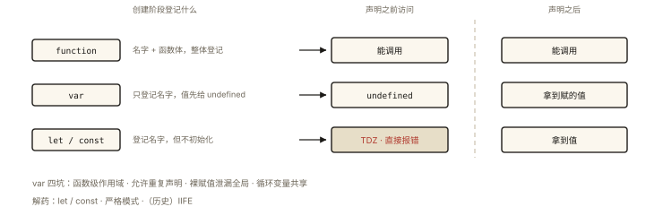

# JavaScript 核心之 var、let、const 与提升

## 从一段「薛定谔的变量」代码说起

```js
console.log(a);  // undefined —— a 还没写，但没报错？
a = 1;
console.log(a);  // 1
var a;

function f() {
  b = 2;         // 忘了声明 —— b 跑到哪去了？
}
f();
console.log(b);  // 2 —— 全局对象上多了一个 b 😱
```

两个老 JS 的「特性」：**var 的声明提升**与**裸赋值泄漏全局**。它们和「变量能不能重复声明」「作用域有多大」一起，构成了 var 的四大坑。⭐ 本文是《es6-001》的 P1 前置版：从零建立「声明提升」的完整认知，再顺手解决「全局污染」。

## 现象与直觉解释

**提升（Hoisting）的直觉版**：

> 引擎进入作用域时，先「预读」整个作用域的声明，把变量名登记好，然后才逐行执行——所以「先使用后声明」能跑，只是 var 登记的值是 undefined。

严谨机制（登记规则的完整版）在《js-deep-002》：创建阶段对**函数声明**（名字+值一起登记）与 **var**（只登记名）区别处理。本文从「行为差异」的角度把它用透。

## 深入原理

### 一、提升的四组对照实验 ⭐⭐

```js
// 实验 1：var —— 声明提升，赋值不提升
console.log(v);   // undefined（登记了名，没赋值）
var v = 1;
// 引擎视角：var v; 提前；v = 1; 留在原地

// 实验 2：函数声明 —— 整体提升（名字+函数体都能用）
fn();             // 'ok' ✅
function fn() { console.log('ok'); }

// 实验 3：函数表达式 —— 只提升变量名（按 var 规则）
fe();             // TypeError: fe is not a function（fe 是 undefined）
var fe = function () {};

// 实验 4：let/const —— 有登记无初始化（TDZ）
console.log(l);   // ReferenceError ❌（不是 undefined！）
let l = 1;
```

### 二、var 的四大坑逐个拆 ⭐

**坑 1：函数级作用域（块形同虚设）**：

```js
for (var i = 0; i < 3; i++) { }
console.log(i);   // 3 —— 循环变量泄漏到函数/全局
if (true) { var x = 1; }
console.log(x);   // 1 —— 块挡不住 var
```

**坑 2：重复声明静默覆盖**：

```js
var config = { v: 1 };
var config = { v: 2 };   // 无报错、直接覆盖（多人协作同名即事故）

// let 直接拦截：
let c2 = 1;
let c2 = 2;              // SyntaxError ✅ 拦住
```

**坑 3：裸赋值泄漏全局（开篇案例）**：

```js
function f() { b = 2; }   // 没声明就赋值
f();
console.log(window.b);    // 2 —— b 成了全局对象属性
// 非严格模式的「宽容」：找不到声明就帮你建一个全局的
```

**坑 4：循环闭包共享**（`for + var + setTimeout` 输出 3 3 3——《js-deep-005 开篇》与《es6-001》双篇详解，此处只列结论：var 只有一个函数级 i，三个闭包共享；let 每轮新建绑定）。

### 三、三大解药 ⭐⭐

**解药 1：let/const 替代 var**（块级作用域 + TDZ + 禁重复声明——《es6-001》专篇）。

**解药 2：严格模式拦住全局泄漏**：

```js
'use strict';
function f() { b = 2; }  // ReferenceError: b is not defined ✅ 提前炸比静默污染好
```

**解药 3：IIFE（历史方案）**——var 时代想造隔离作用域只能包一层函数：

```js
(function () {
  var private1 = '不出这个门';
})();   // 立即执行，private1 随函数作用域消亡
// ES6 后块级作用域 { let … } 已接管此职
```

### 四、一个冷知识：具名函数表达式的「半提升」⭐

```js
var fn = function myName() {
  // myName 只在函数体内可见（递归自引用友好），外面访问不到
  console.log(typeof myName); // 'function'
};
console.log(typeof myName);   // undefined —— 名字没有提升到外面
// 这解释了「函数表达式的名字」与「函数声明的名字」的根本不同
```

## 回看开篇

`console.log(a)` 为 undefined：var 登记在先、赋值在后；`b = 2` 泄漏：非严格模式裸赋值自动建全局——解药分别是 let 声明与 'use strict'。**var 时代的两个「宽容」，在现代 JS 里都被显式报错取代——这就是语言进化的方向：把坑变成异常。**

## 实战延伸

**1. ESLint 三连**：`no-var`（禁 var）、`no-undef`（未声明变量，配合严格模式）、`no-use-before-define`（禁止先用后声明）——三条规则开启，本文所有坑在编码期就被拦截。

**2. 面试快手串烧**：

```js
var x = 1;
function f() {
  console.log(x);   // undefined ❗不是 1 —— 本层 var x 提升，遮蔽外层
  var x = 2;
}
f();
```

**3. TDZ 判定小技巧**：看「本块内有没有 let/const 声明这个变量」——有，则从块开始到声明处全是死区（哪怕外层有同名值也救不了，《es6-001》的进阶实验）。

## 图解总结



*图 · 三者都被登记了，差别只在「登记时给不给值」*

```
进入作用域（代码执行前）
   │
   ├─ 函数声明: 名 + 函数体 全登记 ──▶ 先调用后定义 ✅
   ├─ var:      名登记, 值=undefined ─▶ 先访问得 undefined（赋值不提升）
   └─ let/const: 名登记, 不初始化 ────▶ TDZ 内访问 ReferenceError

var 四坑: 函数级作用域 | 重复声明 | 裸赋值泄漏全局 | 循环共享
解药:    let/const   | 语法错误 | 严格模式 | let 每轮新绑定
```

## 总结

- 提升是「创建阶段登记」的表现：函数声明整体提升、var 只提升名、let/const 有登记无初始化（TDZ）；
- var 四坑：函数级作用域、允许重复声明、裸赋值泄漏全局、循环变量共享；
- 解药三件套：let/const、严格模式、（历史）IIFE；
- 具名函数表达式的名字只在函数体内可见；
- 现代规范：默认 const、需要再赋值用 let、全面禁 var。

**面试一句话回答**：var 声明会被提升到作用域顶部且初始化为 undefined、作用域是函数级、允许重复声明，且非严格模式下未声明直接赋值会泄漏为全局变量；函数声明则名字和函数体一起提升所以可以先调用后定义，函数表达式只提升变量名本身；let 与 const 同样在创建阶段登记但不会初始化，声明之前访问因暂时性死区抛 ReferenceError，它们拥有块级作用域并禁止重复声明——现代实践是默认 const、需要重新赋值用 let、全程禁用 var，并用严格模式拦住全局泄漏。

## 思考题

1. 写出输出（画出每一步的作用域登记状态）：
```js
console.log(a, b, c);
var a = 1;
let b = 2;
function c() {}
```

2. 把开篇的 `b = 2` 分别放在严格模式与非严格模式下运行，行为差异是什么？「严格模式为什么宁可直接报错也不帮建全局」？
3. IIFE 的 `(function(){…})()` 外层为什么必须加括号（或前面加分号）？（提示：上一行没分号时 ASI 会把它解析成什么？）
4. 开放讨论：「let 其实也有提升」这个说法——用 `typeof tdzVar` 在声明前会抛错的实验，反驳「let 完全不提升」的流行说法。

（思考题解析将同步录入小程序题库，关联本文 id：js-core-003）

## 参考文献：

- MDN — [变量提升](https://developer.mozilla.org/zh-CN/docs/Glossary/Hoisting)、[严格模式](https://developer.mozilla.org/zh-CN/docs/Web/JavaScript/Reference/Strict_mode)
- 本课程《js-deep-002 变量对象》（登记机制的原理篇）、《es6-001 let、const 与块级作用域》（进阶篇）
