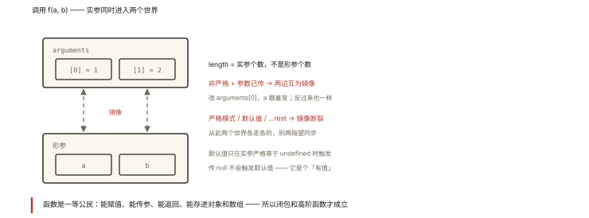

# JavaScript 核心之函数：参数、arguments 与默认值

## 从「改了 arguments，形参跟着变」的灵异事件说起

```js
function f(a, b) {
  arguments[1] = 99;
  console.log(b);        // 99 ❗ 改 arguments 竟然改到了形参！

  b = 100;
  console.log(arguments[1]); // 100 ❗ 反过来也一样
}
f(1, 2);
```

这不是 bug，是 ES5 非严格模式下的**形参与 arguments 的映射关系**——ES6 的默认参数一出现，这条映射就断了。⭐ 函数参数的「镜像世界」（arguments）与「本体世界」（形参）之间的关系，是 P1 阶段最容易被忽略的地基知识。

## 现象与直觉解释

JavaScript 函数的参数哲学：**宽容但不保证一致**。

- 传多不报错：多余的实参进 `arguments`（形参拿不到）；
- 传少不报错：缺的形参是 `undefined`（arguments 里也没对应项）；
- 形参与 arguments **在特定条件下互为镜像**（下文拆解条件）。

而函数本身是**一等公民**：能赋值给变量、当参数传、当返回值、存进数据结构——这正是回调、闭包、高阶函数（整个 JS 前半部）的许可证书。

## 深入原理

### 一、arguments：类数组全档案 ⭐

```js
function demo() {
  console.log(typeof arguments);          // 'object'（不是数组！）
  console.log(arguments.length);          // 实参个数（不是形参个数！）
  console.log(Array.isArray(arguments));  // false
  console.log(Object.keys(arguments));    // ['0', '1'] —— 索引是字符串键
}
demo(1, 2);   // 形参 0 个、实参 2 个 —— length 是 2

function demo2(a, b, c) {}
demo2(1);     // length 1（c 未传，arguments 里也没有）
```

**length 是实参个数**——`arguments.length` 与 `fn.length`（形参个数，且遇默认参数截止，《es6-004》）是两个世界的计数器。

**类数组的代价与转正**：

```js
arguments.map(...)    // ❌ TypeError —— 没有数组方法
// 转真数组三式（es6-005 详述）
Array.from(arguments);
[...arguments];                    // 迭代协议通道
Array.prototype.slice.call(arguments); // 借方法通道（js-deep-007）
```

### 二、形参 ⇄ arguments 的镜像规则 ⭐⭐

| 条件 | arguments[i] 与第 i 个形参 |
|---|---|
| 非严格模式 + **实参真实传入**该位置 | **互为镜像**：改一边另一边跟着变 |
| 非严格模式 + 该位置**没传实参** | 无映射：arguments[i] 是 undefined，改形参不影响它 |
| **严格模式** | 彻底无映射（规范砍掉了这个历史特性） |
| 形参带**默认值**（无论模式） | 无映射（参数获得独立的初始化，《es6-004》） |

```js
'use strict';
function s(a, b) {
  arguments[0] = 99;
  console.log(a);      // 1 —— 严格模式下不联动
}
s(1, 2);
```

**工程结论**：镜像是不安全的历史行为——新代码**永远不要写 arguments**（读老代码时认得它即可），需要收集参数一律用 rest 参数 `...args`（真数组、箭头函数可用、语义显式）。

### 三、传参机制回顾：按值传递 + 引用值的地址拷贝

```js
function change(user, list, n) {
  user.name = '改了';    // 沿地址进堆 ✅ 外部可见
  list.push(1);          // ✅ 同上
  n = 99;                // 原始值拷贝 ❌ 外部无感
  user = {};             // 形参纸条换新 ❌ 外部无感
}
const u = { name: 'a' }, l = [], m = 1;
change(u, l, m);
console.log(u.name, l.length, m); // '改了' 1 1
```

（机制详解见《js-core-001》——本节是它的函数场景应用。）

### 四、默认值：三代演进 ⭐

```js
// 第一代（ES5）：|| 的误伤 —— 0、''、false 都被当「没传」
function setLevel(level) {
  level = level || 1;      // level 传 0 时被误改成 1 ❌
}

// 第二代（ES5 正确版）：显式判断 undefined
function setLevel2(level) {
  if (level === undefined) level = 1;
}

// 第三代（ES6）：语法化 —— 只在 undefined 时触发（《es6-004》全规则）
function setLevel3(level = 1) {}
setLevel3(0);      // 0 ✅ 保留
setLevel3();       // 1
setLevel3(undefined); // 1
setLevel3(null);   // null ❗（null 不触发）
```

### 五、函数作为值：一等公民的四个证据 ⭐

```js
// 1. 赋给变量/属性
const hi = function () {};
obj.method = hi;

// 2. 当参数（回调的根基）
[1, 2].map(function (x) { return x * 2; });
btn.addEventListener('click', hi);

// 3. 当返回值（闭包的根基 —— js-deep-005）
function multiplier(k) { return (x) => x * k; }
const double = multiplier(2);

// 4. 存进结构 / 动态构造
const ops = { add: (a, b) => a + b, sub: (a, b) => a - b };
ops['add'](1, 2);   // 3 —— 表驱动编程（策略模式的平民版）
```

## 回看开篇

灵异事件的解释：非严格模式 + 实参真实传入 → arguments[1] 与 b **共享同一存储**，改谁都是改同一处。而 ES6 的默认参数让参数走「独立初始化」路径，映射即刻消失——**历史行为被新特性悄然终结**，这正是理解它的最佳时机（也是面试里「ES5 与 ES6 参数行为差异」的标准答案）。

## 实战延伸

**1. 面试快手串烧**：

```js
function f(a, b = 2, ...rest) {}
console.log(f.length);          // 1 —— 默认参数前的形参个数
function g() { return arguments.length; }
console.log(g(1, 2, 3, 4));     // 4 —— 实参个数
```

**2. 「不定参函数」的改造**：老代码 `function sum() { return [...arguments].reduce((a,b)=>a+b); }` → 新写法 `const sum = (...nums) => nums.reduce((a,b)=>a+b);`——rest 版可直接进箭头函数与 TS 类型。

**3. 策略表驱动实战**：

```js
const validators = {
  required: (v) => v !== '' && v != null,
  email: (v) => /@/.test(v),
  min: (v, n) => v.length >= n,   // 带参校验器
};
function validate(value, rules) {
  return rules.every((r) => validators[r.type](value, r.arg));
}
```

## 图解总结



*图 · 两个世界平时同步，一旦断链就再也对不上*

```
调用 f(a, b) ──实参们──▶ [ arguments（类数组镜像世界） ]
                        │  length = 实参个数
                        │  非严格+已传 ⇄ 形参互为镜像 ⭐
                        │  严格 / 默认参数 → 镜像断裂
                        ▼
                   [ 形参世界 ] a, b, ...rest
                        │  默认值：仅 undefined 触发
                        ▼
                   函数体执行（this 另算 —— js-deep-006）

函数是一等公民：赋值 ✓ 传参 ✓ 返回 ✓ 存储构造 ✓
```

## 总结

- arguments 是类数组对象：length 记实参个数、无数组方法、新代码不写它；
- 形参⇄arguments 镜像的三个断点：严格模式、默认参数、未传实参的位置；
- 传参 = 按值传递（引用值传地址拷贝）：改属性可见、重赋值不可见；
- 默认值三代演进：||（误伤 falsy）→ 显式 undefined 判断 → ES6 默认参数；
- 函数一等公民四证据：赋值、传参、返回、存储——回调与闭包的地基。

**面试一句话回答**：函数的 arguments 是一个类数组对象，length 是实际传入的实参个数且没有数组方法；在非严格模式下当某个位置真实传入了实参时，arguments 对应项与形参互为镜像——改一边另一边跟着变，而严格模式、形参带默认值或该位置未传实参时映射关系不存在；参数传递是按值传递，引用类型传递的是地址拷贝所以修改属性对外可见而重新赋值不可见；默认参数只在实参严格等于 undefined 时生效，函数作为一等公民可以赋值传参返回与存储，这是回调与闭包的许可基础——新代码收集不定参应一律使用 rest 参数。

## 思考题

1. 写出输出并标注「镜像是否成立」：
```js
function f(a, b) {
  console.log(a, b, arguments.length);
  arguments[1] = 9;
  console.log(b);
  b = 10;
  console.log(arguments[1]);
}
f(1);
```

2. `fn.length` 与 `arguments.length` 分别是什么？`function f(a, b = 1, c, ...d)` 的 length 是几？
3. 手写 `arg2arr`：分别用三种方式把 arguments 转数组，并说明每种依赖的机制（迭代协议/借方法/构造器）。
4. 开放设计：实现 `createValidator(schema)` 的函数骨架——「函数返回函数」+「表驱动」组合，说明每层各干什么。

（思考题解析将同步录入小程序题库，关联本文 id：js-core-005）

## 参考文献：

- ECMA-262 现行版 — FunctionDeclarationInstantiation（参数与 arguments 的映射规则原文）
- 《JavaScript 高级程序设计（第 4 版）》第 5、10 章
- 本课程《js-core-001 数据类型》《es6-004 函数扩展》（地基与进阶）
