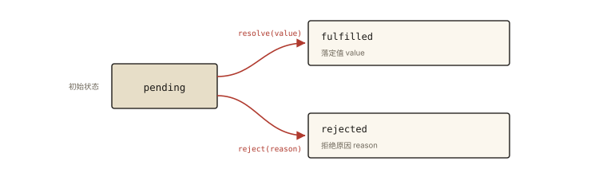

# 异步编程之 Promise 基础

## 从一道 then 链输出题说起

不运行，写出输出顺序：

```js
Promise.resolve(1)
  .then((v) => {
    console.log('then1:', v);
    return v + 1;
  })
  .then(console.log)        // 打印什么？
  .then(Promise.resolve(9)) // 值穿透：这行会打印 9 吗？
  .then((v) => {
    console.log('then4:', v);
    throw new Error('boom');
  })
  .catch((e) => {
    console.log('caught:', e.message);
    return 'recovered';
  })
  .then((v) => console.log('after catch:', v));
```

正确输出：

```
then1: 1
2
then4: 2        ← 不是 9！
caught: boom
after catch: recovered
```

如果 `then4` 打印 `2` 而不是 `9` 让你意外，说明你对「then 返回什么」的理解还差半块拼图。⭐⭐ Promise 是前端面试的绝对高频，而它全部的行为都可以从两条规则推导——本文的目标就是让你**不再背输出，而是推输出**。

## 现象与直觉解释

Promise 对上一篇回调节日的回应，一句话：

> **把「异步结果」从一个「回调行为」变成一个「对象」**——现在结果是一个值，可以被返回、被传递、被链式组合。

直觉上它像一个「提货凭证」：

- 你马上拿到凭证（Promise 对象），不用等货到；
- 凭证上的状态只会从「待定」走向「到货」或「缺货」，**且一旦落定永不改变**；
- 你可以随时在凭证背面写「到货后干什么」（then），写多少条都行——哪怕写的时候货已经到了。

## 深入原理

### 一、状态机：Promise 的第一条公理



*图 · 只有两条出路，而且都是单行道：一旦落定，再调 resolve / reject 都不会生效*

```
            resolve(value)
  pending ────────────────▶ fulfilled（落定值 value）
     │
     │      reject(reason)
     └────────────────────▶ rejected（拒绝原因 reason）

  规则：fulfilled 与 rejected 之间不能互转；
       状态一旦改变，永久定格（再调 resolve/reject 无效）
```

```js
const p = new Promise((resolve, reject) => {
  resolve('first');
  resolve('second'); // 被忽略
  reject('err');     // 被忽略
});
p.then(console.log); // first —— 只认第一次落定
```

**「不可逆、只落定一次」** 正是对上一篇「回调被调多次」信任问题的釜底抽薪——Promise 机制上杜绝了重复兑现。

### 二、then 的返回值：第二条公理（本篇核心）⭐

> **then（以及 catch/finally）总是返回一个全新的 Promise，它的状态由回调的返回值决定：**

| 回调返回什么 | 新 Promise 变成 |
|---|---|
| 普通值（含 undefined） | fulfilled，值为该返回值 |
| 一个 Promise | **采用它的状态与值**（等待它落定） |
| 一个 thenable | 先按 Promise 规则包装，再采用 |
| 抛出异常 | rejected，原因为该错误 |

```js
Promise.resolve(1)
  .then((v) => v + 1)                 // 返回 2 → 新 promise fulfilled(2)
  .then((v) => Promise.resolve(v * 10)) // 返回 promise → 采用 → fulfilled(20)
  .then((v) => { throw new Error('x'); }) // 抛错 → rejected
  .catch((e) => 'ok')                 // 返回 'ok' → 链「恢复」为 fulfilled
  .then(console.log);                 // ok
```

**catch 之后的链是「复活」的**——catch 有返回值，链就重新 fulfilled。这是错误处理编排的基础：一个 catch 管一段，而不是一个 catch 管到底。

### 三、值穿透：开篇第二问的答案

`then` 的参数**必须是函数**。如果传了非函数（比如 `Promise.resolve(9)` 这个对象），规范规定：**忽略它，把收到的值原样传给下一环**：

```js
Promise.resolve(2)
  .then(Promise.resolve(9)) // 参数不是函数 → 穿透
  .then((v) => console.log(v)); // 2 —— 内部的 9 从未生效
```

所以开篇 `then4` 打印 `2`。常见触发场景是「忘了写箭头函数」：

```js
.then(console.log())  // ✗ 立即执行，返回 undefined → 传给 then 的是 undefined（穿透）
.then(console.log)    // ✓ 函数引用，正确接收值
```

### 四、错误冒泡：沿链「顺流而下」

then 链中任何一环抛错/reject，错误会**跳过中间所有只有 onFulfilled 的 then**，直达最近的错误处理器（then 的第二参数或 catch）：

```js
Promise.resolve()
  .then(() => { throw new Error('A'); })
  .then(() => console.log('跳过我'))
  .then(() => console.log('也跳过我'))
  .catch((e) => console.log('捕获:', e.message)); // 捕获: A
```

对照上一篇的三层 `if (err)`——冒泡机制让**错误处理只写一次**。机制根源：onRejected 缺省时，规范让它充当「重新抛出的转发器」。

**then(fn, errFn) 与 catch 的细微差别**（高频追问）：

```js
promise
  .then(fn, errFn)  // errFn 捕获不到 fn 自己抛的错（fn 的错在下一环）
  .catch(errFn2);   // catch = then(null, errFn2)，捕获之前整条链

// 经典对比：两段代码中 errFn 都不会捕获「成功回调里的错」
// —— 所以团队规范通常推荐统一用 .catch
```

### 五、微任务时序：then 永远异步执行

即使 Promise 已经落定，then 回调也**绝不同步执行**，而是进入微任务队列（《js-async-005 事件循环》详细展开）：

```js
console.log('1: 同步');
Promise.resolve().then(() => console.log('3: 微任务'));
console.log('2: 同步');
// 输出 1 → 2 → 3 —— 保证回调时序的可预测性（规范要求）
```

这条「永远异步」的保证，同样是对回调信任问题的回应：**你的回调不会「太早」同步执行**。

## 回看开篇

| 输出行 | 推导依据 |
|---|---|
| `then1: 1` | 初始 fulfilled(1)，回调拿到 1，返回 2 |
| `2` | 上一环返回普通值 2；`console.log` 直接当 onFulfilled |
| `then4: 2` | `Promise.resolve(9)` 非函数 → **值穿透**，2 原样流过 |
| `caught: boom` | then4 抛错 → 沿链冒泡到 catch |
| `after catch: recovered` | catch 有返回值 → 链复活 fulfilled('recovered') |

两条公理（状态机 + then 返回值规则）+ 两个机制（穿透、冒泡）——整段输出没有一行需要「背」。

## 实战延伸

**1. 用 then 链重写回调地狱（呼应第 1 篇）**

```js
getUser(userId)
  .then((user) => getOrders(user.id))   // 返回 promise → 采用
  .then((orders) => getOrderDetail(orders[0].id))
  .then(render)                          // 一个 catch 管全程
  .catch(handleError);
```

**2. 回调风格 API 的 Promise 化**

```js
const readFile = (path) =>
  new Promise((resolve, reject) => {
    fs.readFile(path, (err, data) => (err ? reject(err) : resolve(data)));
  });
// Node 已内置 util.promisify 做同样的事
```

**3. 未捕获拒绝的现代防线**：`p.catch()` 都没写时，Node 会触发 `unhandledRejection`、浏览器控制台报 Uncaught (in promise)——线上应全局监听并上报（关联《architecture-005 前端监控体系》）。

## 图解总结

```
        ┌──────────── 状态机（公理一）────────────┐
        │   pending ──resolve──▶ fulfilled        │
        │      └────reject────▶ rejected          │
        │   （不可逆 · 只落定一次）                 │
        └─────────────────────────────────────────┘
                          │
        ┌──── then 返回新 promise（公理二）────────┐
        │  回调返回 值 → fulfilled(值)             │
        │  回调返回 promise → 采用其状态            │
        │  回调 抛错 → rejected(错) ──▶ 沿链冒泡    │
        │  参数非函数 → 值穿透原样下传              │
        └─────────────────────────────────────────┘
```

## 总结

- Promise 把异步结果「对象化」：状态机不可逆、只落定一次，机制上杜绝重复兑现；
- then 总返回新 Promise：普通值→落定、Promise→采用、抛错→拒绝；catch 之后链可复活；
- 参数非函数触发值穿透；错误沿链冒泡直达最近的处理器；
- then 回调永远走微任务异步执行，绝不「太早」；
- 一切输出题从两条公理推导，不要背。

**面试一句话回答**：Promise 是一个状态只能从 pending 单向落定为 fulfilled 或 rejected 的一次性状态机；then 总是返回新的 Promise，其状态由回调返回值决定——返回普通值则落定、返回 Promise 则采用其结果、抛错则拒绝并沿链冒泡到最近的 catch，传非函数参数则发生值穿透；再配合回调永远异步进微任务的保证，它系统性地解决了回调模式的信任与控制流问题。

## 思考题

1. 写出输出并逐行注明依据（公理/机制）：
```js
Promise.resolve('A')
  .then((v) => { console.log(1, v); return Promise.reject('B'); })
  .then(() => console.log(2), (e) => { console.log(3, e); return 'C'; })
  .then((v) => { console.log(4, v); })
  .catch(() => console.log(5));
```

2. `new Promise((resolve) => { resolve(1); }).then(alert)` 与 `new Promise((resolve) => { setTimeout(() => resolve(1), 0); }).then(alert)`——两个 then 的执行时机有何不同？「永远异步」保证了什么？

3. 为什么 `.then(fn).catch(handler)` 优于 `.then(fn, handler)`？构造一个能区分两者的具体场景。

4. 开放设计：实现 `promiseify(fn)`，把 error-first 回调风格的函数转成返回 Promise 的函数；考虑「回调有多个结果参数」时如何设计（提示：返回数组或让调用方指定取第几个）。

（思考题解析将同步录入小程序题库，关联本文 id：js-async-002）

## 参考文献

- ECMA-262 现行版 — PromiseObjects 章节（then 的 EnqueueJob、《Promise Resolve Functions》）
- Promises/A+ 规范 — then 穿透与采用规则的原始定义
- MDN — [使用 Promise](https://developer.mozilla.org/zh-CN/docs/Web/JavaScript/Guide/Using_promises)
- 《你不知道的 JavaScript（中卷）》第 3 章
