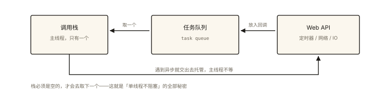
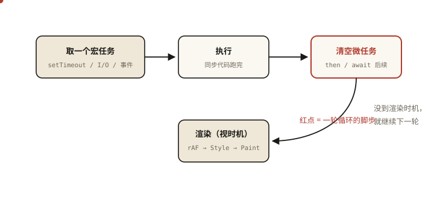
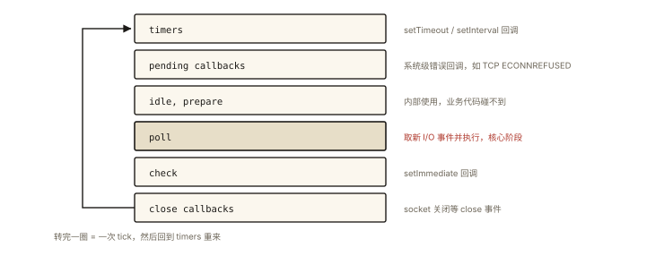
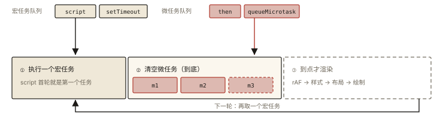

# 异步编程之事件循环

## 从一道综合输出题说起

这是一道经典到近乎「面试标配」的题目，涉及同步任务、`setTimeout`、`Promise`、`async/await` 的完整执行顺序 ⭐⭐ 面试必考：

```js
async function async1() {
  console.log('async1 start');
  await async2();
  console.log('async1 end');
}

async function async2() {
  console.log('async2');
}

console.log('script start');

setTimeout(() => {
  console.log('setTimeout');
}, 0);

async1();

new Promise((resolve) => {
  console.log('promise1');
  resolve();
}).then(() => {
  console.log('promise2');
});

console.log('script end');
```

正确输出：

```
script start
async1 start
async2
promise1
script end
async1 end
promise2
setTimeout
```

如果你对其中任何一行的顺序感到意外，这篇文章就是为你写的。读完你将能**从循环模型出发推导任何这类题目**，而不是靠背答案。

## 第一层：为什么会有事件循环

### JavaScript 为什么是单线程

JavaScript 诞生时的使命是操作 DOM、响应用户交互。如果它是多线程的——线程 A 在给某个节点添加内容，线程 B 同时在删除这个节点——浏览器将无所适从。所以设计者做了一个简单粗暴的决定：**JS 主线程同一时刻只执行一段代码**。

单线程意味着：**耗时操作（网络请求、定时器、IO）绝不能在主线程上同步等待**，否则页面就冻结了。于是所有浏览器/Node.js 都采用同一套思路：

- 把耗时操作交给**其他线程/底层系统**去干；
- 干完之后，把回调函数放进**队列**；
- 主线程空闲时，从队列里取任务执行。

这个「取任务 → 执行 → 再取任务」的无限循环，就是**事件循环（Event Loop）**。名字很朴素：事件驱动 + 循环调度。

### 三个基础角色



*图 · 队列里的回调没有优先级，只有先来后到*

```
   ┌────────────┐        ┌─────────────────┐
   │  调用栈      │◀──取──│  任务队列（队列） │◀──放入── Web API / 底层
   │ （主线程）    │  任务  │  task queue     │         （定时器/网络/IO）
   └────────────┘        └─────────────────┘
```

- **调用栈（Call Stack）**：主线程执行代码的地方，函数调用入栈、执行完出栈；
- **Web API / 底层线程**：`setTimeout`、网络请求、DOM 事件实际工作的地方（浏览器多线程，Node.js 用 libuv 线程池）；
- **任务队列**：完成后的回调排队等待进入调用栈。

走到这一步，你已经能解释简单题了。但开篇那道题里，`setTimeout` 的回调排在 `promise.then` 之后——它们不是同一个队列。

## 第二层：浏览器的事件循环模型 ⭐

### 完整循环步骤

依据 HTML Standard 的 [event loop processing model](https://html.spec.whatwg.org/multipage/webappapis.html#event-loop-processing-model)，通俗化后循环的每一轮是这样的：

1. 从**宏任务队列**中取出**最老的一个**任务执行；
2. 执行完毕后，**清空整个微任务队列**（不停取微任务执行，直到队列空）；
3. （如果到了渲染时机）执行渲染步骤：`requestAnimationFrame` 回调 → 样式计算 → 布局 → 绘制；
4. 回到第 1 步。

```
一轮循环：
┌──────────────────────────────────────────┐
│ ① 执行一个宏任务                           │
│ ② 清空所有微任务（含执行中新产生的微任务）    │
│ ③ （可能）渲染：rAF → style → layout → paint│
└──────────────────────────────────────────┘
                     ↓ 重复
```

两个关键推论：

- **每轮循环只执行一个宏任务**，但微任务是「清空到底」；
- 微任务中产生的微任务也会在同一轮被清空（所以微任务里无限 `then` 会卡死页面——永远轮不到渲染和下一个宏任务）。

### 两个队列的成员清单

| 宏任务（macrotask / task） | 微任务（microtask / job） |
|---|---|
| 整段脚本（script） | `Promise.then/catch/finally` 回调 |
| `setTimeout` / `setInterval` | `queueMicrotask()` |
| I/O、网络事件 | `MutationObserver` 回调 |
| UI 事件（click、scroll…） | （Node 专属）`process.nextTick` 队列，优先级在微任务之前 |
| `postMessage` / `MessageChannel` | |
| `setImmediate`（Node） | |

注意两点：
1. **整段 script 本身就是第一个宏任务**——所以「同步代码」其实就是第一轮循环的第 ① 步；
2. `process.nextTick` 严格说是独立队列，习惯上和微任务一起讨论（见 Node 部分）。

### 为什么需要微任务

只用一个队列行不行？不行，原因有两个：

- **时效性**：宏任务要等下一轮循环，中间还可能插进渲染；微任务在当前任务后**立即**执行。`Promise` 的语义要求 `.then` 回调尽快兑现，不应被别的任务「插队」；
- **性能**：如果每个异步回调都做成宏任务，页面上频繁的状态更新会导致响应延迟和渲染抖动。微任务批量执行，可以在渲染前把一轮状态变更全部消化掉。

一句话：**微任务是「当前任务的后置步骤」，宏任务是「下一轮循环的主菜」。**



*图 · 红点走完一圈 = 一轮事件循环：宏任务 → 微任务清空 →（可能）渲染 → 回到队列*

## 第三层：逐题精讲

### 题 1：Promise 与 setTimeout

```js
console.log('script start');

setTimeout(() => console.log('setTimeout'), 0);

Promise.resolve().then(() => console.log('promise1'))
                 .then(() => console.log('promise2'));

console.log('script end');
```

推导：
1. 整段 script 是宏任务①，同步执行：`script start` → `script end`。期间 `setTimeout` 回调进宏任务队列，两个 `then` 回调先后进微任务队列；
2. 宏任务①结束，清空微任务：`promise1` → 执行中产生第二个 `then` → `promise2`；
3. 下一轮循环取宏任务：`setTimeout`。

输出：`script start → script end → promise1 → promise2 → setTimeout`。

### 题 2：async/await 的本质

要理解开篇题，只需要一个等价转换：

> **`await xxx` 之后的代码，相当于放进 `.then()` 的回调里。**

即：

```js
async function async1() {
  console.log('async1 start');
  await async2();
  console.log('async1 end');
}
// 大致等价于：
function async1() {
  console.log('async1 start');
  async2().then(() => {
    console.log('async1 end');
  });
}
```

`await` 会**暂停当前 async 函数**，把控制权交还给调用者；等到右侧 Promise 落定，恢复执行的代码以**微任务**形式入队。

### 题 3：开篇综合题完整推导

1. **宏任务①（整段 script）**，同步执行：
   - `script start`
   - 调用 `async1()`：`async1 start` → `async2()` 执行 `async2` → 遇 `await`，挂起，把「`async1 end`」以微任务入队，**返回调用处**
   - `new Promise` 的执行器同步执行：`promise1`；`.then` 回调入微任务队列
   - `script end`
   - 此时微任务队列：`[async1 end, promise2 回调]`
2. **清空微任务**：`async1 end` → `promise2`
3. **下一轮宏任务**：`setTimeout`

与开篇给出的答案逐行吻合。可以看到，只要掌握「同步执行到 `await` 挂起」「`.then` 回调是微任务」「`setTimeout` 是宏任务」三条规则，一切顺序题都是纸老虎。

### 题 4：加上渲染的完整节拍

```js
console.log('task start');
requestAnimationFrame(() => console.log('rAF'));
setTimeout(() => console.log('setTimeout'), 0);
Promise.resolve().then(() => console.log('microtask'));
console.log('task end');
```

典型输出：

```
task start
task end
microtask
rAF        ← 渲染时机先于下一个宏任务（大多数情况下）
setTimeout
```

按循环模型：task（script）→ 微任务 `microtask` → 渲染步骤里执行 `rAF` → 下一轮宏任务 `setTimeout`。要注意 rAF 与 setTimeout 的相对顺序在不同浏览器/帧调度下存在实现差异，面试时说出「rAF 在渲染步骤中执行，通常先于下一个宏任务」即可体现理解深度。

## 第四层：Node.js 的事件循环

Node.js 的事件循环由 **libuv** 实现，与浏览器模型同源但更复杂：它把宏任务拆成了**六个阶段（phase）**，每轮循环依次经过：



*图 · 六段固定顺序转圈，不是「谁先准备好谁先跑」*

```
   ┌───────────────────────────┐
   │    timers 阶段             │ ← setTimeout / setInterval 回调
   │    pending callbacks      │ ← 系统级错误回调（如 TCP ECONNREFUSED）
   │    idle, prepare          │ ← 内部使用
   │    poll 阶段               │ ← 取新 I/O 事件；执行 I/O 回调（核心阶段）
   │    check 阶段              │ ← setImmediate 回调
   │    close callbacks        │ ← close 事件回调
   └───────────────────────────┘
```

与浏览器的两个关键差异：

1. **`process.nextTick` 队列优先于微任务队列**：在每轮阶段切换之间，顺序是「清空 nextTick 队列 → 清空微任务队列」；
2. **历史版本差异（常考）**：Node 11 之前，微任务要等**每个阶段的一批任务全部执行完**才清空；Node 11 之后与浏览器对齐——**每执行完一个宏任务就清空微任务**。现代题目默认按 Node 11+ 行为回答。

```js
// Node 11+，输出顺序稳定为：
setImmediate(() => console.log('immediate'));
setTimeout(() => console.log('timeout'), 0);
Promise.resolve().then(() => console.log('promise'));
process.nextTick(() => console.log('nextTick'));
// nextTick → promise → （timeout 与 immediate 顺序不定，取决于进入循环时的毫秒数）→ ...
```

`setTimeout(fn, 0)` 与 `setImmediate` 的顺序问题：进入 timers 阶段的时机受 1ms 门槛影响，两者都可能先执行，属于「实现细节不确定」，面试答出「不确定，取决于进程启动时机」反而是加分项。

## 图解总结



*图 · 一轮只取一个宏任务，但微任务要清到队列空为止——包括执行中新产生的那个（虚线 m3）*

```
                         ┌──────────────┐
          ┌─────────────▶│  宏任务队列    │
          │              └──────┬───────┘
          │                     │ 取一个执行
          │                     ▼
   ┌──────┴──────┐      ┌─────────────┐
   │ 下一轮循环    │      │  执行宏任务    │
   └─────────────┘      └──────┬──────┘
          ▲                    │ 执行完毕
          │                    ▼
          │              ┌─────────────┐    清空到底
          │              │  微任务队列    │────────────▶（可能触发渲染：rAF → paint）
          │              └─────────────┘
          └───────────────────────────────────────────┘
```

## 总结

- JS 单线程 + 耗时操作外部化 → 必须有事件循环调度；
- 浏览器模型：**一个宏任务 → 清空全部微任务 → （可能）渲染 → 下一个宏任务**；
- `await` 之后 = `.then` 之内：async 函数在 `await` 处挂起，剩余代码以微任务入队；
- 微任务的优势是**时效与批处理**，它是「当前任务的后置步骤」；
- Node.js：六阶段循环 + `nextTick` 优先于微任务；Node 11+ 每个宏任务后清空微任务，与浏览器对齐；
- 解题万能流程：先同步 → 途中的微任务排队、宏任务排队 → 清微任务 → 取宏任务，循环。

**面试一句话回答**：事件循环是 JS 单线程下的任务调度机制——每轮从宏任务队列取一个任务执行，随后把微任务队列清空到底，接着视时机执行渲染（rAF → 样式 → 布局 → 绘制），再进入下一轮；Promise 回调和 `await` 后续代码走微任务，`setTimeout`/I/O 走宏任务，所以 `Promise.then` 总是先于 `setTimeout` 执行。

## 思考题

1. 写出输出并说明理由：
```js
Promise.resolve().then(() => {
  console.log('then1');
  setTimeout(() => console.log('setTimeout in then'), 0);
});
setTimeout(() => {
  console.log('setTimeout');
  Promise.resolve().then(() => console.log('then2'));
}, 0);
```

2. 微任务队列中如果不断产生新的微任务（如递归 `then`），页面会发生什么？为什么？（提示：想想渲染发生在哪一步）

3. 在浏览器里，`requestAnimationFrame` 的回调、微任务、`setTimeout(fn, 0)` 三者的典型执行顺序是什么？各自在循环模型的哪个环节？

4. Node.js 中 `process.nextTick` 和 `queueMicrotask` 都能注册「尽早执行的回调」，它们的优先级如何？为什么 Node 要单独提供 nextTick？

（思考题解析将同步录入小程序题库，关联本文 id：js-async-005）

## 参考文献

- HTML Standard — [Event loops（event loop processing model）](https://html.spec.whatwg.org/multipage/webappapis.html#event-loops)
- Jake Archibald — [Tasks, microtasks, queues and schedules](https://jakearchibald.com/2015/tasks-microtasks-queues-and-schedules/)
- Node.js 官方文档 — [The Node.js Event Loop, Timers, and process.nextTick()](https://nodejs.org/en/learn/asynchronous-work/event-loop-timers-and-nexttick)
- MDN — [Concurrency model and the event loop](https://developer.mozilla.org/en-US/docs/Web/JavaScript/Event_loop)
