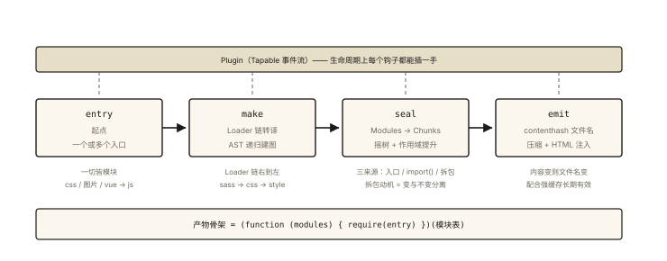
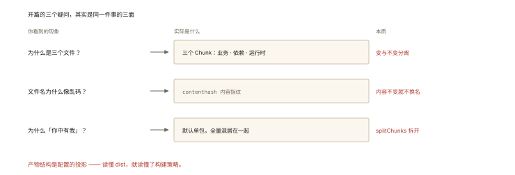

# 前端工程化之 Webpack：打包的完整流程

## 从「打开 dist 目录那一刻的三个疑问」说起

```bash
npm run build 之后 dist/ 里躺着：
app.a3f8c2.js   vendors.7b2d1e.js   runtime.d91f0a.js   index.html
# 疑问一：为什么是【三个】js？谁分的？
# 疑问二：文件名里那串乱码（a3f8c2）是干什么的？
# 疑问三：几 MB 的业务代码 + 几十 KB 的框架，为什么打包后「你中有我」？
```

⭐⭐ Webpack 的「打包流程」是工程化面试的中坚题——《handwritten-011》手写过 100 行内核，本篇把工业版的完整流水线、产物结构与常见概念（chunk/bundle/hash）对齐。

## 现象与直觉解释

Webpack 的工作一句话：**从入口出发，把一切资源当模块，构建依赖图，组装成浏览器可运行的产物**。



*图 · Loader 管单个文件，Plugin 管整条流水线*

```
entry（入口）
  │ ① 递归解析依赖（一切皆模块：js/css/png/vue…）
  ▼
Module（依赖图的基本单元）
  │ ② Loader 转译：非 js → js（或可处理形态）
  ▼
②③ Plugin 全程挂钩：在每个阶段介入（拆包/压缩/生成 html…）
  │ ④ 组装 Chunk（逻辑分组）→ 打包 Bundle（物理文件）
  ▼
output（dist/，带 hash 文件名）
```

## 深入原理

### 一、五个核心概念的对位 ⭐⭐

| 概念 | 是什么 | 一句话 |
|---|---|---|
| Entry | 构建起点 | 依赖图遍历的根 |
| Module | 每个文件 | 一切资源皆是模块 |
| **Chunk** | 逻辑分组 | 一批 Module 的集合（入口 chunk / 异步 chunk / split 出来的 chunk）⭐ |
| Bundle | 最终文件 | Chunk 输出到磁盘的形态（常说 chunk≈bundle） |
| Loader | 转译器 | `非js → js`，单一职责、链式执行 |
| Plugin | 全周期钩子 | 基于 Tapable 事件流，能做一切「流程级」的事 |

**开篇疑问一的答案（为什么三个 js）**——三个 Chunk：

```
app.*.js      → 入口 chunk（你的业务代码）
vendors.*.js  → splitChunks 拆出的「第三方依赖」chunk（插件干的）
runtime.*.js  → Webpack 的模块运行时（那个手写的 require，100 行内核的工业版）
```

### 二、完整流水线四阶段 ⭐⭐⭐

**阶段 1：初始化**——合并配置（cli/config/默认）→ 创建 Compiler → 注册所有 Plugin（apply 钩子）。

**阶段 2：构建（make）**——从 entry 开始递归：

```
对每个文件：
  ① 匹配 rules 里的 Loader（test 正则命中）
  ② Loader 链从右到左执行：sass-loader → css-loader → style-loader
     （css → js 模块：本质是把 CSS 变成「创建 style 标签的 JS」）
  ③ 对转译产物做依赖解析（AST 找 import/require ——《handwritten-011》的正则升级版）
  ④ 发现新依赖 → 重复 ①②③（递归到没有新依赖）
产出：完整的 Module 集合（依赖图）
```

**阶段 3：封装（seal）**——按规则把 Modules 组织成 Chunks：

```
entry 的 Modules → 入口 chunk
import() 动态导入 → 异步 chunk（代码分割的来源 ⭐）
splitChunks 规则命中（如全部 node_modules）→ vendors chunk
优化：Tree Shaking（标记删除，engineering-007）、作用域提升（Scope Hoisting）
产出：chunk 间的依赖关系 + 每个 chunk 的内容
```

**阶段 4：输出（emit）**——按 output 配置生成文件：

```js
output: {
  filename: '[name].[contenthash:8].js',   // ⭐ 开篇疑问二的答案：
  // contenthash = 【内容哈希】：内容变 → 文件名变 → 配合强缓存完美（network-006）
  // 对比：hash（全构建变）｜chunkhash（chunk 级）｜contenthash（文件内容级，最准）
  path: path.resolve('dist'),
}
+ HTML 插件注入 <script>、压缩 Terser、Copy 静态资源……
```

**开篇疑问三（你中有我）**：默认单入口全量打进一个文件——业务与依赖混居；`splitChunks` 把稳定少变的依赖拆出去独立缓存——**「变与不变分离」是拆包的核心动机**（缓存利用率，《network-006》）。

### 三、一次产物的运行时回放 ⭐

```js
// dist/app.js 的骨架（对照 handwritten-011 的 100 行内核）：
(function (modules) {                    // ① 模块注册表（id → [函数, 依赖映射]）
  function __webpack_require__(id) { … } // ② 运行时 require（缓存 + 递归）
  // ③ 异步 chunk 加载器（JSONP/script 动态插入 —— import() 的实现）
  __webpack_require__(entryId);           // ④ 启动
})({ 'src/index.js': [fn, {'./a': 12}], … });
// 「打包」的本质没变：模块函数化 + 内置 require —— Webpack 只是把它工业到了极致
```

### 四、开发与生产的两张脸 ⭐

| | dev（webpack-dev-server） | build |
|---|---|---|
| 产物 | **内存中**（不落盘） | dist 文件 |
| 编译范围 | **增量**（HMR 热替换只更新变更模块） | 全量 |
| 辅助 | source map、代理（跨域绕开，network-007） | 压缩、拆包、contenthash |

HMR 一句话原理：WebSocket 通知「模块 X 变了」→ 浏览器拉新模块 → 模块系统热替换（不丢组件状态的部分场景）。

## 回看开篇

三个疑问的答案：三个文件 = 三个 Chunk（业务/依赖/运行时——拆包为了变与不变分离）；乱码 = contenthash（内容指纹，缓存策略的钥匙）；「你中有我」= 默认单包全量混居——splitChunks 是解药。**产物结构是配置的投影，读懂 dist 就读懂了构建策略。**

## 实战延伸

**1. 面试答题骨架**：「Webpack 从 entry 出发把一切资源视为模块——每个文件经匹配的 Loader 链转译成 JS，再通过 AST 解析出依赖递归处理，构建完整依赖图；seal 阶段按入口、动态 import 与 splitChunks 规则把模块组织成 chunk，并做 Tree Shaking 与作用域提升；emit 阶段按 [name].[contenthash].js 输出——contenthash 是内容指纹，配合强缓存实现变才更新。Plugin 基于 Tapable 在全流程挂钩，拆包、压缩、HTML 注入都是插件；产物骨架是模块注册表加内置 require 运行时，与手写打包器同构。」

**2. 三种 hash 的判定题**：改一行业务代码——hash/chunkhash/contenthash 各变哪些文件？（hash：全部；chunkhash：app 变 vendors 不变；contenthash：只有 app 变 ✅ 生产首选）

## 图解总结



*图 · 开篇的三个疑问，其实是同一件事的三面*

```
entry ──make──▶ [Loader链转译] ──AST解析依赖──▶ 递归 ──▶ 依赖图(Modules)
                │（一切皆模块：css/图片/vue → js）
   Plugin(Tapable) ─────────全流程挂钩──────────────┘
seal: Modules → Chunks（入口 │ import()异步 │ splitChunks拆vendors）
      + TreeShaking + ScopeHoisting
emit: [name].[contenthash:8].js + runtime + html注入 + Terser压缩
运行时: (function(模块表){ require(入口) })(…) —— handwritten-011 的工业版
```

## 总结

- 流水线四阶段：初始化 → make（Loader 转译 + 递归建图）→ seal（组 chunk + 优化）→ emit（输出）；
- 一切皆模块；Loader 转译（链式右到左）、Plugin 全周期（Tapable）；
- Chunk 是逻辑分组：入口/异步/拆包三来源——拆包动机是变与不变分离；
- contenthash 是缓存友好的文件名方案（三种 hash 的差异要能判定）；
- 产物骨架 = 模块表 + require 运行时，与手写内核同构。

**面试一句话回答**：Webpack 从 entry 出发把一切资源当作模块——每个文件先经过匹配规则命中的 Loader 链从右到左转译成 JavaScript，再通过 AST 解析出 import 与 require 依赖并递归处理，最终构建出完整的模块依赖图；seal 阶段把模块按入口、动态 import 以及 splitChunks 规则组织成多个 chunk，并执行 Tree Shaking 与作用域提升优化；emit 阶段以名字加 contenthash 的形式输出——contenthash 基于文件内容生成，内容变则文件名变，配合强缓存策略实现不发版就永久缓存。Plugin 基于 Tapable 事件流挂载在完整生命周期的各个钩子上，负责拆包、压缩与 HTML 注入等流程级任务；产物本质是模块注册表加内置的 require 运行时，从入口模块启动执行。

## 思考题

1. `import(/* webpackChunkName: "admin" */ './Admin')` 在 seal 阶段发生了什么？浏览器运行时第一次点击管理页的网络请求序列？
2. CSS 的 Loader 链 `style-loader → css-loader → sass-loader`（从左到右配置）为什么实际执行从右到左？每层各输出什么？
3. dev 的 HMR 改一个模块，为什么有的页面状态会丢？（模块热替换的边界：无 HMR 处理逻辑时整页刷新兜底）
4. 开放讨论：构建从 40s 优化到 10s 的排查路线（缓存 cache:filesystem、include/exclude 收窄 Loader、Dll 为何过时、并行压缩）。

（思考题解析将同步录入小程序题库，关联本文 id：engineering-002）

## 参考文献：

- Webpack 官方文档 — Concepts / Module Methods / Caching
- 《深入浅出 Webpack》（吴浩麟）
- 本课程《handwritten-011 mini-webpack》《network-006 浏览器缓存》《engineering-008 部署缓存》
