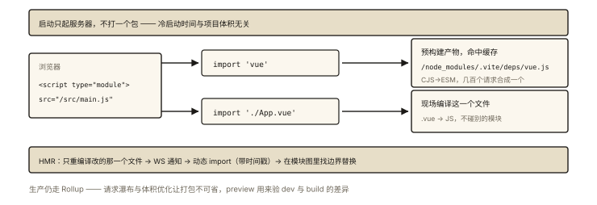

# 前端工程化之 Vite 为什么快

## 从「npm run dev 只要 300ms」说起

同一个项目：Webpack dev 冷启动 30 秒，Vite 300 毫秒——**百倍差距**。而且项目越大，差距越大（Webpack 越大越慢，Vite 几乎恒定）。⭐⭐⭐「Vite 为什么快」是工程化面试的热门题——答案的两根支柱：**开发期不打包（按需编译）** 与 **esbuild 预构建**。

## 现象与直觉解释

先看两者 dev 阶段的根本差异：

```
Webpack dev（Bundle 模式）：
  启动 = 把【整个应用】打包好（全量 Loader/转译/组装）→ 再起服务器
  ⚠️ 项目越大启动越慢 —— 你要等它干完全部的活

Vite dev（No-Bundle / Native ESM 模式）：
  启动 = 直接起服务器（几乎零工作）✅
  浏览器请求 index.html → 请求 main.js → 按需逐个请求模块
  ⚠️ → 哪个模块被请求，才现场编译哪个 —— 「启动快」的真相：
     不是编译得快，而是【把编译推迟到被需要的那一刻】
```

一句话：**Webpack 是「先做好一桌菜再开饭」，Vite 是「点一个菜炒一个」**。

## 深入原理

### 一、No-Bundle 的实现基础：浏览器原生 ESM ⭐⭐⭐

```html
<!-- Vite dev 下浏览器实际收到的 index.html（极简版）： -->
<script type="module" src="/src/main.js"></script>

<!-- main.js 里的 import 语句被 Vite【原样保留】（浏览器认识 ESM！）：
     import { createApp } from 'vue'
     import App from './App.vue'
     ──▶ 浏览器逐个发起请求：
          GET /node_modules/.vite/deps/vue.js     （预构建产物）
          GET /src/App.vue                        （现场编译）
```

**中间件逐请求编译**：Vite 拦截每个模块请求，只编译这一个文件（App.vue → export default 组件的 JS），返回给浏览器。冷启动的工作量从「全应用」缩到「入口链上的几个文件」——**与项目体积解耦**。

### 二、预构建（deps pre-bundling）：No-Bundle 的补丁 ⭐⭐⭐

按需编译有三个现实障碍，Vite 用 **esbuild 预构建**一次解决：

| 障碍 | 预构建的解法 |
|---|---|
| ① 第三方包多为 CJS（浏览器只认 ESM） | esbuild 把 CJS → ESM |
| ② lodash-es 几百个文件的几百次请求（瀑布） | 合并成单文件（减少请求） |
| ③ import 裸说明符 `'vue'` 浏览器不认识 | 改写为 `/node_modules/.vite/deps/vue.js` |

```js
// 为什么用 esbuild 而不是 babel/rollup 做这件事？
// esbuild 是 Go 编写的原生二进制（并行、无 JS 开销），转译比 JS 写的工具快 10~100 倍
// ⭐ 预构建只在「首次启动 / 依赖变化 / 锁文件变化」时跑 —— 平时直接用缓存
// .vite/deps 目录 + 优化过的 hash —— 手动重来：vite --force
```

### 三、HMR 的降维打击 ⭐⭐

```
Webpack HMR：改动 → 受影响的 chunk 局部重建（还要过一遍打包流程）
Vite HMR：
  改一个文件 → 重新编译【这一个文件】→ WebSocket 通知浏览器
  → 浏览器动态 import 新版模块（URL 带时间戳戳破缓存）
  → 模块图沿 import 链向上找到「HMR 边界」就地热替换
⭐ HMR 速度与项目体积【无关】—— 只与你改的那个模块链有关
```

### 四、生产构建：为什么仍是 Rollup（打包）⭐⭐

高频追问：「dev 不打包这么爽，为什么 build 还要打包？」

```
① 嵌套 import 的瀑布请求：成百上千个模块的逐个请求在弱网/生产不可接受
② Tree Shaking、代码压缩、chunk 优化：产物体积优化的必需（Rollup 生态成熟）
③ 浏览器兼容与统一：生产的复杂目标（polyfill 注入等）
```

```js
// Vite 生产 = Rollup + 一套预设插件（CSS/资源/分割策略）
// ⚠️ 由此产生的「dev 与 build 行为差异」风险 —— Vite 的主要吐槽点：
//    某些代码 dev 能跑 build 挂（如 CJS 依赖的引入方式差异）
//    缓解：preview 命令本地验证产物 + vitest 在 node 环境跑同一套解析
```

### 五、一张对照表总结 ⭐⭐

| | Webpack dev | Vite dev |
|---|---|---|
| 启动 | 全量打包（慢，随体积增长） | 起服务即用（~恒定）⭐ |
| 请求粒度 | bundle/chunk | 单模块（原生 ESM） |
| 第三方处理 | 打进 bundle | esbuild 预构建（快+缓存） |
| HMR | 局部重建 chunk | 单文件重编译（恒定快）⭐ |
| 生产构建 | Webpack 自身 | Rollup（打包不可省） |

## 回看开篇

300ms vs 30s 的百倍差距分解：**①不打包**（省掉全量构建——启动只起服务）+ **②按需编译**（只编译被请求的模块）+ **③esbuild 预构建**（第三方一次性高速转译并缓存）。三个「不是更快，而是不做/晚做/快做」——优化思想的教科书案例。

## 实战延伸

**1. 面试答题骨架**：「Vite dev 快在三点——利用浏览器原生 ESM 实现 No-Bundle：启动只起服务器，浏览器按 import 逐个请求模块、Vite 中间件按需编译单文件，冷启动与项目体积解耦；用 esbuild（Go 原生实现）预构建第三方依赖，把 CJS 转 ESM、合并几百个文件的请求并改写裸导入路径，结果缓存在 .vite/deps；HMR 只重编译改动文件并沿模块图热替换，速度恒定。生产构建仍用 Rollup 打包——避免成百模块的请求瀑布并获得 tree shaking 与压缩优化，dev/build 差异用 preview 验证。」

**2. 一道判断题**：「Vite dev 完全不打包」对吗？——不严谨：**第三方依赖**仍被 esbuild 预构建「打包」成单文件；No-Bundle 指的是**你的源码**。

**3. 演进一句话**：Webpack 5 的 persistent cache、Turbopack（Rust）、Rspack（Rust）都在追「dev 快」——Vite 的护城河是「原生 ESM 按需」的架构正确性，工具语言的军备竞赛则是另一层。

## 图解总结



*图 · 裸导入走缓存，相对路径现场编译 —— No-Bundle 说的是后者*

```
Vite dev 全景：

 启动: 服务器秒起 ──▶ esbuild 预构建(首次/依赖变) ──▶ .vite/deps 缓存
                                                    │
 浏览器: <script type=module src=/src/main.js>      │
   ├─ import 'vue' ──────────────▶ 重写为 /node_modules/.vite/deps/vue.js（预构建产物）
   └─ import './App.vue' ────────▶ 中间件现场编译该单文件（No-Bundle ⭐）

 HMR: 改动文件 → 重编译一个 → WS 通知 → 动态import(带t戳) → 模块图找HMR边界替换
      （速度与项目体积无关）

 生产: Rollup 打包（请求瀑布/tree-shaking/压缩 —— 打包不可省）+ preview 验差异
```

## 总结

- dev 三快：起服务不打包、按需编译单模块、esbuild 预构建依赖（缓存）；
- 原生 ESM 是架构基础：import 原样到浏览器，请求即编译；
- 预构建三职责：CJS→ESM、合并请求、路径改写——esbuild 快因 Go 原生；
- HMR 单文件级，速度与体积解耦；
- 生产仍用 Rollup：请求瀑布与体积优化决定打包不可省；preview 验证差异。

**面试一句话回答**：Vite 开发快的三个支柱——其一，利用浏览器原生 ES Module 实现免打包：启动时只启动开发服务器，浏览器按 import 语句逐个请求模块，Vite 的中间件现场编译被请求的单一文件，冷启动时间与项目体积解耦；其二，用 Go 编写的 esbuild 做依赖预构建，把大量 CommonJS 包转为 ESM、把几百个模块请求合并为单文件、并把裸导入改写为可访问路径，结果缓存在 node_modules 的 .vite 目录、仅在依赖或锁文件变化时重建；其三，热更新只重新编译改动的那一个文件，通过 WebSocket 通知浏览器按时间戳动态加载新模块并在 HMR 边界内替换，速度恒定。生产构建仍交给 Rollup 完成打包、摇树与压缩，因为成百上千个模块的请求瀑布与体积优化决定了打包不可省略。

## 思考题

1. 为什么浏览器原生 ESM 场景下「CJS 包不能直接用」？预构建还顺带解决了哪些问题？
2. dev 下改一个被 200 个模块引用的公共文件，HMR 的行为路径？为什么可能退化为整页刷新（HMR 边界不存在时）？
3. Vite 中间层改写 import 的完整链路：裸说明符 → 预构建路径；相对路径 → 编译后 URL——写出两条例子的前后对照。
4. 开放讨论：Rspack/Turbopack 用 Rust 重写 Webpack 路线，Vite 用「原生 ESM + 按需」路线——两条路线的根本分歧是什么？各自的天花板？

（思考题解析将同步录入小程序题库，关联本文 id：engineering-005）

## 参考文献：

- Vite 官方文档 — Why Vite / Dep Pre-Bundling（官方第一手解释）
- esbuild 官方 — FAQ（为什么快）
- 本课程《engineering-002 Webpack 流程》《es6-010 模块化》（ESM/CJS 地基）
