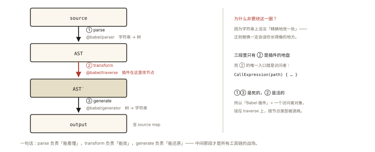
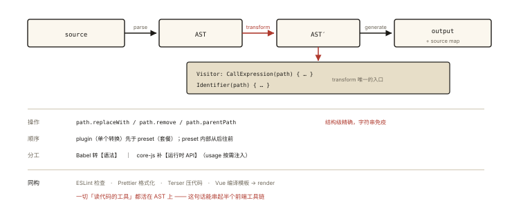

# 前端工程化之 Babel 与 AST

## 从「一个插件引发的线上事故」说起

```js
// 同事写了个 Babel 插件：把所有 console.log 换成空函数
// 上线后发现：Math.pow(x, 2) 全变成了 NaN —— 插件误伤了「字符串里的 console.log」？
```

排查方向直指本篇主题：**Babel 是怎么「读懂并改写」你的代码的——AST**。⭐⭐「AST 是什么、Babel 的工作流程、插件怎么写」是工程化的深水题，且 AST 是 Babel/ESLint/Prettier/模板编译（handwritten-010）/代码压缩器全部工具的共同地基。

## 现象与直觉解释

**AST（抽象语法树）**：把源码解析成「**描述代码结构的对象树**」——每个节点是一个语法单元（函数调用、标识符、字面量……），操作 AST = 操作代码的结构本身。

```js
// 源码：
const answer = 6 * 7;
// AST（简化）：
{
  type: 'VariableDeclaration',          // 变量声明
  declarations: [{
    id: { type: 'Identifier', name: 'answer' },
    init: {
      type: 'BinaryExpression',         // 二元表达式
      operator: '*',
      left: { type: 'NumericLiteral', value: 6 },
      right: { type: 'NumericLiteral', value: 7 },
    },
  }],
}
```

把代码变成树，就能用「遍历树 + 改节点」的方式做一切变换——比正则改字符串**安全一万倍**（正则不知道什么是「字符串里的内容」——开篇事故的根源）。

## 深入原理

### 一、Babel 三段式流水线 ⭐⭐⭐



*图 · 三段是死的，插件全挂在中间那段上*

```
source（源码字符串）
   │ ① parse：@babel/parser 把源码 → AST
   ▼
AST
   │ ② transform：@babel/traverse 遍历 + 各插件【访问者】修改节点
   ▼
AST'（修改后）
   │ ③ generate：@babel/generator 把 AST → 新源码字符串
   ▼
output（含 source map）
```

（对比《handwritten-010》的模板编译三段论 parse/transform/generate——**所有编译器同构**，只是语言与目标不同。）

### 二、Visitor：插件的编程模型 ⭐⭐⭐

Babel 插件 = 一个返回 Visitor 的工厂。「你想处理什么节点，就声明什么方法」：

```js
// 手写插件：把 === 误用修正（演示用）—— 把所有 if(x == y) 换成 ===
module.exports = function looseToStrict() {
  return {
    visitor: {
      BinaryExpression(path) {           // ⭐ 遍历到 BinaryExpression 节点时触发
        if (path.node.operator === '==') {
          path.node.operator = '===';    // 直接改节点
        }
      },
    },
  };
};
```

两个核心对象：

- **node**：当前 AST 节点（数据）；
- **path**：节点 + 位置信息 + 操作 API（替换/删除/插入/父子跳转）——**改代码用 path 不用 node** ⭐：

```js
path.replaceWith(t.identifier('safeLog'));   // 替换当前节点
path.remove();                                // 删除
path.parentPath;                              // 跳到父节点（上下文判断必备）
path.get('callee');                           // 取子路径
```

**开篇事故的正解版插件**（只在「真的 CallExpression 里调 console.log」时替换——AST 天然区分字符串内容与代码结构）：

```js
module.exports = function dropConsole() {
  return {
    visitor: {
      CallExpression(path) {
        const callee = path.node.callee;
        const isConsoleLog =
          t.isMemberExpression(callee) &&
          callee.object.name === 'console' && callee.property.name === 'log';
        if (isConsoleLog) path.remove();      // 结构级精确删除，字符串内容免疫 ✅
      },
    },
  };
};
```

### 三、preset 与 plugin 的关系 ⭐

```
plugin：单个转换（@babel/plugin-transform-arrow-functions）
preset：插件套餐（@babel/preset-env = 按目标浏览器智能组合的一堆插件）
执行顺序：plugins 先于 presets；同层内 plugin 从前到后、preset 从后到前 ⭐（高频细节题）
```

`@babel/preset-env` 的智能：配 `targets: "> 0.25%, not dead"` → 只转目标环境不支持的语法（按需引入 polyfill）——**「为旧浏览器转译」不再是无差别全转**。

### 四、AST 工具链全景（一通百通）⭐⭐

| 工具 | 用 AST 做什么 |
|---|---|
| Babel | 语法转译（箭头函数→function、ESM→CJS） |
| ESLint | 检查规则（no-unused-vars：声明了没用的 Identifier） |
| Prettier | 格式化（按 AST 重新 generate 标准风格） |
| TypeScript | 类型检查（AST + 类型系统） |
| Vue/JSX 编译 | 模板/JSX → render 函数 |
| 代码压缩 | Terser（删没用的 AST 节点——死代码消除） |
| Codemod | 大规模代码重构（jscodeshift） |

**「学一次 AST，通吃前端工具链」**——astexplorer.net 是最好的实验室（左写代码右看 AST，可切换各工具的解析器）。

### 五、Babel 与 polyfill 的分工 ⭐

```
Babel（语法层）：箭头函数、可选链、class —— 编译期【转译】✅
缺失 API（运行时）：Promise.allSettled、Array.at —— 转译无法凭空造出实现 →
  polyfill（core-js）运行时【补实现】
现代方案：@babel/preset-env + useBuiltIns: 'usage' —— 按实际用到的 API 精准注入
（「转译」与「垫片」的分工是 Babel 面试的经典辨析题）
```

## 回看开篇

事故的根源：正则/字符串替换**不理解代码结构**——字符串里的 "console.log" 与代码里的调用毫无区别。AST 版插件遍历的是「CallExpression 节点」——只有真正的函数调用节点才命中，字符串内容天然免疫。**改代码的正确姿势：解析成树、按结构操作、再生成。**

## 实战延伸

**1. 面试答题骨架**：「Babel 的工作分 parse、transform、generate 三步——parser 把源码解析成 AST，traverse 遢访每个插件声明的 Visitor 修改节点，generator 把新 AST 生成为代码并携带 source map。插件是返回 visitor 的工厂，方法名对应对应类型节点的访问时机，操作要用 path 而不是裸 node——path 提供替换、删除、父级跳转等上下文 API。preset 是插件套餐，执行顺序 plugins 先于 presets。AST 同时是 ESLint、Prettier、TypeScript、压缩器与模板编译的共同地基；语法转译与运行时 polyfill 分工：Babel 转语法、core-js 补 API。」

**2. 动手实验**：astexplorer.net 选 @babel/parser，粘自己项目的代码看 AST 结构——十分钟建立「代码即树」的直觉。

**3. 一个快手题**：`2 ** 10`、`a?.b`、`f(...arr)` 各是什么节点类型？（BinaryExpression、ChainExpression/OptionalMemberExpression、CallExpression+SpreadElement）

## 图解总结



*图 · 一条流水线，四个借用者 —— 差别只在访问者里写了什么*

```
source ──parse──▶ AST ──transform──▶ AST' ──generate──▶ output(+sourcemap)
                      ▲
      Visitor: { CallExpression(path){…}, Identifier(path){…} }
      操作: path.replaceWith / remove / parentPath（结构级精确，字符串免疫）

plugin(单个转换) < preset(套餐；执行序 plugin先、preset内从后到前)
分工: Babel转【语法】 │ core-js polyfill 补【运行时API】(usage 按需注入)

同构工具链: ESLint(检查) Prettier(格式化) Terser(压死代码) Vue编译(模板→render)
            —— 一切「读代码的工具」都活在 AST 上
```

## 总结

- Babel 三段式：parse → transform（visitor 遍历改节点）→ generate；
- 插件 = visitor 工厂；改节点用 path（带位置与操作 API）；
- plugin 先于 preset 执行，preset 内从后到前；
- AST 是 Babel/ESLint/Prettier/TS/Terser/模板编译的共同地基；
- 语法转译与 polyfill 分工：转译造不出运行时 API，core-js 来补。

**面试一句话回答**：Babel 的处理流程分三步——先用 parser 将源码解析为抽象语法树，再由 traverse 按插件声明的访问者模式遍历并修改节点，最后由 generator 将修改后的 AST 重新生成为代码并携带 source map。插件是返回 visitor 对象的工厂函数，visitor 的方法名对应节点类型、在该类节点被访问时触发，对节点的修改应通过 path 完成——path 封装了节点位置与替换、删除、跳转父级等操作 API，因此基于 AST 的转换能精确区分代码结构与字符串内容，这是正则替换做不到的。preset 是插件的集合，执行顺序是 plugins 先于 presets、preset 内部从后到前。AST 同时是 ESLint、Prettier、TypeScript 与代码压缩器的共同基础；而 Babel 只负责语法转译，运行时缺失的 API 由 core-js 等 polyfill 补齐。

## 思考题

1. 手写「把 await 包装成 then 链」的可行性与难点？从 AST 的哪些节点入手（AwaitExpression → 包一层 Promise.then 的 CallExpression）？
2. ESLint 的 no-console 与本文的 dropConsole 插件，一个报警一个删除——两者的 AST 操作差异？
3. sourcemap 的生成原理：transform 改动节点后，generator 怎么维持「新代码位置 ↔ 原位置」映射？
4. 开放讨论：用 jscodeshift 给全仓库把 `moment` 换成 `dayjs`——识别哪些 AST 形态（import/调用/链式），哪些必须人工复核（日期格式字符串语义）？

（思考题解析将同步录入小程序题库，关联本文 id：engineering-006）

## 参考文献：

- Babel 官方文档 — Babel Plugin Handbook（visitor 模型一手资料）
- astexplorer.net（AST 实验室）
- 本课程《handwritten-010 模板编译》（同构编译器的姊妹篇）
