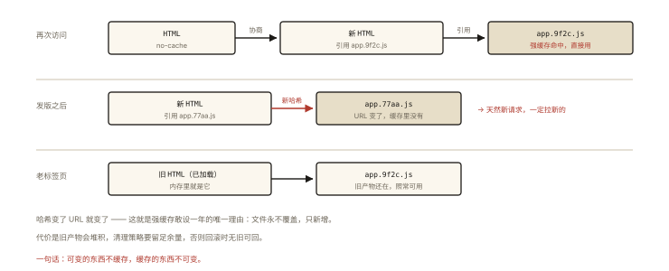
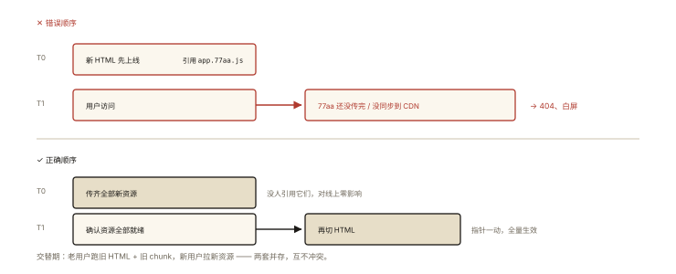
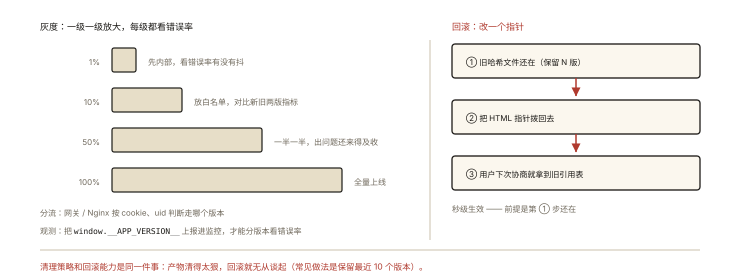
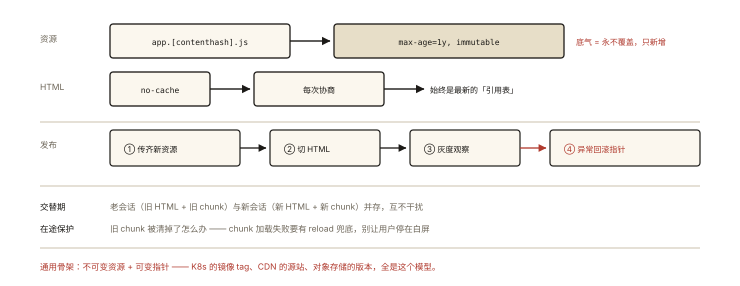

# 前端工程化之部署与缓存策略

## 从「发版后用户看到新旧混合的页面」说起

> 本篇是《前端工程化系列》收官——代码出了构建流水线之后的事：**怎么把它安全地送到用户浏览器**。

```bash
发版 5 分钟后用户反馈：
「页面白屏 / 控制台报 chunk loading error / 样式是新的交互是旧的」
# 经典原因：HTML 是新的（引用 app.9f2c.js），但用户浏览器里还缓存着旧 chunk 依赖图
# —— 新旧资源「交叉引用」，加载到不存在的旧 chunk
```

⭐⭐ 部署的核心三问：**资源怎么命名（哈希）、HTML 怎么发布（缓存策略）、上线怎么兜底（灰度与回滚）**——前两问的答案在《network-006》浏览器缓存篇已铺垫，本篇把它们接到「发布动作」上。

## 现象与直觉解释

一个健康的部署策略由三层共识构成：

```
① 静态资源：文件名带内容哈希 + 永久强缓存
   （内容不变名字不变 → 缓存永远命中；内容变名字变 → 天然新请求）

② HTML 入口：no-cache（每次协商）——保证用户总能拿到「最新的资源引用表」

③ 发布顺序：先发资源、后发 HTML ——新旧交替期两套资源共存，互不干扰
```

## 深入原理

### 一、资源命名与缓存的三段论 ⭐⭐

```nginx
# 资源（js/css/图片）：内容哈希 + 一年强缓存
location ~* \.(js|css|png|woff2)$ {
  expires 1y;
  add_header Cache-Control "public, immutable";
}

# HTML 入口：不缓存（或协商）
location = /index.html {
  add_header Cache-Control "no-cache";
}
```

效果闭环（与 network-006 对齐）：



*图 · 哈希变了 URL 就变了 —— 这是强缓存敢设一年的唯一理由*

```
用户再次访问：
  HTML no-cache ──协商──▶ 新 HTML（引用 app.9f2c.js）
  app.9f2c.js 未过期强缓存命中 ──▶ 直接用 ✅
发版后：
  新 HTML 引用 app.77aa.js（新哈希）──▶ 天然新请求 ──▶ 拉新
  旧 app.9f2c.js 对老标签页仍然有效（老页面还在引用它）✅
```

### 二、发布顺序：为什么「先资源后 HTML」⭐⭐⭐



*图 · 顺序颠倒一次，就是一片白屏*

```
错误顺序（先 HTML 后资源）：
  T0 新 HTML 上线（引用 app.77aa.js）
  T1 用户访问 —— 77aa 还没传完/没传到 CDN ──▶ 404/白屏 ❗

正确顺序：
  T0 上传全部新资源（77aa…）到 CDN/存储 —— 不影响任何在线用户（没人引用它们）
  T1 确认资源全部就绪 ──▶ 再发布新 HTML
  交替期：老用户跑旧资源（旧 HTML 缓存或旧 chunk），新用户拉新资源 —— 并存不冲突 ✅
```

**异步 chunk 的「交叉引用」问题**（开篇白屏的另一半）：老标签页的旧 HTML 已经加载，用户此时点击进入懒加载路由——运行时按**旧依赖图**请求 `chunk-3.9f2c.js`，而它已被清理 → 加载失败。解法：

```js
// 运行时兜底：加载失败刷新页面拿最新入口
router.onError((error) => {
  if (/chunk/.test(error.message)) location.reload();
});
// 或 chunkLoadError 时清缓存重试一次再提示升级
```

### 三、CDN：分发层的两个关键配置 ⭐⭐

```
① 回源（origin）：CDN 节点未命中时回源站取 —— 源站 = 对象存储/源服务器
② 刷新 vs 过期：
   资源（哈希名）：过期设很长 —— 新文件名是新 URL，无需刷新 ⭐
   HTML：短过期/边缘缓存关闭 —— 保证入口新鲜
③ 多级缓存心智：浏览器 → 本地 CDN 节点 → 源站 —— 每层的命中决定延迟
```

**为什么资源可以「永久缓存」**：因为**我们从不原地覆盖资源文件**——新构建永远是新名字。「可缓存性」是命名策略给的，不是 CDN 给的。

### 四、灰度与回滚：上线的安全网 ⭐⭐



*图 · 灰度是一级级放大，回滚是拨一下指针*

```
灰度发布（gradual rollout）：
  按流量比例（1% → 10% → 50% → 100%）或按用户分组（内部 → 白名单 → 全量）
  ── 网关/Nginx 按 cookie/uid 分流到不同版本
  ── 前端配合：版本上报（window.__APP_VERSION__ 进监控）观察错误率

回滚（rollback）：
  资源层：旧哈希文件还在（保留最近 N 版产物）──▶ 回滚 HTML 即回到旧版 ⭐
  ── 「保留历史产物」是秒级回滚的前提，清理策略要留足余量（如保留 10 个版本）
```

**docker 镜像/静态资源不可变 + HTML 指针可切换**——这个「不可变资源 + 可变指针」模式是现代发布的通用骨架（Kubernetes 滚动更新同理）。

### 五、一张发布清单（checklist 实战）⭐

```bash
# 构建：产出带 contenthash 的资源 + no-cache 的 HTML
# 上传：资源 → CDN（等待全部节点生效，校验 URL 可达）
# 发布：切换 HTML 指针（或 CDN 刷新 HTML）
# 验证：灰度环境冒烟 —— 资源 200、HTML 引用一致、无 chunk error
# 观察：错误率/性能指标（architecture-005 的监控）
# 兜底：异常 ──▶ 回滚 HTML 指针（秒级）；保留产物供在途会话
```

## 回看开篇

新旧混合页面的完整解释：HTML 的「引用表」变了、但部分 chunk 还是旧缓存——运行时新旧交叉请求导致加载失败。根治方案即本文三层共识：**哈希命名保资源永久缓存、HTML no-cache 保入口新鲜、先资源后 HTML 保交替期共存**，加上运行时 chunk 兜底刷新。

## 实战延伸

**1. 面试答题骨架**：「部署缓存策略三层——静态资源以内容哈希命名并设置长强缓存加 immutable，内容不变则 URL 不变永久命中，内容变则新 URL 天然回源；HTML 入口设 no-cache 每次协商，保证用户总能拿到最新资源引用；发布顺序必须先传齐全部新资源再切换 HTML，让新旧版本在交替期共存互不影响，异步 chunk 加载失败要有刷新兜底。CDN 层资源因哈希命名无需主动刷新、HTML 保持边缘短过期；灰度按流量比例放量并上报版本监控，回滚依赖保留的历史产物——切回旧 HTML 指针即可秒级回滚。」

**2. 一道排障题**：「用户反馈点击某页面白屏，控制台 Failed to fetch dynamically imported module」——给出五步排查：确认报错 chunk 的哈希是否存在（CDN）→ 判断是否在途旧会话（版本上报比对）→ 触发兜底刷新逻辑是否生效 → 检查发布顺序是否漏传 → 复盘清理策略是否过早删旧产物。

## 图解总结



*图 · 不可变资源 + 可变指针 —— 这套骨架到处都在用*

```
资源: [name].[contenthash].js ──▶ Cache-Control: max-age=1y, immutable（永不过期的底气=永不覆盖）
HTML: no-cache ──▶ 每次协商 ──▶ 始终最新"引用表"
发布: ①传齐新资源(CDN) ②切HTML ③灰度观察 ④异常回滚HTML指针(旧产物保留)

交替期: 老会话(旧HTML+旧chunk) ‖ 新会话(新HTML+新chunk) 并存 ✅
在途会话保护: chunk 加载失败 → reload 兜底
通用骨架: 不可变资源 + 可变指针（K8s/CDN/对象存储同构）
```

## 总结

- 资源：contenthash 命名 + 长强缓存 + immutable——「永不覆盖」是永久缓存的底气；
- HTML：no-cache——入口永远新鲜；
- 发布：先资源后 HTML；交替期新旧共存；异步 chunk 失败要兜底刷新；
- CDN：资源无需刷新（新名字），HTML 边缘短过期；
- 灰度按比例放量 + 版本上报；回滚 = 切回旧 HTML（保留历史产物是前提）。

**面试一句话回答**：前端部署的缓存策略三层配合——静态资源以内容哈希命名并设置一年强缓存加 immutable，因为内容不变文件名就不变、缓存永久命中，内容变化生成新哈希天然回源；HTML 入口设置 no-cache 每次与服务器协商，确保用户总能拿到最新的资源引用表；发布顺序必须先把全部新资源传到 CDN 并确认生效，再切换 HTML 指针，使新旧版本在交替期并存互不干扰，同时对异步 chunk 的加载失败做整页刷新兜底处理在途旧会话。灰度按流量比例放量并配合版本上报监控，回滚只需把 HTML 指回旧版本——前提是保留最近若干版本的产物不清理，这也是不可变资源加可变指针这一现代发布通用骨架的具体应用。

## 思考题

1. `Cache-Control: immutable` 解决了什么问题？（F5 刷新时对未过期资源的重新验证——省一次 304 往返）
2. 微前端场景（多个子应用独立发版）：HTML 的「引用表」散落在主应用与子应用——发布顺序怎么设计？
3. Service Worker 版本更新（skipWaiting vs 等待刷新）：与本文策略怎么配合防「新旧混合」？
4. 开放设计：设计「发布安全门」：资源完整性校验（清单比对）+ 自动灰度（错误率阈值熔断自动回滚）——画出流水线。

（思考题解析将同步录入小程序题库，关联本文 id：engineering-008）

## 参考文献：

- Webpack/Vite 官方文档 — output.filename 与 contenthash
- 《Web 性能权威指南》CDN 章节
- 本课程《network-006 浏览器缓存》（本篇的浏览器侧地基）、《architecture-005 前端监控》（灰度观察）
