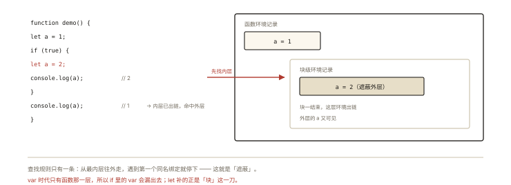
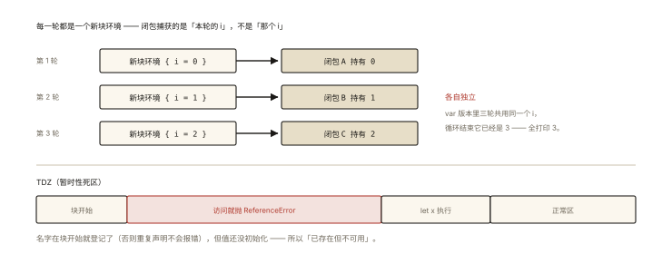

# ES6+ 之 let、const 与块级作用域

## 从「两行代码三个坑」说起

> **系列导读**：《ES6+ 系列》共 10 篇，逐个拆解 ES2015 至今的高价值语法：作用域、解构、箭头函数、Symbol、Set/Map、Proxy、迭代器、class 与模块化。本篇是第 1 篇，从 let/const 与 var 的本质差异讲起。

```js
// 坑一：循环变量共享
var fns = [];
for (var i = 0; i < 3; i++) fns.push(() => i);
console.log(fns.map((f) => f())); // [3, 3, 3]

// 坑二：意外全局
function save() { mode = 'edit'; } // 忘了 var —— 全局污染

// 坑三：重复声明静默覆盖
var config = {}; var config = { v: 2 }; // 不报错，前者被覆盖
```

三个坑的共同根源是 **var 的设计**：函数级作用域 + 声明提升 + 可重复声明 + 裸赋值泄漏全局。let/const 是对这四点的逐项修正。⭐ 「let/const 与 var 的区别」是基础面试必考，但「块级作用域在引擎里怎么实现」能拉开差距。

## 现象与直觉解释

直觉差异表：

| 特性 | var | let / const |
|---|---|---|
| 作用域 | 函数级 | **块级**（`{}` 内有效） |
| 提升 | 登记为 undefined，可先用 | **有登记无初始化**（TDZ，先用报错） |
| 重复声明 | 允许 | 报 SyntaxError |
| 裸赋值泄漏全局 | `x=1` 挂到全局 | 同样会（严格模式报错）——**let 不解决这个，`'use strict'` 才解决** |
| 全局声明挂 globalThis | 是 | **否**（活在脚本级词法环境） |
| 循环中 | 共享一个绑定 | **每轮迭代新建绑定** |

## 深入原理

### 一、块级作用域：环境记录的「块化」 ⭐

回顾《js-deep-002》：var 时代的变量挂在**函数环境记录**上；ES6 引入了**块级环境记录（declarative Environment Record）**——每个 `{}` 块可以拥有自己的环境层：



*图 · 块内的 a 是另一个变量，只是名字撞了*

```js
function demo() {
  let a = 1;           // ┐ 函数环境记录
  if (true) {          // │
    let a = 2;         // ├ 块级环境记录（新的 a，遮蔽外层）
    console.log(a);    // │ 2
  }                    // │ 块结束，块环境出链
  console.log(a);      // ┘ 1
}
```

查找链依旧由内到外（《js-deep-004》），只是链条上多了「块」这一层节点。**IIFE 的历史使命**（人为造一层函数作用域隔离变量）被块级作用域正式接替：

```js
// 过去：用 IIFE 拍平变量
(function () { var private1 = 'x'; })();
// 现在：花括号就是围墙
{ let private2 = 'x'; }
```

### 二、暂时性死区（TDZ）：「有登记、无初始化」⭐⭐

《js-deep-002》讲过：let/const 声明的变量**同样在创建阶段被登记**（否则同名重复声明不会报语法错），但**不初始化**——从块开始到声明语句执行之前的区间叫 TDZ，访问抛 `ReferenceError`：

```js
{
  console.log(a); // ReferenceError（TDZ）—— 不是 undefined！
  let a = 1;
}
```

对照 var：登记 + 初始化 undefined（值为 undefined）；let/const：登记 + **不初始化**（碰了就炸）。这是**故意的**设计——把「先用后声明」从静默的 undefined 陷阱变成显式报错，bug 提前暴露。

TDZ 的范围判定小题：

```js
let x = 'outer';
{
  console.log(x); // ReferenceError！—— 块内有 let x，整个块到声明处都是它的 TDZ
  let x = 'inner';
}
// 结论：TDZ 看的是「本块内有无声明」，而不是「外层有没有可用值」
```

### 三、for 循环里的 let：每轮一个新绑定 ⭐⭐

开篇坑一的修复只需 var → let，机制值得深挖：

```js
var fns = [];
for (let i = 0; i < 3; i++) fns.push(() => i);
console.log(fns.map((f) => f())); // [0, 1, 2] ✅
```

规范为 `for (let ...)` 定义了特殊语义：**每次迭代开始时，创建一个新的块环境，把上一轮的 i 值复制进去**——三次迭代 = 三个独立的 i 绑定，三个闭包各自捕获自己的那个（闭包机制见《js-deep-005》）。而 var 只有一个函数级 i，三个闭包共享到循环结束的 3。

```js
// 概念等价展开（帮助理解，非真实转译）：
{
  let i_prev = 0;
  { let i = i_prev; fns.push(() => i); } // 第 1 轮：新 i = 0
  i_prev = 1;
  { let i = i_prev; fns.push(() => i); } // 第 2 轮：新 i = 1
  // ...
}
```

### 四、const：绑定不可变 ≠ 值不可变 ⭐

最高频误解：「const 的对象不能改」——错。

```js
const user = { name: 'a' };
user.name = 'b';    // ✅ 完全合法 —— 改的是「对象的内容」
user = {};          // ❌ TypeError —— 改「绑定指向」不行
Object.freeze(user); // 想要内容也不可变？显式冻结（浅冻结！嵌套对象仍可变）
```

const 锁的是**变量名与值之间的绑定关系**（该槽位不能再指向别处），对象内容不受约束——「const 保证的是指向，不是指向的东西」。

### 五、一个少有人知的差异：全局声明挂不挂 globalThis

```js
var g1 = 1;     // globalThis.g1 === 1（挂在全局对象上）
let g2 = 2;     // globalThis.g2 === undefined ❗
// let/const 的全局声明活在「全局词法环境」，不在全局对象上
// 意义：切断「变量 ↔ 全局对象属性」的等价性 —— 全局变量不再是 window 的属性
```

## 回看开篇

坑一（循环共享）由「每轮新绑定」修复；坑二（裸赋值全局）注意 **let 并不解决它**，要靠严格模式/class 默认严格；坑三（重复声明）由语法错误直接拦截。三个坑的修复手段各不相同——这正是「逐项修正 var」的完成态。

## 实战延伸

**1. 团队规范基线**：默认 const，需要重新赋值才用 let，禁用 var（ESLint: `no-var` + `prefer-const`）。「对象不想被改」显式用 `Object.freeze` 或 immutable 库，别指望 const。

**2. 循环变量捕获**是 React/Vue 列表渲染闭包陷阱的底层原理（事件处理里拿到「正确的 index」），框架只是把这个机制包装了一遍。

**3. 面试答题骨架**：「let/const 相对 var 有四点差异——块级作用域由块级环境记录实现、有登记无初始化形成暂时性死区、禁止重复声明、全局声明不挂全局对象；const 的本质是绑定不可变而非值不可变；for 循环中 let 每轮迭代创建新的块级绑定，这就是循环闭包输出 0 1 2 而不是 3 3 3 的机制。」

## 图解总结



*图 · 每轮一个新绑定，加上一段「已登记未初始化」的死区*

```
        ┌────────── 一轮 for(let i) ──────────┐
新块环境: { i(本轮副本) } ──▶ 闭包捕获的是「本轮的 i」
        └────────────────────────────────────┘
   轮1: i=0 ─ 闭包A 持有 0
   轮2: i=1 ─ 闭包B 持有 1        ✅ 各自独立
   轮3: i=2 ─ 闭包C 持有 2

TDZ: { [块开始] ──── ReferenceError 区 ──── let x ──── 正常区 }
     有登记（否则重复声明不报错）· 无初始化（访问即炸）
```

## 总结

- let/const 四大修正：块级作用域、TDZ、禁重复声明、不挂全局对象；
- TDZ = 有登记无初始化——把「先用后声明」从静默 undefined 变成显式报错；
- `for (let ...)` 每轮新建块级绑定，闭包各自捕获独立副本；
- const 锁定绑定不锁定内容，深冻结需 Object.freeze 递归或工具库；
- 块级作用域取代了 IIFE 的隔离职责。

**面试一句话回答**：let 和 const 相比 var 有四个本质差异——作用域从函数级变为块级（由块级环境记录实现）、声明的变量有登记但无初始化从而在声明前访问会因暂时性死区抛 ReferenceError、禁止重复声明、全局声明不再挂到全局对象上；const 的不可变指的是变量绑定不可重新赋值而非对象内容不可修改；for 循环中 let 会为每轮迭代创建新的块级绑定，闭包各自捕获独立副本，这是循环闭包输出 0 1 2 而非 3 3 3 的根本机制。

## 思考题

1. 写出输出并解释（TDZ 范围）：
```js
let a = 1;
function f() {
  console.log(a);
  let a = 2;
}
f();
```

2. 为什么 `typeof x` 对未声明的 x 返回 'undefined'，对 TDZ 中的 x 却抛 ReferenceError？这个「倒退」合理吗？

3. 手写 `deepFreeze(obj)`（递归冻结）；说明它对性能与循环引用对象需要做什么处理。

4. 开放讨论：「默认 const、需要再赋值才 let」这条规范的道理是什么？反过来「默认 let」会失去什么？

（思考题解析将同步录入小程序题库，关联本文 id：es6-001）

## 参考文献：

- ECMA-262 现行版 — CreateGlobalVarBinding / CreateGlobalLexicalBinding、ForIn/Of Head Evaluation（每轮新绑定的规范出处）
- MDN — [let](https://developer.mozilla.org/zh-CN/docs/Web/JavaScript/Reference/Statements/let)、[const](https://developer.mozilla.org/zh-CN/docs/Web/JavaScript/Reference/Statements/const)
- 《ES6 标准入门（第 3 版）》第 2 章
- 本课程《js-deep-002 变量对象》（登记机制的 P1 视角）
