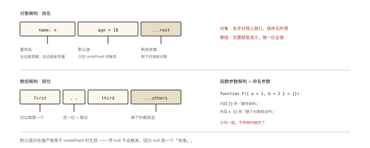

# ES6+ 之解构赋值

## 从一段「点了很多下」的代码说起

取接口返回的嵌套字段，老写法：

```js
var res = await fetchUser();
var user = res.data;
var city = user && user.address && user.address.city; // 防御式连点
var name = user.profile ? user.profile.nickname : '游客';
var rest = { email: user.email, phone: user.phone };   // 手动挑字段
```

四件事——**取值、防御默认、命名、挑拣**——每件都要专门写一段。ES6 解构赋值把它们统一成一种语法：

```js
const {
  data: user,
  address: { city } = {},        // 嵌套 + 默认值
  profile: { nickname: name = '游客' } = {}, // 重命名 + 默认值
  email, phone,                  // 简写挑拣
} = res ?? {};
```

⭐ 解构是「日常写得最多、面试却讲不深」的语法——本文把它的规则一次收全，重点是那些**边界行为**（默认值何时触发、解构失败的报错点）。

## 现象与直觉解释

解构 = **按结构「对位取值」**：

- 数组解构按**位置**：`const [first, second] = arr;`
- 对象解构按**属性名**：`const { name, age } = obj;`

直觉上像「拆快递」：盒子是什么形状（数组/对象），就按什么形状把东西拿出来；拿不完的用剩余打包，缺了的给默认值。

## 深入原理

### 一、对象解构：完整的规则清单 ⭐

```js
const user = { name: '小明', address: { city: '北京' }, tags: ['a'] };

// ① 基本形式：{ 属性名: 新变量名 }
const { name: userName } = user;           // userName = '小明'

// ② 简写：{ 属性名 } 等价于 { name: name }
const { name } = user;                     // name = '小明'

// ③ 默认值：属性为 undefined 时生效 ⭐⭐
const { gender = '保密' } = user;          // '保密'（user.gender === undefined）
const { nickname = '游客' } = user;        // '游客'

// ④ 重命名 + 默认值组合
const { nickname: nick = '游客' } = user;  // nick = '游客'

// ⑤ 嵌套解构
const { address: { city } } = user;        // city = '北京'

// ⑥ 剩余收集（rest）
const { name, ...others } = user;          // others = { address: {...}, tags: [...] }
```

**默认值触发的唯一条件：值为严格等于 `undefined`**——这是最高频考点：

```js
const { a = 1 } = { a: undefined }; // 1 ✅ undefined 触发
const { b = 1 } = { b: null };      // null ❌ null 不触发！
const { c = 1 } = { c: 0 };         // 0   ❌ falsy 不等于 undefined
const { d = 1 } = {};               // 1   （缺属性 = undefined）
```

### 二、解构的「翻车点」：模式 vs 表达式 ⭐

**坑 1：行首花括号被当块语句**

```js
let x;
{ x } = { x: 1 };        // ❌ SyntaxError：{ 被解析为代码块
({ x } = { x: 1 });      // ✅ 括号包裹后是表达式
```

**坑 2：等号右边必须是可解构的（对象/数组，null/undefined 直接炸）**

```js
const { a } = null;      // TypeError: Cannot destructure 'null'
const { b } = undefined; // TypeError
// 防御写法：给右侧兜底
const { b: safe } = maybeNull ?? {};  // ✅ 工程必备防御
```

**坑 3：嵌套解构的中间层不存在时**

```js
const user = {};                        // 没有 address
const { address: { city } } = user;     // ❌ TypeError：对 undefined 取 city
const { address: { city } = {} } = user; // ❌ 仍然炸！默认值给的是 address，
                                        //    但 address 是 undefined 时先解构再默认？
                                        // —— 正确写法：
const { address = {} } = user;           // 先给 address 兜底
const { city } = address;                // 再解构
// 或合并写：const { address: { city } = {} } = { address: {} } —— 注意等号左边结构
```

精确规则：**默认值加在哪一层，就兜底哪一层的「结果」**；中间层为 undefined 时，深层默认值来不及生效。防御嵌套取值，现役最佳是可选链 `user?.address?.city ?? '未知'`（ES2020）。

### 三、数组解构与迭代协议

数组解构按**位置对位**，底层走迭代协议（`Symbol.iterator`，详见《es6-009》）——所以任何可迭代对象都能解构：

```js
const [first, , third] = ['a', 'b', 'c']; // 跳位：first='a', third='c'
const [head, ...tail] = [1, 2, 3, 4];     // head=1, tail=[2,3,4]
const [x, y] = 'hi';                      // x='h', y='i'（字符串可迭代）
const [a, b] = new Set([1, 2]);           // Set 也可以
const [c = 10] = [];                      // c=10（缺位 = undefined → 默认值）
```

经典应用一行流：

```js
[a, b] = [b, a];                          // 交换变量（无需中间变量）
const [year, month, day] = '2026-10-26'.split('-');
function f() { return [1, 2]; }
const [one, two] = f();                   // 「多返回值」
```

### 四、函数参数解构：现代函数签名的基础设施 ⭐⭐

```js
// 老痛点：可选参数在中间、参数膨胀、调用方可读性差
function createChart(width, height, options) { /* options 可能 undefined */ }

// 解构参数 + 默认值：命名参数 + 缺省防御一步到位
function createChart({
  width = 800,
  height = 600,
  theme = 'light',
  interactive = true,
} = {}) {                                  // 整个参数对象的默认 {} —— 不传参数也不炸
  // ...
}

createChart({ theme: 'dark' });            // 只传关心的 ✅
```

两个工程细节：① 外层 `= {}` 必不可少（否则 `createChart()` 直接 TypeError）；② 这正是 React Hooks 大量「`(props)` 再解构 props」、Vue3 组合式 API 参数对象的语法地基。

## 回看开篇

四个痛点对位四个特性：取值（嵌套解构）、防御（默认值 + `?? {}`）、命名（`属性名: 新名`）、挑拣（简写 + rest）。老代码 7 行，新写法 5 行且意图自明——**解构的价值不是行数，是把「数据形状」直接写进签名**。

## 实战延伸

**1. 模块导入也是解构**：`import { ref, computed: dc } from 'vue'`——按名导入 + 重命名；`import * as api from './api'` 则是「剩余收集」的近亲。

**2. 遍历中的解构**：`for (const { id, name } of users)`、`Object.entries(obj).forEach(([k, v]) => …)`——键值对解构是最顺手的一招。

**3. 面试快手题**：

```js
const { a = 1, b = 2 } = { a: null, b: undefined };
console.log(a, b);            // null 2 —— null 不触发默认值！
const [x = 1, y = 2] = [0];   // 0 2
```

## 图解总结



*图 · 一个是「按名找」，一个是「按位对号入座」*

```
对象解构（按名）                     数组解构（按位）
{ name: n, age = 18, ...rest }     [first, , third, ...others]
   │      │      └ 剩余收集          │      └ 跳位取第三个
   │      └ 默认值（仅 undefined 触发）└ 对位取第一个
   └ 重命名

函数参数解构 = 「命名参数」语法：
function f({ a = 1, b = 2 } = {}) —— 内层兜属性，外层兜「不传参」
```

## 总结

- 对象按名、数组按位（迭代协议）；重命名、默认值、嵌套、rest 四件套；
- 默认值仅在 `=== undefined` 时触发（null/falsy 均不触发）——最高频考点；
- 右侧 null/undefined 直接 TypeError，防御用 `?? {}`；嵌套中间层缺失时深层默认值救不了场；
- 函数参数解构 = 命名参数 + 缺省防御，是现代 API 设计的标配；
- 解构失败的三个报错点：行首块语句、右侧不可解构、嵌套中间层为 undefined。

**面试一句话回答**：解构赋值按数据结构对位提取——对象按属性名、数组按位置（基于迭代协议），支持重命名、剩余收集与默认值，默认值只在值为严格 undefined 时生效而 null 不会触发；右侧为 null 或 undefined 会直接抛 TypeError 所以要配合空对象兜底，嵌套解构中中间层不存在时深层的默认值无法生效；函数参数解构配合整体默认空对象，实现了命名参数与缺省防御，是现代函数签名与框架 API 的语法基础。

## 思考题

1. 写出输出：
```js
const { a = 1, b = 2, c: d = 3 } = { a: 0, b: null, c: undefined };
const [x = 1, y = 2, ...z] = [undefined, 0];
console.log(a, b, d, x, y, z);
```

2. 为什么 `const { length } = 'hello'` 能得到 5，而 `const { length } = 123` 是 undefined？（提示：解构对象时对原始值做什么装箱？number 装箱后有 length 吗？）

3. 用解构实现 `pick(obj, keys)` 的简化版：`pick({ a:1, b:2, c:3 }, ['a','c'])` → `{a:1, c:3}`（提示：数组 reduce + 计算属性名）。

4. 开放设计：设计一个 `createRequest({ method, url, headers, retries } = {})` API——用参数解构给出完整默认值方案，并对比「位置参数」版本的可维护性差异。

（思考题解析将同步录入小程序题库，关联本文 id：es6-002）

## 参考文献：

- ECMA-262 现行版 — Destructuring Assignment、Destructuring Binding Pattern
- MDN — [解构赋值](https://developer.mozilla.org/zh-CN/docs/Web/JavaScript/Reference/Operators/Destructuring_assignment)
- 《ES6 标准入门（第 3 版）》第 1 章
