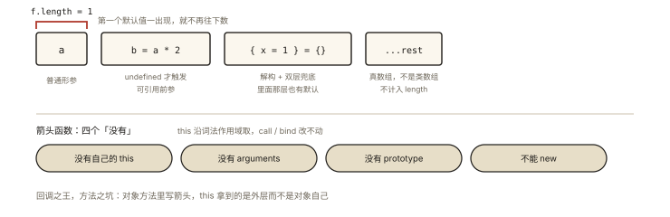

# ES6+ 之函数扩展：默认值、rest 与箭头函数

## 从三个「经典翻车现场」说起

```js
// 翻车 1：默认参数写 0，判断时手滑用了 falsy 判断
function setLevel(level = 1) {
  if (!level) level = 1;    // level 传 0 时被误重置！
}

// 翻车 2：函数体内改了参数，arguments 竟然跟着变（非严格模式）
function f(a) { arguments[0] = 99; console.log(a); } // 99！映射的坑

// 翻车 3：回调里 this 丢了，箭头函数一把梭——直到在对象方法上也用箭头函数
const obj = { name: 'o', getName: () => this.name }; // undefined，箭头拿的是外层 this
```

三个翻车现场分别对应本篇三大主题：**参数默认值、rest 参数取代 arguments、箭头函数的能与不能**。⭐ 箭头函数的 this 是面试超高频（机制详解在《js-deep-006》，本文补全它的完整边界）。

## 现象与直觉解释

```js
// 一行看懂三大扩展
function fetchPage(url, { page = 1, size = 10 } = {}, ...rest) {}
//    │             └─ 参数默认值（含解构默认值双层）
//    └─ rest 参数：多余的实参收进真数组
const handler = (e) => console.log(e.target); // 箭头函数：没有自己的 this/arguments
```

## 深入原理

### 一、参数默认值：四个精确行为 ⭐

**行为 1：默认值只在 `undefined` 时触发**（与解构默认值同一规则，《es6-002》）：

```js
function f(x = 1) { console.log(x); }
f(undefined); // 1
f(null);      // null ❗
f(0);         // 0
f();          // 1（缺参 = undefined）
```

**行为 2：默认值是惰性求值的**——每次调用时才计算，且**前面的参数可被后面的默认值引用**：

```js
let count = 0;
function g(n = ++count) { return n; }
g(); g();          // 1, 2 —— 每次都重新求值（对比：参数默认值若在定义时算，永远是 1）
function h(a, b = a * 2) { return [a, b]; } // b 默认依赖 a ✅
h(3);              // [3, 6]
```

**行为 3：默认值参数会「切断」arguments 映射**：

```js
function f(a = 1) { arguments[0] = 99; console.log(a); }
f(5); // 5 ✅ 不再同步——有默认值的参数与 arguments 解耦（非严格模式下老函数才有映射）
```

**行为 4：参数形成独立作用域**——默认值表达式里的变量查找：参数自身 > 外层（**跳过函数体**）：

```js
let x = 1;
function f(x, y = x) { return y; } // y 的默认值 x 先查参数区：x（形参）
f(2); // 2 ✅ 不是外层的 1
function g(x = () => z, z = 3) { return x(); } // 参数间的暂时性死区：z 声明在后
g(); // ReferenceError（x 的默认值里引用了还没初始化的 z）
```

**length 属性的联动**（面试细节题）：`f.length` = **第一个默认值参数之前的形参个数**——`function(a, b = 1, c)` 的 length 是 1。rest 参数同样不计入。

### 二、rest 参数：arguments 的正式接班人 ⭐

```js
// arguments：类数组（无数组方法）、非严格下与参数映射、箭头函数里根本没有
function oldSort() { return Array.prototype.sort.apply(arguments); } // 别扭

// rest：真数组、方法齐全、配合箭头函数可用、明示「吸收剩余实参」的签名
const sum = (...nums) => nums.reduce((a, b) => a + b, 0);
sum(1, 2, 3); // 6
const merge = (head, ...rest) => [head, ...rest].flat();
```

| 对比项 | arguments | rest 参数 |
|---|---|---|
| 类型 | 类数组对象 | 真数组 |
| 箭头函数可用 | ❌（没有） | ✅ |
| 与形参映射 | 非严格模式有（坑） | 无 |
| 签名可读性 | 隐式 | 显式声明 |

结论：新代码一律 rest；arguments 只在读老代码/面试讲历史时出现。

### 三、箭头函数：一份完整的「能/不能」清单 ⭐⭐

**没有的东西**（全部沿词法作用域向外找或干脆不存在）：

```js
// ① 没有自己的 this —— 沿外层作用域取（机制详解《js-deep-006》）
const timer = {
  seconds: 0,
  start() {                    // 普通函数：this = timer
    setInterval(() => {        // 箭头：this 沿词法取 start 的 this ✅
      this.seconds++;
    }, 1000);
  }
};

// ② 没有自己的 arguments
const f = () => arguments;     // 外层函数的 arguments（或全局直接报错）
const g = (...args) => args;   // 需要收集参数就用 rest ✅

// ③ 没有 prototype、不能 new
const F = () => {};
F.prototype;      // undefined
new F();          // TypeError

// ④ 不能作 Generator（无 function* 形态）；call/apply/bind 改不动它的 this
const h = () => this.foo;
h.call({ foo: 1 }); // this 不变（foo 来自定义处外层）
```

**适用与禁用场景速判**：

| 场景 | 用箭头？ |
|---|---|
| 回调里保外层 this（定时器、事件、Promise 链） | ✅ 最佳 |
| 数组方法回调 map/filter/reduce | ✅ |
| 对象字面量的方法 | ❌（this 需动态指向该对象） |
| 原型上的方法 | ❌（同上） |
| 构造函数 | ❌（不能 new） |
| 需要 arguments 的场合 | ❌（用 rest 替代） |

```js
// 最经典的错误示范
const counter = {
  count: 0,
  inc: () => { this.count++; } // ❌ this 是模块/全局，counter.count 永远 0
};
// 正确：inc() {} 或 inc: function () { this.count++; }
```

### 四、函数 name 与 length：被忽略的两个元属性 ⭐

```js
const f = function foo() {};    // f.name === 'foo'
const g = () => {};             // 'g'
const bound = f.bind(null);     // 'bound foo'
const obj = { method() {} };    // 'method'（ES2019 起对 foo: function 也不再是 'foo' 匿名）
function h(a, b = 1, ...c) {}   // h.length === 1
```

`name` 用于调试与错误堆栈，`length` 用于「形参设计意图」探测（早期框架用它做依赖注入，Angular1 的参数名解析前身）——两者都是**不可配置但可读**的元信息。

## 回看开篇

翻车 1：默认值触发条件是 `undefined` 而非 falsy——判断默认值是否存在别用 `!level`；翻车 2：rest 参数与 arguments 解耦，映射坑消失；翻车 3：箭头函数「词法 this」决定了它是回调之王、方法之坑——**箭头解决的是「内层要外层 this」，对象方法要的恰恰是「动态 this」**。

## 实战延伸

**1. 面试答题骨架**：「参数默认值仅在实参为 undefined 时触发且惰性求值，可引用前面的形参，并与 arguments 解耦；rest 参数是真数组、箭头函数可用，全面替代 arguments；箭头函数没有自己的 this、arguments、prototype，this 沿词法作用域取且 call/bind 改不动，适合回调和数组方法、不适合对象方法与构造函数。」

**2. 柯里化/偏函数的箭头链**：`const add = (a) => (b) => (c) => a + b + c;`——箭头链是函数式风格的天然写法（关联《js-deep-005 闭包》柯里化一节）。

## 图解总结



*图 · length 数到第一个默认值就停，后面写了什么它都不管*

```
function f(a, b = a * 2, { x = 1 } = {}, ...rest) {}
   │    │    │        │          │
   │    │    │        │          └ rest：真数组收尾（不计入 length）
   │    │    │        └ 解构默认值（双层兜底）
   │    │    └ 默认值可引用前参（惰性求值，undefined 才触发）
   │    └ f.length 到此为止 === 1
   └ 普通形参

箭头函数：this ──沿词法──▶ 外层 | 无 arguments | 无 prototype | 不能 new
```

## 总结

- 默认值：undefined 才触发、惰性求值、可引前参、切断 arguments 映射、影响 length；
- rest 参数是真数组的显式签名，全面接班 arguments；
- 箭头函数无 this/arguments/prototype、不能 new、this 词法化且不可改——回调之王、方法之坑；
- name/length 是函数的元信息，length = 第一个默认值前的形参数。

**面试一句话回答**：参数默认值只在实参严格等于 undefined 时触发且每次调用惰性求值、可以引用前面的形参并与 arguments 解耦，length 属性只统计默认值之前的形参；rest 参数把剩余实参收成真数组，在箭头函数中也可用，全面替代类数组的 arguments；箭头函数没有自己的 this、arguments 和 prototype，不能作为构造函数，this 沿词法作用域继承定义处外层且无法被 call/apply/bind 修改——因此它是回调与数组方法的最佳选择，却不适合对象方法、原型方法与构造函数。

## 思考题

1. 写出输出：
```js
function f(a, b = () => a, c = b()) { return [a, b, c]; }
let a = 'outer';
console.log(f('in'));
console.log(f.length);
```

2. 为什么 `const obj = { m: () => this.x }` 拿不到 obj.x？改造为正确版本（两种写法）。
3. 实现 `argCount(fn)`：利用 length 与实际调用对比，判断「调用时传参比声明形参多几个」——rest 版本怎么写？
4. 开放讨论：「箭头函数 + 解构参数 + 默认值」组合成现代工具函数签名——给 `createLogger({ prefix = '[app]', ts = Date.now } = {})` 补全实现并说明 ts 的惰性求值价值。

（思考题解析将同步录入小程序题库，关联本文 id：es6-004）

## 参考文献：

- ECMA-262 现行版 — FunctionDeclarationInstantiation（参数作用域）、ArrowFunction、SetFunctionLength
- MDN — [默认参数](https://developer.mozilla.org/zh-CN/docs/Web/JavaScript/Reference/Functions/Default_parameters)、[剩余参数](https://developer.mozilla.org/zh-CN/docs/Web/JavaScript/Reference/Functions/rest_parameters)
- 本课程《js-deep-006 this》（箭头函数词法 this 的机制专篇）
