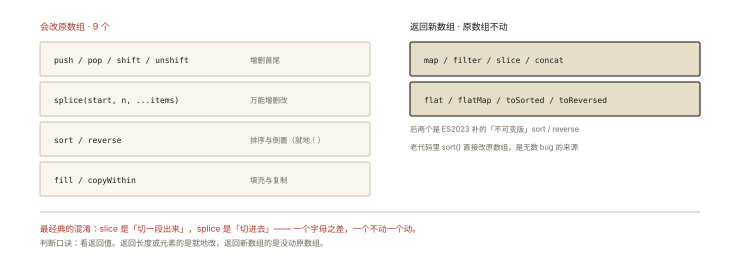
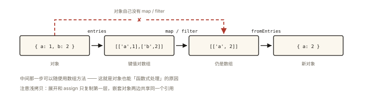

# ES6+ 之数组与对象的新方法

## 从一次「React 状态没更新」的排障说起

```js
function toggleDone(todos, id) {
  todos.find((t) => t.id === id).done = true; // 直接改了老数组里的对象
  setTodos(todos);                            // React：引用没变，不重渲染！
}
```

这个 Bug 的根源不在 React，而在**方法的可变性意识**：哪些方法改原数组、哪些返回新数组——这是前端日常正确性的地基，也是面试「数组方法」题真正想考的。⭐ 本篇把 ES6+ 新方法按「可变性 × 用途」收成一张地图。

## 现象与直觉解释

数组方法的心智分类法——先问两个问题：

1. **改不改原数组？**（mutating / immutable）
2. **返回什么？**（新数组 / 元素或索引 / 布尔 / 遍历器）

```js
const arr = [3, 1, 4, 1, 5];
arr.sort();              // 改原数组！（返回引用）
[...arr].sort();         // 不动原数组的排序 ✅
```

## 深入原理

### 一、可变性地图（必须刻进肌肉记忆）⭐⭐

**会改原数组的方法（9 个）**：



*图 · 看返回值就能判断它动不动原数组*

```
push / pop / shift / unshift   ─ 增删首尾
splice                         ─ 万能增删改
sort / reverse                 ─ 排序与倒置（就地！）
fill / copyWithin              ─ 填充与复制
```

**不改原数组（返回新结果）**：

```
slice / concat / map / filter / flat / flatMap  → 新数组
find / findIndex / findLast / findLastIndex     → 元素或索引
includes / indexOf / lastIndexOf / some / every  → 布尔
reduce / reduceRight / join / at                → 聚合值
keys / values / entries                          → 遍历器
```

**React/Vue 场景的推论**：状态更新必须「换引用」——用 map/filter/slice 造新数组；误用 sort/splice/push 改原数组，视图不更新就是经典报障（关联《react-006 setState》）。

### 二、ES6+ 高频新方法逐个过 ⭐

**1. `includes` vs `indexOf`（ES2016）**：

```js
[1, 2, NaN].indexOf(NaN);    // -1 ❌（严格相等 ===，NaN !== NaN）
[1, 2, NaN].includes(NaN);   // true ✅（SameValueZero 算法，认 NaN）
// 另：indexOf 返回索引可作双用，includes 只答有没有——语义清晰优先用 includes
```

**2. `Array.from`：类数组/可迭代 → 真数组的标准通道**：

```js
Array.from({ length: 3 }, (_, i) => i * 2);  // [0, 2, 4] —— length 对象也能变数组（生成序号的惯用法）
Array.from('abc');                            // ['a','b','c']
Array.from(new Set([1, 1, 2]));               // [1, 2] —— 去重一把梭
Array.from(document.querySelectorAll('li'));  // NodeList → 数组
// 对比 [...like]：展开只支持可迭代，from 连「有 length 的类数组」都吃 ✅
```

**3. `flat` / `flatMap`（ES2019）**：

```js
[1, [2, [3, [4]]]].flat();      // [1, 2, [3, [4]]]（默认拍 1 层）
[1, [2, [3]]].flat(Infinity);   // [1, 2, 3]（彻底拍平）
[1, 2, 3].flatMap((x) => [x, x * 10]); // [1,10,2,20,3,30]（map 后拍一层 = 一对多映射）
// flatMap 的省流本质：少建一层中间数组
```

**4. `find` / `findLast` 家族（ES2022 补 findLast）**：返回**元素本身**（filter 返回数组）——「找第一个满足条件的对象」首选。

```js
const users = [{ id: 1, name: 'a' }, { id: 2, name: 'b' }];
users.find((u) => u.id === 2);        // { id: 2, name: 'b' }
users.findLast((u) => u.vip);         // 从尾找
```

**5. `at`（ES2022）**：负索引取尾部元素的官方姿势。

```js
const list = [1, 2, 3];
list.at(-1);   // 3（替代 list[list.length - 1]）
'abcdef'.at(-2); // 'e'（字符串也支持）
```

### 三、对象侧的新方法 ⭐

**1. 遍历三件套与解构联动**：

```js
const obj = { a: 1, b: 2 };
Object.keys(obj);     // ['a', 'b']
Object.values(obj);   // [1, 2]
Object.entries(obj);  // [['a',1], ['b',2]] —— for...of 解构的黄金搭档：
for (const [k, v] of Object.entries(obj)) console.log(k, v);
```

**2. `Object.fromEntries`（ES2019）——entries 的逆运算**：

```js
// 对象的 map：JS 没有原生 obj.map，套路 = entries → 数组 map → fromEntries
const doubled = Object.fromEntries(
  Object.entries({ a: 1, b: 2 }).map(([k, v]) => [k, v * 2])
); // { a: 2, b: 4 }
// URLSearchParams ↔ 对象：
Object.fromEntries(new URLSearchParams('?x=1&y=2')); // { x: '1', y: '2' }
```

**3. `Object.assign` vs 展开运算符**——浅拷贝与合并的双雄：

```js
const merged = Object.assign({}, defaults, options);
const merged2 = { ...defaults, ...options }; // 语义相同、更顺手
// ⚠️ 共同点：都是【浅合并】——嵌套对象仍然共享引用
{ ...{ list: [1] }, list: [2] }.list; // [2] ✅ 顶层替换
const shallow = { ...nested };  // shallow.inner === nested.inner ❗嵌套层共享
```

**4. `Object.hasOwn`（ES2022）**：比 `Object.prototype.hasOwnProperty.call` 简洁、比 `in` 精确（不查原型链）：

```js
const obj = Object.create({ inherited: 1 });
obj.own = 2;
'own' in obj;                 // true（连原型链一起查）
Object.hasOwn(obj, 'own');    // true ✅ 只查自身
Object.hasOwn(obj, 'inherited'); // false
```

## 回看开篇

toggleDone 的正解——不改原数组、换新引用：

```js
setTodos(todos.map((t) => (t.id === id ? { ...t, done: !t.done } : t)));
//            └ map 造新数组，命中项展开成新对象 ✅ 引用全换、老状态不碰
```

可变性地图 + 「map/filter/展开」三件套，就是 React/Vue 状态更新的日常武器。

## 实战延伸

**1. 面试快手串烧**：

```js
// 去重的五种姿势
[...new Set(arr)];                          // 基本类型（ES6 起首选）
arr.filter((v, i) => arr.indexOf(v) === i); // 经典 filter
Array.from(new Set(arr));                   // from 版
// 对象去重按 key：Map 或 reduce
const uniqBy = (arr, key) => [...new Map(arr.map((x) => [x[key], x])).values()];
```

**2. 「数组方法手写」是手写题富矿**：map/reduce/filter 的实现见《handwritten-006 发布订阅》同系列风格题，核心是「回调 + thisArg + 空位跳过」三个细节。

## 图解总结



*图 · 对象没有 map，所以先拆成数组，处理完再装回去*

```
                  ┌── 改原数组（9个）──▶ push pop shift unshift splice sort reverse fill copyWithin
数组方法 ──可变性─┤
                  └── 不改（返回新的）──▶ slice concat map filter flat / find* / includes / reduce…

                  ┌── 读 ──▶ keys values entries hasOwn
对象方法 ─────────┤
                  └── 写 ──▶ assign / 展开运算符（浅合并）/ fromEntries（从键值对重建）

惯用链条：entries → 数组操作 → fromEntries（对象的函数式处理闭环）
```

## 总结

- 可变性地图是核心：改原数组的只有 9 个（push/pop/shift/unshift/splice/sort/reverse/fill/copyWithin）；
- includes 用 SameValueZero 认 NaN；from 兼吃可迭代与类数组；flat/flatMap 拍平与一对多；at 负索引；
- 对象三板斧：entries/keys/values 读、展开/assign 浅合并、fromEntries 重建；
- 展开与 assign 都是浅拷贝，嵌套层共享引用；
- 框架状态更新的黄金律：不改原数据，用 map/filter/展开造新引用。

**面试一句话回答**：数组方法按可变性分两类——push、pop、shift、unshift、splice、sort、reverse、fill、copyWithin 九个会原地修改数组，其余如 slice、concat、map、filter、flat、find、includes、reduce 等都返回新结果；includes 采用 SameValueZero 能识别 NaN 而 indexOf 不能，Array.from 兼容可迭代与类数组，flat/flatMap 负责拍平与一对多映射，at 支持负索引；对象侧 Object.entries 配合 fromEntries 构成函数式处理闭环，展开与 assign 是浅合并、嵌套引用共享，Object.hasOwn 只查自身属性；框架状态更新务必用不可变方法生成新引用。

## 思考题

1. `[10, 1, 3].sort()` 输出什么？为什么？给出数字升序的正确写法（两种）。
2. 实现 `deepMerge(target, source)`：递归合并嵌套普通对象、数组直接替换——指出展开运算符在哪儿不够用。
3. `Object.entries` 的遍历顺序规则是什么？（整数键升序 → 字符串键插入序 → Symbol 键插入序）
4. 开放设计：实现 `updateIn(state, ['todos', 0, 'done'], true)`：不可变更新嵌套路径——不引入 immer，写出递归版本。

（思考题解析将同步录入小程序题库，关联本文 id：es6-005）

## 参考文献：

- MDN — Array 与 Object 方法各条目（含 TC39 提案阶段标注）
- 《ES6 标准入门（第 3 版）》第 7、8 章
- 本课程《react-006 setState》（可变性与渲染联动的专篇）
