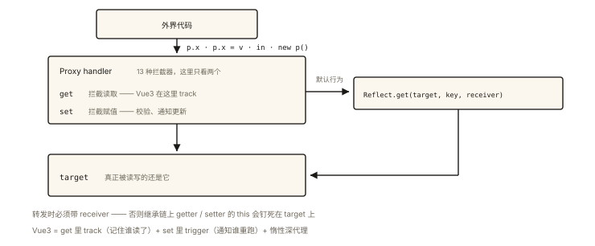

# ES6+ 之 Proxy 与 Reflect

## 从「一行代码监控所有属性访问」说起

需求：给任何对象加上访问日志、默认值、校验——不改动任何一行使用该对象的代码。

```js
const user = loggable(defaults(validatable({
  name: '小明', age: 18,
})));

user.age = -1;   // ⚠️ 校验：age 不能为负
user.xxx;        // 📖 读取 name（有默认值逻辑）… 全部被透明拦截
```

这就是 **Proxy** 的能力：**在对象与外界之间放一层代理，重定义一切基础操作的语义**（读、写、删、遍历、函数调用…）。⭐⭐ Proxy 是 ES6 元编程的巅峰，也是 Vue3 响应式、众多 ORM/校验库的引擎。配套的 **Reflect** 则是这层魔法的「默认实现工具箱」。

## 现象与直觉解释

Proxy = **目标对象 + 处理器（handler）**：外界对代理的一切操作，都先问处理器「拦截吗」，不拦截就走默认行为。

```js
const proxy = new Proxy(target, {
  get(target, key, receiver) { /* 拦截「读」 */ },
  set(target, key, value, receiver) { /* 拦截「写」 */ },
  // deleteProperty / has / ownKeys / apply / construct … 共 13 种
});
```

而 **Reflect** 提供与 13 种拦截器**一一对应的默认实现**：

```js
// handler 里调用默认行为的标准姿势
get(target, key, receiver) {
  console.log('读取了', key);
  return Reflect.get(target, key, receiver); // ✅ 不是 target[key]（后述陷阱）
}
```

## 深入原理

### 一、13 种拦截器速览（按使用频率分级）⭐

| 拦截器 | 拦截的操作 | 典型用途 |
|---|---|---|
| `get` | `p.x` / `p[x]` | 默认值、惰性计算、负索引、访问日志 |
| `set` | `p.x = v` | 校验、响应式触发、脏标记 |
| `has` | `x in p` | 隐藏属性 |
| `deleteProperty` | `delete p.x` | 删除审计 |
| `ownKeys` | `Object.keys` / for...in | 键过滤 |
| `apply` | 调用代理（目标是函数） | 函数包装、缓存 |
| `construct` | `new p()` | 构造校验 |
| 其余 6 种 | 原型/属性描述符等 | 低频 |

```js
// apply 的妙用：自动缓存函数结果（记忆化一行版）
function memoize(fn) {
  const cache = new Map();
  return new Proxy(fn, {                     // 代理「函数本身」
    apply(target, thisArg, args) {
      const key = JSON.stringify(args);
      if (!cache.has(key)) cache.set(key, Reflect.apply(target, thisArg, args));
      return cache.get(key);
    },
  });
}
const slowDouble = memoize((n) => { /* 假设很慢 */ return n * 2; });
```

### 二、receiver 与「必须用 Reflect」的继承陷阱 ⭐⭐

最常见的错误写法与它的翻车现场：

```js
const father = {
  get firstHalf() { return this.value?.slice(0, 2); }, // getter 里用了 this
};

const son = new Proxy(father, {
  get(target, key) {
    return target[key];   // ❌ 错误姿势：this 被硬钉在 father 上
  },
});
// 期望：son.firstHalf 用 son 的 value；实际：target[key] 里的 this 是 father ❗
```

正确姿势——**把 receiver（操作的实际发起者）传给 Reflect**：

```js
const sonValue = { value: 'abcdef', __proto__: new Proxy(father, {
  get(target, key, receiver) {
    return Reflect.get(target, key, receiver); // ✅ receiver = sonValue
    // getter 内的 this === receiver —— 沿真正的发起者取 value
  },
})};
sonValue.firstHalf; // 'ab' ✅
```

**一句话：handler 里转发默认行为一律用 `Reflect.xxx(target, ..., receiver)`，不要手写 `target[key]`**——receiver 保证了 getter/setter 内的 this 指向正确的对象。这也是 Vue3 源码里满屏 `Reflect.get(target, key, receiver)` 的原因。

### 三、Proxy vs Object.defineProperty：Vue3 为什么换引擎 ⭐⭐

| 能力 | defineProperty（Vue2） | Proxy（Vue3） |
|---|---|---|
| 拦截读取/写入 | ✅（逐属性定义） | ✅（整个对象一层） |
| **新增属性** | ❌ 监听不到（要 $set） | ✅ set 直接拦截 |
| **删除属性** | ❌（要 $delete） | ✅ deleteProperty |
| 数组下标/length | ❌（Vue2 靠重写 7 个数组方法绕） | ✅ 原生拦截 |
| Map/Set 内部 | ❌ | ✅ |
| 浏览器兼容 | ES5 全兼容 | ES6+（无法 polyfill） |

```js
// Vue3 响应式核心的极简骨架（10 行看懂灵魂）：
const reactive = (obj) => {
  return new Proxy(obj, {
    get(target, key, receiver) {
      track(target, key);                      // 依赖收集：谁在读我
      const res = Reflect.get(target, key, receiver);
      return typeof res === 'object' && res !== null ? reactive(res) : res; // 惰性深代理
    },
    set(target, key, value, receiver) {
      const old = target[key];
      const res = Reflect.set(target, key, value, receiver);
      if (old !== value) trigger(target, key);  // 变更通知：通知读过我的人更新
      return res;
    },
  });
};
```

细节品读（面试可讲）：① track/trigger 即依赖收集与派发更新；② 嵌套对象**惰性代理**（读到才包一层，避免初始化全量递归的性能浪费）；③ WeakMap 存 target→deps（对象销毁依赖自动释放，《es6-007》）——完整机制在《vue-001》展开。

### 四、Proxy 的边界与不可代理对象 ⭐

1. **目标必须是对象**（原始值不能代理；`new Proxy(42, {})` 报 TypeError）；
2. **代理后身份变化**：`proxy !== target`；将 proxy 作为 Map 键或传给内部槽敏感的内置对象（Map/Set/Promise）时会因为「代理上没有内部槽」报错——`new Proxy(map, {}).get(1)` 会炸，因为 get 转发到 target 前，内置方法先检查 this 的内部槽（解法是绑定 target：handler 里 `target.get.bind(target)`）；
3. **性能**：代理层有可测量的开销（V8 已高度优化，但热路径仍能测出差异）——别给超大数组的逐元素访问套多层代理；
4. **取消代理**：ES2021 Revocable Proxy——`Proxy.revocable()` 返回的代理可随时 `revoke()` 作废，之后访问全报错（安全隔离场景，如沙箱）。

## 回看开篇

loggable/defaults/validatable 三层包装，就是三个 Proxy 叠加——每层拦截自己的关注点（get 记日志、set 校验、get 兜默认值），业务代码零改动。**Proxy 的本质：把「横切关注点」从业务代码里抽出来，装进对象边界上的一层**——AOP（面向切面编程）在 JS 的原生形态。

## 实战延伸

**1. 面试答题骨架**：「Proxy 通过 13 种拦截器重定义对象基础操作的语义，get/set 拦截读写、has 拦截 in、apply 拦截函数调用、construct 拦截 new；handler 转发默认行为必须用 Reflect 并传 receiver，否则继承链上 getter/setter 的 this 会钉死在 target 上；相比 defineProperty，Proxy 能拦截属性新增、删除与数组下标，这是 Vue3 响应式换引擎的原因；局限是原始值不可代理、代理身份不等于目标、内置对象内部槽敏感，以及热路径的性能开销。」

**2. Reflect 的独立价值**：即便不配 Proxy，Reflect 也统一了一批「以前姿势各异」的操作——`Reflect.ownKeys`（字符串+symbol 键）、`Reflect.construct(target, args, newTarget)`、函数式 apply（不必防原型被改的 `Function.prototype.apply.call`）。

## 图解总结



*图 · 所有操作都得先过 handler 这道门，没有绕过去的路*

```
        外界代码
           │ p.x / p.x=v / in / new p()
           ▼
   ┌── Proxy handler ──┐
   │ get: 拦截/增强      │  ──不拦截──▶  Reflect.get(target, key, receiver)
   │ set: 校验/通知      │  ──默认行为──▶ 真正作用在 target（receiver 保 this 正确）
   └───────────────────┘
           │
           ▼
        target 对象

Vue3 = get 里 track（收集读的人）+ set 里 trigger（通知读的人）+ 惰性深代理 + WeakMap 存依赖
```

## 总结

- Proxy = 目标 + handler（13 种拦截器），在对象边界重定义基础操作语义；
- Reflect 是拦截器的默认实现工具箱；handler 转发必须传 receiver，否则 getter/setter 的 this 错位；
- 相比 defineProperty：能拦截增删与数组下标、整对象一层代理、惰性深代理——Vue3 的引擎；
- 边界：原始值不可代理、代理身份不等于目标、内置对象内部槽敏感、热路径有开销、可 revoke；
- 应用光谱：校验/日志/默认值（AOP）、函数记忆化、响应式系统、沙箱。

**面试一句话回答**：Proxy 为目标对象创建一层代理，通过 get、set、has、deleteProperty、apply、construct 等 13 种拦截器重定义基础操作的语义；handler 中转发默认行为应使用 Reflect 并传入 receiver，以保证继承场景下 getter 与 setter 内部的 this 指向实际操作对象；相比 Object.defineProperty 只能逐属性劫持且监听不到新增删除与数组下标，Proxy 对整个对象一层拦截、天然覆盖这些场景，这正是 Vue3 响应式改用 Proxy 的原因；局限在于原始值不可代理、代理与目标身份不同、Map 等内部槽敏感对象需要绑定 target 转发，热路径存在可测量的性能开销。

## 思考题

1. 实现负索引数组：`negArr[-1]` 返回最后一个元素（提示：get 里判 key < 0 转换为 length + key）。
2. `new Proxy(new Map(), handler)` 后调用 `proxy.set(1, 'a')` 为什么报错？给出两种修复方案。
3. 用 Proxy 实现深只读对象 `deepReadOnly(obj)`：任何 set/delete 抛错，嵌套对象读到时返回新的只读代理。
4. 开放设计：利用 `Proxy.revocable` 设计「过期即失效的能力凭证」——api 传入凭证对象，token 刷新后旧凭证必须立即不可用。

（思考题解析将同步录入小程序题库，关联本文 id：es6-008）

## 参考文献：

- ECMA-262 现行版 — Proxy Object Internal Methods、Reflect（与拦截器一一对应清单）
- MDN — [Proxy](https://developer.mozilla.org/zh-CN/docs/Web/JavaScript/Reference/Global_Objects/Proxy)、[Reflect](https://developer.mozilla.org/zh-CN/docs/Web/JavaScript/Reference/Global_Objects/Reflect)
- 《Vue.js 设计与实现》第 2~4 章（响应式系统的完整工业实现）
