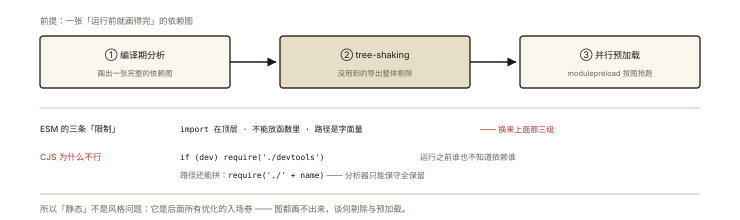
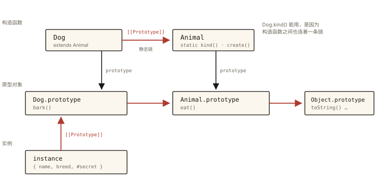

# ES6+ 之 Class 与模块化

## 从两个「老时代的别扭」说起

> **系列导读**：本篇是《ES6+ 系列》收官篇，把「class 的原型真相」与「ESM/CJS 的模块之战」一次讲完——前者承接《js-deep-010 继承》，后者直通工程化系列。

```js
// 别扭一：ES5 的「伪类」——一大堆仪式性代码
function Animal(name) { this.name = name; }
Animal.prototype.eat = function () {};
Animal.staticMethod = function () {};   // 静态方法手动挂函数
// 继承更是四步仪式（寄生组合式，《js-deep-010》）

// 别扭二：模块化三国杀
// AMD（浏览器，requirejs）/ CMD（seajs）/ CommonJS（Node）——
// 浏览器里没有原生模块，只能拿函数作用域模拟（IIFE）
```

ES6 用 **class** 与 **ESM（import/export）** 分别终结了两个时代。⭐⭐ 「class 是语法糖吗」「ESM 与 CommonJS 的区别」都是面试必考，且 ESM 的静态性是 tree-shaking 的理论根基。

## 第一部分：class 的原型真相

### 一、class 做了什么、没做什么 ⭐

```js
class Animal {
  static kind = '动物';              // 静态属性（挂 Animal 上）
  #secret = '内';                     // 私有字段（真私有，实例级）
  constructor(name) { this.name = name; }  // 实例属性
  eat() {}                            // 原型方法（Animal.prototype.eat）
  static create(n) { return new Animal(n); } // 静态方法
}

// 引擎视角的真实结构：
Animal.prototype = { constructor: Animal, eat: ƒ };  // 原型方法在这
Animal.kind = '动物'; Animal.create = ƒ;              // 静态在这
// 实例：{ name, #secret } —— [[Prototype]] → Animal.prototype
```

**「语法糖」辨析**：基础形态确实是构造函数 + 原型的语法包装，但有四点**超出糖**的硬化：

1. **必须 new 调用**：`Animal()` 直接抛 TypeError（构造函数裸调用静默污染全局）；
2. **类体内默认严格模式**（方法里裸调用的 this 是 undefined，《js-deep-006》）；
3. **方法不可枚举**（`Object.keys(Animal.prototype)` 为空——构造函数写法的方法可枚举）；
4. **私有字段 #x 是硬边界**：类外访问直接语法报错，而非约定（`_x` 只是君子协定）。

### 二、extends 与 super：与寄生组合式的对照 ⭐

```js
class Dog extends Animal {
  constructor(name, breed) {
    super(name);            // 必须先 super 再用 this！
    this.breed = breed;
  }
  eat() {
    super.eat();            // 沿原型链调用父类同名方法
    console.log(this.name, '吃完了');
  }
}
// 双链（《js-deep-010》讲过的那两条）：
Dog.__proto__ === Animal;                      // 静态链：Dog 继承 Animal 的静态成员
Dog.prototype.__proto__ === Animal.prototype;  // 原型链：实例方法查找路径
```

**「先 super 后 this」的原理**：派生类构造函数执行时，**this 对象由父类构造创建**（通过 super 调用父类 [[Construct]]），super 之前 this 还不存在（TDZ 保护）——这不是语法洁癖，是实例创建顺序的规范事实。

### 三、 getter/setter 与 static 块速览

```js
class Temperature {
  #celsius = 0;
  get fahrenheit() { return this.#celsius * 9 / 5 + 32; }   // 存取器（defineProperty 的类内形态）
  set celsius(v) { if (v < -273.15) throw new RangeError(); this.#celsius = v; }
  static #registry = new Map();
  static { /* 静态初始化块（ES2022）：类定义时执行一次，可访问私有静态 */ }
}
```

## 第二部分：ESM 与 CommonJS 的模块之战 ⭐⭐

### 一、五大差异对照

| 维度 | CommonJS（require） | ESM（import） |
|---|---|---|
| 加载时机 | **运行时**加载（require 是函数调用） | **编译期**确定依赖（静态结构） |
| 导出 | 值的**拷贝**（快照） | **绑定**（实时映射，live binding） |
| this 顶层 | module.exports | undefined |
| 循环依赖 | 返回「已执行部分」的快照 | 引擎保证绑定存在（取值时决定） |
| 异步/顶层 await | ❌ | ✅（ES2022） |

```js
// 值拷贝 vs 绑定（最直观的实验）：
// ------ CJS counter.js ------
let count = 0;
module.exports = { count, inc: () => count++ };
// ------ main.js ------
const c = require('./counter');
c.inc();            // count 内部变 1
console.log(c.count); // 0 ❗ 导出时拷贝的 0

// ------ ESM counter.js ------
export let count = 0;
export const inc = () => count++;
// ------ main.mjs ------
import { count, inc } from './counter.mjs';
inc();
console.log(count); // 1 ✅ 导入的是「绑定」——指向同一变量
```

### 二、静态性：ESM 一切能力的源头 ⭐

**import/export 必须写在顶层、不能放函数里、路径必须是字符串字面量**——这些「限制」换来的是：**不运行代码就能画出完整依赖图**。



*图 · 静态不是风格，是后面所有优化的入场券*

```
静态依赖图的三级火箭：
① 编译期分析 ──▶ ② tree-shaking（未用到的导出整体剔除，《engineering-007》）
              ──▶ ③ 浏览器/CDN 原生并行预加载（<link rel=modulepreload>）
CJS 的 require 可以写在 if 里 —— 运行前谁也不知道依赖谁 —— 优化无从下手
```

这也解释了历史现象：**打包器为 CJS 做 tree-shaking 乏力**（只能保守保留），全 ESM 依赖树才能安全摇树——「package.json 加 type: module / exports 字段」的现代库规范由此而来。

### 三、细节速查（面试的「你不知道」环节）⭐

```js
// ① import 是「提升」的（hoisted）——模块顶部的所有 import 先于任何代码执行
// ② 导入的绑定是只读的（对使用者）：count = 5 ❌ TypeError（但对象属性可改）
// ③ 默认导出是「名为 default 的具名导出」：import X from … === import { default as X }
// ④ 动态导入是运行时的（返回 Promise）——静态结构的逃生舱：
const { heavy } = await import('./heavy.js');  // 代码分割的基础（懒加载）
// ⑤ import.meta：模块自身元信息（url 等）
// ⑥ 循环依赖：ESM 不报错，拿到的是「尚未初始化的绑定」，取值时机决定结果——
//    设计上应避免循环，工具链（circular-dependency-plugin）用来检测
```

### 四、历史包袱与现代实践

- Node 长期双轨（CJS 为主），`.mjs`/`.type: module` 渐进迁移；Node 22+ 已默认支持 require(esm)，双阵营正在合流；
- 浏览器原生 ESM 早已可用（`<script type="module">`），但裸导入需要 import map；生产仍走打包器（性能与兼容，《engineering-002》）；
- 新库发布建议：源码 ESM + `exports` 字段双格式（bundlers 条件给 ESM、require 条件给 CJS）。

## 回看开篇

class 把「构造函数 + 原型 + 四步继承」收编为清晰语法，同时硬化了 new 强制、严格模式、不可枚举、真私有四条边界；ESM 用静态结构 + 绑定导出终结模块三国杀，并把 tree-shaking、并行预加载、原生浏览器模块三样礼物交给生态。**两者的共同本质：把过去的运行时约定，升级为语言级保证**。

## 实战延伸

**1. 面试答题骨架**：「class 基础形态是构造函数加原型的语法糖，但多了四点硬化——必须 new、类体默认严格、方法不可枚举、# 私有字段的硬边界；extends 对应寄生组合式并建立静态与原型双链，派生类必须先 super 再用 this，因为实例由父类构造创建。ESM 与 CJS 的核心差异是静态结构与运行时加载、绑定导出与值拷贝，静态性使 tree-shaking 与并行预加载成为可能；import 有提升性、导入绑定只读、动态 import 是静态结构的运行时逃生舱。」

**2. 快手题**：

```js
class A { constructor() { console.log(new.target.name); } }
class B extends A {}
new B();         // 'B' —— new.target 指向实际构造的类
A();             // TypeError —— 必须new
console.log(Object.keys(A.prototype)); // [] —— 方法不可枚举
```

## 图解总结



*图 · extends 同时连出两条链：构造函数之间一条（静态成员靠它继承），原型对象之间一条（实例查找靠它走）*

```
class Dog extends Animal 真实结构：
 Animal.kind/create（静态）        Animal.prototype.eat
      ▲ __proto__(静态链)              ▲ __proto__(原型链)
 Dog                                    Dog.prototype.bark
      ▲ new                                 ▲ [[Prototype]]
 instance {name, breed, #secret} ───────────┘

ESM：import 前置提升 ── 编译期依赖图 ──▶ tree-shaking / 预加载
     导入的是「绑定」（live）──▶ 只读、实时反映模块内部变化
CJS：require 运行时执行 ── 导出值的拷贝 ──▶ 无法静态优化
```

## 总结

- class = 构造函数/原型的语法包装 + 四条硬化（强制 new、默认严格、不可枚举、# 私有）；
- extends 建双链（静态链 + 原型链）；super 前 this 不存在是实例创建顺序的规范事实；
- ESM 三大特征：静态结构、绑定导出、顶层 await；CJS 是运行时加载与值拷贝；
- 静态性带来 tree-shaking 与预加载；动态 import 是静态结构的运行时逃生舱（代码分割基础）；
- import 提升、绑定只读、默认导出即 default 具名导出。

**面试一句话回答**：class 在基础形态上是构造函数与原型方法的语法糖，但额外强制必须 new 调用、类体默认严格模式、原型方法不可枚举，并提供硬边界的 # 私有字段；extends 建立构造函数静态链与原型双链，派生类必须先 super 再访问 this，因为实例由父类构造创建。ESM 与 CommonJS 的核心区别是：import/export 是编译期确定的静态结构而 require 是运行时函数调用，ESM 导出的是实时绑定而 CJS 导出值的拷贝——静态性使 tree-shaking 与模块预加载成为可能，动态 import 则是静态体系里做代码分割的运行时逃生舱。

## 思考题

1. `class C { x = 1; }` 与 `class C { constructor() { this.x = 1; } }` 有区别吗？（提示：字段定义的时机与 # 私有字段的初始化顺序）
2. ESM 循环依赖下 `import { a } from './a.js'`（a 尚未初始化）在「立即取值」与「延迟到函数调用时取值」两种写法的结果差异？画出两条加载路径。
3. 为什么 CJS 的 `if (dev) require('./dev-tool')` 是 tree-shaking 的噩梦？举一个打包器不得不保留代码的具体场景。
4. 开放设计：给你负责的 CJS 老库做 ESM 化改造——列出迁移清单（exports 字段、双格式构建、循环依赖检测、灰度策略）与风险点。

（思考题解析将同步录入小程序题库，关联本文 id：es6-010）

## 参考文献：

- ECMA-262 现行版 — Class Definitions、Modules（Source Text Module Records）
- MDN — [类](https://developer.mozilla.org/zh-CN/docs/Web/JavaScript/Reference/Classes)、[模块](https://developer.mozilla.org/zh-CN/docs/Web/JavaScript/Guide/Modules)
- Node.js 官方文档 — Modules: ESM 与 require(esm)
- 本课程《js-deep-010 继承》《engineering-007 Tree Shaking》
