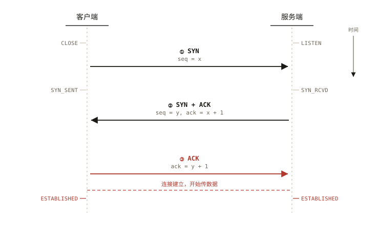
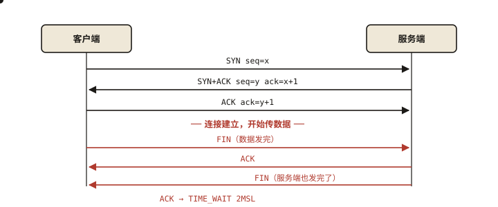
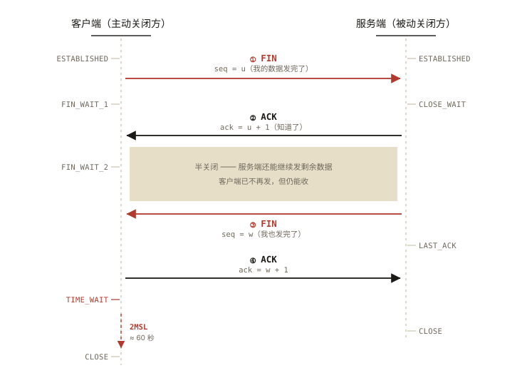

# 网络与浏览器之 TCP：三次握手与四次挥手

## 从面试官的三个追问说起

> **系列导读**：《网络与浏览器系列》共 10 篇，从 TCP 连接到 HTTP 协议族，再到缓存、跨域与完整渲染链路。本篇是第 1 篇，讲一切 HTTP 请求的地基——TCP 连接的建立与断开。

面试经典三连：

1. 「三次握手为什么不是两次？」
2. 「四次挥手为什么比握手多一次？」
3. 「TIME_WAIT 为什么要等 2MSL？」

三道题的错误率极高，因为大多数人背的是「SYN、SYN+ACK、ACK」的名词，没有理解握手**到底在确认什么**。⭐⭐ 本篇的目标：让你能用自己的话回答「为什么」，而不是复述报文名。

## 现象与直觉解释

TCP 是**面向连接的可靠传输协议**。「面向连接」的意思是：正式传数据前，双方要先「对上暗号」——确认彼此的收发能力、同步初始序列号。直觉类比打电话：

```
你：「喂，能听到吗？」                 —— 我能发，你（假设）能收
对方：「能听到，你能听到我吗？」        —— 你能发我能收；我能发，你能收吗？
你：「能。」                          —— 双向收发全部确认 ✅ 通话开始
```

注意：**最少三轮**才能把「双向都能收发」确认完。这就是三次握手的直觉版本。

## 深入原理

### 一、三次握手：报文与时序 ⭐



*图 · 三次握手的报文与时序：左侧是客户端状态机，右侧是服务端状态机*

```
客户端                          服务端
  │ ── SYN, seq=x ────────────▶ │  ① 我要建立连接，我的序号是 x
  │ ◀─ SYN+ACK, seq=y, ack=x+1─│  ② 收到你的 x（确认）；我也要连，我的序号是 y
  │ ── ACK, ack=y+1 ──────────▶ │  ③ 收到你的 y（确认）
  │                              │
  ═══════ 连接建立，开始传数据 ═══════
```

每一步都在「确认一件事」：

| 步骤 | 客户端知道 | 服务端知道 |
|---|---|---|
| ① 发出 SYN | — | 收到后：对方能发、我能收 |
| ② 收到 SYN+ACK | 对方能发、我能收；**我发的对方收到了** | — |
| ③ 服务端收到 ACK | — | **我发的对方收到了** ✅ 双向闭环 |



*图 · 三次握手（上）与四次挥手（下）——墨线建立，红线拆除*

### 二、为什么不能两次？（正问与反问都考）⭐⭐

**理由 1：两次无法确认「客户端能收」。** 假设只有 ①② 两步：服务端发出 SYN+ACK 后就直接开始传数据——但客户端能不能收到服务端的包，服务端**并不知道**（② 的 ACK 缺失）。

**理由 2（更本质）：防止历史重复连接。** 经典场景：

```
客户端发了一个 SYN（seq=90），该包在网络里迷路滞留；
客户端超时，发新的 SYN（seq=100）建立连接，完成通信并关闭；
此时那个「旧 SYN(90)」姗姗到达服务端；
服务端若「两次握手即建连」→ 直接建立了一个客户端根本不认的连接，傻等数据；
三次握手中：服务端回 SYN+ACK(ack=91)，客户端发现自己并没有发起 seq=90 的连接
→ 回 RST 拒绝，旧连接被掐灭 ✅
```

一句话：**第三次握手给了客户端「否决历史连接」的机会**——这是「为什么不是两次」的标准答案核心。

### 三、四次挥手：为什么多一次？



*图 · 四次挥手：中间那段灰底就是「半关闭」，也是挥手比握手多一次的原因*

```
客户端（主动关闭方）                服务端（被动关闭方）
  │ ── FIN ─────────────────▶ │  ① 我的数据发完了，想关（我不再发，但还能收）
  │ ◀─ ACK ────────────────── │  ② 知道了（但我可能还有数据没发完）
  │        ……（半关闭状态：服务端继续发剩余数据）……
  │ ◀─ FIN ────────────────── │  ③ 我的数据也发完了，我也关
  │ ── ACK ─────────────────▶ │  ④ 好的，确认
  │                              │
```

**为什么握手三次、挥手四次？** 因为 TCP 是**全双工**（两个方向独立收发）：

- 握手时，服务端可以把「确认（ACK）」和「我也连（SYN）」**合并**成一个 SYN+ACK 报文——它没有「能不能合并」的障碍；
- 挥手时，服务端收到 FIN 后**可能还有数据没发完**，只能先回 ACK（②），等数据发完再发自己的 FIN（③）——ACK 和 FIN **被迫拆开**，所以多一次。

「半关闭」正是这么设计的价值：一方说完了，还能听对方说完。

### 四、TIME_WAIT：为什么主动关闭方要等 2MSL？⭐

最后一个 ACK（④）丢了怎么办？服务端会**重传 FIN**。若客户端收到重传却已「彻底关闭」，将回 RST，服务端异常关闭。所以客户端发完 ACK 后进入 TIME_WAIT，**等 2 个 MSL（报文最大生存时间）**：

- 等第 1 个 MSL：让自己的 ACK 有机会送达对方；
- 等第 2 个 MSL：万一对方重传 FIN，还能再回一次 ACK；
- 附带价值：让本连接的所有旧报文在网络中自然消亡，不污染「相同四元组」的新连接。

**前端关联的工程现实**：TIME_WAIT 只由**主动关闭方**承担——大量短连接 + 主动关闭（如压测机、某些网关配置）会堆积 TIME_WAIT。浏览器的对策是**连接复用（keep-alive）**：一个 TCP 连接上串行跑多个 HTTP 请求，避免反复握手挥手（HTTP/2 更进一步单连接多路复用，见《network-003》）。

### 五、前端视角的 TCP 知识点地图

1. **Chrome 对同一域名最多 6 个并行 TCP 连接**（HTTP/1.1 时代）——这就是「把资源分散到多个域名」这种老优化手段的根源；
2. **HTTPS 的握手发生在 TCP 握手之后**（先通线路，再谈加密，见《network-005》）；
3. **CLOSE_WAIT 堆积**是应用层 bug 信号（收到 FIN 却不调 close），排查方向在代码而非网络；
4. **SYN Flood** 攻击一句话：伪造大量 SYN 让服务端半连接队列爆满，防御靠 SYN Cookie——知道概念即可。

## 回看开篇三问

1. **为什么三次不是两次**：两次无法确认「客户端能收」，更关键的是失去「客户端否决历史重复连接」的机会；
2. **为什么挥手四次**：全双工下被动方的 ACK 与 FIN 因「可能还有数据」被迫拆成两步；
3. **为什么等 2MSL**：一个 MSL 保证最后的 ACK 可达并响应 FIN 重传，一个 MSL 让旧报文消亡。

## 实战延伸

**抓包亲眼看一次握手**：Chrome DevTools → Network → 选择一条请求 → Timing 面板中的 `Initial connection` 就是 TCP 握手耗时（HTTPS 还有 SSL 时间）——前端性能优化里「减少新连接」的数据依据。

**面试答题模板**：「TCP 是面向连接的可靠协议，连接建立要三次——本质是双方各自确认『对方能收发』并同步初始序列号；不能是两次，因为服务端无法确认自己的包客户端能收到，且第三次握手给了客户端拒绝历史重复 SYN 的机会。断开要四次，因为全双工下两个方向独立关闭，被动方的 ACK 和 FIN 可能因未发完数据而拆开；主动方 TIME_WAIT 等 2MSL，一半确保最后的 ACK 与 FIN 重传响应，一半让旧报文消亡。」

## 图解总结

```
建立（3 次）                      断开（4 次）
C ──SYN──▶ S                      C ──FIN──▶ S        ① 主动方数据发完
C ◀─SYN+ACK── S                   C ◀─ACK── S         ② 确认（S 可能还有数据）
C ──ACK──▶ S ✅                   C ◀─FIN── S         ③ 被动方也发完
                                  C ──ACK──▶ S        ④ 确认
                                  C ─ TIME_WAIT 2MSL ─ 确保ACK可达 + 旧报文消亡
```

## 总结

- 三次握手 = 双向收发能力的最小确认轮数 + 历史重复连接的否决机制；
- 四次挥手源于全双工：两个方向独立关闭，ACK 与 FIN 分开发送，中间是半关闭状态；
- TIME_WAIT（2MSL）由主动关闭方承担：保障最后 ACK 可达、旧报文消亡；
- 前端关联：6 连接限制、keep-alive 复用、HTTPS 握手在其上、CLOSE_WAIT 堆积是代码 bug。

**面试一句话回答**：三次握手是因为双方要各自确认对方的收发能力并同步序列号，且第三次 ACK 让客户端能否决历史重复的 SYN 连接；四次挥手是因为 TCP 全双工、被动关闭方收到 FIN 后可能还有数据要发，只能先 ACK 再择机 FIN；主动关闭方进入 TIME_WAIT 等待 2MSL，是为了确保最后的 ACK 送达（并响应可能的 FIN 重传），同时让旧报文在网络中消亡，不污染复用相同四元组的新连接。

## 思考题

1. 如果第三次握手的 ACK 在网络中丢失，会发生什么？（客户端/服务端各自的状态与行为）
2. 服务端出现大量 CLOSE_WAIT，说明什么？从「谁来调 close」的角度定位代码层面的问题。
3. 为什么浏览器要对同域名限制 6 个 TCP 连接？HTTP/2 是如何用「一条连接」绕开这个限制的？（预习《network-003》）
4. 开放讨论：手机在电梯里断网后恢复，TCP 连接还在吗？为什么长连接需要「心跳」机制（关联《network-009 WebSocket》）？

（思考题解析将同步录入小程序题库，关联本文 id：network-001）

## 参考文献

- 《TCP/IP 详解 卷 1：协议》第 13、17~18 章（连接建立与终止）
- RFC 793 — Transmission Control Protocol
- Chrome DevTools 文档 — Network Timing
- 本系列《network-003 HTTP/2》《network-005 HTTPS》（连接层的上层应用）
