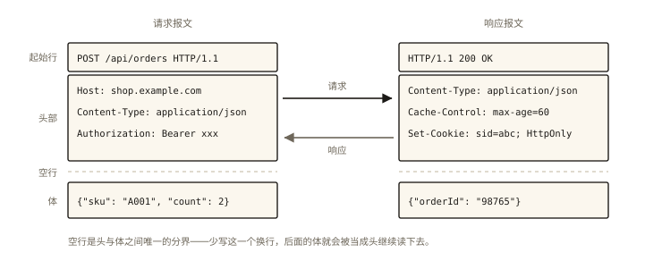

# 网络与浏览器之 HTTP 报文、方法与状态码

## 从一次「5xx 排障」说起

线上告警：某个接口大面积报错。前端同学看到状态码 `502`，在群里问「服务挂了吗」；后端同学说「我这边服务正常」；运维说「网关日志有 upstream timeout」。

**一个状态码没读懂，排障方向就全错**：`502` 意味着「网关收到了你的请求，但上游服务返回了无效响应/拒绝连接」——问题大概率在服务侧或网关到服务之间；如果是 `504`，则是「上游处理超时」；如果是 `429`，则是「请求太频被限流」。⭐⭐ 状态码是前后端联调与线上排障的「通用语言」，读不懂就只能瞎猜。

## 现象与直觉解释

HTTP 是**应用层**的「请求-响应」协议，跑在 TCP（上一篇）搭好的线路上。一次通信就两样东西：**请求报文**和**响应报文**。直觉上像寄信：信封（起始行+头部）写清「谁寄的、寄给谁、什么格式」，信纸（消息体）装内容；回信的信封上写着「处理结果」（状态码）。

## 深入原理

### 一、报文结构：三段式

```http
POST /api/orders HTTP/1.1          ┐ 起始行：方法 路径 版本
Host: shop.example.com             │
Content-Type: application/json     │ 请求头：键值对（元数据）
Authorization: Bearer xxx          │
Content-Length: 42                 ┘
                                   （空行 —— 头与体的分界）
{"sku": "A001", "count": 2}        请求体：数据本身
```

```http
HTTP/1.1 200 OK                    ┐ 状态行：版本 状态码 短语
Content-Type: application/json     │ 响应头
Cache-Control: max-age=60          │
Set-Cookie: sid=abc; HttpOnly      ┘
                                   （空行）
{"orderId": "98765"}               响应体
```



*图 · 唯一的分岔点是第一行：左边写「要什么」，右边写「结果如何」；后面的头部与体只是内容不同*

高频请求头/响应头速记（前端必须秒懂）：

| 头 | 方向 | 作用 |
|---|---|---|
| `Content-Type` | 双向 | 体的格式（application/json、text/html…） |
| `Authorization` | 请求 | 凭证（Bearer token / Basic） |
| `Cookie` / `Set-Cookie` | 请求/响应 | 会话状态（《network-008》专篇） |
| `Cache-Control` / `ETag` | 响应 | 缓存策略（《network-006》专篇） |
| `Origin` / `Access-Control-Allow-Origin` | 请求/响应 | 跨域（《network-007》专篇） |
| `Location` | 响应 | 重定向目标（配合 3xx） |

### 二、请求方法：语义即契约 ⭐

| 方法 | 语义 | 幂等 | 有体 |
|---|---|---|---|
| GET | 读取资源 | ✅ | 无 |
| POST | 创建/提交处理 | ❌ | 有 |
| PUT | 整体替换 | ✅ | 有 |
| PATCH | 部分更新 | ❌（通常） | 有 |
| DELETE | 删除 | ✅ | 可有 |
| HEAD | 只要元数据（不要体） | ✅ | 无 |
| OPTIONS | 询问支持的方法 | ✅ | 无（跨域预检的主角，《network-007》） |

**幂等性是重试安全的判据**（直通《js-async-008 重试》）：同一请求发 N 次，服务端状态与发 1 次相同 → GET/PUT/DELETE 可放心重试；POST 不幂等，盲目重试有重复下单风险。

**GET vs POST 的「面试标准答案」**：语义（读 vs 写）才是本质差异；其余多为「约定俗成」——GET 可被缓存/收藏/留历史记录、参数在 URL（有长度限制的其实是浏览器与服务器的实现约定，不是 HTTP 规范）、参数在 body 的 GET 也规范允许但生态不支持；「GET 不如 POST 安全」是误解，两者都是明文（加密靠 HTTPS）。URL 参数会出现在日志与历史记录里，所以「敏感数据放 body」的真实理由是**减少泄露面**，而非「POST 加密了」。

### 三、状态码：五大家族与易混辨析 ⭐⭐

```
1xx 信息中转    101 Switching Protocols —— WebSocket 升级时见（《network-009》）
2xx 成功        200 OK（通用）| 201 Created（创建成功）| 204 No Content（成功无体）
3xx 重定向      301 | 302 | 304 | 307 | 308
4xx 客户端问题  400 | 401 | 403 | 404 | 405 | 429
5xx 服务端问题  500 | 502 | 503 | 504
```

**辨析组一：301 vs 302 vs 307/308（重定向四兄弟）**

| 码 | 语义 | 方法是否保留 |
|---|---|---|
| 301 | 永久移动 | 浏览器历史习惯改 GET（早期实现「绑架」了规范） |
| 302 | 临时移动 | 同上，POST 常被改成 GET（不可靠） |
| 307 | 临时，**严格保留方法** | POST 重定向后仍是 POST |
| 308 | 永久，严格保留方法 | 同理 |

**辨析组二：301/302（永久/临时）的实战差异**：永久重定向会被**浏览器缓存**，后续请求不再询问原地址——用于域名迁移；临时重定向不缓存，用于登录跳转、短链。**把临时跳转写成 301 是大型事故**（用户被缓存「锁死」在错误地址，极难恢复）。

**辨析组三：401 vs 403**：401 = 「你是谁？」（未认证/凭证无效，配合 `WWW-Authenticate` 头）；403 = 「我知道你是谁，但你没权限」（认证通过、授权失败）。前端处理：401 → 引导登录/刷新 token；403 → 提示无权限，别再重试登录。

**辨析组四：5xx 排障速查**（对应开篇场景）：

| 码 | 含义 | 排查方向 |
|---|---|---|
| 500 | 服务内部错误 | 后端日志、异常堆栈 |
| 502 | 网关收到上游无效响应 | 上游服务挂了/重启中/拒绝连接 |
| 503 | 服务不可用 | 过载、维护（常带 Retry-After 头） |
| 504 | 网关等待上游超时 | 上游处理慢（慢 SQL、下游依赖卡） |

**特别的一员：304 Not Modified**——它不是「错误」，而是缓存协商成功的标志（浏览器问「我缓存的还能用吗」，服务器答「能，304，无 body」）——完整决策链在《network-006 浏览器缓存》展开。

### 四、前端工程视角：状态码的统一处理

```js
// axios 拦截器的典型分层
axios.interceptors.response.use(
  (res) => {
    // 业务层：HTTP 200 但业务码失败（code !== 0）的约定处理
    const { code, data, message } = res.data;
    return code === 0 ? data : Promise.reject(new BizError(message));
  },
  (err) => {
    const status = err.response?.status;
    if (status === 401) return redirectToLogin();
    if (status === 403) return showForbidden();
    if (status >= 500) return reportAndToast('服务开小差了'); // 上报监控
    return Promise.reject(err);
  }
);
```

**HTTP 状态码 vs 业务码**是团队规范的经典之争：状态码表达**传输层语义**（成功收到响应了吗），业务码表达**领域语义**（订单创建成功吗）——两者正交，健康的设计是「HTTP 层管通断、业务层管对错」，而不是把一切业务失败都塞成 200+code。

## 回看开篇

`502` 的正确排障链：网关（nginx）收到请求 → 转发上游 → 上游连接被拒/返回垃圾 → 网关回 502。方向：查上游服务存活与网关 upstream 配置。若是 504 → 查上游为何慢；若是 429 → 查触发了谁的限流。**状态码把「三个团队的排障会议」变成了一句定位**。

## 实战延伸

**1. DevTools 的 Network 面板就是报文浏览器**：Headers 标签页里「General/Request Headers/Response Headers」三段与本文报文结构一一对应；Size 列里 `(from cache)`、`(memory cache)` 是《network-006》的前奏。

**2. RESTful 风格速记**：资源作 URL（`/orders/98765`）、方法作动作（GET 读/POST 建/PUT 换/PATCH 补/DELETE 删）、状态码作结果——「语义即契约」的工程化落地。

**3. 面试快手题**：「浏览器输入 URL 到服务器返回 304，中间发生了什么」——是本篇 + 《network-001》 + 《network-006》的串烧，也是检验三篇是否贯通的标尺。

## 图解总结

```
请求报文                          响应报文
┌──────────────────┐            ┌──────────────────┐
│ 起始行：方法 路径 版本│            │ 状态行：版本 状态码    │
│ 头部：元数据键值对     │  ──TCP──▶ │ 头部：类型/缓存/Cookie │
│ （空行）            │            │ （空行）             │
│ 体：数据           │            │ 体：数据（304 无体）   │
└──────────────────┘            └──────────────────┘
 方法=动作语义(幂等?)              状态码=结果语义(五大家族)
```

## 总结

- 报文三段式：起始行（方法/状态码）、头部（元数据）、体（数据）；
- 方法是语义契约：GET 读、POST 建、PUT 换、PATCH 补、DELETE 删；幂等性决定重试安全；
- 状态码五大家族，易混组：301/302/307/308（永久/临时 × 保不保留方法）、401/403（认证/授权）、500/502/503/504（内部错/网关上游无效/过载/超时）；
- 304 是缓存协商成功而非错误；HTTP 状态码管「传输语义」，业务码管「领域语义」，两者正交。

**面试一句话回答**：HTTP 报文由起始行、头部、消息体三段构成；请求方法表达动作语义——GET 读取幂等可缓存、POST 提交不幂等重试需防重复、PUT 整体替换、PATCH 局部更新；状态码表达结果语义——2xx 成功、3xx 重定向（301 永久会被缓存而 302 临时不缓存、307/308 严格保留方法）、4xx 客户端问题（401 未认证、403 未授权）、5xx 服务端问题（500 内部错误、502 网关收到上游无效响应、504 上游超时），其中 304 是缓存协商成功的专用码。

## 思考题

1. 「GET 请求 URL 长度不能超过 2048 字符」这个说法对吗？依据是什么？
2. 为什么「把登录跳转写成 301」会造成事故？给出修复思路（连浏览器缓存怎么清都考虑）。
3. 接口偶发 502 且自动恢复，列出你的排查清单（按「网关配置 / 上游服务 / 部署动作」分组）。
4. 开放设计：你们团队的列表接口要支持「删除后返回 200 + code=10001」与「404 + code=10001」两种设计——从缓存、监控告警、前端处理三个角度对比并给出结论。

（思考题解析将同步录入小程序题库，关联本文 id：network-002）

## 参考文献

- RFC 9110 — HTTP Semantics（方法与状态码的现行权威定义）
- MDN — [HTTP 概述](https://developer.mozilla.org/zh-CN/docs/Web/HTTP/Overview)、[HTTP 状态码](https://developer.mozilla.org/zh-CN/docs/Web/HTTP/Status)
- 《图解 HTTP》第 2~4 章
