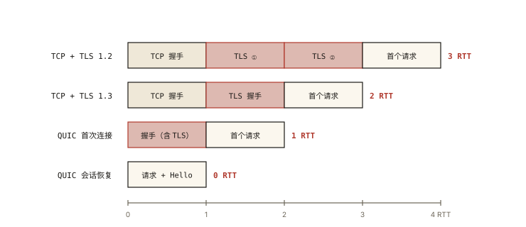
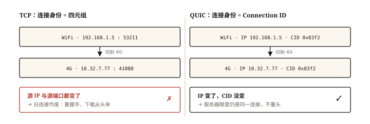
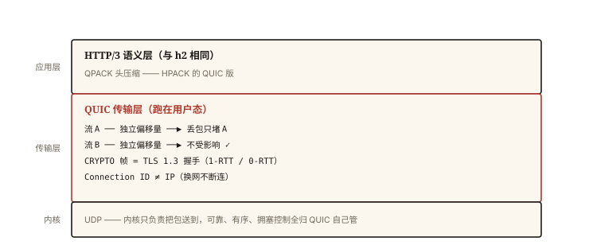

# 网络与浏览器之 HTTP/3 与 QUIC

## 从「地铁里刷网页为什么卡」说起

上一篇结尾留了悬念：HTTP/2 把所有流塞进**一条 TCP 连接**，弱网丢包时全流遭殃——队头阻塞下移到了 TCP 层。日常体感就是：地铁、电梯、人流密集的会场里，网页「转圈」——丢一个包，整个连接所有资源一起卡住。

更糟的是建立连接的成本：TCP 握手（1 RTT）+ TLS 握手（1~2 RTT）串行执行，弱网下每多一个 RTT 都是肉眼可见的白屏时间。

HTTP/3 的答案很激进：**抛弃 TCP，在 UDP 上重写一套传输层——QUIC**。⭐⭐ 「为什么用 UDP 重造 TCP」是 HTTP/3 的高频考题，答案分三层：解阻塞、省握手、可演进。

## 现象与直觉解释

先破一个误解：「UDP 不可靠，HTTP/3 不会丢数据吗？」

**QUIC 是「UDP 之上的可靠传输协议」**——它把 TCP 的可靠机制（确认、重传、拥塞控制）在用户态重新实现了一遍，同时修正了 TCP 的结构性缺陷。直觉类比：TCP 是运营商修的老铁路（改不动），QUIC 是在公共道路上自己调度的一列智能车队——道路（UDP）只是承载，调度规则全部自己定，想怎么优化就怎么优化。

而 HTTP/3 之上（方法、状态码、头部语义）与 HTTP/2 几乎不变——变的只是「下层怎么运」。

## 深入原理

### 一、核心改进 1：流级别的独立交付，终结传输层队头阻塞 ⭐

TCP 的可靠是**字节流级**的：字节必须按序上抛，丢一个包，后面已到的字节也只能等（重传补齐才能交付）。

QUIC 的可靠是**流（Stream）级**的：

```
TCP（字节流）：
  字节序号: 100 101 102 [丢] 104 105 106 …
  → 104 之后全部卡住等待 103 重传 —— 所有流一起遭殃

QUIC（流独立）：
  流A: 帧1 [丢] 帧3      帧3 可以先交付给流A 的重组缓冲
  流B: 帧1 帧2 帧3        —— 完全不受流A 丢包影响，立即交付 ✅
  → 丢包只阻塞「丢包所在的那个流」
```

每个流用独立的单调递增偏移量（offset）管理，帧到达即可按流内序重组交付——**队头阻塞从「连接级」缩小到「流级」**。这是 HTTP/3 最大的性能收益。

### 二、核心改进 2：传输层与加密层合并，握手更快 ⭐

对比建立一条可用加密连接的成本：



*图 · 同一件事——「多久能发出第一个请求」：TCP 叠 TLS 1.2 要 3 个 RTT，TLS 1.3 要 2 个，QUIC 把两层握手并成一步，会话恢复还能压到 0*

```
HTTPS over TCP/1.1 或 2：
  TCP 握手: 1 RTT ┐
  TLS 1.3:  1 RTT ┘ 共 2 RTT（TLS1.2 需 2 RTT，共 3 RTT）

HTTPS over QUIC（首次连接）:
  QUIC 握手与 TLS 1.3 握手合并: 1 RTT ✅

QUIC 会话恢复（0-RTT）:
  首个请求的数据包可以随「Hello」一起发出: 0 RTT ✅✅
```

QUIC 帧结构里直接内置了 TLS 1.3 的握手消息（CRYPTO 帧）——**传输握手与加密握手融合为一步**。0-RTT 的原理：客户端缓存上次会话的密钥参数，重连时直接带数据出发（有重放攻击的约束，只对幂等请求安全）。

弱网下 RTT 又大又抖，省 1~2 个 RTT 对首屏时间的改善立竿见影。

### 三、核心改进 3：连接迁移（Connection Migration）⭐

TCP 连接由「四元组」（源 IP、源端口、目标 IP、目标端口）标识——手机从 WiFi 切到 4G，IP 变了，TCP 连接作废，一切重来。

QUIC 用 **Connection ID** 标识连接（与 IP 解耦）：



*图 · 身份挂在 IP 上，换网就得重来；身份挂在 CID 上，IP 怎么变都还是那条连接*

```
WiFi 下: [CIP=192.168.1.5, CID=0x83f2…] ─┐
                                          ├─ 服务器眼里是同一个连接 ✅
4G 下:   [CIP=10.32.7.77, CID=0x83f2…] ─┘
```

网络切换（WiFi→蜂窝、信号漫游）时连接不断、下载不重头——移动端体验的关键改进。

### 四、核心改进 4：可演进性（TCP 僵化问题）

想给 TCP 加特性（新的拥塞控制、新的选项）需要**内核与全网中间设备**都升级——运营商 NAT、防火墙对「陌生的 TCP 选项」往往直接丢弃，二十年间 TCP 几乎无法演进（中间件僵化，ossification）。QUIC 跑在用户态：协议逻辑在浏览器/服务器自己的代码里，**升级一个版本即可全网生效**——连「队头阻塞修复」本身都受益于这种自由。

### 五、代价与兼容策略

天下没有免费的协议：

1. **CPU 开销**：QUIC 在用户态做可靠传输，失去了内核 TCP 的零拷贝等优化，早期 CPU 占用更高（近年在持续优化）；
2. **运营商与设备对 UDP 的区别对待**：个别网络限速/丢弃 UDP，QUIC 有探测降级机制；
3. **兼容方案**：浏览器通过 HTTP/2 的 `Alt-Svc: h3=":443"` 头宣告「我也支持 HTTP/3」，下次连接先试 QUIC（UDP 443），失败自动回落 TCP——**一切对业务代码透明**。

## 回看开篇

地铁卡顿的两个根因都有了着落：丢包全流阻塞（QUIC 流级独立交付解决）、切换网络/弱网建立连接慢（0-RTT 与连接迁移解决）。HTTP/3 之于 HTTP/2，改的不是「HTTP」，而是「HTTP 脚下的路」。

## 实战延伸

**1. 验证 HTTP/3**：DevTools → Network → Protocol 列显示 `h3`；或访问 cloudflare-quic.com 之类演示站观察。主流大站（Google 系、Cloudflare、主流视频站）已默认开启。

**2. 面试新姿势**：问到 HTTP/3 不要只答「基于 UDP」——标准展开是「**为什么**换：TCP 队头阻塞无解（流共享字节流）+ 握手成本 + 中间件僵化；**怎么**换：QUIC 在 UDP 上实现流级可靠交付、握手与 TLS 融合（1-RTT/0-RTT）、Connection ID 连接迁移、用户态可演进」。

**3. 一图看三代协议**：

```
HTTP/1.1:  文本报文 · 连接串行 · 6连接hack
HTTP/2:    二进制帧 · 单连接多路复用 · HPACK     ┐ 应用层进化
HTTP/3:    QUIC(UDP) · 流独立交付 · 0-RTT · CID ┘ 传输层重写
```

## 图解总结



*图 · 换掉的只有中间那一层：语义层原样复用 h2，UDP 只是「道路」，可靠性、流、加密、迁移全被搬进了用户态的 QUIC*

```
              ┌────────── HTTP/3 语义层（同 h2）──────────┐
              │   QPACK 头压缩（HPACK 的 QUIC 版）          │
              ├────────── QUIC 传输层（用户态）────────────┤
              │  流A ─独立偏移─▶ 丢包只堵A                  │
              │  流B ─独立偏移─▶ 不受影响 ✅                 │
              │  CRYPTO帧=TLS1.3 握手(1-RTT/0-RTT)         │
              │  Connection ID ≠ IP（网络切换不断连）        │
              └─────────────── UDP（内核仅提供「道路」）─────┘
```

## 总结

- QUIC 是 UDP 之上的可靠传输协议：TCP 的可靠 + 修正 TCP 的结构性缺陷；
- 四大改进：流级独立交付（队头阻塞从连接级缩到流级）、握手与 TLS 融合（1-RTT/0-RTT）、Connection ID 连接迁移（网络切换不断连）、用户态可演进（绕开中间件僵化）；
- 代价：CPU 开销、UDP 被个别网络区别对待；通过 Alt-Svc 与自动降级保证兼容；
- HTTP 语义层不变——前端代码零改动，收益由协议栈自动交付。

**面试一句话回答**：HTTP/3 把传输层从 TCP 换成了基于 UDP 的 QUIC，动机有三：TCP 的字节流按序交付让 HTTP/2 的多流共享一条连接时丢包阻塞所有流，QUIC 实现流级独立交付把队头阻塞缩小到单个流；QUIC 把传输握手与 TLS1.3 握手融合实现 1-RTT 甚至 0-RTT 建连；并用与 IP 解耦的 Connection ID 支持网络切换不断连，同时因跑在用户态而绕开了 TCP 的中间件僵化、可持续演进——上层 HTTP 语义不变，浏览器通过 Alt-Svc 探测并自动降级保证兼容。

## 思考题

1. QUIC 的 0-RTT 为什么只对幂等请求安全？重放攻击在这条链路上如何发生？
2. 从 WiFi 切到 4G：TCP 连接和 QUIC 连接分别会发生什么？已有认证状态的 WebSocket 会断吗（结合《network-009》）？
3. 「QUIC 是 UDP 上的 TCP 重写」——列出 QUIC 必须自己实现的 TCP 特性清单（确认/重传/拥塞控制/流控…），并说明哪一项它刻意做得不同。
4. 开放讨论：既然 QUIC 证明「用户态重写传输层」可行，未来浏览器还可能把哪些「内核能力」搬到用户态？代价是什么？

（思考题解析将同步录入小程序题库，关联本文 id：network-004）

## 参考文献
 

- RFC 9114 — HTTP/3、RFC 9000 — QUIC 传输协议、RFC 9001 — QUIC 与 TLS 集成
- Chrome 官方博客 — HTTP/3 与 QUIC 部署进展
- Cloudflare 博客 — HTTP/3 实战系列
- 本系列《network-003 HTTP/2》（QUIC 所修复问题的上下文）
