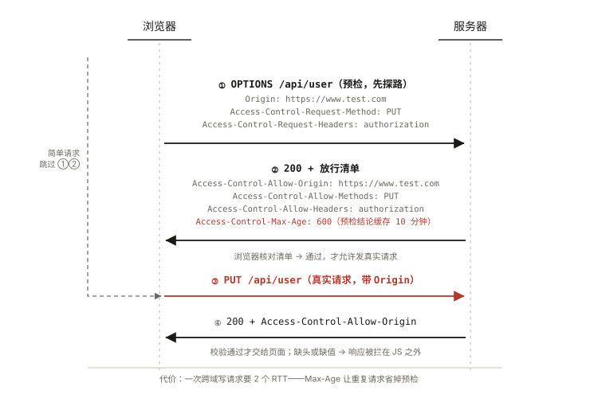
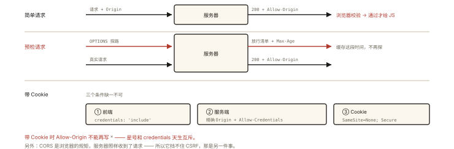

# 网络与浏览器之跨域：CORS 与其他方案

## 从开发环境「能跑」、上线「报错」说起

本地开发一切正常（`localhost:5173` 请求 `localhost:3000` 的接口），部署到测试环境立刻报错：

```
Access to XMLHttpRequest at 'https://api.test.com/user' from origin
'https://www.test.com' has been blocked by CORS policy:
No 'Access-Control-Allow-Origin' header is present on the requested resource.
```

同样的代码，换了个域名就「被浏览器拦截」。这就是**跨域问题**——严格说是**浏览器的同源策略**在拦截。⭐⭐ 跨域是实战与面试的双高频，但 90% 的人只会说「JSONP 和 CORS」，讲不清「谁拦的、拦的什么、怎么放行」。

## 现象与直觉解释

**同源 = 协议 + 域名 + 端口 全部相同**，任一不同即「跨域」。

关键直觉：**同源策略是浏览器对「响应读取」的拦截，不是对「请求发出」的拦截**——

1. 跨域请求**其实发出去了**，服务器也**收到并响应了**（Network 面板能看到 200）；
2. 是**浏览器**检查响应头里有没有「放行凭证」（CORS 头），没有就**把结果扣下**，抛出 CORS 错误；
3. 所以 CORS 的配置在**服务端**，前端只能配合（这也是为什么「接口跨域挂了找后端/网关」）。

同源策略的本质：**隔离潜在恶意网站的文档与数据**——A 站的 JS 不能读 B 站的响应、不能操作 B 站的 DOM、不能乱拿 B 站的 Cookie（详见《browser-basic-005 同源策略初识》）。

## 深入原理

### 一、CORS：标准方案的两类请求 ⭐⭐

浏览器把跨域请求分成两类，处理流程完全不同：

**第 1 类：简单请求（Simple Request）——一发一收**

同时满足：方法是 GET/HEAD/POST 之一；头部仅限安全集合（Accept、Accept-Language、Content-Language、Content-Type 且仅限 `text/plain`、`multipart/form-data`、`application/x-www-form-urlencoded`）；无 FileReader/事件监听等特殊触发。

```
浏览器                                    服务器
  │ ── GET /api/user ────────────────────▶ │
  │    Origin: https://www.test.com        │ ← 浏览器自动带上 Origin
  │ ◀─ 200 + Access-Control-Allow-Origin ──│ ← 服务器放行声明
  │ 浏览器校验通过 → 交给页面 ✅
```

**第 2 类：预检请求（Preflighted Request）——先探路再发货** ⭐

触发条件（任一）：方法是 PUT/DELETE/PATCH 等；Content-Type 是 `application/json`（**前端最常撞上的就是它**）；带自定义头（`Authorization`、`X-Token`…）。



*图 · 两条路径：简单请求直接走 ③④；其余请求要先过 ①② 的 OPTIONS 预检，清单对上了才放行真实请求*

```
浏览器                                     服务器
  │ ── OPTIONS /api/user ────────────────▶ │  ① 预检：探路
  │    Origin / Access-Control-Request-     │
  │    Method: PUT                          │
  │    Request-Headers: authorization       │
  │ ◀─ 200 + 放行清单 ─────────────────────│
  │    Access-Control-Allow-Origin: …       │
  │    Access-Control-Allow-Methods: PUT    │
  │    Access-Control-Allow-Headers: …      │
  │    Access-Control-Max-Age: 600          │
  │                                         │
  │ ── 真实 PUT 请求 ─────────────────────▶ │  ② 预检通过才发
  │ ◀─ 200 + Allow-Origin ─────────────────│
```

**为什么要预检**：PUT/DELETE 这类「有破坏力」的请求如果直接发出去再被拒，服务器已经**执行了副作用**（删了数据）。预检用一次无害的 OPTIONS 先问「这个方法和头你允许吗」，把风险拦在真实请求之前。`Access-Control-Max-Age` 让浏览器缓存预检结论（期内不再重复 OPTIONS——Network 里忽隐忽现的 OPTIONS 就和它有关）。

### 二、跨域携带 Cookie：三处都要配置 ⭐⭐

默认情况下，跨域请求**不带 Cookie**（fetch 的 credentials 默认 `same-origin`）。要带上必须三方配合：

```js
// ① 前端：显式声明要带凭证
fetch(url, { credentials: 'include' });
// axios: axios.defaults.withCredentials = true
```

```http
# ② 服务端：Allow-Origin 不能再用通配符 *！必须精确指定来源
Access-Control-Allow-Origin: https://www.test.com
Access-Control-Allow-Credentials: true
```

```
# ③ Cookie 本身：跨站 Cookie 需要 SameSite=None; Secure（详见《network-008》）
Set-Cookie: sid=abc; SameSite=None; Secure
```

**`*` 与凭证互斥**是规范设计：允许任意网站携带用户 Cookie 请求自己，等于向所有站点敞开 CSRF 之门。三处缺一，Cookie 就是「明明登录了却 401」的经典排障现场。

### 三、其他方案与它们的适用边界

| 方案 | 原理 | 现状与适用 |
|---|---|---|
| **开发环境代理** | vite/webpack dev server 把 `/api` 转发到目标服务器——浏览器与代理同源，跨域不存在 | 开发期标配；生产用 nginx 反向代理同理（服务端之间无跨域概念） |
| **JSONP** | `<script src>` 不受同源限制，回调函数取数据 | 只支持 GET、有安全面问题，基本进博物馆，但面试要能讲原理 |
| **postMessage** | 跨窗口/iframe 的受控通信 | 嵌入第三方页面、微前端通信（关联《architecture-003》） |
| **图片打点** | `new Image().src` 发 GET | 埋点上报的老办法（无需响应内容） |
| **WebSocket** | 不受同源策略约束 | 天然跨域，但有自己的鉴权要做（《network-009》） |
| **document.domain / COOP** | 同主域子域互通 / 跨源隔离 | 前者已废弃，后者为高级 API（SharedArrayBuffer）服务 |

**生产环境正解排序**：同域部署（根本无跨域）> nginx/网关反向代理 > 服务端配 CORS。开发环境用代理「绕开」、生产用代理「同域化」，是大多数团队的实际做法。

### 四、常见误区排雷 ⭐

1. **「跨域是浏览器行为，服务端之间没有跨域」**——所以 Node 服务器互调、或 nginx 转发，都不存在 CORS；
2. **CORS 错误 ≠ 请求失败**：状态码可能 200，只是浏览器扣了响应；真正失败时（如 401 + 无 CORS 头），前端只看到 CORS 报错——**排障要看服务端日志**；
3. **`Access-Control-Allow-Origin` 多个值怎么写**：规范只允许一个（或 `*`）——要支持多个来源需服务端根据 Origin 动态回写；
4. **预检 OPTIONS 被网关拦截**（404/405）：老网关不认识 OPTIONS，要放行它。

## 回看开篇

本地能跑是因为开发代理让浏览器「全程同源」；上线报错是因为生产环境浏览器直连 API 域名，触发了同源策略——服务器响应里没有 CORS 放行头，浏览器扣下了本已成功的响应。解法任选：服务端补 CORS 头（三类要点：Allow-Origin/预检放行/凭证三件套）或生产 nginx 同域反代。

## 实战延伸

**1. 面试答题骨架**：「同源策略是浏览器对跨源响应读取的拦截——请求其实到达了服务器。标准解法 CORS 分简单请求与预检请求：简单请求浏览器自动带 Origin、服务器回 Allow-Origin 即可；带自定义头/JSON 内容类型/PUT/DELETE 会先发 OPTIONS 预检，服务器回放行清单后才发真实请求。携带 Cookie 需要前端 credentials:include、服务端精确 Allow-Origin + Allow-Credentials、Cookie 本身 SameSite=None 三处齐备。开发用代理、生产同域部署是工程上最常见的方案。」

**2. JSONP 原理 60 秒版**：`<script src="https://api.com?cb=callback">` + 服务器返回 `callback({...})`——script 不受同源限制，加载即执行全局回调。局限 GET-only、无错误处理、信任服务端代码。

## 图解总结



*图 · 预检多一次往返，带 Cookie 多三个条件*

```
简单请求:  ──请求+Origin──▶ 服务器 ──200+Allow-Origin──▶ 浏览器校验 ✅
预检请求:  ──OPTIONS 探路──▶ 服务器 ──放行清单(Max-Age缓存)──▶
           ──真实请求────▶ 服务器 ──200+Allow-Origin──▶ ✅
带Cookie:  前端 include + 服务端精确Origin+Credentials + Cookie SameSite=None
```

## 总结

- 同源 = 协议+域名+端口一致；同源策略拦的是「响应读取」，请求本身已到达服务器；
- CORS 两类请求：简单请求一发一收；预检（OPTIONS）先探路，保护服务端免于副作用；
- 预检触发：PUT/DELETE/PATCH、application/json、自定义头；
- 跨域带 Cookie 三处配置缺一不可，`*` 与凭证互斥；
- 工程方案排序：同域部署 > 反向代理 > CORS；JSONP 已是历史。

**面试一句话回答**：跨域是浏览器同源策略对跨源响应读取的拦截而非阻止请求发出——标准方案 CORS 把请求分为两类，简单请求浏览器自动带 Origin、服务器以 Access-Control-Allow-Origin 放行即可；携带自定义头、JSON 类型的 PUT/DELETE 请求会先触发 OPTIONS 预检，由服务器返回允许的方法与头部清单后才发送真实请求；携带 Cookie 需要前端 credentials include、服务端精确指定来源并开启 Allow-Credentials、Cookie 设置 SameSite=None 三处齐备，工程上开发用代理生产用同域反代或服务端 CORS 配置。

## 思考题

1. 为什么 `Access-Control-Allow-Origin: *` 与 `Allow-Credentials: true` 不能同时使用？从 CSRF 的角度解释这个设计的必要性。
2. 请求明明返回 200，前端却报 CORS 错误——用「拦截点」解释这个现象；此时 Network 面板的 Response 能看到内容吗？
3. 服务端如何正确支持「多个来源域名」的放行？（写出伪代码：从 Origin 白名单匹配并回写）
4. 开放设计：你们的 H5 嵌在客户 App 的 WebView（不同域）里要与 App 通信取 token——postMessage 如何设计校验（origin 白名单 + 数据格式约定）？

（思考题解析将同步录入小程序题库，关联本文 id：network-007）

## 参考文献

- MDN — [HTTP 访问控制（CORS）](https://developer.mozilla.org/zh-CN/docs/Web/HTTP/CORS)、[同源策略](https://developer.mozilla.org/zh-CN/docs/Web/Security/Same-origin_policy)
- Fetch Standard — CORS 协议章节
- 本系列《browser-basic-005 同源策略初识》《network-008 Cookie》《security-002 CSRF》
