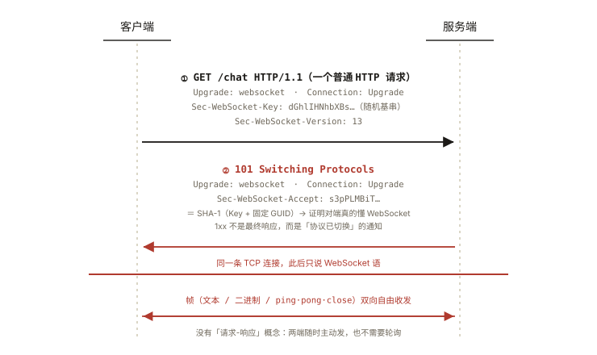
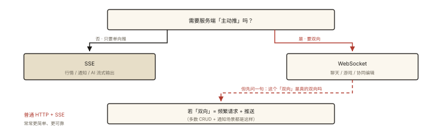
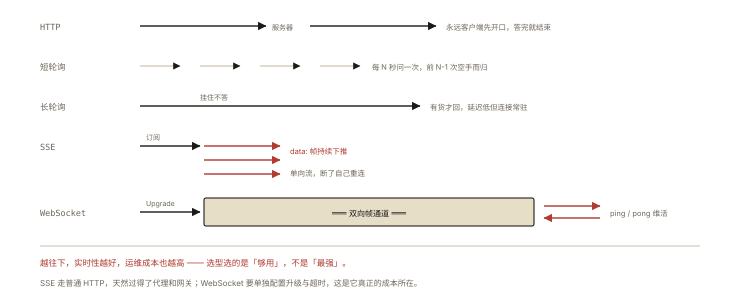

# 网络与浏览器之 WebSocket 与实时通信

## 从「客服消息延迟 30 秒」说起

电商客服系统初版用 HTTP 轮询：前端每 5 秒问一次「有新消息吗」。压测没问题，真实用户却抱怨「消息延迟大」；把间隔改成 1 秒，延迟降了，服务器 QPS 涨了 5 倍——「实时性」和「服务器成本」在轮询模型里**天然互斥**。

这背后是 HTTP 的一个根本设定：**请求永远由客户端发起，服务器只能被动回答**。而客服、聊天、协同编辑、行情推送的需求是反过来的——「服务器有话要说」。⭐ WebSocket 与 SSE 的选型是实时场景的高频考点。

## 现象与直觉解释

四代方案的演进，本质是「**让服务器的话尽早到达**」的逼近过程：

| 方案 | 模型 | 实时性 | 成本/复杂度 |
|---|---|---|---|
| 短轮询 | 定时问「有了吗」 | 差（=间隔） | 大量空请求 |
| 长轮询（long-polling） | 问「有了吗」→ 服务器**挂住不答**，有消息才回 → 立刻再问 | 好 | 每条消息一次连接开销、挂起占连接 |
| SSE | 客户端订阅，服务器**单向**持续推 | 好（单向） | 轻量，但只能服务器→客户端 |
| WebSocket | 升级为**双向**全双工通道 | 最好 | 需要专门协议与心跳维护 |

## 深入原理

### 一、WebSocket 的建立：一次「借壳 HTTP」的升级 ⭐⭐

WebSocket 复用 HTTP 端口，靠 HTTP 的**协议升级机制**完成身份转换：



*图 · 借 HTTP 的升级机制换协议：101 之后同一条 TCP 连接改说 WebSocket 语，Sec-WebSocket-Accept 的哈希用来证明对端真的懂这套协议*

```
客户端                                   服务器
  │ ── GET /chat HTTP/1.1 ─────────────▶ │
  │    Upgrade: websocket                │  ← 「我想换协议」
  │    Connection: Upgrade               │
  │    Sec-WebSocket-Key: dGhlIHNhbXBs…  │  ← 随机基串
  │    Sec-WebSocket-Version: 13         │
  │                                       │
  │ ◀─ 101 Switching Protocols ────────── │  ← 记住这个状态码！
  │    Upgrade: websocket                │
  │    Sec-WebSocket-Accept: s3pPLMBiT…  │ ← Key + 固定 GUID 的 SHA-1（防普通HTTP服务器误答）
  │                                       │
  │ ══ 此后这条 TCP 连接说「WebSocket 语」══ │
  │ ◀══════════ 帧（双向自由收发）═══════▶ │
```

两个设计点：① `101 Switching Protocols` 是 1xx 家族的实战主角（《network-002》）；② `Sec-WebSocket-Accept` 的哈希运算证明对端**真的懂 WebSocket**（防止不支持的 HTTP 服务器「正常答了 200」造成协议错乱）。

升级之后：不再有「请求-响应」的概念，两端随时互发**帧（frame）**——文本/二进制、分片、控制帧（ping/pong/close）。同源策略**不约束** WebSocket（它不是 HTTP 请求），鉴权要自己做（URL token / 首条消息认证——Cookie 在跨站场景还受 SameSite 限制，别指望默认携带）。

### 二、长连接的维护成本：心跳与重连 ⭐

TCP 连接会「静默死亡」（NAT 超时、电梯断网）——双方都不知道对方没了，等真发消息才发现超时。所以生产级 WebSocket 必须自带两件事：

**心跳（keep-alive）**：

```js
// 客户端定时 ping，超时未收 pong 判定断线
const HEARTBEAT = 30_000;
let pongTimer = null;

function startHeartbeat(ws) {
  setInterval(() => {
    if (ws.readyState === WebSocket.OPEN) {
      ws.send(JSON.stringify({ type: 'ping' }));
      pongTimer = setTimeout(() => ws.close(), 5000); // 5s 没 pong 视为死链
    }
  }, HEARTBEAT);
}
// 服务端收到 ping 回 pong 并清 pongTimer
```

**重连（retry）**：指数退避 + 抖动（`1s → 2s → 4s → … + random`，复用《js-async-008》的重试策略），并做好「重连后补拉断线期间的消息」（带 lastMessageId 上线）——否则用户看到的聊天记录会「缺一段」。

### 三、SSE：被低估的单向推送方案 ⭐

需求若是「服务器→客户端」单向（行情、进度、通知流、AI 流式输出），SSE 往往比 WebSocket 更合适：

```js
const es = new EventSource('/api/price-stream');
es.onmessage = (e) => render(JSON.parse(e.data));
es.onerror = () => { /* 浏览器自动重连（自带重试与 Last-Event-ID 续传） */ };
```

本质是**一条永不关闭的 HTTP 长响应**（`Content-Type: text/event-stream`，`data: …\n\n` 分帧）——享受 HTTP 全套基础设施：天然过网关/代理、可鉴权、自动重连、断点续传（Last-Event-ID）。局限：单向、HTTP/1.1 下同域 6 连接限制（HTTP/2 多路复用解决，又一处「协议版本重写手册」的案例，关联《network-003》）。

### 四、选型决策树 ⭐



*图 · 先问「要不要主动推」，再问「双向是不是真双向」*

```
需要客户端 → 服务器 的主动推送吗（聊天、游戏、协同）？
 ├─ 否（只要服务器单向推：行情/通知/AI 流式输出）──▶ SSE ✅
 └─ 是 ──▶ WebSocket
      └─ 但若「双向」其实 = 频繁请求 + 推送（多数 CRUD+通知场景）
          ──▶ 普通 HTTP + SSE 组合常常更简单可靠
```

工程真相：**很多「上 WebSocket」的需求，SSE + HTTP 就够了**——WebSocket 的代价（网关配置、心跳、重连、粘包处理、鉴权设计）不应被低估。

## 回看开篇

客服系统最终形态：消息通道换 WebSocket（双向、毫秒级推送），历史消息走 HTTP 分页拉取（天然可缓存可鉴权），断线靠心跳 + 指数退避重连 + lastMessageId 补拉。轮询模型的「实时性 vs 成本」死结，被「长连接 + 服务器主动推」解开。

## 实战延伸

**1. 面试答题骨架**：「WebSocket 通过 HTTP 的 Upgrade 握手（101 Switching Protocols + Sec-WebSocket-Key/Accept 校验）把一条 TCP 连接升级为全双工的帧协议，同源策略不约束它，鉴权与心跳重连要自己做；若只需服务器单向推送，SSE 基于 HTTP 长响应更轻（自动重连、Last-Event-ID 续传、复用 HTTP 基础设施）；选型先问是否真需要双向。」

**2. 心跳间隔的经验值**：30~60s——比运营商 NAT 超时（常见几分钟）短一截即可，太频繁白耗流量与电量（移动端注意）。

**3. 调试工具**：DevTools → Network → WS 过滤 → Messages 标签页实时看帧；`wscat` 命令行直连调试。

## 图解总结



*图 · 五种形态，差的只是「谁先开口、能不能主动开口」*

```
HTTP:        客户端 ──请求──▶ 服务器 ──响应──▶ （对话永远客户端先开口）
短轮询:      每N秒问一次（空手而归 N-1 次）
长轮询:      问一次，服务器挂住到有货才答（延迟低，连接常驻）
SSE:        客户端订阅 ──▶ 服务器持续推 data: 帧（单向流，自动重连）
WebSocket:  HTTP Upgrade(101) ──▶ ═══ 双向帧通道 ═══（ping/pong 心跳维活）
```

## 总结

- 实时需求的本质矛盾：HTTP 只能客户端发起，服务器「有话说不出」；
- WebSocket = HTTP Upgrade（101）借壳建立的全双工帧协议：双向、低延迟，但心跳/重连/鉴权自理，不受同源策略保护；
- SSE = 永不结束的 HTTP 响应：单向推送的最轻实现，自带重连与续传；
- 选型先问「是否真需要双向」：多数「通知 + 请求」场景 HTTP + SSE 更稳；
- 心跳防静默死链（30~60s），重连用指数退避并补拉断线消息。

**面试一句话回答**：WebSocket 复用 HTTP 端口，通过带 Upgrade 头的请求与 101 Switching Protocols 响应（Sec-WebSocket-Key/Accept 哈希校验防误升级）把一条 TCP 连接升级为全双工的帧协议，双方随时互发数据帧、由 ping/pong 控制帧维活，不受同源策略约束故鉴权需自理，生产实现还要做心跳检测与指数退避重连加断线消息补拉；若只需服务器单向推送，SSE 基于一条持续的 HTTP 流式响应更轻量并自带重连续传，选型的关键是判断是否真的需要双向通信。

## 思考题

1. 长轮询和 WebSocket 都「占住连接」，两者占用的本质区别是什么？各自对服务器并发模型（每连接一线程 vs 事件循环）的压力？
2. WebSocket 握手为什么必须经过 HTTP？直接新建一条 TCP 说 WebSocket 语不行吗？（从 80/443 端口复用、中间设备兼容、鉴权复用角度想）
3. SSE 的 `Last-Event-ID` 续传如何设计服务端存储？断线 10 分钟后重连，事件从哪开始补？
4. 开放设计：多人协同文档的「编辑同步」通道怎么选型？需要考虑：双向性、消息顺序、离线补拉、多标签页同步（提示：BroadcastChannel + WebSocket 的组合）。

（思考题解析将同步录入小程序题库，关联本文 id：network-009）

## 参考文献：

- RFC 6455 — The WebSocket Protocol
- MDN — [WebSocket](https://developer.mozilla.org/zh-CN/docs/Web/API/WebSockets_API)、[Server-Sent Events](https://developer.mozilla.org/zh-CN/docs/Web/API/Server-sent_events)
- 本系列《network-002 状态码》《js-async-008 异步实战》（101 与重连策略的呼应）
