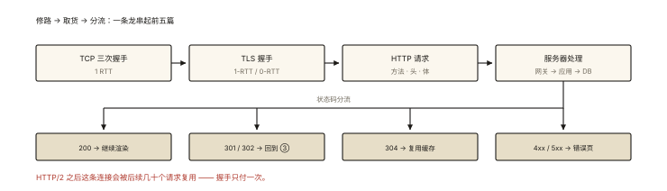
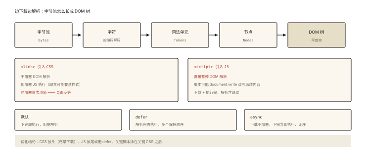
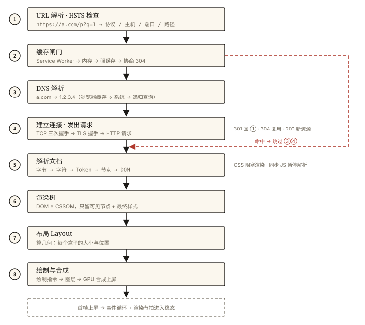

# 网络与浏览器之从输入 URL 到页面呈现（完整版）

## 一道题检验整个系列

> 「浏览器地址栏输入 URL 回车，到页面完整呈现，中间发生了什么？」

这是前端面试的「圣经题」——它没有边界，考多深由面试官决定。基础版见《browser-basic-003》；本文是**完整版**：把本系列前 9 篇 + 渲染知识全部串进一条时间线。⭐⭐⭐ 答好这道题 = 网络 + 浏览器两条线全部贯通。

## 现象与直觉解释

整个过程可以切成两大阶段、八个子步骤：

```
【导航阶段】让浏览器拿到 HTML        【渲染阶段】让像素出现在屏幕上
 ① URL 解析 → ② 缓存检查 → ③ DNS    ⑤ HTML 解析
 ④ 建连与请求响应                     ⑥ CSS 计算 + 样式合成
                                     ⑦ 布局 → ⑧ 绘制与合成
```

直觉上像快递：**找地址（DNS）→ 修路（建连）→ 下单取货（请求响应）→ 组装上架（解析渲染）**。每一步都可能是性能瓶颈，也都有前文对应的深挖入口。

## 深入原理：全链路逐步展开

### 第 ① 步：URL 解析与重定向检查

输入可能是关键词（走搜索）或 URL（补全协议）。浏览器先检查 **HSTS 列表**——该域名若声明过「只用 HTTPS」，即使输入 `http://` 也直接升级（防降级劫持，《network-005》）。

### 第 ② 步：缓存检查（发请求之前先过闸门）⭐

浏览器按《network-006》的决策链检查：Service Worker → 内存缓存 → 磁盘强缓存（未过期直接用，**整段网络阶段被跳过**）→ 需要时发协商请求（304 复用）。**很多「秒开」页面根本没走网络**——这也是为什么完整版必须从缓存讲起。

### 第 ③ 步：DNS 解析（找地址）

浏览器缓存 → 系统缓存（hosts）→ 本地 DNS → 递归/迭代查询根 → 顶级域 → 权威 DNS，拿到 IP（可能多条，配合 Happy Eyeballs 竞速）。优化入口：`dns-prefetch`/`preconnect` 提前暖线、CDN 让「地址」就近解析。

### 第 ④ 步：建连与请求响应（修路 + 取货）⭐

一条龙串起前 5 篇：



*图 · 建连与请求响应的四段，以及状态码的四种去向*

```
TCP 三次握手（1 RTT，《network-001》）
   ▼ （若 HTTPS）
TLS 握手（1-RTT/0-RTT，《network-005》；HTTP/3 则由 QUIC 融合握手，《network-004》）
   ▼
发送 HTTP 请求（方法/头/体，《network-002》）
   ▼
服务器处理（网关→应用→DB）→ 响应
   ▼ 状态码分流
200 → 继续 | 301/302 → 回到 ③ 重新导航到 Location | 304 → 复用缓存
      4xx/5xx → 错误页（《network-002》排障表）
```

HTTP/2 场景下这条连接会被后续几十个资源请求**复用**（多路复用，《network-003》）。

### 第 ⑤ 步：HTML 解析——DOM 树的流水线构建

浏览器拿到 HTML 字节流开始**边下载边解析**（增量解析，不必等全文）：



*图 · 五段流水线 + 两个打断点：CSS 拦住渲染，JS 直接拦住解析*

```
字节 (Bytes) ──▶ 字符 (Chars, 按编码解码) ──▶ 词法单元 (Tokens)
              ──▶ 节点 (Nodes) ──▶ DOM 树
```

解析过程中的三个关键阻塞规则 ⭐：

- **遇 CSS（`<link>`）**：不阻塞 DOM 解析，但**阻塞 JS 执行**（JS 可能读取样式）与**首次渲染**；
- **遇 JS（`<script>`）**：**暂停 DOM 解析**（脚本可能 document.write 改写后续内容），下载并执行完才继续——除非 `defer`（推迟到 DOM 解析完、有序执行）或 `async`（下载不阻塞、下完立即执行、无序）；
- 优化结论：CSS 放头（尽早开始下载）、JS 放尾或 defer、关键脚本前置于关键 CSS 之后。

### 第 ⑥ 步：CSSOM 与样式计算

CSS 同样被解析成 **CSSOM**（选择器规则树），与 DOM 合成**渲染树（Render Tree）**——每个可见节点 + 计算后的最终样式（computed style）。`display: none` 的节点不进渲染树（但仍在 DOM 里）、`head` 等不可见节点也不进。

### 第 ⑦ 步：布局（Layout / Reflow）

计算渲染树每个节点的**几何信息**（大小、位置）——输出「盒模型树」。首次布局即 **FCP/LCP 的前夜**（性能指标见《performance-001》）。文本流、视口尺寸、字体加载完成都会触发布局变更。

### 第 ⑧ 步：绘制与合成（Paint → Composite）

- **绘制（Paint）**：生成每个节点的绘制指令（填充什么颜色、文字、图片）与**分层**决策；
- **合成（Composite）**：GPU 把各图层（layer）合并成最终帧。`transform`/`opacity` 动画只走合成、不触发布局与绘制——这就是「GPU 加速」的真相（《rendering-003 合成层》专篇展开）。

首帧像素上屏——随后进入「事件循环 + 渲染节拍」的稳态：任务 → 微任务 → rAF → 渲染（《js-async-005》+《rendering-005》）。

### 收尾：子资源与页面生命周期

HTML 里的图片/字体/异步脚本按优先级继续加载（preload/scanner 已提前发现并预取）；`DOMContentLoaded`（DOM 构建完成）→ `load`（全部资源完成）→ 用户可交互。Vue/React 应用在此之后才开始「挂载 → 请求首屏数据 → 渲染」——SPA 的「白屏时间」大头常在 JS 下载执行与首屏接口，而非 HTML 本身（优化见《performance-003》）。

## 一图总览 ⭐⭐



*图 · 一次首屏访问的八段路：② 命中缓存就能跳过整个 ③④，⑤ 之后的时间全花在主线程上*

```
输入 URL
  │ ①HSTS/URL 解析   │ ②缓存闸门(SW→内存→强缓存→协商304)──命中──▶ 跳到⑤
  ▼
 ③DNS 解析 ──▶ IP
  │
 ④TCP握手 ─▶ TLS握手 ─▶ HTTP请求 ─▶ 301(回③)/304(复用)/200
  ▼ HTML 字节流
 ⑤解析: 字节→字符→Token→节点→DOM    ──遇CSS──▶ CSSOM(阻塞渲染)
  │   遇同步JS: 暂停解析,下载执行(defer/async可免)      │
  ▼                                                    ▼
 ⑥渲染树 = DOM × CSSOM（可见节点+最终样式）
  ▼
 ⑦Layout：几何计算（盒与位置）
  ▼
 ⑧Paint：绘制指令与分层 ─▶ Composite：GPU 合成上屏 ═▶ 首帧！
  ▼
 DOMContentLoaded → load → 事件循环+渲染节拍的稳态运行
```

## 回看与深挖入口（面试的「加分导航」）

面试官的每个追问都有对应的前文：

| 追问 | 深挖篇目 |
|---|---|
| 「缓存什么时候介入的？」 | 《network-006》决策链 |
| 「握手为什么要三次 / TLS 怎么加密？」 | 《network-001》《network-005》 |
| 「HTTP/2 之后有什么不同？」 | 《network-003》《network-004》 |
| 「304 和 200 的区别？」 | 《network-006》《network-002》 |
| 「JS/CSS 怎么阻塞解析？」 | 本文第 ⑤ 步 + 《performance-003》 |
| 「重排重绘什么时候发生？」 | 本文第 ⑦⑧ 步 + 《rendering-001》《performance-005》 |
| 「渲染时机与事件循环的关系？」 | 《js-async-005》《rendering-005》 |

**答题策略**：先给八步框架（一分钟版），再按面试官追问逐段下钻——**框架证明你有体系，下钻证明你不是背的**。

## 实战延伸：全链路性能优化地图

每个步骤对应的优化武器：

```
①② 预连接 preconnect / 缓存策略（哈希+强缓存）
③   dns-prefetch、CDN
④   HTTP/2/3、TLS1.3、资源压缩(gzip/brotli)
⑤   关键CSS内联、JS defer、代码分割
⑥⑦ 选择器不过度嵌套、避免强制同步布局
⑧   transform/opacity 动画、content-visibility
```

完整方法论见《performance-003 加载优化》与《performance-005 渲染优化》。

## 总结

- 两大阶段八个子步骤：URL/缓存/DNS/建连请求/解析/样式/布局/绘制合成；
- 缓存闸门在网络之前——很多加载根本不出网；
- CSS 阻塞渲染与 JS 执行，同步 JS 阻塞 DOM 解析——defer/async 是解药；
- 渲染三步 Layout→Paint→Composite 各有触发条件与优化空间；
- 这道题是「体系化前端」的试金石：框架 + 追问下钻的答法最优。

**面试一句话回答**：从输入 URL 到呈现分导航与渲染两大阶段——先过缓存闸门（Service Worker、强缓存命中则直接进渲染，否则发协商请求可能 304 复用），未命中则 DNS 解析拿 IP、TCP 三次握手、HTTPS 再做 TLS 握手、发送 HTTP 请求按状态码分流拿到 HTML；渲染阶段浏览器增量解析 HTML 构建 DOM（CSS 构建 CSSOM 并阻塞渲染、同步脚本阻塞解析），两者合成渲染树，经布局计算几何、绘制生成指令与图层、GPU 合成上屏得到首帧，随后进入事件循环与渲染节拍的稳态——每一步都对应缓存、协议、解析阻塞、渲染优化等可深挖的专题。

## 思考题

1. 一个页面首帧出现后 2 秒，Network 里 CSS 才下载完——这可能吗？（提示：首屏渲染 vs 全部样式）
2. 从「defer 和 async 的区别」讲到「为什么会存在这两种属性」——用本文第 ⑤ 步的阻塞规则完整回答。
3. HTTP/2 下「HTML 和 CSS 的下载顺序问题」变轻了还是变重了？DOM 解析阻塞关系变了吗？
4. 开放分析：给一个 SPA 首屏 4 秒的页面做全链路优化——按本文八步列出你的检查清单与预期收益排序。

（思考题解析将同步录入小程序题库，关联本文 id：network-010）

## 参考文献：

- MDN — [渲染页面：浏览器的工作原理](https://developer.mozilla.org/zh-CN/docs/Web/Performance/How_browsers_work)
- Chrome 开发者文档 — Critical Rendering Path
- 本系列第 1~9 篇（本文为系列收官串讲）
- 本课程《rendering-001 渲染管线》（渲染阶段的专篇下钻）
