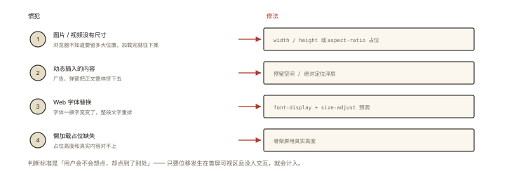

# 性能优化之指标：FCP、LCP、CLS 与 INP

## 从「老板问：页面快不快」说起

> **系列导读**：《性能优化系列》共 8 篇——先立指标与测量，再讲加载/图片/渲染/长列表/Worker/内存的专项手段。

```js
// 「页面快不快？」—— 没有指标就无法回答：
开发同学：「我这边挺快的」（他的 Mac + 千兆宽带 + 本地环境）
真实用户：手机 + 弱网 + 中端安卓 —— 完全另一个世界
```

性能优化的第一步不是改代码，是**定义「快」的可量化标准**。⭐⭐ Core Web Vitals（FCP/LCP/CLS/INP）是 Google 定义的行业通用语言，也是面试性能题的必答开头。

## 现象与直觉解释

用户体感「快不快」拆成三个独立问题：

```
① 内容出来了吗？（加载）   → FCP / LCP
② 内容跳不跳？（稳定性）   → CLS
③ 点了有反应吗？（交互）   → INP
```

| 指标 | 全称 | 测什么 | 良好线 |
|---|---|---|---|
| **FCP** | First Contentful Paint | 首次内容绘制（第一个文字/图片出现） | < 1.8s |
| **LCP** | Largest Contentful Paint | 最大内容元素绘制（主视觉就位）⭐核心 | < 2.5s |
| **CLS** | Cumulative Layout Shift | 累积布局偏移（内容跳动程度）⭐核心 | < 0.1 |
| **INP** | Interaction to Next Paint | 交互到下一帧（替代 FID，2024 起）⭐核心 | < 200ms |
| TTFB | Time to First Byte | 首字节（服务器+网络） | < 800ms |

**Google 的「核心三件套」**：LCP（加载）+ INP（交互）+ CLS（稳定）——分别对应三个体感问题的最重要答卷。

## 深入原理

### 一、LCP：最大内容元素 ⭐⭐

「主内容区最大的那个元素」完成渲染的时刻——通常是大图、大标题、视频首帧：

```
候选元素： <video>(首帧) 带背景图的元素 块级文本
LCP = 这些元素中【渲染面积最大者】的首次绘制时间
⚠️ 滚动后出现的新内容不计（只看首屏视口内）
```

**LCP 的四个时间瓶颈段**（优化的路线图）：


*图 · LCP 的四个时间瓶颈段：TTFB、资源发现、资源下载与渲染*

```
TTFB ──▶ 资源加载延迟 ──▶ 资源加载耗时 ──▶ 渲染耗时
（服务器慢）（发现晚：没预加载）（图片大）（JS 阻塞）
```

对应弹药：CDN/SSR（TTFB）、preload/fetchpriority（发现）、图片优化（体积）、关键 CSS/JS 精简（渲染）——《performance-003/004》展开。

### 二、CLS：布局偏移的精确算法 ⭐⭐

「页面内容突然跳动」的量化——**影响份量 × 距离份量**的累加：

```
单次偏移分 = 影响区域占比 × 移动距离占比
例：首屏 25% 的区域向下跳了 20% 视口高 → 0.25 × 0.2 = 0.05
CLS = 所有【非用户操作引起】的偏移分之和（会话内累计）
```

**排除项**：用户点击/按键后 500ms 内的偏移不算（那是响应不是捣乱）。

**CLS 的四大惯犯与修复**：



*图 · CLS 的四大惯犯与各自的修复手段*

```
① 无尺寸的图片/视频 ──▶ width/height 或 aspect-ratio 占位 ⭐
② 动态插入的内容（广告/弹窗把正文推下去）──▶ 预留空间/绝对定位浮层
③ Web 字体替换（FOUT：字宽变化）──▶ font-display + size-adjust 预调
④ 懒加载占位缺失 ──▶ 骨架屏真实高度
```

### 三、INP：交互响应（FID 的继任者）⭐⭐

```
FID（旧）：只测【第一次】交互的输入延迟 —— 只管第一枪
INP（2024 起核心）：观测【所有】交互的「输入 → 下一帧渲染」全程
  = 输入延迟 + 事件处理 + 渲染（完整闭环）
  取近似最差值（排除个别异常）—— 全程都不能慢
```

**INP 慢的元凶**：长任务霸占主线程（《browser-basic-002》的物理根源）——点击回调排队等长任务 → 响应延迟。弹药：任务拆分（<50ms）、让路（scheduler.yield）、Worker 卸载、《performance-005/007》展开。

### 四、百分位：P75 的意义 ⭐⭐

```
指标不是平均值，是分布 —— 官方口径取 P75（75 分位）：
  P75 LCP = 2.3s 的含义：75% 的用户体验好于 2.3s
为什么不用平均？—— 性能分布是长尾：中位数漂亮但尾部用户惨不忍睹
  （优化目标从来是「消灭糟糕体验」，不是「平均好看」）
```

CrUX（真实用户数据）/ RUM（自建采集）见《performance-002》。

## 回看开篇

「快不快」的专业答案：用核心三件套对着 P75 报数——「LCP P75 = 2.1s（良好）、INP = 180ms（良好）、CLS = 0.04（良好），但移动端 LCP P75 = 3.5s（需改进），瓶颈在首图 1.8MB」——**一句话里含指标、口径、分位数、瓶颈定位**，这就是性能对话的正确开场。

## 实战延伸

**1. 面试答题骨架**：「核心 Web 指标分三个维度——加载用 LCP，即视口内最大内容元素的绘制时间，瓶颈分布是 TTFB、资源发现、加载与渲染四段；交互用 INP，2024 年起替代只测首次输入延迟的 FID，观测全部交互从输入到下一帧的完整时长，元凶是长任务占主线程；稳定用 CLS，累加每次布局偏移的影响面积与移动距离乘积，常见元凶是无尺寸图片、动态插入内容、字体替换与懒加载占位缺失；辅助指标有 FCP 与 TTFB；官方口径取 P75 分位关注长尾体验。」

**2. DevTools 现场看**：Lighthouse 面板直接给出三项打分；Performance 面板时间轴上能看到 LCP 标记与每次 layout shift 的红色块。

## 图解总结


*图 · 体感三问对应核心三件套与辅助指标*

```
体感三问 ──▶ 核心三件套（P75 口径）
 内容出来了吗 ──▶ LCP <2.5s（最大内容绘制；瓶颈:TTFB/发现/加载/渲染）
 点了有反应吗 ──▶ INP <200ms（所有交互 输入→下一帧；元凶:长任务）
 内容跳不跳  ──▶ CLS <0.1（Σ 面积占比×距离占比；元凶:无尺寸图/插入/字体）

辅助: FCP<1.8s(首次内容) │ TTFB<0.8s(首字节)
口径: P75 分位 —— 性能是长尾分布，目标是消灭糟糕体验
```

## 总结

- 三维度三指标：LCP（加载）/ INP（交互，FID 继任）/ CLS（稳定）；
- LCP 四段瓶颈是优化路线图；CLS=面积×距离的累计，用户主动操作后 500ms 内不算；
- INP 观测全部交互闭环，长任务是元凶；
- 口径是 P75 不是平均——关注长尾；
- FCP/TTFB 是辅助观测位。

**面试一句话回答**：Core Web Vitals 用三个指标对应三类用户体验——LCP 衡量加载性能，指视口内最大内容元素的绘制时间，良好线 2.5 秒，其时间可拆解为 TTFB、资源发现延迟、资源加载与渲染四段分别优化；INP 衡量交互响应，自 2024 年取代只测首次输入延迟的 FID，它观测会话中所有交互从输入到下一帧渲染的完整耗时并取近似最差值，长任务占用主线程是主要元凶；CLS 衡量视觉稳定性，是每次布局偏移的影响面积占比与移动距离占比乘积的累计，用户操作后五百毫秒内的偏移不计，常见成因是无尺寸图片、动态插入内容与字体替换。所有指标以 P75 分位为口径，因为性能分布长尾明显，目标是消灭糟糕体验而非平均好看。

## 思考题

1. 一个页面首屏只有一张 2MB 大图与一行标题：FCP 与 LCP 分别受谁主导？先优化哪个？
2. 用户点击「展开」按钮后内容下推——算 CLS 吗？（用户操作 500ms 窗口内不计——但异步加载完成后才插进来呢？）
3. 为什么 FID 被 INP 替代？（首次 vs 全程、输入延迟 vs 完整闭环——举例：首屏后某个搜索框卡顿 FID 完全看不见）
4. 开放设计：给电商详情页定性能预算：LCP/INP/CLS 目标值 + 关键资源（首图/主 JS）的体积上限——写出预算表与 CI 校验思路。

（思考题解析将同步录入小程序题库，关联本文 id：performance-001）

## 参考文献：

- web.dev — Core Web Vitals 官方定义与阈值
- W3C WebPerf WG — INP/LCP 规范（PerformanceObserver 条目）
- 本课程《performance-002 测量》《browser-basic-002 渲染线程》（INP 的物理根源）
