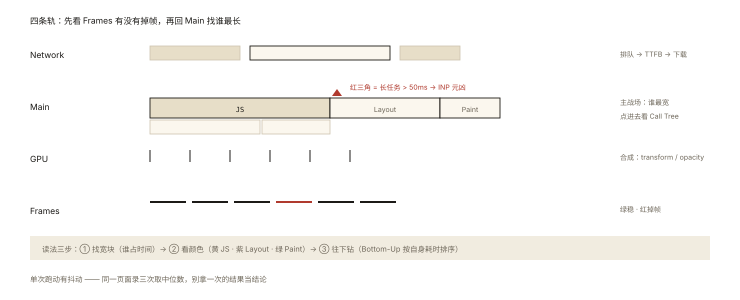
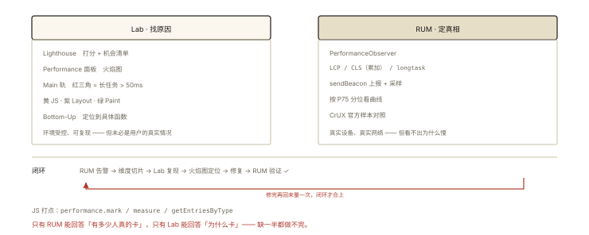

# 性能优化之测量：Performance API 与 Lighthouse

## 从「优化全靠感觉」到「数据说话」

> 上一节定义了「快」的指标；本篇回答「怎么测」——**没有测量就没有优化**。

```
工具全景（按「谁的数据」分类）：

实验室数据（Lab）：模拟环境、可复现、能看火焰图 —— 开发期用
  Lighthouse / DevTools Performance / WebPageTest

真实用户数据（RUM）：真设备真网络真用户 —— 上线后用
  CrUX（Chrome 官方统计）/ 自建采集（PerformanceObserver 上报）
```

⭐⭐ 面试标准句式：「Lab 找原因，RUM 定真相」——两者结合才是完整测量体系。

## 深入原理

### 一、Lighthouse：一键体检的正确用法 ⭐⭐

```bash
npx lighthouse https://app.com --preset=desktop   # CLI（可进 CI）
# 或 DevTools → Lighthouse 面板（移动/桌面模拟）
```

**它给你什么**：Core Web Vitals 打分 + 逐项机会清单（「消除阻塞资源」「图片转 WebP 可省 1.2MB」——按预估收益排序的待办列表）。

**三个必知的局限**（否则误信数据）：

1. **模拟环境**（CPU 4x 减速 + 慢 4G）≠ 真实用户分布——分数是「压力测试结果」；
2. **单次跑动的抖动**——同一页面跑三次分数可能差 10 分，取中位数；
3. **本地环境的偏差**——开发服务器无 CDN、无真实鉴权、缓存为空。

### 二、DevTools Performance：火焰图读法 ⭐⭐⭐

录制一段交互/加载，时间轴四大轨（对应《browser-basic-002》的线程分工）：



*图 · 四条轨各看一件事：Frames 判有没有掉帧，Main 找谁最长，颜色告诉你卡在哪一段*

```
Network 轨：请求瀑布（TTFB/下载/排队）
Main 轨：主线程火焰图 —— 性能分析的主战场 ⭐
  ├ 长任务（顶部红三角 >50ms）→ INP 元凶
  ├ 黄色 = JS，紫色 = 样式计算/Layout，绿色 = 渲染绘制
GPU 轨 / Frames 轨：帧率与掉帧（绿条 = 稳、红 = 掉）
```

**火焰图的三步读法**：

```
① 找宽块：谁占用时间长（顶层的宽横条 = 大任务）
② 看颜色：黄宽块=JS 计算（算法/序列化）；紫宽块=Layout/Recalculate Style（DOM 太多/选择器太差）
③ 往下钻：点击块看 Call Tree / Bottom-Up（按自身耗时排序，直接定位函数名）
```

### 三、Performance API：JS 侧的精确测量 ⭐⭐⭐

**① 时间戳与导航计时**：

```js
performance.timeOrigin;                    // 页面起点
performance.getEntriesByType('navigation')[0];
// { domContentLoadedEventEnd, loadEventEnd, responseStart(TTFB), transferSize, … }
```

**② 打点自定义区间**：

```js
performance.mark('list-start');
renderHugeList();
performance.mark('list-end');
performance.measure('list-render', 'list-start', 'list-end');
performance.getEntriesByName('list-render')[0].duration;   // ms
```

**③ PerformanceObserver：异步订阅指标（RUM 的核心）** ⭐⭐：

```js
// LCP：持续观察（它会被更大的元素"顶替"）
new PerformanceObserver((list) => {
  const entries = list.getEntries();
  const last = entries.at(-1);       // 最新一次 LCP 候选
  report({ lcp: last.startTime, element: last.element?.tagName });
}).observe({ type: 'largest-contentful-paint', buffered: true });

// CLS：累加 layout-shift（hadRecentInput 过滤用户操作）
let cls = 0;
new PerformanceObserver((list) => {
  for (const e of list.getEntries()) if (!e.hadRecentInput) cls += e.value;
}).observe({ type: 'layout-shift', buffered: true });

// 长任务（INP 的预警雷达）
new PerformanceObserver((list) => {
  list.getEntries().forEach((t) => report({ longTask: t.duration }));
}).observe({ type: 'longtask', buffered: true });

// 资源计时：哪个接口/资源慢
performance.getEntriesByType('resource')
  .filter((r) => r.duration > 500)   // 慢资源清单
```

**上报的工程要点**（自建 RUM）：`sendBeacon`（页面卸载不丢）、采样率（别全量）、`visibilitychange` 时统一上报 LCP/CLS 终值、上报进 `architecture-005` 的监控管道。

### 四、一个完整的排查循环 ⭐

```
RUM 告警（P75 LCP 恶化 3.2s）
  → 按维度切片：机型/地域/版本 —— 定位「安卓低端机 + 某 CDN 区域」
  → Lab 复现：DevTools Performance 录制同类环境
  → 火焰图定位：首图 1.8MB + 无 preload
  → 修复（performance-003/004 的弹药）
  → RUM 验证曲线回落 ✅ 闭环
```

## 回看开篇

「优化全靠感觉」的替代品是一套组合拳：**Lighthouse 出待办清单（Lab 快扫）→ Performance 火焰图定位元凶（Lab 深挖）→ PerformanceObserver 建 RUM 看真实用户（上线真相）→ 修复后 RUM 曲线验证**。四个工具各守一段，缺任何一段都会回到「感觉」。

## 实战延伸

**1. 面试答题骨架**：「性能测量分实验室与真实用户两层——Lighthouse 在模拟环境跑出指标打分与按收益排序的优化清单，适合开发期快扫但要跑多次取中位数；DevTools Performance 的火焰图定位具体瓶颈，长任务红三角对应 INP 元凶，黄紫绿三色区分 JS、样式布局与绘制；JS 侧用 performance.mark/measure 打自定义区间，PerformanceObserver 异步订阅 LCP、CLS、longtask、resource 等条目，配合 sendBeacon 与采样上报构建 RUM，上线后以 P75 曲线验证优化闭环。」

**2. 一个快手实验**：打开任意网站 DevTools → Performance → Record 十秒滚动——找出最长任务的函数名（Bottom-Up 第一行），你已经完成了一次真实定位。

## 图解总结



*图 · 实验室数据与真实用户数据的互补闭环*

```
Lab(找原因)                        RUM(定真相)
 Lighthouse: 打分+机会清单          PerformanceObserver:
 Performance面板: 火焰图             LCP/CLS(累加)/longtask/resource
  Main轨: 长任务红三角>50ms           + sendBeacon/采样上报
  黄JS 紫Layout 绿Paint              + P75 分位看曲线
  Bottom-Up 定位函数                  CrUX(官方样本) 对照

JS打点: mark/measure/getEntriesByType
循环: RUM告警 ─▶ 维度切片 ─▶ Lab复现 ─▶ 火焰图定位 ─▶ 修复 ─▶ RUM验证 ✅
```

## 总结

- 两层数据：Lab（可复现找原因）+ RUM（真实分布定真相）；
- Lighthouse 是清单生成器，注意模拟环境与单次抖动；
- Performance 火焰图三步读法：找宽块、看颜色、Bottom-Up 钻函数；
- PerformanceObserver 是 RUM 内核：LCP/CLS/longtask/resource 四类订阅；
- mark/measure 打自定义区间；修复必须以 RUM 曲线闭环。

**面试一句话回答**：性能测量分实验室与真实用户两层。实验室层用 Lighthouse 在模拟环境中获得指标打分和按预估收益排序的优化清单，注意单次跑动抖动需取中位数；用 DevTools Performance 面板录制火焰图定位具体瓶颈——主线程上超过五十毫秒的长任务是 INP 元凶，黄色代表脚本、紫色代表样式与布局、绿色代表绘制，通过 Bottom-Up 视图可直接定位到函数。真实用户层用 PerformanceObserver 异步订阅 largest-contentful-paint、layout-shift、longtask 与 resource 等性能条目，CLS 需过滤用户操作后累加，配合 performance.mark 与 measure 打自定义区间，再用 sendBeacon 带采样上报构建 RUM，最终以 P75 分位曲线验证优化效果形成闭环。

## 思考题

1. 为什么 Lighthouse 分数高但用户仍抱怨慢？（模拟环境 vs 真实分布——哪些维度 Lab 覆盖不到：鉴权、个性化数据、地区网络）
2. RUM 采样的取舍：全量 vs 10%——指标精度与成本怎么平衡？P75 对采样量有什么要求？
3. 用 measure 量化「首屏数据渲染耗时」：从 fetch 开始到列表 DOM 更新完成——写出打点代码（注意 microtask 时点）。
4. 开放设计：给团队搭「性能看板」：指标（三件套）、维度（机型/版本/页面）、告警（P75 连续 3 天超阈值）——列出数据管道的各环节。

（思考题解析将同步录入小程序题库，关联本文 id：performance-002）

## 参考文献：

- MDN — Performance API / PerformanceObserver 各条目文档
- web.dev — Lighthouse 使用指南与指标说明
- 本课程《performance-001 指标》《architecture-005 前端监控》（RUM 的归宿）
