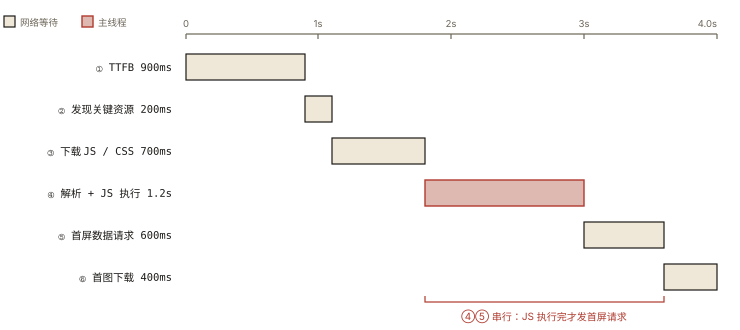
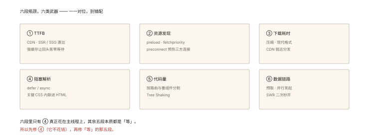

# 性能优化之加载优化

## 从「首屏 4 秒的时间都花哪了」说起

对着一张瀑布图（DevTools Network）拆解一个典型慢首屏：



*图 · 首屏 4 秒的六段耗时*

```
0.0s  请求 HTML ──▶ 0.8s 到达（TTFB 慢：无 CDN + 服务端渲染慢）
0.8s  HTML 解析 ──▶ 发现 CSS（头部）/ 发现 bundle.js（头部同步）
0.9s  请求 app.css (200KB) + app.js (1.8MB) ──▶ 2.4s 下载完（弱网+无压缩）
2.4s  JS 执行 800ms（框架初始化+路由+组件挂载）
3.2s  发起首屏接口（等 JS 执行完才发！）──▶ 3.9s 返回
4.0s  渲染列表 + 首图 1.6MB ──▶ 4.4s LCP 😱
```

每一段浪费都有对应的武器。⭐⭐ 加载优化的本质：**让「首屏必需的资源」尽早开始、尽快到达、尽快可渲染；其余的一切都别挡路**。

## 现象与直觉解释

两个核心概念先立住：

**① 关键渲染路径（Critical Rendering Path）**：首屏像素所需的**最小资源链**（HTML → CSS + 首屏 JS → 首屏数据/图）。优化=缩短这条链、并行化这条链。

**② 首屏 vs 非首屏**：用户第一屏看不到的一切（其它路由、折叠以下、首屏后才用的库）都是「可延迟」的候选。

## 深入原理：按瓶颈段给武器

### ① TTFB 慢：让字节早点出发 ⭐⭐

```
CDN 边缘节点（静态资源 + HTML 边缘缓存）
SSR/SSG（首屏 HTML 直出 —— 数据在服务端就拼进页面，省一轮「JS→请求→渲染」）
缓存策略（network-006：强缓存让回头客 TTFB≈0）
```

**SSR 的收益结构**（与 CSR 对比）：CSR 的链路是「HTML→JS→执行→请求→渲染」五段；SSR 把中间三段挪到服务端并行处理——浏览器拿到 HTML 即含内容（FCP/LCP 大幅提前）。代价：服务端成本与复杂度（hydration 的水合成本）。

### ② 资源发现晚 / 下载慢：提示浏览器 + 瘦身 ⭐⭐

```html
<!-- 预加载提示：把「稍后才会被发现」的关键资源提前告诉浏览器 -->
<link rel="preload" href="/font.woff2" as="font" crossorigin>
<link rel="preload" href="/hero.webp" as="image" fetchpriority="high">
<!-- fetchpriority：LCP 图的高优先级通道（比 preload 更精准）⭐ -->

<!-- 预连接：提前完成 DNS+TCP+TLS（三方资源的暖线） -->
<link rel="preconnect" href="https://cdn.example.com">
<link rel="dns-prefetch" href="https://analytics.example.com">
```

传输瘦身：gzip/brotli（服务器配）、HTTP/2+（多路复用，network-003）、资源本身减肥（图片篇/js 摇树——engineering-004）。

### ③ 阻塞渲染：别挡首屏的路 ⭐⭐⭐

回顾《network-010》阻塞规则——对症下药：

```html
<!-- JS：非首屏脚本不阻塞 -->
<script src="app.js" defer></script>        <!-- defer：解析不阻塞，DOM 完成后有序执行 -->
<script src="stat.js" async></script>       <!-- async：下载不阻塞，到了就执行（统计类）-->

<!-- CSS：非关键 CSS 延迟 -->
<link rel="stylesheet" href="all.css">       <!-- 首屏关键 CSS 保留阻塞（否则FOUC） -->
<link rel="preload" href="lazy.css" as="style"
      onload="this.rel='stylesheet'">        <!-- 非首屏 CSS：preload + onload 换rel ⭐ -->
<!-- 极致：关键 CSS 内联进 HTML（省一个请求），其余异步 -->
```

**defer vs async 的判定**：依赖 DOM/执行顺序 → defer；独立统计/追踪 → async。

### ④ 代码分割：首屏只要首屏的代码 ⭐⭐⭐

```js
// 路由级懒加载：首屏 bundle 不含 admin/editor 等页面
const Admin = React.lazy(() => import('./pages/Admin'));       // React
const routes = [{ path: '/admin', component: () => import('./admin.vue') }]; // Vue

// 组件级：重灾区组件单独拆（编辑器/图表库）
const Chart = React.lazy(() => import('./Chart'));  // + Suspense 兜底 loading
```

配套：`splitChunks` 拆稳定依赖（缓存友好）、预取下一页（`import(/* webpackPrefetch */ './next')` 空闲时拉）。

### ⑤ 数据链路：别让数据等代码 ⭐⭐

```
CSR 的隐形浪费：JS 下载执行完才发首屏接口（上面时间线的 3.2s）
武器：
  预取数据：HTML 里内联 <link rel="preload" as="fetch" href="/api/first"> 
           或 SSR 边渲染边取数、hydration 时直接用（流式）
  接口并行：首屏多接口 Promise.all 并行（js-async-007 的循环陷阱反过来用）
  缓存数据：SWR/stale-while-revalidate 策略（二次进入秒开）
```

### ⑥ 图片：LCP 的头号嫌疑人（下篇专讲）

首图 preload + fetchpriority=high + 现代格式 + 正确尺寸——《performance-004》全展开。

## 回看开篇

4 秒时间线的对症下药：TTFB 慢 → CDN/SSG；1.8MB bundle → 代码分割 + 摇树；JS 头部阻塞 → defer；「等 JS 执行完才发接口」→ 数据预取/并行；1.6MB 首图 → 图片优化 + preload。**每一段浪费都有名字、有武器——加载优化就是把瀑布图一段段压缩。**

## 实战延伸

**1. 面试答题骨架**：「加载优化围绕关键渲染路径展开——TTFB 用 CDN 与 SSR/SSG 让首字节提前并让内容直出；用 preload 与 fetchpriority 提示关键资源提前下载、preconnect 暖三方连接；JS 用 defer/async 消除解析阻塞、非首屏 CSS 用 preload 换 rel 的方式异步化、关键 CSS 内联；代码分割按路由与重组件拆 chunk，首屏只带必需代码；数据层用预取与并行请求消除『等 JS 执行完才发请求』的串行段；LCP 主力通常是首图，配 preload 高优先级与现代格式。」

## 图解总结



*图 · 六段瓶颈，六类武器 —— 一一对位，别错配*

```
首屏时间线的六段瓶颈 ──▶ 六类武器
TTFB慢 ──────▶ CDN │ SSR/SSG │ 强缓存
发现晚 ──────▶ preload │ fetchpriority │ preconnect
下载慢 ──────▶ brotli │ HTTP/2 │ 体积优化(摇树/图片)
阻塞渲染 ────▶ defer/async │ 非关键CSS异步 │ 关键CSS内联
代码全量 ────▶ 路由/组件级 lazy │ splitChunks │ prefetch
数据串行 ────▶ 数据预取 │ 接口并行 │ SWR秒开
（首图 → performance-004 专治）
```

## 总结

- 关键渲染路径 = 首屏最小资源链——缩短、并行、去阻塞；
- 六段瓶颈六类武器：TTFB/发现/下载/阻塞/代码量/数据链路；
- defer（有序 DOM 后）与 async（独立即执行）按依赖选；
- 非关键 CSS 用 preload+onload 换 rel 异步化，关键 CSS 内联是极致款；
- 路由与重组件代码分割是首屏体积的第一刀；数据预取消除 JS→请求的串行。

**面试一句话回答**：加载优化围绕关键渲染路径展开——先让首字节快：CDN 分发、SSR 或 SSG 让内容直出、强缓存让回头客零等待；再让资源早发现：用 preload 与 fetchpriority 提示浏览器提前下载关键字体与 LCP 主图、preconnect 预热第三方连接；消除阻塞：脚本加 defer 或 async，非首屏 CSS 用 preload 加载完成后切换 rel 的方式异步启用，关键 CSS 内联进 HTML；削减体积：按路由与重组件做代码分割让首屏只含必需代码，配合 Tree Shaking 与压缩；打通数据链路：首屏接口预取并行，避免等 JS 执行完才发起请求，配合 SWR 策略实现二次进入秒开——每一段优化都对应瀑布图上的一段可测量时间。

## 思考题

1. `defer` 脚本与 `DOMContentLoaded` 的时序？async 脚本可能在 DOMContentLoaded 之后吗？
2. 关键 CSS 内联的全量做法有什么代价？（HTML 不可缓存公共 CSS、维护成本——什么团队适合）
3. 「prefetch 下一路由」的策略怎么定？（高转化路径/平均停留时长——过量 prefetch 反而费流量）
4. 开放设计：SSR 的 hydration 成本在长列表页可能反超收益——什么场景选 SSG、什么场景选 CSR+预取？给出决策树。

（思考题解析将同步录入小程序题库，关联本文 id：performance-003）

## 参考文献：

- web.dev — Optimize LCP / Fast delivery（官方四段分解）
- MDN — defer/async、rel=preload/preconnect 文档
- 本课程《network-003 HTTP2》《network-010 URL到页面》《engineering-004 体积优化》
