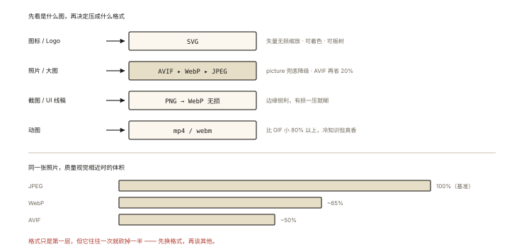
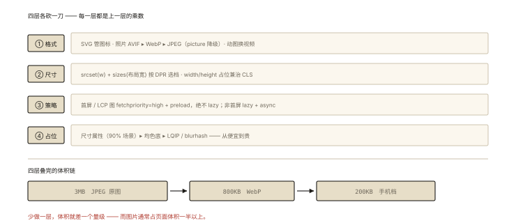

# 性能优化之图片优化

## 从「一张 banner 图 3MB」说起

```html
   <!-- 设计给的 2x 切图，直接扔上来了 -->
<!-- 3MB @ 弱网 1Mbps ≈ 24 秒 —— LCP 直接报废 -->
```

图片通常占页面体积的 **50%+**，而 LCP 元素十有八九是图——**图片优化是加载性能里投入产出比最高的一项**。⭐⭐ 面试「图片怎么优化」的标准答案框架：**格式、尺寸、加载策略、占位** 四连。

## 深入原理：四层优化

### 第一层：格式——选对压缩算法 ⭐⭐⭐

| 格式 | 压缩 | 透明 | 动图 | 兼容 | 结论 |
|---|---|---|---|---|---|
| JPEG | 有损 | ❌ | ❌ | 全 | 老照片基线 |
| PNG | 无损 | ✅ | ❌ | 全 | 图标/需要锐利边缘 |
| WebP | 有损/无损 | ✅ | ✅ | 全（现代） | **现代默认** ⭐ |
| AVIF | 有损/无损 | ✅ | ✅ | 主流新 | **更优 20%+**（编码慢） |
| SVG | 矢量 | ✅ | ✅(SMIL) | 全 | 图标/Logo 首选 ⭐ |

```
体积直觉（同一照片，质量视觉相近）：
JPEG 100% ──▶ WebP ~60-70% ──▶ AVIF ~50%
```

**按内容选格式的决策**：



*图 · 按内容选格式，以及同一张照片的体积对比*

```
图标/Logo ──────────▶ SVG（矢量无损缩放 + 可着色 + 摇树按需）
照片类 ─────────────▶ AVIF > WebP > JPEG（<picture> 兜底降级 ⭐）
截图/UI 线稿 ───────▶ PNG→WebP 无损（边缘锐利）
动图 ───────────────▶ 视频替代（mp4/webm 比 gif 小 80%+）⭐冷知识
```

```html
<!-- <picture>：新格式优先 + 优雅降级 -->
<picture>
  <source srcset="hero.avif" type="image/avif">
  <source srcset="hero.webp" type="image/webp">
          <!-- 最终兜底（也是 CLS 占位的载体） -->
</picture>
```

### 第二层：尺寸——别发用不到的像素 ⭐⭐⭐

**原罪：2x/3x 大图发给所有设备**。武器两件：

```html
<!-- ① srcset + sizes：按 DPR 与布局宽度选文件 -->

<!-- sizes 告诉浏览器「这张图实际显示多宽」→ 浏览器按 DPR 挑最合适的文件 -->

<!-- ② 固定容器：宽高属性占位（顺带治 CLS ⭐） -->
   <!-- 浏览器预留 16:9 的坑 -->
/* 或 CSS */ .hero { aspect-ratio: 16/9; }
```

服务端/CDN 侧：动态缩放参数（`?w=800&q=75`——image CDN 按需生成），构建侧：image-webpack-loader/vite-plugin 自动产出多档。

### 第三层：加载策略——该早的早，该晚的晚 ⭐⭐⭐

```html
<!-- LCP 主图：反懒加载 + 高优先级（首屏图懒加载是最常见事故 ⚠️） -->

<!-- 更早：<link rel="preload" as="image" href="hero.webp" fetchpriority="high"> 放 head -->

<!-- 非首屏图：懒加载（原生一行） -->

<!-- 原生 lazy 的边界感知距离由浏览器控制；需要更早触发可换 IntersectionObserver 方案 -->

<!-- 关键提示：loading=lazy 千万别用在首屏/LCP 图上 —— 直接毁 LCP ⭐⭐ -->
```

### 第四层：占位与体验——图没来之前别让页面「空转」⭐⭐

```
问题：图片加载中（几百 ms~几 s）区域是空白 → 到达后 CLS 跳动
武器梯度：
  低配：width/height 占位（上面第二层，已解决 90%）
  中配：纯色/渐变底（平均色 blurhash 的退化版）
  高配：LQIP（20x20 的模糊小图秒到 → 大图覆盖）/ blurhash（一个字符串生成占位图）
```

### 一张图的完整优化模板 ⭐⭐

```html
<!-- LCP 主图（首屏）：早+高优+占位+现代格式 -->
<link rel="preload" as="image" href="hero.avif" fetchpriority="high">


<!-- 内容图（非首屏）：懒+异步解码+尺寸占位 -->

```

## 回看开篇

3MB banner 的五连修：AVIF/WebP 格式（3MB→~800KB）→ srcset 多档（手机拿 400w 而不是 1600w，~200KB）→ width/height 占位（CLS 稳住）→ fetchpriority=high + preload（LCP 提速）→ 动图类换视频。**格式、尺寸、策略、占位四连拳，弱网 24 秒可以打到 2 秒内。**

## 实战延伸

**1. 面试答题骨架**：「图片优化四层——格式上 SVG 用于图标、照片用 AVIF 优先 WebP 兜底、动图用视频替代，picture 标签做降级；尺寸上用 srcset 配 sizes 让浏览器按 DPR 与布局宽选档，img 声明宽高或 aspect-ratio 占位同时治理 CLS；加载策略上 LCP 主图反懒加载并加 fetchpriority 高优先级、可再用 head 内 preload 提前，非首屏图 loading=lazy 加 decoding=async；体验上用低清晰度占位图或 blurhash 过渡。图片通常占页面体积一半以上、LCP 元素多为图，是投入产出比最高的优化。」

**2. 一个快手判断**：`loading="lazy"` 写在首屏 banner 上——错（毁 LCP）；`` 无 width/height——错（CLS）；给 50px 头像发 800px 图——错（DPR 浪费）。

## 图解总结



*图 · 图片优化的四层与体积逐层下降的链条*

```
格式: SVG(图标) ▸ AVIF▸WebP▸JPEG(picture降级) ▸ 视频(替动图)
尺寸: srcset(w)+sizes(布局宽) → 按 DPR 选档 │ width/height 占位(兼治CLS)
策略: 首屏/LCP图 ── fetchpriority=high + preload + 【绝不lazy】⚠️
     非首屏 ── loading=lazy + decoding=async
占位: 尺寸属性(90%场景) ▸ 均色底 ▸ LQIP/blurhash
体积链: 3MB JPEG → 800KB WebP → 200KB(手机按需档)
```

## 总结

- 格式：图标 SVG、照片 AVIF/WebP（picture 降级）、动图换视频；
- 尺寸：srcset+sizes 按设备选档；width/height 一举两得（占位+治 CLS）；
- LCP 图高优先级（fetchpriority/preload）且绝不懒加载；非首屏 native lazy；
- 占位梯度：尺寸属性→均色→LQIP/blurhash；
- 图片是体积与 LCP 的双重主角——四层模板直接落地。

**面试一句话回答**：图片优化分四层——格式层，图标用 SVG 矢量、照片用 AVIF 优先并以 WebP 和 JPEG 通过 picture 标签降级、动图用视频格式替代可省八成体积；尺寸层，用 srcset 声明多档宽度配 sizes 告知浏览器实际显示宽度，让设备按像素比选择合适文件，同时给 img 声明宽高或用 aspect-ratio 预留空间，一并解决布局偏移；加载策略层，首屏与 LCP 主图绝不使用懒加载，用 fetchpriority 设为 high 并可在 head 中 preload 提前请求，非首屏图片使用原生 loading 等于 lazy 配合 decoding 异步解码；体验层，用低清晰度占位图或 blurhash 过渡加载过程。图片通常占页面体积一半以上且 LCP 元素多为图片，是加载优化中收益最高的方向。

## 思考题

1. `sizes` 写错（比实际显示宽大很多）会发生什么？（选档过大——体积浪费；过小则模糊）
2. 原生 `loading=lazy` 与 IntersectionObserver 懒加载的触发距离差异？什么场景必须自研（精确控制预加载距离）？
3. LQIP 的实现流程：构建期生成 20px 模糊图 → 内联 base64 → 大图 onload 覆盖——写出关键 CSS 过渡。
4. 开放设计：UGC 图片平台（用户上传任意大图）的服务端管线：格式转换/多档缩放/质量参数/ CDN 缓存键设计。

（思考题解析将同步录入小程序题库，关联本文 id：performance-004）

## 参考文献：

- web.dev — Optimize LCP（图片章节）/ Fast images
- MDN — img 的 srcset/sizes/loading/fetchpriority 文档
- 本课程《performance-001 指标》《dom-events-006 观察者API》（懒加载原理）
