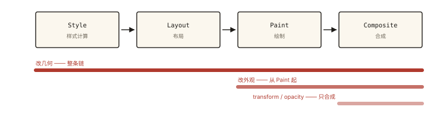
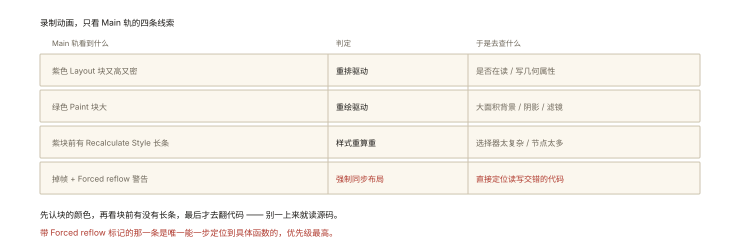
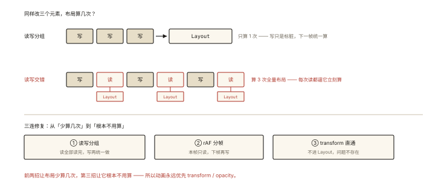

# 性能优化之渲染优化：重排与重绘

## 从「动画每帧都在查 offsetHeight」的慢性死亡说起

```js
// 拖拽跟随的经典错误写法
elements.forEach((el) => {
  const top = el.offsetTop;          // ① 读几何（触发 Layout）
  el.style.top = top + 1 + 'px';     // ② 写样式（使 Layout 失效）
});
// 循环里【读-写-读-写】交替 —— 每次读都被迫立刻算一次布局！
```

这就是臭名昭著的 **Layout Thrashing（布局抖动）**——本文的头号反派。⭐⭐⭐ 重排/重绘的触发条件与读写分离，是渲染性能的核心考点，也是《rendering-001 渲染管线》的性能应用篇。

## 现象与直觉解释

回顾渲染管线（一个改动从 JS 到像素的代价阶梯）：



*图 · 越靠左入场，要跑的段数越多，代价越大*

```
JS 改了 DOM/样式
   ▼
Style（样式重算）──▶ Layout（重排：几何全算）──▶ Paint（重绘：像素重画）──▶ Composite（合成）
   便宜                  贵 ⭐                  中                       便宜（GPU）

重排（Reflow/Layout）：几何属性变了（宽高/位置）→ 后面全部重做
重绘（Repaint）：外观变了（颜色/背景）→ 只从 Paint 开始
合成（Composite only）：transform/opacity → 只最后一步 ⭐ 最优
```

**级联规则**：触发靠前的会连带后面全部——**重排必重绘，重绘不重排**；transform/opacity 只走合成（css-deep-010 讲过的圣杯属性）。

## 深入原理

### 一、重排的触发清单 ⭐⭐⭐

```
几何变化：width/height/top/left/margin/padding/border/max-height…
结构性：增删节点、改文本内容、display:none↔block
读取几何信息（强制同步布局 ⭐⭐）：
  offsetTop/Width、scrollY、clientWidth、getBoundingClientRect()…
窗口与字体：resize、字体加载完成
```

**「读几何」为什么也触发重排？**——浏览器本来的策略是**惰性批量**：写样式时只标脏（invalidation），到下一帧渲染时才算。但你中途**读几何**——不重新算 Layout 怎么答对？→ 被迫**立即同步**算一次（强制同步布局，Forced Synchronous Layout）。**写使布局失效、读迫使立即重算**——读写交错就是灾难（开篇代码一帧内做了 N 次全量布局）。

### 二、Layout Thrashing 的修复：读写分离 + 批处理 ⭐⭐⭐

```js
// ❌ 错误：读-写交错（每对读写都强制一次布局）
els.forEach((el) => { el.style.top = el.offsetTop + 1 + 'px'; });

// ✅ 修复一：读写分组（一次布局服务全部读，写统一最后做）
const tops = els.map((el) => el.offsetTop);          // 全部读（1 次布局）
els.forEach((el, i) => { el.style.top = tops[i] + 1 + 'px'; });  // 全部写

// ✅ 修复二：rAF 批处理（本帧读、下一帧写——天然分离）
function tick() {
  const tops = els.map((el) => el.offsetTop);
  requestAnimationFrame(() => {
    els.forEach((el, i) => { el.style.top = tops[i] + 1 + 'px'; });
  });
}

// ✅ 修复三（本质解）：改用 transform —— 连 Layout 都不触发
els.forEach((el) => { el.style.transform = 'translateY(1px)'; }); // 只走合成
```

**FastDOM** 库就是「读写自动分组」的工业版（read/write 队列在 rAF 里分批冲刷）。

### 三、减少重排重绘的七件武器 ⭐⭐⭐

```js
// ① 用 transform/opacity 替代几何动画（css-deep-010 的铁律，合成层直通）
el.style.transform = `translate(${x}px, ${y}px)`;   // ✅ 替代 left/top

// ② class 切换替代多次 style 逐条改（一次失效）
el.classList.add('active');   // ✅ vs el.style.width=…; el.style.height=…

// ③ 离线操作：DocumentFragment / display:none 后操作再显示 / 复制节点改完替换
const frag = document.createDocumentFragment();
items.forEach((i) => frag.appendChild(renderItem(i)));   // dom-events-001
list.appendChild(frag);   // 一次上树

// ④ 避免逐条触发布局的样式（table 布局代价高、flex 改主轴尺寸连锁）

// ⑤ 慎用强制布局读——尤其循环与高频事件（scroll/resize/mousemove）里 ⭐

// ⑥ will-change 提示（提前提升合成层——慎用：内存代价，rendering-003）

// ⑦ content-visibility: auto（长页面的渲染跳段神器）
.long-section { content-visibility: auto; contain-intrinsic-size: 500px; }
// 视口外的段落跳过渲染 —— 长文页面的免费大提速
```

### 四、一次诊断流程（Performance 面板实战）⭐⭐



*图 · Performance 面板的四条线索与对应结论*

```
录制动画 → 看 Main 轨：
  紫色 Layout 块又高又密 ──▶ 重排驱动（检查：是否在读几何/动几何属性）
  绿色 Paint 块大 ──▶ 重绘驱动（大面积背景/阴影/滤镜）
  紫块前有 Recalculate Style 长条 ──▶ 选择器太复杂/节点太多
  掉帧 + Layout 块标着 "Forced reflow" 警告 ⭐ ──▶ 直接定位到强制同步布局代码
```

## 回看开篇

Layout Thrashing 的完整因果：写使布局失效 → 下一次读被迫同步重算 → 循环里读写交错 = 每对读写一次全量布局 → 主线程挤爆掉帧。三连修复：**读写分组**（1 次布局服务 N 个读）、**rAF 分帧**（本帧读下帧写）、**transform 直通合成层**（连布局都不需要）——第三种是「让问题不存在」的最优解。

## 实战延伸

**1. 面试答题骨架**：「渲染管线中重排触发样式重算、布局、绘制全链，重绘只从绘制开始，而 transform 与 opacity 只走 GPU 合成——所以动画必须用合成属性。重排的隐藏触发源是读取 offsetTop、getBoundingClientRect 等几何信息：写样式只是标脏、下一帧才算，中途读会强制立即同步布局，循环里读写交错形成 Layout Thrashing，每对读写付一次全量布局。修复是读写分离分组、rAF 分帧批处理，或改用 transform 根本不触发布局；此外 class 切换、DocumentFragment 离线操作、content-visibility 跳段都是常规武器。」

**2. 一个快手判断题**：改 `color` 触发什么？（重绘）改 `transform`？（仅合成）读 `offsetHeight`？（可能强制重排）`display:none→block`？（重排）批量改 20 条 style 属性 vs 加一个 class？（后者一次失效）。

## 图解总结



*图 · 读写分组与读写交错，布局次数的差别*

```
管线阶梯与代价：
 Style ─▶ Layout ─▶ Paint ─▶ Composite
 改几何: 全链 ❌贵 │ 改外观: Paint起 │ transform/opacity: Composite起 ✅

Layout Thrashing：
 写(标脏) → 读(被迫立刻算) → 写 → 读…  循环内交错 = N 次全量布局
修复三连： 读写分组 │ rAF分帧(本帧读下帧写) │ transform(不进Layout)

武器： class切换 │ Fragment离线 │ 避免高频读几何 │ content-visibility:auto
诊断： Performance面板紫色Layout块 / "Forced reflow" 警告 → 定位代码
```

## 总结

- 代价阶梯：几何改动全链最贵，外观改动从 Paint 起，transform/opacity 只合成；
- 隐藏触发源：读几何信息强制同步布局；读写交错 = Layout Thrashing；
- 修复三连：读写分组、rAF 分帧、transform 直通；
- 常规武器：class 切换、离线操作、content-visibility、慎读几何于高频事件；
- Performance 面板的紫色 Layout 块与 Forced reflow 警告是定位入口。

**面试一句话回答**：渲染管线从样式计算、布局、绘制到合成的代价逐级递减——修改几何属性触发全链路的重排最昂贵，修改颜色等外观只触发重绘，而 transform 与 opacity 只经过 GPU 合成最廉价，因此动画必须用合成属性。重排还有一个隐藏触发源：读取 offsetTop、getBoundingClientRect 等几何信息——浏览器本应在下一帧统一重算布局，但中途的读取会强制它立即同步执行，循环中读写交替就形成布局抖动，每一对读写都要付出一次完整布局的代价。修复方案是读写分离把所有读取集中先行、把写入集中随后，或用 requestAnimationFrame 把读和写分到两帧，最彻底的是改用 transform 让元素根本不进入布局阶段。

## 思考题

1. 为什么「改 top 的动画」在低端机必卡而「改 transform 不卡」？从主线程与合成线程的分工（browser-basic-002）完整推导。
2. `getBoundingClientRect` 在 scroll 回调里读一次、然后在同回调里改样式——单次也会抖吗？什么规模才成为问题？
3. `content-visibility: auto` 为什么能跳过视口外的渲染？contain-intrinsic-size 缺失会带来什么副作用（滚动条跳动/CLS）？
4. 开放设计：可视化大屏有 200 个实时刷新的数字卡片——设计「数据到像素」的渲染管线（增量更新、Canvas 替代 DOM、DocumentFragment 节流）。

（思考题解析将同步录入小程序题库，关联本文 id：performance-005）

## 参考文献：

- web.dev — Avoid large, complex layouts and layout thrashing
- Chrome DevTools 文档 — Diagnose Forced Synchronous Layouts
- 本课程《rendering-001 渲染管线》《rendering-003 合成层》《css-deep-010 CSS 动画》
