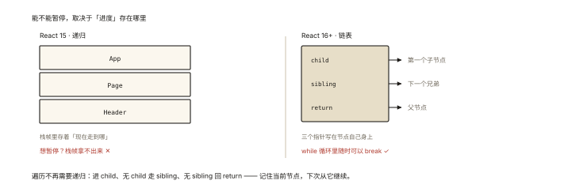
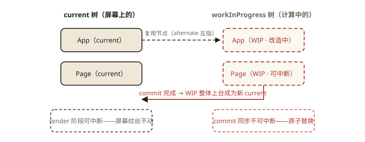
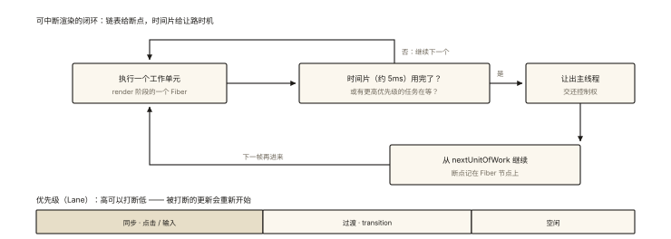
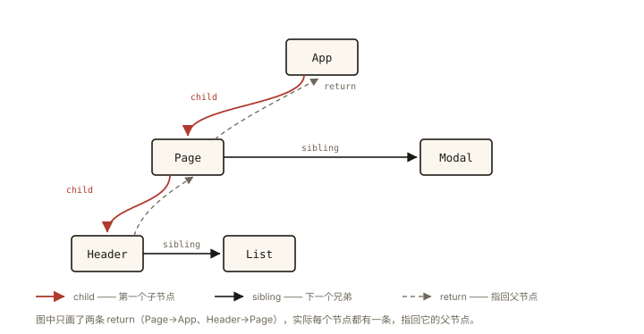

# React 原理之 Fiber 架构：可中断的渲染

## 从「递归不可停」的老大难说起

React 15 时代的渲染是**递归的**：

```
递归 reconcile（Stack Reconciler）：
  renderApp() → 组件A → B → C → … 一路递归到底
  ⚠️ 递归一旦开始【停不下来】—— 3000 个组件的 diff 要 120ms？
  这 120ms 主线程锁死：点击没反应、输入卡顿 —— "用户输入被长渲染堵住"
```

React 16 的答案：**Fiber 架构——把递归改成可暂停的循环，把树改成链表**。⭐⭐⭐ Fiber 是 React 原理的分水岭（并发特性、Hooks、优先级调度全部建立在它上面）。

## 现象与直觉解释

**Fiber 是什么？**——三层含义一个词：

1. **数据结构**：组件树的一种节点表示——**链表化的「工作单元」**；
2. **执行流程**：把「一口气递归完」拆成「一个个 Fiber 单元的工作」，**做完一个可以歇一下**（检查有没有更要紧的事）；
3. **架构体系**：可中断/恢复/优先级调度的整套渲染架构。

直觉：**从「一口气搬完整栋楼」改成「清单式搬砖」**——每搬一块砖看一眼清单（有没有更高优先级插单），有就先干别的，回头从断点继续。

## 深入原理

### 一、数据结构：树 → 链表 ⭐⭐⭐

为什么必须从树改成链表？——**递归的暂停点藏在调用栈里（恢复不了），链表的「下一步」存在节点上（随时可走可停）**：

```
树结构（React 15）：父子关系靠【递归栈】维系
  └─ 栈帧 = 当前进度 —— 想暂停？进度在栈里，拿不出来 ❌

Fiber 链表（React 16+）：每个 Fiber 携带三个指针 ⭐
  child   → 第一个子节点
  sibling → 下一个兄弟
  return  → 父节点（命名避免与 return 混淆）

        App
        │ child
        Page ──sibling── Modal
        │ child              │ child
      Header ─sibling─ List  …
```



*图 · 递归栈与 Fiber 三指针的差别*

有了这三个指针，**遍历整棵树不需要递归**——用一个 while 循环按「深度优先」走：进 child、无 child 走 sibling、无 sibling 回 return——**每一步的「下一站」都写在节点上**，循环里随时可以 break（记住当前节点，下次从它继续）。

```
workLoop() {
  while (nextUnitOfWork && !shouldYield()) {   // ⭐ 每个单元后检查"该不该让路"
    nextUnitOfWork = performUnitOfWork(nextUnitOfWork);
  }
}
```

### 二、双缓冲：current 树与 workInProgress 树 ⭐⭐

Fiber 用「双树」管理新旧状态：

```
current 树：      当前屏幕上呈现的树（对应真实 DOM）
workInProgress 树：正在 render 阶段构建的新树

更新开始：以 current 为蓝本建 workInProgress（大量复用节点——alternate 指针互指）
render 阶段：在 workInProgress 上算 Diff（可中断——current 不受影响，屏幕稳定 ✅）
commit 阶段：完成 → workInProgress 整体"上台"成为新 current（指针一换）
```

**双缓冲的价值**：render 可中断重试期间，屏幕上的 current 纹丝不动；只有 commit 一次切换——「计算阶段随便折腾，呈现阶段原子替换」。



*图 · 双缓冲——render 在影子树里随便折腾，commit 时整体切换上台，用户永远看到完整的帧*

### 三、调度与优先级：让路给更要紧的事 ⭐⭐



*图 · 时间片让路与优先级的闭环*

```
shouldYield() 的判定（Scheduler 调度器）：
  每个工作单元执行后检查：本轮时间片（约 5ms）用完了吗？有更高优先级任务吗？
  ── 是 ──▶ 记下 nextUnitOfWork，把控制权还给主线程（处理输入/渲染帧）
  ── 稍后 ──▶ 从断点继续

优先级体系（Lane 模型）：
  同步（离散事件点击/输入）> 过渡（transition 非紧急更新）> 空闲
  高优先级可以【打断】低优先级的 render ——被打断的更新重新开始
```

**这就是「可中断渲染」的完整闭环**：链表提供断点、时间片提供让路时机、优先级决定谁插队、双缓冲保证屏幕永远完整。

### 四、Effect List：commit 阶段的购物清单 ⭐

render 阶段 Diff 时，有变更的 Fiber 把自己挂进 **Effect List（单向链表）**——commit 阶段只需遍历这张清单执行 DOM 操作，**不用再扫整棵树**。「计算时记账、落地时按账执行」——两阶段的数据交接（react-002 的变更列表）。

### 五、Fiber 与 Hooks 的关系（下一站的铺垫）⭐

函数组件「没有实例」怎么存 state？——**存在它的 Fiber 节点上**：每个 Fiber 有一个 `memoizedState` 链表，useState 的数据就是链表上的节点（按 Hook 调用顺序排列）——「Hook 不能写在 if 里」的根源在此（react-004 全篇展开）。

## 回看开篇

递归不可停的死结，被「链表 + 循环 + 时间片」三件套解开：Fiber 用 child/sibling/return 指针把进度**存在节点上**（不再依赖调用栈），工作循环做完一个单元就查 shouldYield——120ms 的长 diff 被切成 24 个 5ms 的时间片，用户输入随时插队，**页面从此「卡但仍能响应」直到「不卡」**。

## 实战延伸

**1. 面试答题骨架**：「Fiber 是 React 16 引入的架构，同时指一种链表化的工作单元结构——每个 Fiber 通过 child、sibling、return 三个指针连接，使树的遍历可以用循环替代递归，进度保存在节点上从而可中断可恢复；配合双缓冲设计，render 在 workInProgress 树上计算、current 树保持屏幕稳定，commit 时整体切换；调度器按时间片（约 5ms）与 Lane 优先级决定让路与插队，高优先级更新可打断低优先级渲染；render 期间有变更的节点挂入 Effect List，commit 只按清单落地。Hooks 的状态也存在 Fiber 的 memoizedState 链表上。」

**2. 对比 Vue 一句话**：Vue 靠依赖收集把更新粒度缩到组件（组件内仍是同步一次完成）；React 用 Fiber 把更新过程本身切分——**「减少每次做多少」vs「把一次大的拆成多次小的」**，两种哲学。

**3. 一个认知纠偏**：Fiber 不是「虚拟 DOM 的替代」——React 元素（描述）→ Fiber（工作单元）→ DOM（呈现），三者是流水线上的三站。

## 图解总结



*图 · 三个指针就是一次「深度优先遍历」的全部状态：child 往下、sibling 往右、return 回父——遍历进度因此存在节点上，而不在调用栈里*

```
链表三指针:  App ──┐ child
                 ▼   sibling
              Page ──── Modal
               │child
            Header ──── List      （return 指针指回父，图略）

workLoop: while(unit && !shouldYield()) unit = perform(unit)
          └ 5ms时间片 / 高优先级插队 → 记断点让路 → 稍后续跑

双缓冲:  current(屏幕) ◇alternate◇ workInProgress(计算中)
         render 在 WIP 上中断重试，commit 原子切换
优先级:  Lane模型  同步 > transition > idle
账本:    render时 EffectList(有变更的Fiber) → commit 按单执行
Hook:    Fiber.memoizedState 链表 = Hooks 数据的家
```

## 总结

- Fiber 三义：链表化工作单元、可暂停的执行流程、优先级调度架构；
- child/sibling/return 三指针把递归变循环，断点可存可续；
- 双缓冲：workInProgress 计算、current 呈现，commit 原子切换；
- 时间片 + Lane 优先级：高优先级可打断低优先级渲染；
- Effect List 是两阶段的交接账本；Hooks 状态住在 Fiber 的 memoizedState 链表上。

**面试一句话回答**：Fiber 是 React 16 引入的架构，包含三层含义——它是一种链表化的节点结构，每个 Fiber 用 child、sibling、return 三个指针连接组件树，使遍历从递归改为循环，当前进度保存在节点上因此渲染可以随时中断并从断点恢复；它是可中断的执行流程，调度器按约 5ms 的时间片执行工作单元，遇到时间片耗尽或更高优先级任务（Lane 优先级模型）就交还主线程，稍后继续；它配合双缓冲设计，render 阶段在 workInProgress 树上计算、屏幕对应的 current 树保持稳定，commit 阶段原子切换两树。有变更的节点在 render 时挂入 Effect List，commit 按清单一次性落地，而函数组件的 Hooks 状态也存在 Fiber 的 memoizedState 链表上。

## 思考题

1. 用 child/sibling/return 手工遍历 `A(B(C,D), E)` 这棵树，写出访问顺序（深度优先：A→B→C→D→E）。
2. 为什么「被打断的低优先级更新」要从头重算而不是继续？（新插入的高优先级更新可能已改变输入）
3. 时间片 5ms 太小/太大会怎样？从「切换开销 vs 响应延迟」的权衡分析。
4. 开放讨论：Vue 选择「组件级细粒度依赖收集 + 组件内同步渲染」，React 选择「组件函数全跑 + Fiber 切片」——从「模板可静态分析 vs JSX 全动态」推演两种选择背后的必然性。

（思考题解析将同步录入小程序题库，关联本文 id：react-003）

## 参考文献：

- React 官方博客 — React Fiber Architecture（Lin Clark 的链表比喻经典）
- React 源码 — ReactFiberWorkLoop / Scheduler
- 本课程《react-002 渲染流程》《react-004 Hooks 原理》
