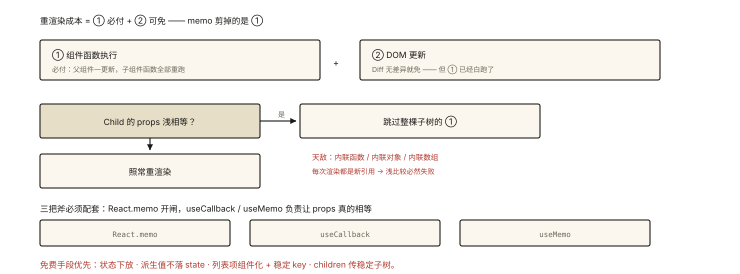

# React 原理之性能优化：memo、useMemo 与 useCallback

## 从「输入一个字，整页重渲染」说起

> 本篇是《React 原理系列》收官——把前七篇的机制知识变现为性能手段。

```jsx
function App() {
  const [keyword, setKeyword] = useState('');
  return (
    <>
      <input value={keyword} onChange={(e) => setKeyword(e.target.value)} />
      <HeavyList />                          {/* 与输入毫无关系，却每次重渲染 */}
      <Footer />                             {/* 静态内容，也每次重渲染 */}
    </>
  );
}
```

每敲一个字：App 函数重跑 → **默认所有子组件函数全部重跑**（react-002 的规则）——重灾区就是它。⭐⭐ React 性能优化的三板斧 memo/useMemo/useCallback，本质全是「**跳过无意义的重渲染**」。

## 现象与直觉解释

先精确化问题。React 的「渲染成本」分两层：

```
① 组件函数执行（render 阶段：React 世界的"渲染"）—— 成本：JS 计算
② DOM 更新（commit：Diff 后真正改 DOM）—— Diff 无差异则这层本来就免了 ⭐
```

**关键认知**：即使 DOM 毫无变化，①的成本照付——函数执行、Hooks 遍历、Diff 本身。优化的目标是砍掉①里「结果注定不变」的部分。而砍的依据是**引用比较**：React.memo 看新 props 与旧 props 是否「浅相等」——相等就跳过整棵子树的 render。

## 深入原理

### 一、React.memo：子树级跳过 ⭐⭐

```jsx
const HeavyList = React.memo(function HeavyList({ items }) {
  // props 浅相等时【整个组件函数都不执行】——子树整棵跳过
  return <ul>{items.map(...)}</ul>;
});
// 默认浅比较：Object.is 逐个比较 props 顶层字段
// 自定义比较：React.memo(Cmp, (prev, next) => prev.id === next.id)
```

**memo 失效的第一现场：每次渲染新建的引用**：

```jsx
function App() {
  const [keyword, setKeyword] = useState('');
  return <HeavyList items={list} filter={() => keyword && list.filter(...)} />;
  //                                 ⚠️ 内联函数：每次渲染新引用 → 浅比较必不等 → memo 白挂
}
```

**每渲染必新的三类值**：内联函数、内联对象 `{...}`、内联数组——它们是 memo 的天敌，引出后两板斧。

### 二、useCallback 与 useMemo：引用的稳定器 ⭐⭐

```js
// useCallback(fn, deps)：记住【函数引用】—— deps 不变则返回同一个函数
const handleClick = useCallback(() => { doSomething(id); }, [id]);

// useMemo(factory, deps)：记住【计算结果】—— deps 不变则返回同一个值（还省计算）
const stats = useMemo(() => expensiveCalc(data), [data]);
const config = useMemo(() => ({ theme, size }), [theme, size]);  // 对象也能稳
```

**两者本质是同一个东西**：`useCallback(fn, deps) === useMemo(() => fn, deps)`——都挂在 Hooks 链表上（react-004），deps 不变就返回上次存的引用。

**配合公式** ⭐：

```jsx
const Child = React.memo(({ onClick, config }) => ...);

function Parent() {
  const [x, setX] = useState(0);
  const handleClick = useCallback(() => {...}, []);        // 稳定引用
  const config = useMemo(() => ({ size: 10 }), []);         // 稳定对象
  return <Child onClick={handleClick} config={config} />;   // 浅比较通过 → Child 跳过 ✅
}
```

### 三、三条使用纪律（防止反向优化）⭐⭐

**纪律 1：优化「传给 memo 组件的 props」，别的场景多半白做**

```jsx
// 无意义的 useCallback（没有 memo 子组件消费它）：
<button onClick={useCallback(() => save(id), [id])}>保存</button>
// 每次 render 本来就要执行组件函数，内联函数成本 ≈ 0 —— 包一层反而多存一份 deps
```

**纪律 2：useMemo 的真实收益 = 计算成本 + 引用稳定，两者至少占一**

```js
const cheap = a + b;                          // 不值得 memo（计算比比较还便宜）
const heavy = useMemo(() => sort(hugeList), [hugeList]);   // 值得（计算贵）
const stable = useMemo(() => ({ a, b }), [a, b]);          // 值得（为下游 memo 提供稳定引用）
```

**纪律 3：先测量再优化**——React Profiler 的火焰图标出「哪个组件 render 花了多少 ms」；没有数据的优化是玄学（也是面试的加分表达）。

### 四、免费的优化优先做 ⭐⭐

在动三板斧之前，先排空这些零成本项：

```jsx
// ① 状态下放：把只跟输入框有关的状态，移进小组件
function Search() {                 // App 不再持有 keyword —— 敲字只重渲染 Search
  const [kw, setKw] = useState('');
  return <input value={kw} onChange={(e) => setKw(e.target.value)} />;
}
// App: <Search /><HeavyList />    —— HeavyList 与输入解耦 ✅ 零 API 成本

// ② 列表项组件化 + 合理 key：每项单独 memo，增删只影响变化项（key 规则同 vue-002）

// ③ 派生状态不落 state：能算出来的不要 useState + useEffect 同步
const fullName = firstName + ' ' + lastName;              // ✅ 渲染期直接算
// ❌ const [full, setFull] = useState(); useEffect(() => setFull(...))  多一次渲染

// ④ children 模式：把稳定的 JSX 子树作为 children 传入
<Panel>  {/* Panel 重渲染时 children 引用不变（是同一份 JSX 元素对象）✅ */}
  <HeavyTree />
</Panel>
```

### 五、一把尺子：什么时候需要优化 ⭐

```
重渲染的组件树很小 / 计算便宜 → 不优化（React 本身很快，diff 兜底）
组件树大 + 高频更新（输入、拖拽、动画）+ Profiler 证实慢 → 三板斧
超大列表 → 虚拟滚动（performance-006）才是正解，memo 治标
```

## 回看开篇

输入卡顿的分层治理：**状态下放**（keyword 移进 Search，HeavyList 根本不参与重渲染——零成本首选）；仍不够时给 HeavyList 挂 memo + 稳定 props（useCallback/useMemo）；超大列表直接上虚拟滚动。**优化的顺序是「先改结构、再上 memo、最后测量验证」。**

## 实战延伸

**1. 面试答题骨架**：「React 重渲染成本主要在组件函数执行——即使 DOM 无变化，父组件重渲染默认带动全部子组件函数重跑。React.memo 让子组件在 props 浅相等时整棵跳过，但内联函数、对象、数组每次渲染都是新引用会使 memo 失效，因此用 useCallback 稳定函数引用、useMemo 稳定计算结果与对象引用（两者同源，useCallback 等价 useMemo 返回函数）。使用纪律：只为传给 memo 组件的 props 做稳定化、计算便宜的不值得 memo、先用 Profiler 测量。零成本手段优先：状态下放、列表项组件化、派生值不落 state、children 传稳定子树。」

**2. 一道判断题**：`useMemo(() => fn, deps)` 与 `useCallback(fn, deps)` 输出相同吗？——引用行为相同（deps 不变返回同一函数），前者还多包了一层工厂调用。

**3. 对照 Vue 一句话**：Vue 靠依赖收集天然做到「只重渲染相关组件」（组件级精准更新）；React 用「全跑 + memo 剪枝」逼近同一目标——两家的性能差异与选型哲学都源于此（react-003 结尾的呼应）。

## 图解总结



*图 · 重渲染的成本构成与 memo 的剪枝条件*

```
重渲染成本 = ①组件函数执行（必付） + ②DOM 更新（Diff 无差异则免）

React.memo(Child)：props 浅相等 → 跳过整棵 Child 子树的 ①
   ⚠️ 天敌：内联函数/对象/数组（每渲染新引用 → 浅比较必不等）
useCallback：稳定函数引用      useMemo：稳定结果/对象引用（同一机制）
   组合拳: memo(Child) + 父组件用 useCallback/useMemo 造稳定 props

纪律: 只为 memo 消费者稳定化 │ 计算贵或需引用稳定才 memo │ 先 Profiler 测量
免费优先: 状态下放 │ 派生不落 state │ 项组件化+key │ children 传稳定子树
```

## 总结

- 优化对象是「注定不变的重渲染」：memo 跳子树，useMemo/useCallback 稳引用；
- memo 失效三害：内联函数/对象/数组；三斧必须配套使用；
- 纪律三连：为 memo 而 memo 化 props、便宜计算不值得、先测量；
- 免费手段优先：状态下放、派生不落 state、项组件化、children 模式；
- 超大列表的正解是虚拟滚动，不是 memo。

**面试一句话回答**：React 的重渲染成本主要在组件函数执行——父组件更新默认导致所有子组件函数重跑，即使 DOM 无变化。React.memo 包裹的组件在 props 浅比较相等时整棵子树跳过渲染，但内联函数、对象与数组每次渲染都产生新引用导致浅比较必然失败，所以要用 useCallback 缓存函数引用、useMemo 缓存计算结果与对象引用——两者是同一机制，useCallback 等价于 useMemo 返回函数。使用纪律是只为传给 memo 组件的 props 做引用稳定化、计算量小的值不值得缓存、优化前先用 Profiler 测量。零成本手段优先：把状态下放到最小组件、派生值直接在渲染期计算而不落入 state、列表项组件化配合稳定 key、用 children 传递稳定子树。

## 思考题

1. `React.memo` 的自定义比较函数返回 true 表示什么？（跳过渲染——与 shouldComponentUpdate 返回 true 含义相反，经典混淆点）
2. `children` 为什么天然是「稳定引用」？父组件重渲染时 `<Panel><Heavy/></Panel>` 里的 children 引用变不变？（同一次渲染的元素对象被复用——注意父重渲染时 JSX 重新执行，children 引用会变，除非作为变量/props 提前构造）
3. 给「表格排序 + 筛选 + 分页」设计优化方案：哪些用 useMemo、哪些组件化、哪些下放状态？
4. 开放讨论：React 19 的 React Compiler（自动 memo 化）要解决的正是本篇的手工心智——如果它普及，useMemo/useCallback 会被淘汰吗？哪些场景仍需手动？

（思考题解析将同步录入小程序题库，关联本文 id：react-008）

## 参考文献：

- React 官方文档 — memo / useMemo / useCallback / Profiler
- React 官方博客 — react.dev 的 You Might Not Need an Effect（免费优化思想）
- 本课程《react-002 渲染流程》《performance-006 虚拟滚动》《vue-002 diff》（跨框架对照）
