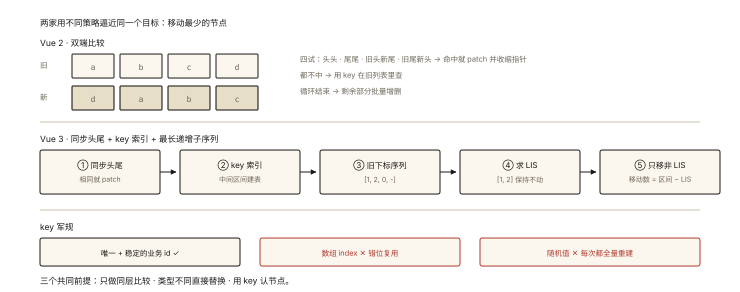

# Vue 原理之虚拟 DOM 与 diff 算法

## 从「同是 diff，Vue2 和 Vue3 打得不一样」说起

```html
<!-- 旧 -->
<li v-for="i in [a, b, c, d]" :key="i">
<!-- 新（头部插入一个 e） -->
<li v-for="i in [e, a, b, c, d]" :key="i">
```

同一个「头部插入」场景：

- **朴素 diff**（逐位比较，无 key 感知）：5 次内容改写；
- **Vue 2 双端 diff**：识别出整体后移，1 次新建 + 0 次改写；
- **Vue 3 静态标记 + 最长递增子序列**：同样 1 次新建，且跳过静态节点的属性对比。

⭐⭐⭐ 「diff 算法怎么工作、key 的作用」是 Vue/React 通吃的高频题——《handwritten-008》手写过朴素版，本篇升到 Vue 的实战版本：**双端 diff（Vue 2）与最长递增子序列（Vue 3）**。

## 现象与直觉解释

diff 的前提回顾（三假设，《handwritten-008》）：**只比同层、类型不同即替换、靠 key 认节点**——把树 diff 的 O(n³) 压到 O(n)。

在这个框架下，**列表 diff 的核心难题**是：

```
旧: [a, b, c, d]      新: [d, a, b, c]     （尾部挪到头部）
「谁动了」有两种解读：
  ① d 移动到最前 —— 1 次移动 ✅
  ② a、b、c 各后移一位 —— 3 次移动 ❌
好的 diff = 识别"最小移动集"
```

## 深入原理

### 一、Vue 2 的双端 diff（Diff during comparison from both ends）⭐⭐

维护**四个指针**：新旧列表各自的头尾。

```
旧: [a, b, c, d]      新: [d, a, b, c]
     ↑oldS      oldE↑     ↑newS      newE↑

每轮做【四组两两比较】，命中哪组走哪组：

① oldS vs newS（头头）→ 同一节点：patch 两个，双头指针右移
② oldE vs newE（尾尾）→ 同一节点：patch，双尾指针左移
③ oldS vs newE（旧头=新尾）→ patch + 【移到尾部】；oldS++ newE--
④ oldE vs newS（旧尾=新头）→ patch + 【移到头部】；oldE-- newS++
⑤ 都不中 → 拿 newS 的 key 去旧列表找（keyMap）：找到 patch+移动；找不到新建
循环到某一侧越界 → 剩余的批量增删
```

用头插场景 `[a,b,c,d] → [e,a,b,c,d]` 走一遍：

```
轮1: oldS=a vs newS=e ✗; oldE=d vs newE=d ✓(尾尾) → patch(d,d)，双尾左移
轮2: oldE=c vs newE=c ✓ → patch；继续…直到旧列表耗尽
新列表还剩 [e] 未处理 → 头部新建 e ✅ 总代价：1 次新建 + 0 次移动
```

**双端的聪明之处**：真实业务里「头部插入/尾部追加/倒序」都是头尾附近的变化——四组比较用 O(1) 的代价覆盖了最高频的场景。

### 二、Vue 3 的 diff：预处理 + 最长递增子序列 ⭐⭐⭐

Vue 3 抛弃双端，改为「**预处理 + 从头尾同步 + LIS 求最少移动**」：

**第 1 步：同步头尾（快速通道）**

```
从头开始：a==a ✓、b==b ✓ … 遇到不同停下（c≠e）
从尾开始：d==d ✓、c==c ✓ … 遇到不同停下
中间剩下「真正乱序的区间」才进入正式处理
```

**第 2 步：中间区间建 key 索引**

```
旧中间: [c, a, b]          新中间: [e, a, b, c]（示意）
用新中间的 key 建索引 → 逐个旧节点查「新列表里有没有我」
```

**第 3 步：最长递增子序列（LIS）—— 最少移动的秘密 ⭐⭐**

对「新中间的每个位置：它在旧列表中的下标」形成数列，求**最长递增子序列**——**这串下标对应的节点是"相对顺序没变"的，不移动；其余节点才是真正要动的**。

```
新中间:   [a, b, c, e]
对应旧下标: [1, 2, 0, 不存在]
LIS = [1, 2] → a、b 不动 ✅
要处理: c（移动）、e（新建）
移动次数 = 区间长度 - LIS 长度 —— 数学上最少
```

一句话：**LIS 就是「本来就排好序的最大群体」，让它们原地不动，只动剩下的人**——这就是「最少移动集」的算法化。

### 三、静态提升与 PatchFlag（Vue 3 编译时优化）⭐⭐

Vue 3 的 diff 快，另一半功劳在**编译期**（《handwritten-010》的 transform 阶段）：

```html
<div>
  <p>静态文本永远不变</p>
  <p>{{ dynamic }}</p>
</div>
```

编译产物（概念）：

```js
// 静态提升：静态节点只在首次创建，之后复用同一个 vnode 引用
const hoisted = createVNode('p', null, '静态文本永远不变');

function render() {
  return createVNode('div', null, [
    hoisted,                                    // diff 时直接跳过（同一引用）
    createVNode('p', null, ctx.dynamic, 1 /* PatchFlag: TEXT */),
  ]);
}
```

**PatchFlag**：给动态节点打标「只有文本会变 / 只有 class 会变」——运行时 diff 只查标记的那一项，跳过全部属性遍历。**「编译时知道的信息，绝不留到运行时」**——这是 Vue 3 性能的哲学。

### 四、key 三军规（跨框架通用的收尾）⭐⭐

```html
<!-- ❌ index 作 key：头部插入后 index 全变 → diff 认为"全换了一遍" -->
<li v-for="(item, index) in list" :key="index">

<!-- ❌ 随机数：每次渲染都变 → 每次都是"全新节点" → 全量重建 -->
<!-- ✅ 稳定业务 id：唯一 + 稳定 → diff 正确认人 -->
<li v-for="item in list" :key="item.id">
```

index 作 key 的三大事故：输入框焦点丢失（复用了错节点）、过渡动画错乱、状态串行（复用节点带着旧状态）。**机制根源：key 是节点的「身份证」，diff 认证不认位**。

## 回看开篇

同一个头插场景三种结果的原因：朴素 diff 只会「逐位对齐」；Vue 2 双端用头尾四组比较识别出「尾部相同」的锚点；Vue 3 再进一步——LIS 把「相对有序的最大群体」钉住不动，移动数到达数学下限。**diff 的进化史 = 「识别不变量」能力的进化史**。

## 实战延伸

**1. 面试答题骨架**：「虚拟 DOM diff 基于三个假设——只比同层、类型不同即替换、key 认节点。Vue 2 用双端比较：新旧列表各持头尾四个指针，头头、尾尾、旧头新尾、旧尾新头四组匹配，命中即 patch 并按需移动，都不中则按 key 查找，剩余批量增删，能 O(1) 处理头尾高频变化。Vue 3 改为先同步头尾相同部分，中间区间建 key 索引，再用最长递增子序列求出可保持不动的节点群，只移动其余节点达到最少移动；同时编译期做静态提升与 PatchFlag 标记，运行时只比对标记的动态部分。key 必须唯一稳定，用 index 会导致复用错节点、状态串行。」

**2. 与 React 的对照一句**（《react-003》展开）：React 按位置单向扫 + key 匹配（不双端不 LIS），靠调度弥补——两家用不同策略逼近同一目标。

## 图解总结



*图 · 双端比较、最长递增子序列与 key 军规*

```
Vue2 双端: [旧头┤a b c d├旧尾] vs [新头┤d a b c├新尾]
  每轮四试: 头头/尾尾/旧头新尾/旧尾新头 → patch+指针收缩
  都不中 → key索引查找 → 越界后批量增删

Vue3 流水线: 同步头尾(快) → 中间区间 key 索引 →
  旧下标序列 [1,2,0,-] → LIS=[1,2] → a,b 不动; c 移动; e 新建
  移动数 = 区间长 - LIS长（数学最少）+ PatchFlag 跳过静态比对

key 军规: 唯一 + 稳定业务id ✅ | index ❌(错位复用) | 随机 ❌(全量重建)
```

## 总结

- 双端 diff（Vue 2）：四指针四组匹配 + key 查找兜底，擅长头尾变化；
- Vue 3 diff：同步头尾 + key 索引 + 最长递增子序列求最少移动；
- 静态提升让静态节点只建一次；PatchFlag 让运行时只比对动态标记部分；
- key = 身份证：唯一、稳定、禁 index 与随机值；
- 三个假设（同层/类型/key）是一切 diff 的共同前提。

**面试一句话回答**：虚拟 DOM 的 diff 基于同层比较、类型不同即替换、以 key 识别节点三个假设。Vue 2 采用双端比较——新旧列表各持头尾指针，头头、尾尾、旧头新尾、旧尾新头四组匹配命中就 patch 并移动相应节点，都不匹配时用 key 在旧列表查找，循环结束后对剩余部分批量增删，以 O(1) 的比较覆盖头部插入、尾部追加等高频变更。Vue 3 则先从头尾同步相同部分，再对中间乱序区间建立 key 到下标的索引，对每个新节点求出旧下标序列的最长递增子序列，该子序列对应的节点保持不动、其余节点才移动，从而达成理论最小移动次数；配合编译期的静态提升与 PatchFlag 动态标记，运行时只比对真正会变的部分。key 必须唯一且稳定，用数组下标会导致复用错节点丢失状态。

## 思考题

1. 手推 `[a,b,c,d,e] → [e,a,b,c,d]` 在双端 diff 下的每轮动作（哪个分组命中、移动几次）。
2. LIS 求最少移动的证明思路：为什么「最长递增子序列不动」就保证移动数最少？
3. 同一个列表用 index 作 key，「尾部追加」与「头部插入」的表现为什么完全不同？
4. 开放讨论：Vue 3 的编译时优化（PatchFlag）依赖模板的静态可分析性——JSX/渲染函数组件拿不到这些优化，这对「模板 vs JSX」的技术选型意味着什么？

（思考题解析将同步录入小程序题库，关联本文 id：vue-002）

## 参考文献：

- 《Vue.js 设计与实现》第 6~8 章（双端与快速 diff 的完整实现）
- Vue 3 官方 — 渲染机制与优化文档
- 本课程《handwritten-008 虚拟 DOM 与 diff》（手写地基）、《handwritten-010 模板编译》（静态提升出处）
