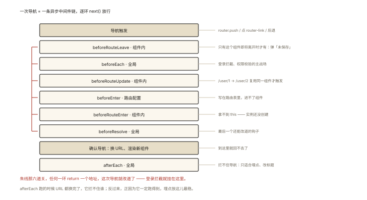
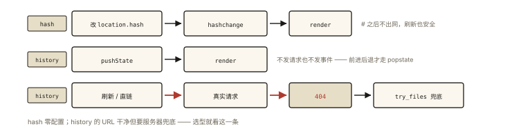

# Vue 原理之 Vue Router：hash 与 history 模式

## 从「路由刷新 404」的部署事故说起

SPA 用 history 模式开发时一切正常，部署到服务器后**一刷新就 404**：

```
开发环境：localhost:5173/user/123   ✅ 正常（dev server 兜底了）
生产刷新：www.app.com/user/123     ❌ 404！
原因：服务器收到 /user/123 的请求，去找这个「文件」——它当然不存在
```

这是 hash 与 history 模式的核心差异引发的经典事故。⭐⭐「两种路由模式的原理与区别」「history 为什么要配 fallback」是路由必考题——本质是**「用哪种方式把 URL 变化变成前端状态」**。

## 现象与直觉解释

SPA 路由要解决两个问题：**URL 变了（不刷新页面）→ 视图切换**；**直接输入/刷新 URL → 恢复对应视图**。两种模式是两条技术路线：

| | hash 模式 | history 模式 |
|---|---|---|
| URL 形态 | `/#/user?id=1` | `/user?id=1`（干净 ✅） |
| 依赖 API | `location.hash` + `hashchange` | `pushState/replaceState` + `popstate` |
| 服务器要求 | **无**（# 后不发请求） | **需配置 fallback**（所有路径回 index.html） |
| 兼容 | 全兼容 | IE10+（现代无虞） |

## 深入原理

### 一、hash 模式：借「锚点」的东风 ⭐⭐

`#` 本来是页内锚点——**它的变化不会让浏览器发请求、也不会刷新页面**，且变化时触发 `hashchange` 事件：

```js
// hash 路由的极简内核：
window.addEventListener('hashchange', () => {
  const path = location.hash.slice(1) || '/';   // '#/user' → '/user'
  render(match(path));                           // 匹配组件并渲染
});
location.hash = '/user';   // 编程式导航：改 hash → 触发 hashchange → 切视图 ✅
```

刷新为什么安全？——请求只发 `/#` 之前的部分（`www.app.com/`），`#` 及之后**根本不出网**——服务器永远只见到 index.html，fallback 配置天然不需要。

### 二、history 模式：正规军的 pushState ⭐⭐

HTML5 History API 提供了「改 URL 不发请求」的正道：

```js
// 极简内核：
function navigate(path) {
  history.pushState({ }, '', path);   // ⭐ 改地址栏、加入历史栈，但【不发请求不刷新】
  render(match(path));
}
window.addEventListener('popstate', () => {   // 只有【后退/前进】触发它！
  render(match(location.pathname));
});
```

**两个关键细节（高频追问）**：

1. **pushState/replaceState 不触发 popstate**——只有浏览器后退/前进才触发。所以编程式导航后要「手动渲染」，popstate 只负责历史导航；
2. **URL 是真路径**——刷新/直链时浏览器如实向服务器请求 `/user/123` → 404 的根源。

**fallback 配置**（事故的正解）：

```nginx
# nginx：找不到的文件全部回 index.html（把"路由"还给前端）
location / {
  try_files $uri $uri/ /index.html;
}
```

### 三、路由表的匹配与组件渲染 ⭐

```js
const routes = [
  { path: '/', component: Home },
  { path: '/user/:id', component: User },          // 动态参数
  { path: '/admin', component: () => import('./Admin.vue'), meta: { requiresAuth: true } }, // 懒加载
];

// 匹配本质：把 '/user/:id' 编译成正则，对 pathname 提取参数
// '/user/123' 匹配 → params: { id: '123' }
// <router-view> 渲染 matched 的组件；<router-link> 是被拦截的 <a>
```

### 四、导航守卫：路由版的「拦截器链」⭐⭐

路由切换的完整流水线（`router.beforeEach` 们的用武之地）：



*图 · 九步里有六步能改道，另外三步只是通知*

```
导航触发
 → beforeRouteLeave（组件内，离开守卫）
 → 全局 beforeEach ──────┐
 → beforeRouteUpdate     │ 异步链：next() 依次放行
 → beforeEnter（路由配置）│
 → beforeRouteEnter      │
 → 全局 beforeResolve ───┘
 → 确认导航：换 URL、渲染新组件
 → afterEach（全局，收尾/埋点）
```

```js
router.beforeEach(async (to, from) => {
  if (to.meta.requiresAuth && !await checkAuth()) {
    return '/login';                 // 重定向（替代 next('/login') 新写法）
  }
  // 返回 undefined / true：放行
});
```

经典应用：登录拦截、权限校验、数据预取、埋点。

### 五、路由的响应式化（与 vue-001 的联动）⭐

Router 内部维护 `currentRoute` 的 **ref**——地址变化 → 更新 currentRoute → `<router-view>` 的渲染函数依赖它 → 自动重渲染。「路由也是状态」——useRoute/useRouter 本质是对这个响应式数据的读写封装。

## 回看开篇

404 的解释与修复：history 模式下 URL 是真路径，服务器按静态资源去找 `/user/123` 这个「文件」必然落空；`try_files … /index.html` 把所有未命中路径回退到入口 HTML，前端路由接管一切——**hash 把路由信息藏在不出网的 # 里，history 让服务器学会「装傻」**。

## 实战延伸

**1. 面试答题骨架**：「hash 模式利用 # 锚点不触发请求的特性，监听 hashchange 切换视图，无需服务器配置；history 模式用 pushState 修改地址且不发请求，但 popstate 仅在前进后退触发、编程导航需手动渲染，刷新与直链会真实请求服务器路径，必须配置 try_files 回退 index.html。路由匹配是把路径规则编译成正则提取动态参数，导航守卫按 leave、全局 beforeEach、enter、beforeResolve、afterEach 的链条异步放行，内部 currentRoute 是响应式数据驱动 router-view 更新。」

**2. 快手辨析**：`history.pushState` 后按浏览器刷新 vs 按后退——前者请求服务器（要 fallback），后者触发 popstate（纯前端）。

**3. 选型建议一句话**：能配服务器就用 history（URL 干净、SEO 友好）；静态托管改不了配置（如某些 OSS 场景）就 hash。

## 图解总结



*图 · 两种模式的分水岭只有一个：会不会让浏览器真的发请求*

```
hash:     改 location.hash ──▶ hashchange ──▶ render（#后不出网→刷新安全）
history:  pushState(改URL不发请求) ──▶ 手动 render
          后退/前进 ──▶ popstate ──▶ render
          刷新/直链 ──▶ 真实请求 ──▶ 404 ⇒ try_files /index.html 兜底

导航流水线: leave → beforeEach → enter → beforeResolve → 确认 → afterEach
匹配: '/user/:id' → 正则 → params.id ；currentRoute(响应式) → router-view 重渲染
```

## 总结

- hash：# 后不出网，hashchange 驱动，零服务器配置；
- history：pushState 不发请求，popstate 只管前进后退；刷新/直链需 fallback 回 index.html；
- 路由匹配是规则编译正则提参数；懒加载路由 = 动态 import；
- 导航守卫链条：leave → beforeEach → beforeResolve → afterEach，返回值控制重定向/放行；
- currentRoute 是响应式数据——路由即状态。

**面试一句话回答**：hash 模式利用锚点特性——井号后面的内容变化不会发起请求也不刷新页面，监听 hashchange 事件切换组件，因此刷新时服务器只会收到井号前的路径，天然不需要额外配置；history 模式使用 pushState 与 replaceState 修改地址栏但不发请求，浏览器的前进后退通过 popstate 事件监听，但编程式导航不触发该事件需要手动渲染，且刷新或直接访问时浏览器会真实请求该路径，服务器必须配置回退规则把所有未命中路径指向 index.html 才能交给前端路由处理。路由匹配将路径规则编译为正则提取动态参数，导航守卫按离开守卫、全局 beforeEach、进入守卫、beforeResolve、afterEach 的异步链放行，内部 currentRoute 是响应式引用驱动 router-view 更新。

## 思考题

1. 手写 30 行 hash 路由（route 表 + hashchange + render）；再改成 history 版，列出必须补的三处差异。
2. `pushState` 的第一个参数（state 对象）有什么用？「刷新后恢复列表页码」怎么用它 + 后端配合实现？
3. 导航守卫里发异步请求校验权限，用户狂点链接——如何防止「旧校验后到覆盖新导航」（版本号/守卫取消）？
4. 开放设计：多标签页路由同步（A 页跳转，B 页也跳）——路由信息放哪（localStorage/BroadcastChannel）+ 监听什么事件？

（思考题解析将同步录入小程序题库，关联本文 id：vue-006）

## 参考文献：

- MDN — [History API](https://developer.mozilla.org/zh-CN/docs/Web/API/History_API)、[hashchange](https://developer.mozilla.org/zh-CN/docs/Web/API/Window/hashchange_event)
- Vue Router 官方文档 — History 模式与部署
- 本课程《vue-001 响应式》（currentRoute 的响应式机制）
