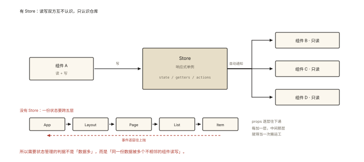
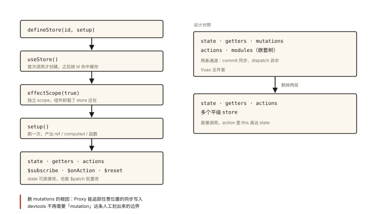

# Vue 原理之状态管理：Pinia 的设计

## 从「Vuex 的五件套」到「Pinia 的两件套」说起

Vuex 时代的样板代码（老玩家都背过）：

```js
// Vuex：state / getters / mutations / actions / modules 五件套
const store = new Vuex.Store({
  state: { count: 0 },
  mutations: { INCREMENT(state) { state.count++; } },      // 同步才能用 mutation
  actions: { async increment({ commit }) { await api(); commit('INCREMENT'); } },
  getters: { double: (s) => s.count * 2 },
});
// 组件里：mapState / mapGetters / commit / dispatch 四种访问方式
```

Pinia（Vue 官方现役推荐）把同样的能力写成了：

```js
const useCounter = defineStore('counter', {
  state: () => ({ count: 0 }),
  getters: { double: (s) => s.count * 2 },
  actions: {                       // ⭐ mutations 没了！action 同步异步通吃
    async increment() { await api(); this.count++; }   // ⭐ this 直达 state
  },
});
// 组件里：
const counter = useCounter();
counter.count;  counter.double;  counter.increment();   // 一种访问方式
```

⭐⭐ 「Pinia 与 Vuex 的区别」「为什么去掉 mutations」是状态管理必考——答案不只是 API 变简单，而是**底座变了**（Proxy 响应式让同步追踪不再是问题）。

## 现象与直觉解释

**为什么需要状态管理？**——当「多个组件共享 + 频繁变化」的状态超出父子传递能力（props 层层 drilling、事件层层冒泡），需要一个**全局的单例响应式仓库**：



*图 · 判据不是「数据多」，是「同一份数据被多个不相邻的组件读写」*

```
组件 A ──写──▶ ┌──────────────┐ ──通知──▶ 组件 B/C/D 自动更新
               │ Store（响应式单例）│
组件 B ──读──▶ └──────────────┘
```

**Pinia 的设计哲学**：把 store 做成「**一个全局的组合式函数**」——你定义的就是一个 `useXxx()`，内部全是响应式数据与普通函数，没有新的概念体系。

## 深入原理

### 一、defineStore 的两种风格 ⭐⭐

```js
// ① 选项式（ Vuex 迁移友好）
export const useCounter = defineStore('counter', {
  state: () => ({ count: 0 }),
  getters: { double: (s) => s.count * 2 },
  actions: { increment() { this.count++; } },
});

// ② 组合式（Setup Store，与组件 setup 同构 ⭐）
export const useCounter = defineStore('counter', () => {
  const count = ref(0);                                  // state = ref/reactive
  const double = computed(() => count.value * 2);        // getter = computed
  async function increment() { await api(); count.value++; } // action = 函数
  return { count, double, increment };                   // 暴露的即是公共 API
});
```

组合式 store 的精妙：**「组件逻辑」与「全局状态」用同一套语法**——把组件里的 composable 函数直接搬进 store 就完成了全局化（逻辑复用与状态共享统一）。

### 二、mutations 为什么被删除 ⭐⭐⭐（核心考点）

Vuex 要求 mutation 的历史原因：**Vue 2 的响应式追踪能力有限**——devtools 需要一个「明确的同步变更点」来做时间旅行（time travel）调试；异步变更散落在 action 里，同步变更集中在 mutation，工具才能准确重放。

Vue 3 的改变：**Proxy 响应式 + 依赖收集的完善，使得「任何位置的同步变更」都能被追踪与记录**——devtools 直接观察每个响应式属性的写入，不再需要人工划分「变更地点」。所以：

- mutation（同步变更专用通道）失去存在意义 → 删除；
- action 统一承担同步/异步逻辑（`this.count++` 或 `await` 后改都行）；
- **代价与收益**：少了强约束（大项目里「变更散落」可能更难管），换来少一层样板与心智负担——这是官方的权衡选择。

### 三、store 的实现骨架：一个特殊的 effect 作用域 ⭐⭐

```js
// Pinia store 的极简原理：
function defineStore(id, setup) {
  let store;
  return function useStore() {          // 每个组件调用的就是这个函数
    if (!store) {                       // 单例：首次调用才创建
      const scope = effectScope(true);  // ⭐ 独立的 effect 作用域
      store = scope.run(() => setup()); // setup 里创建的 ref/computed/effect 都归 scope 管
      // 包装成响应式代理 + 注入 $patch/$reset/$subscribe 等能力
    }
    return store;
  }
}

// effectScope 的意义：组件卸载时，store 【不该】被销毁（全局单例）——
// 独立作用域把 store 的响应式效果与组件的生命周期解耦 ⭐
```

两个关键机制：

1. **单例**：`useCounter()` 在任何组件调用都拿到同一个实例（按 id 缓存）——这就是「全局仓库」；
2. **effectScope**：store 的 effect 不挂在组件上（组件卸载 store 还活着）；`$dispose()` 可手动销毁（微前端/测试场景）。

### 四、与组件的数据流约定 ⭐

```js
const counter = useCounter();

counter.count++;        // ⭐ 可以直接改（Pinia 允许；Vuex 严格模式禁止）
counter.$patch({ count: 1, list: [...] });   // 批量改（一次触发一次更新）
counter.$reset();       // 回到初始 state（组合式 store 需自己实现）
counter.$subscribe((mutation, state) => {}); // 订阅变更（持久化的地基）
counter.$onAction(({ after }) => { ... });   // 订阅 action（日志/埋点）

// 持久化惯用法：$subscribe + localStorage / pinia-plugin-persistedstate
```

**「解构丢失响应式」的老朋友**（vue-001 的规则在 store 同样生效）：

```js
const { count } = useCounter();       // ❌ 拿到裸值
const { count } = storeToRefs(useCounter()); // ✅ 变 ref
// actions 直接解构没问题（普通函数无响应式语义）
```

### 五、store 的切分哲学 ⭐

Vuex 时代的 modules（嵌套模块树）在 Pinia 被抛弃：**多个平级的小 store**（用户、购物车、设置…）取代「一棵大树」——扁平、按领域切、天然代码分割（懒加载 store 配合路由分包）。唯一「跨 store 依赖」：一个 store 的 setup 里直接调用别的 `useStore()`——像普通函数依赖一样自然。

## 回看开篇

五件套变两件套的本质：**底座升级让「仪式」失业**——Proxy 响应式使 devtools 不再依赖 mutation 划界（追踪一切同步写入），组合式 API 使 store 与组件同构（同一套 ref/computed/函数）——**Pinia 不是发明了新东西，而是删掉了不再必要的中间层**。

## 实战延伸

**1. 面试答题骨架**：「Pinia 相比 Vuex 去掉了 mutations——Vue 2 需要把同步变更集中到 mutation 供 devtools 时间旅行追踪，而 Vue 3 的 Proxy 响应式能追踪任何位置的同步写入，专用通道失去意义，action 因此统一同步异步。API 上 state/getters/actions 与组件的 ref/computed/函数同构（Setup Store），store 以 id 单例存在，内部用 effectScope 与组件生命周期解耦；支持直接修改、$patch 批量、$subscribe 订阅与 $onAction 监听，跨 store 依赖直接互相 useStore，组织上用多个平级小 store 取代 Vuex 嵌套模块树。」

**2. 一道实战题**：「购物车 store + 持久化 + 多标签页同步」——$subscribe 写 localStorage + storage 事件广播，30 行内可完成。

## 图解总结



*图 · 一个工厂函数被调一次，就变成全局单例*

```
defineStore(id, setup)
   │ 首次 useStore() 创建（单例缓存 by id）
   ▼
 effectScope(true) ──▶ setup() 运行 ──▶ ref/computed/函数
   │ 与组件生命周期解耦（组件卸载 store 存活）
   ▼
 store 实例：state(可直接改/$patch) + getters + actions(this 直达)
             $subscribe $onAction $reset $dispose

设计对照：
 Vuex: state/getters/mutations/actions/modules + 嵌套树 + commit/dispatch
 Pinia: state/getters/actions + 平级多 store + 直接调用
 删 mutations 的根因：Proxy 可追踪一切同步写入，devtools 无需人工边界
```

## 总结

- Pinia = 全局单例的组合式函数仓库：与组件同一套语法（Setup Store）；
- mutations 被删：Vue 3 响应式可追踪任意位置同步写入，devtools 不再依赖 mutation 边界；
- 单例 by id + effectScope 与组件解耦；直接改 / $patch / $subscribe / $onAction；
- 解构要用 storeToRefs；跨 store 直接互相调用；
- 平级小 store 取代嵌套模块树，天然配合代码分割。

**面试一句话回答**：Pinia 把 store 定义为全局单例的组合式函数——state 用 ref 或 reactive、getter 用 computed、action 用普通函数，与组件的 setup 完全同构；相比 Vuex 最大的删减是去掉了 mutations，因为 Vue 2 时代需要把同步变更集中到 mutation 才能让 devtools 实现时间旅行追踪，而 Vue 3 基于 Proxy 的响应式系统能追踪任何位置的同步写入，专用通道失去意义，于是 action 统一承担同步与异步逻辑且内部 this 直达 state。store 按 id 单例缓存，用独立的 effectScope 与组件生命周期解耦，支持直接修改、批量 patch、订阅与 action 监听，组织上以多个平级小 store 取代 Vuex 的嵌套模块树，解构时需 storeToRefs 保持响应式。

## 思考题

1. Setup Store 里定义但**没 return** 的 ref——它是 store 的私有状态；对比组件的「setup 局部变量」——两者的可见性设计为什么一致？
2. `$patch({ list: [...] })` 与逐个赋值的更新次数差异（结合 vue-005 批量调度——$patch 内部如何合并触发）？
3. 两个组件同时 `counter.count++`，devtools 里显示几条变更？时间旅行的粒度是什么？
4. 开放设计：SSR 项目里 Pinia 要解决「每个请求独立的 store 实例」——为什么浏览器单例模型在服务器会串数据？（提示：服务器是长驻多请求进程 vs 浏览器一页一用户）

（思考题解析将同步录入小程序题库，关联本文 id：vue-007）

## 参考文献：

- Pinia 官方文档（核心概念与 Setup Store）
- Vue 官方 — 状态管理指南
- 《Vue.js 设计与实现》effectScope 相关章节
