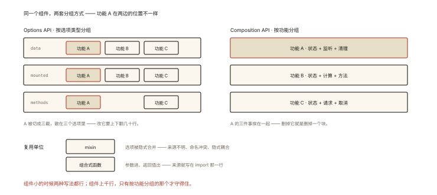
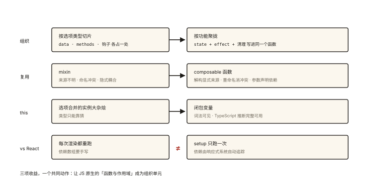

# Vue 原理之 Composition API 的设计动机

## 从「同一个功能的代码散落五处」说起

> 本篇是《Vue 原理系列》收官——回到 API 设计本身：Composition API 到底解决了什么？

一个「鼠标位置追踪」功能，在 Options API 里要拆到四个选项：

```js
// Options API：一个功能被「按选项类型」肢解
export default {
  data() { return { x: 0, y: 0 }; },              // 状态在这
  mounted() { window.addEventListener('mousemove', this.update); },  // 启动在这
  beforeUnmount() { window.removeEventListener('mousemove', this.update); }, // 清理在这
  methods: { update(e) { this.x = e.pageX; this.y = e.pageY; } },    // 逻辑在这
};
// 组件一大：搜「鼠标功能」要在 4 个区块间反复横跳
```

Composition API 版本：

```js
// 同一功能的代码聚在一处，还能抽出去复用 ⭐
function useMouse() {
  const x = ref(0), y = ref(0);
  const update = (e) => { x.value = e.pageX; y.value = e.pageY; };
  onMounted(() => window.addEventListener('mousemove', update));
  onBeforeUnmount(() => window.removeEventListener('mousemove', update));
  return { x, y };
}
// 组件里：const { x, y } = useMouse();  —— 一行接入
```

⭐⭐ 「为什么要有 Composition API」「与 Options API 的区别」是 Vue 面试必考——答案的关键词是**代码组织与逻辑复用**，而非「新语法更好写」。

## 现象与直觉解释

两种 API 的本质差异是**代码的组织维度**：



*图 · 同一个功能，一种写法把它切成三截，另一种把它收成一摞*

```
Options API：按【选项类型】分组        Composition API：按【功能】分组
┌─────────────────┐                 ┌─────────────────┐
│ data:   功能A,B,C │                 │ 功能A: 状态+监听+清理 │
│ mounted: 功能B,C │                 │ 功能B: 状态+计算+方法 │
│ methods: 功能A,C │                 │ 功能C: …            │
└─────────────────┘                 └─────────────────┘
小组件无所谓；组件一大，前者「同功能远隔千行」，后者「同功能近在咫尺」
```

第二个（更硬核的）动机是**逻辑复用机制**：Options 时代复用靠 mixin，Composition 时代复用靠「函数」——函数是 JS 原生的组合单元。

## 深入原理

### 一、mixin 的三大顽疾（Composition API 要治的病）⭐⭐

```js
// Options 时代的复用方案：
const mouseMixin = { data() { return { x: 0, y: 0 }; }, mounted() {...} };
export default { mixins: [mouseMixin, sizeMixin, themeMixin], ... };
```

| 顽疾 | 现场表现 |
|---|---|
| **来源不明** | 模板里的 `x` 来自哪个 mixin？肉眼不可知，搜索地狱 |
| **命名冲突** | 两个 mixin 都有 `x` —— 静默覆盖，bug 温床 |
| **隐式耦合** | mixin 依赖组件的 `this.user`，组件改动牵连 mixin——契约不可见 |

**函数调用的天然解法**（一一对应）：

```js
const { x, y } = useMouse();              // 来源显式（解构自谁一目了然）✅
const { x: sx, y: sy } = useSize();       // 重命名消冲突 ✅
function useCart(user) { ... }            // 依赖通过参数显式传入 ✅
```

**组合式 API 的复用不是新机制，是「函数」**——闭包（js-deep-005）+ 响应式引用 + 生命周期钩子注册，三者拼出 composable。

### 二、`this` 的消失：为什么是好事 ⭐⭐

Options API 的 `this` 是「选项合并后的实例大杂烩」——类型推断困难（TS 对 this 的推断是灾难）、来源模糊（this.anything 可能是 data/computed/mixin/全局注入）。

Composition API 用**闭包变量**替代 this：

```js
setup(props) {
  const count = ref(0);        // count 是词法作用域里的变量
  const double = computed(() => count.value * 2);  // 依赖关系【肉眼可见】
  // 不存在 this.count 到底从哪来的问题 —— 变量就在那里（js-deep-004 作用域链）
}
```

收益链：this 消失 → TS 类型零成本推断 → 与外部 JS 生态（纯函数库）无缝组合。

### 三、composable 的设计规范 ⭐⭐

```js
// 1. 命名：use 开头（useMouse、useFetch —— 社区公约，工具可识别）
// 2. 输入：ref 或 getter 保持响应式连接（接收原始值会断开）
function useFilter(listRef, predicate) {          // ✅ 接收 ref
  return computed(() => listRef.value.filter(predicate));
}
// 3. 返回：返回 ref 组成的普通对象（而不是 reactive）—— 便于调用方解构重命名
function useX() { return { data, loading }; }     // data/loading 是 ref
// 4. 副作用：在内部注册生命周期钩子做清理（把清理责任封装进 composable）
// 5. 钩子注册时机：必须在 setup 同步调用链上（vue-004 的规则）
```

**VueUse** 就是这套规范的生态答卷——上百个 composable 组成的「组合式工具箱」，等价于 React 生态的 hooks 库。

### 四、与 React Hooks 的同与异 ⭐⭐（高频对比题）

| | React Hooks | Vue Composition API |
|---|---|---|
| 复用单元 | 函数组件 + hooks | setup 函数 + composables |
| 状态载体 | useState 的「按序号」链表 | ref/reactive 的响应式对象 |
| **执行模型** | **每次渲染整个函数重跑** | **setup 只跑一次**，依赖自动追踪 |
| 依赖声明 | useEffect 手写 deps 数组 | 无需声明（自动收集） |
| 由此产生的坑 | 闭包过期值、deps 遗漏 | 基本没有对应物 |

一句话：**React 靠「重跑 + 手动声明依赖」，Vue 靠「跑一次 + 自动追踪」**——Vue 的响应式系统替开发者干了 React 里 deps 数组的活（这也是 vue-001 的价值所在：两家的差异根源都在各自的状态底座）。

### 五、理性的另一面：Options API 没有「死」⭐

- 中小项目/快速原型：Options 上手快、结构约定俗成；
- Composition 的心智门槛：闭包、引用语义、解构失响应等概念对新人是负担；
- Vue 3 两者完全共存——**按场景选型**：小型页面用 Options 不丢人，复杂逻辑/强复用需求用 Composition。

## 回看开篇

同一功能散落五处的根源：Options 按「类型」切片，代码组织与「功能边界」错位；Composition API 用函数把功能聚拢（组织问题）+ 用显式参数/返回替代 this 与 mixin（复用问题）+ 用响应式自动追踪换掉手动依赖声明（与 React 分野）——**三项收益，一个共同动作：让 JS 原生的「函数与作用域」成为组织单元**。

## 实战延伸

**1. 面试答题骨架**：「Composition API 的动机有二——代码组织上，Options API 按选项类型分组，同一个功能的 data、methods、生命周期散落各处，大组件可读性崩坏，组合式按功能聚拢；逻辑复用上，mixin 有来源不明、命名冲突、隐式耦合三大顽疾，而 composable 以函数为单元——解构显式来源、重命名消冲突、参数显式依赖。this 被闭包变量取代带来完整 TS 推断；与 React Hooks 的关键差异是 setup 只执行一次、依赖由响应式系统自动追踪，无需手写依赖数组。」

**2. 一个规范实战题**：把「防抖搜索 + 竞态取消」写成 useSearch composable——输入 ref/debounce（handwritten-005）+ AbortController（js-async-008）+ 返回 { results, loading }，就是三篇知识的组装。

## 图解总结



*图 · 前三行是转变，第四行是分野 —— 别混为一谈*

```
组织维度转变：  按选项类型(data/methods/钩子) ──▶ 按功能(state+effect+清理 同处)

复用机制转变：  mixin（来源不明/冲突/隐式耦合）
                ──▶ 函数 composable（解构显式 + 重命名 + 参数依赖）
                     useMouse() { ref + onMounted + onUnmounted → return {x,y} }

this 转变：    选项合并的实例大杂烩 ──▶ 闭包变量（词法可见 + TS 友好）

vs React Hooks: 每次渲染重跑+手动deps ── vs ── setup跑一次+自动追踪
                （根源：useState链表 vs 响应式Proxy）
```

## 总结

- 两大动机：按功能组织代码（解决大组件散落）+ 函数化逻辑复用（解决 mixin 三顽疾）；
- composable 规范：use 命名、ref 入参保持响应式、返回普通对象包 ref、内部管清理；
- this 消失 → 闭包变量 → TS 推断与生态组合的双赢；
- 与 React Hooks 分野：跑一次 + 自动追踪 vs 重跑 + 手动 deps；
- Options 未死——按项目规模与团队选型。

**面试一句话回答**：Composition API 的设计动机有两个——其一是代码组织，Options API 按选项类型切分，同一功能的状态、方法与生命周期钩子散落在组件不同区块，组件变大后可读性急剧下降，组合式 API 让同一功能的代码按功能聚合；其二是逻辑复用，mixin 存在来源不明、命名冲突与隐式耦合三大缺陷，而 composable 以普通函数为复用单元，通过解构显式来源、重命名解决冲突、参数显式声明依赖。this 被闭包变量取代使得 TypeScript 推断完整可用；与 React Hooks 的本质差异在于 setup 只执行一次、依赖关系由响应式系统自动追踪，开发者无需手写依赖数组——这是响应式底座带来的开发体验差异。

## 思考题

1. 把课程里的三个知识点组装成一个 `useDebouncedValue(source, delay)`（防抖值）：说明它内部用了哪几篇的机制。
2. composable 里调用 `setTimeout` 但没清理——组件卸载后会发生什么？写出规范版。
3. 「setup 里同步调用钩子」的限制源于什么？（注册时与当前组件实例的绑定——vue-004/007 的关联）
4. 开放讨论：如果让你设计「跨框架的逻辑复用」方案（同一份 useSearch 给 Vue 和 React 用），最大的障碍是什么？（执行模型差异：一次 vs 每次重跑）

（思考题解析将同步录入小程序题库，关联本文 id：vue-008）

## 参考文献：

- Vue 官方 — Composition API FAQ（设计动机的官方陈述）
- VueUse 源码（composable 规范的生态范本）
- 本课程《vue-001 响应式》《vue-004 生命周期》《react-004 Hooks 原理》（对照线）
