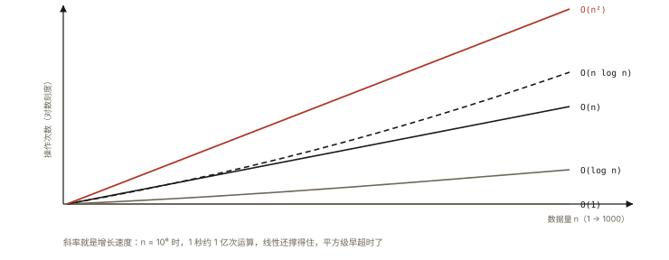

# 前端算法之复杂度分析

## 从「同是去重，差了 1000 倍」说起

> **系列导读**：《算法与数据结构·前端向系列》共 10 篇——复杂度、双指针、链表、栈队列、哈希、树、DP 到前端手写题与大厂真题。面向前端实战与面试，不搞竞赛深水。

```js
// 一万条数据去重，两种写法:
arr.filter((v, i) => arr.indexOf(v) === i);   // O(n²) —— ~5000万次比较
[...new Set(arr)];                            // O(n)   —— ~1万次哈希
// 实测: 800ms vs 2ms —— 复杂度是"规模的天敌" ⭐
```

⭐⭐ 复杂度分析是算法的「度量衡」——本篇建立：大 O 的正确直觉、常见量级排序、均摊分析、以及「前端场景的规模感」。

## 现象与直觉解释

**大 O 表示「增长趋势」，不是秒数**：

```
O(n) 的含义: 输入规模翻倍 → 耗时大致翻倍（线性关系）
             —— 常数差异被忽略（100n 和 3n 都是 O(n)）
为什么忽略常数? —— 规模足够大时，趋势碾压常数:
   100n vs n²: n=10000 时 100万 vs 1亿 —— 平方必败 ⭐
```

**常见量级从好到坏（必须形成直觉）**：

```
O(1) 常数     数组取下标 / Map.get
O(log n) 对数  二分查找（n 翻倍只多一步）
O(n) 线性     一次遍历
O(n log n)    好的排序（快排/归并）
O(n²) 平方    双重循环（两两组合）
O(2ⁿ) 指数    子集枚举 —— n=30 就跑不动
```

**规模感速查（1 亿次运算 ≈ 1 秒的粗标尺）**：

```
n = 10⁶（百万级）: O(n) ✅ ｜ O(n log n) ✅ ｜ O(n²) ❌（10¹² 次 = 十几分钟）
n = 10³: O(n²) ✅（百万次）｜ O(n³) ⚠️ 刚好
面试铁律: 先看数据范围倒推可行复杂度 —— n≤10⁵ → 需要 O(n log n) 以内 ⭐
```

## 深入原理

### 一、如何数复杂度：三条规则 ⭐⭐

```js
// 规则① 顺序结构取最大（加法取大）
a();  // O(n)
b();  // O(n²)
// 总: O(n²)

// 规则② 嵌套结构相乘
for (…) {        // O(n)
  for (…) { … }  // O(n)
}                 // O(n²)

// 规则③ 只看"主导项"，丢弃常数与低阶
3n² + 5n + 100 → O(n²)
```

### 二、递归的复杂度：主定理直觉版 ⭐⭐

```
递归复杂度 = 递归调用次数 × 每次的工作量

二分查找: 每层 1 次调用 × log n 层           → O(log n)
遍历二叉树: 每个节点访问 1 次                 → O(n)
坏递归的斐波那契: fib(n)=fib(n-1)+fib(n-2)
   调用树节点数 ≈ 2ⁿ（大量重复计算）          → O(2ⁿ) ⚠️
   记忆化后每个 n 只算一次                    → O(n) ⭐（DP 的伏笔）
归并排序: log n 层 × 每层 O(n) 合并          → O(n log n)
```

### 三、对数从哪来：三种来源 ⭐⭐

```
① 折半（二分）: 每次问题规模减半
② 平方递进: i = i * 2（for (let i = 1; i < n; i *= 2)）—— 跑 log n 次
③ 平衡树的深度: 完全二叉树高 log n
「每次把问题规模显著缩小（减半），就是 log」⭐
```

### 四、均摊复杂度（前端最常忽略）⭐⭐

```js
// JS 数组的 push: 大多数 O(1)，偶尔触发扩容 O(n)（复制全部）
// 均摊（amortized）: n 次 push 总代价 O(n) → 每次 O(1) ⭐
// 同理: 动态字符串拼接、Map 扩容、v8 的数组增长
// ⚠️ 但 unshift 是真 O(n)（每次都搬移全部元素 —— js-core-006 的性能注脚）

// 反面教材: 循环里字符串 +=
let s = '';
for (const w of words) s += w;   // 老引擎可能每次复制 → O(n²)；现代有 rope 优化但别赌 ⚠️
// 稳妥: parts.join('') —— O(n) 
```

### 五、空间复杂度一句话 ⭐

```
除输入外的额外内存: 
  原地算法 O(1) ｜ 辅助数组 O(n) ｜ 递归的调用栈也算! ⭐
  递归深度 n 的递归 → 空间 O(n)（栈帧）—— "时间 O(n) 空间 O(1)"的递归不存在（除非尾调用优化）
```

## 回看开篇

去重差 1000 倍的解释：filter+indexOf 是 O(n·n)（每个元素全表扫）；Set 是哈希 O(n)——**选对数据结构就是选对复杂度**（本系列反复上演的主旋律，下一篇哈希与双指针正式开场）。

## 实战延伸

**1. 面试答题骨架**：「大 O 表示耗时随输入规模的增长趋势，忽略常数与低阶项；量级直觉上 O(1)、对数、线性、线性对数、平方、指数依次恶化，用 1 秒约 1 亿次的标尺和数据范围倒推可行算法。计数三规则：顺序取大、嵌套相乘、只留主导项；递归看调用次数乘单次工作量，减半产生对数、无记忆的分叉递归产生指数。均摊分析说明动态数组 push 的扩容代价摊薄后仍是常数；空间复杂度要计入递归调用栈。」

**2. 一道秒答题**：`for(i=0;i<n;i++) for(j=i;j<n;j++)` 的复杂度？（n + n-1 + … + 1 = n(n+1)/2 → O(n²)——三角计数是内层依赖外层变量的经典）。

## 图解总结



*图 · 曲线的弯法比阶数名字更值得记*

```
量级阶梯: O(1) < O(logn) < O(n) < O(nlogn) < O(n²) < O(2ⁿ)
标尺: 1秒≈1亿次 │ n=10⁶: 线性✅ 平方❌ │ 数据范围反推复杂度 ⭐
计数: 顺序取大 │ 嵌套相乘 │ 留主导项
对数三源: 折半 │ i*=2 │ 平衡树高
均摊: push扩容 O(1)均摊 │ unshift 真O(n) │ 字符串拼接用join
空间: 辅助内存 + 递归调用栈 ⚠️
```

## 总结

- 大 O 是趋势不是秒数；数据范围反推可行复杂度是解题第一步；
- 计数三规则：顺序取大、嵌套相乘、留主导项；
- 对数三来源：折半、平方递进、平衡树；
- 递归=调用次数×单次工作；无记忆分叉=指数灾难；
- 均摊（push）vs 真贵（unshift）；空间含递归栈。

**面试一句话回答**：大 O 表示算法耗时随输入规模增长的趋势，忽略常数与低阶项，量级从优到劣依次是常数、对数、线性、线性对数、平方与指数，可以用一秒约一亿次的标尺结合数据范围反推可行解，例如十万规模就需要线性对数以内。分析规则是顺序结构取最大、嵌套结构相乘、只保留主导项；递归的复杂度等于递归调用次数乘以单次工作量，每次规模减半产生对数复杂度、无记忆化的分支递归产生指数复杂度。均摊分析解释动态数组 push 的偶发扩容摊薄后仍是常数时间，而 unshift 每次搬移是真实的线性开销；空间复杂度除辅助数组外还必须计入递归调用栈的深度。

## 思考题

1. `[...arr].sort()` 与 `arr.sort()` 的时间/空间复杂度各是什么？（原地排序的现代引擎与展开拷贝的一份额外数组）
2. 递归版深度优先遍历深度为 n 的链表——时间与空间各多少？（O(n) 时间 O(n) 栈——改迭代+显式栈空间仍 O(n) 但防栈溢出）
3. 两层循环但内层 `j = j * 2` 的复杂度？（O(n log n)——外层 n × 内层 log n）
4. 开放估算：你们的商品列表页 n=2000，现有实现 O(n²) 的筛选 60ms——是否值得优化？（用标尺估算余量与用户感知阈值，工程判断题）。

（思考题解析将同步录入小程序题库，关联本文 id：algorithm-001）

## 参考文献：

- 《算法（第 4 版）》第 1 章（算法分析）
- LeetCode 官方 — 复杂度分析入门
- 本课程《js-core-006 数组方法》《v8-001 执行流水线》（性能的两级地基）
