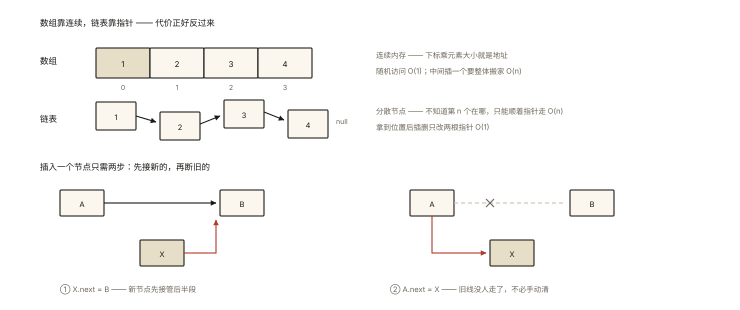

# 前端算法之链表

## 从「一场面试的链表三连」说起

```
面试官: "反转链表写一下"      → 30 秒写完（练过）
       "那 K 个一组反转呢？"   → 卡住 5 分钟
       "判断有环，要求 O(1) 空间" → 想起快慢指针，过了
—— 链表题的难度全在「指针操作的不变量」上，套路固定但极易写错 ⭐
```

⭐⭐⭐ 链表是前端面试的「白板常客」——考点密度高、代码量小、边界多。本篇：结构心智、六大必刷题、以及它在真实前端的化身。

## 现象与直觉解释



*图 · 一个靠连续，一个靠指针 —— 谁快谁慢取决于你问哪个操作*

```
数组: [1|2|3] 连续内存 │ 下标随机访问 O(1) │ 插删 O(n)
链表: 1→2→3→null 分散节点 │ 只能沿指针走 O(n) │ 插删 O(1)（拿到位置后）⭐

心智: 链表 = 「用指针串起来的对象」
      操作链表 = 「小心地重新连线」（先接新的，再断旧的 ⭐）
```

```js
class ListNode {
  constructor(val, next = null) { this.val = val; this.next = next; }
}
```

## 深入原理：六大必刷与核心套路

### 套路①：dummy 哑结点——头结点会变就用它 ⭐⭐⭐

```js
// 合并两个有序链表（LC 21）—— 头可能换 → dummy 兜底
function mergeTwoLists(l1, l2) {
  const dummy = new ListNode(0);
  let tail = dummy;                        // tail 始终指向"已接好的尾部"
  while (l1 && l2) {
    if (l1.val <= l2.val) { tail.next = l1; l1 = l1.next; }
    else { tail.next = l2; l2 = l2.next; }
    tail = tail.next;
  }
  tail.next = l1 ?? l2;                    // 剩余的直接挂上
  return dummy.next;                       // 真头在 dummy 之后 ⭐
}
// dummy 的价值: 消灭「头结点特判」—— 这是链表代码一半的 bug 来源
```

### 套路②：反转链表——三指针的舞步 ⭐⭐⭐

```js
function reverseList(head) {
  let prev = null, cur = head;
  while (cur) {
    const next = cur.next;   // ① 先存后路（否则断了就找不回）
    cur.next = prev;         // ② 掉头指向前
    prev = cur;              // ③ prev 前进
    cur = next;              // ④ cur 前进
  }
  return prev;               // prev 即新头 ⭐
}
// 不变量: [prev..之前已反转] ← cur → [剩余原序]
// 每次循环只做"让 cur 掉头"这一件事 —— 注释清楚每行，面试官最爱问
```

**K 个一组反转（LC 25）**= 「数 k 个 → 局部反转（同上）→ 接回前后段」的组装——分组内套用②，组间用①的 dummy 收头。

### 套路③：快慢指针——中点与环 ⭐⭐（algorithm-002 的链表版）

```js
// 链表中点: 快 2 步慢 1 步，快到尾慢在中点（归并排序链表的前置）
// 环判定 + 入口（LC 142）:
//   快慢相遇证有环；然后一指针回头，同速前进，再相遇处即入口 ⭐（数学结论，记住即可）
function detectCycle(head) {
  let slow = head, fast = head;
  while (fast?.next) {
    slow = slow.next; fast = fast.next.next;
    if (slow === fast) {                 // 相遇 → 有环
      let p = head;                      // 相遇后: 头出发 与 slow 同速
      while (p !== slow) { p = p.next; slow = slow.next; }
      return p;                          // 第二次相遇 = 环入口
    }
  }
  return null;
}
```

### 套路④：倒数第 k（一次遍历）⭐⭐

```js
// 快指针先走 k 步 → 快慢同速 → 快到尾时慢在倒数第 k
let fast = head;
for (let i = 0; i < k; i++) fast = fast.next;   // 保证 k ≤ 长度（先校验）
let slow = head;
while (fast) { fast = fast.next; slow = slow.next; }
return slow;
```

### 套路⑤：虚拟头 + 前驱指针——删除类 ⭐⭐

```js
// 删除倒数第 N 个（LC 19）= 套路④找到「倒数第 n+1」→ 改它的 next
// 删除给定值（LC 203）= dummy + 双指针（prev/cur），删除时 prev.next = cur.next
// 要点: 删除永远操作【前驱】的 next —— "要删 B，得攥住 A" ⭐
```

### 套路⑥：相交链表（LC 160）——浪漫的双走 ⭐⭐

```js
// 两条链表走完自己再走对方的 —— 路程相等（a+b = b+a），交点必同频相遇
let pA = headA, pB = headB;
while (pA !== pB) {
  pA = pA ? pA.next : headB;   // A 走完走 B
  pB = pB ? pB.next : headA;   // B 走完走 A
}
return pA;   // 相交点或 null（同时到达终点）
```

### 链表的前端化身 ⭐⭐

```
· React Fiber 的 child/sibling/return —— 链表树（react-003）⭐
· Hooks 链表: fiber.memoizedState（react-004）
· LRU 的双向链表（handwritten-012）
· 浏览器 history / 路由栈
「前端框架内部就是一个链表世界」——链表题练的就是读框架源码的指针直觉
```

## 回看开篇

链表三连的应答结构：反转的三指针舞步（存后路→掉头→双前进）；K 组反转 = 分组套反转 + dummy 收头；判环入口 = 快慢相遇 + 头回同速。**链表题的通关密码：dummy 消特判、先接新线再断旧线、注释每步的不变量**。

## 实战延伸

**1. 面试答题骨架**：「链表操作的核心纪律是先接新线再断旧线，头结点可能变化时用哑结点消灭特判。反转链表用 prev/cur/next 三指针，每轮先保存后继、当前掉头指向前驱、双指针前移；K 个一组反转在分组内复用反转逻辑、组间用哑结点拼接。快慢指针解决中点、倒数第 k 与环问题——判环后一指针回到头部同速前进，再相遇即入口；相交链表让两指针互走对方路径，等长性保证在交点相遇。链表在前端框架中无处不在——Fiber 的三向链表与 Hooks 链表都是同一结构。」

## 图解总结


*图 · 接新线和断旧线是同一条赋值，这就是它危险的地方*

```
纪律: 先接新线再断旧线 │ 删除攥前驱 │ 头会变→dummy ⭐

六套路:
 ①dummy: 合并/分组拼接 —— 消灭头部特判
 ②反转: 存后路→掉头→双进 (不变量: prev段已反 + cur段原序)
 ③快慢: 中点 │ 判环 │ 环入口(相遇后头回同速)
 ④倒数k: 快先k步再同速
 ⑤删除: prev.next = cur.next (操作前驱)
 ⑥相交: 互走对方 a+b==b+a
前端化身: Fiber链表 │ Hooks链表 │ LRU双向链表 │ history栈
```

## 总结

- 三纪律：先接后断、删攥前驱、头变用 dummy；
- 反转三指针舞步是地基，K 组反转是组合应用；
- 快慢指针一箭三雕：中点、倒数 k、环（含入口）；
- 相交链表的互走技巧；删除操作前驱的 next；
- Fiber/Hooks/LRU——框架内核的链表世界。

**面试一句话回答**：链表题的稳定性来自三条纪律——修改指针时先接新线再断旧线、删除节点要攥住其前驱操作 next、头结点可能变化就引入哑结点消掉特判。反转链表用 prev、cur、next 三指针循环：先保存后继、当前节点掉头指向前驱、两指针各前移一步；K 个一组反转就是分组内套反转、组间用哑结点拼接。快慢指针一次遍历解决三件事：快走两步慢走一步找中点、快先走 k 步再同速找倒数第 k、快慢相遇判定有环且相遇后一指针回到头部同速前进再相遇处即环入口。相交链表让两指针走完自己再走对方，路程相等保证在交点相遇或同时到达终点。React 的 Fiber 结构与 Hooks 链表正是这套结构的工业应用。

## 思考题

1. 手写「反转链表 II」（区间反转，LC 92）：定位区间前驱 → 断开 → 区间反转 → 接回。
2. 为什么双向链表 + 哈希是 LRU 的标准解？（O(1) 定位 + O(1) 摘除/头插——handwritten-012 的完整呼应）
3. 快慢指针找中点在「奇偶长度」下 slow 停在哪？（画图看清两种终止条件——归并分治的细节坑）
4. 开放实战：实现「带撤销重做的编辑历史」（双向链表 + 游标）——cursor undo/redo 的指针操作各是什么？

（思考题解析将同步录入小程序题库，关联本文 id：algorithm-003）

## 参考文献：

- LeetCode 21/206/142/160/25/19（本篇题单）
- 《算法（第 4 版）》链表章节
- 本课程《react-003 Fiber》《react-004 Hooks》《handwritten-012 LRU》
